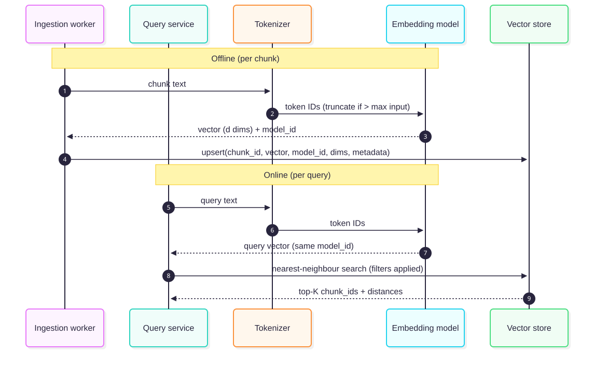
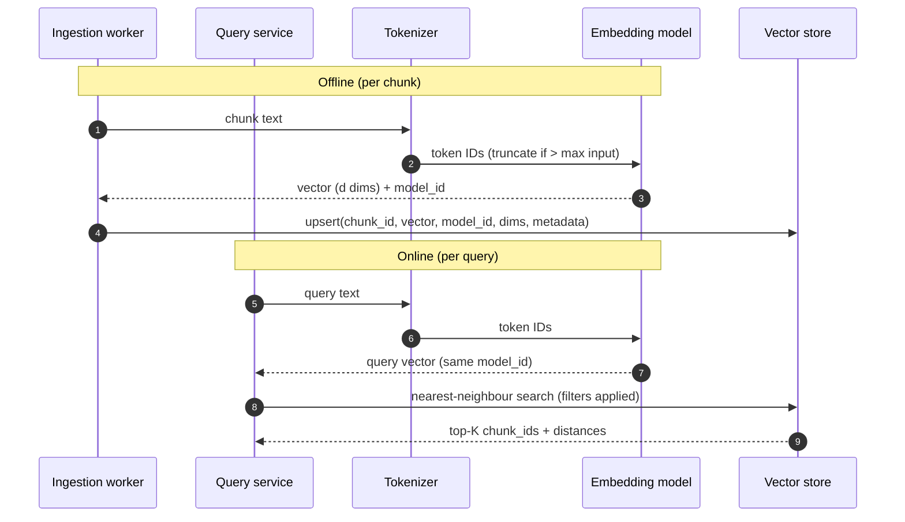

# Chapter 2 — RAG Internals: Tokens, Embeddings and Similarity

> **Evidence legend.** **[S#]** = supported by a source in References (IDs map to `project-management/RESEARCH-REGISTER.md`). **[E]** = engineering recommendation/reasoning. **[A]** = assumption. **[I]** = illustrative. **[X]** = executed and verified in this repository. Research date: 2026-11-07. Papers reviewed at abstract level only (OI-007).

## 2.1 Learning Objectives

After this chapter you can:

1. Explain what a token is, why token counts differ between tokenizers, and why that affects chunking and cost.
2. Describe how a text embedding is produced and what a vector "means" — and does not mean.
3. Choose between cosine similarity, dot product and Euclidean distance, and know when they give identical rankings.
4. Distinguish dense from sparse representations and say when each wins.
5. Select an embedding model and dimension count using constraints, not leaderboards alone.
6. Identify embedding drift and corpus drift, and design for model migration.
7. Explain why semantic similarity is not semantic relevance.

## 2.2 Problem Statement

A retrieval system must answer: *of millions of chunks, which few should the model read?* Computers cannot compare meanings, only numbers. Embeddings map text to points in a high-dimensional space so that "close" approximates "related". Every later decision — chunk size, index type, hybrid fusion, reranking, evaluation — inherits the strengths and blind spots of that mapping. Misunderstanding it produces systems that look fine in demos and fail on identifiers, negation, jargon, and long documents.

## 2.3 Why It Matters in Production

- **Cost and limits are in tokens, not characters.** Azure's embedding endpoint caps each input at 8,192 tokens, each request at 2,048 inputs and 300,000 aggregate tokens (HTTP 400 above that) [S29]. A local candidate, `embeddinggemma`, lists a 2K context window [S16]. Chunking (Chapter 4) must respect these.
- **Embeddings are a schema.** Azure documents that you cannot upgrade between embedding models without generating new embeddings [S9]. Treat the model as part of your data schema with a migration story [E].
- **No model is best everywhere.** MTEB's authors benchmarked 33 models over 8 task types, 58 datasets and 112 languages and found no method dominates all tasks [S24]. Leaderboards inform shortlists; your golden dataset decides.

## 2.4 Core Concepts

### 2.4.1 Tokenization

Models do not read characters or words; they read **tokens**, subword units from a fixed vocabulary. Hugging Face's reference describes three subword algorithms in widespread use — byte-pair encoding (BPE), Unigram and WordPiece — with SentencePiece as a library that applies BPE or Unigram to raw text, including the space character, so it also works for languages without whitespace word boundaries [S27].

Properties that matter to architects [S27 unless marked]:

- **Common words stay whole; rare words split into pieces.** `annoyingly` may become `annoying` + `ly` or `annoy` + `ing` + `ly` depending on the vocabulary.
- **Word-level vocabularies explode and produce unknown tokens;** character-level sequences are long and individually weak. Subword sits between.
- **Byte-level BPE** uses the 256 byte values as the base vocabulary so every string can be tokenized without an unknown token (the page cites GPT-2's 50,257-token vocabulary).
- **Tokenizers differ across model families**, so the same text yields different token counts. Therefore: count tokens with the tokenizer of the model you will call [E]. Character-count heuristics are for sketching only.
- Identifiers, code, and non-English text often fragment into many tokens [E — commonly observed; measure on your corpus]. Fragmentation raises cost and can blur exact identifiers in dense retrieval, one reason hybrid search exists (Chapter 9).

### 2.4.2 From text to vector

An **embedding model** is typically a transformer encoder that reads the token sequence and pools its outputs into one fixed-length vector **[E — general architecture; model-specific details vary]**. Intuition before equations:

> Imagine a very large map where every chunk of text is placed so that chunks about similar things end up near each other. The model has learned the map from vast amounts of text; the coordinates are the vector. A query is placed on the same map, and retrieval returns the chunks closest to the query's location.

The map is only meaningful within one model: coordinates from model A and model B are not comparable **[E]**, consistent with the re-embedding requirement in [S9].

The retrieval formulation is not new to LLMs. DPR trained a **dual encoder** — one encoder for questions, one for passages — into a shared space, and reported beating a strong Lucene-BM25 baseline by 9–19% absolute in top-20 passage retrieval accuracy on the QA datasets it studied [S20]. That result is dataset-specific; it motivates dense retrieval but does not mean dense always beats BM25 (see §2.4.5, Chapter 9).

<!-- figure:02-embedding-generation -->


*Figure 2.1: From text to vector. Original diagram; source below.*

<details><summary>Mermaid source</summary>



</details>
<!-- /figure -->

*Original diagram by the handbook author; source: `docs/assets/diagrams/02-embedding-generation.mmd`. Rule it encodes: the query and the chunks must be embedded with the same model — Ollama's documentation says to use the same model for indexing and querying [S15].*

### 2.4.3 Vector dimensions

Dimension count *d* is the vector length. Examples from verified documentation: `text-embedding-3-large` 3,072; `text-embedding-3-small` 1,536; `text-embedding-ada-002` 1,536 [S9]. Local models are "typically 384 to 1024" dimensions per Ollama's docs [S15].

Dimension drives three costs [E]:

| Cost | Scaling |
|---|---|
| Storage | ∝ *d* × bytes per element × number of chunks |
| Distance computation | ∝ *d* per comparison |
| Index feasibility | Store-specific limits |

On the last point, pgvector can index `vector` columns up to 2,000 dimensions and `halfvec` up to 4,000 [S1] (`text-embedding-3-large` at 3,072 therefore needs `halfvec` or reduced dimensions in pgvector — ADR-001/002).

**Dimension reduction.** Matryoshka Representation Learning trains embeddings with coarse-to-fine structure so one embedding can serve different compute budgets, and its authors report representations at least as accurate as independently trained low-dimensional ones [S25]. Whether a *particular* model supports truncation, and how to do it safely (including re-normalising), must be taken from that model's documentation, not assumed. The Azure embeddings how-to reviewed for this chapter does **not** document a `dimensions` parameter [S29]; do not rely on one without confirming in current model docs.

### 2.4.4 Similarity and distance

Let **a**, **b** be vectors.

- **Dot product:** a·b = Σ aᵢbᵢ. Grows with magnitude and alignment.
- **Cosine similarity:** cos(a,b) = a·b / (‖a‖‖b‖). Depends only on direction.
- **Euclidean (L2) distance:** ‖a−b‖. Sensitive to magnitude.

Intuition: dot product asks "how far does a go in b's direction?"; cosine asks "do they point the same way?"; Euclidean asks "how far apart are the points?"

**Key identity** (algebra): for unit-length vectors, ‖a−b‖² = 2 − 2·cos(a,b), and a·b = cos(a,b). Therefore **cosine, dot product and Euclidean distance produce the same ranking when vectors are normalised.** This was checked numerically on toy vectors **[X]** with `docs/exercises/ch02_similarity_demo.py` (run 2026-11-07, Python 3.14.2, all assertions passed). Without normalisation the metrics disagree: in the demo, dot product ranks a 10×-magnitude vector first, Euclidean ranks it last, and cosine ties it with a 2×-magnitude vector that points the same way **[X]** (ties are exact; their order is arbitrary).

Practical rules:

1. Ollama's embed endpoint returns L2-normalised vectors and recommends cosine similarity for most semantic search [S15]; for such vectors, inner product gives identical rankings and is cheaper. pgvector's own docs recommend inner product for vectors normalised to length 1 [S1].
2. Never assume a hosted model's output is normalised — check its documentation, or normalise on write and record that you did [E].
3. **pgvector operators:** `<->` L2 distance, `<#>` **negative** inner product, `<=>` cosine distance (1 − cosine similarity), `<+>` L1. `<#>` is negative because Postgres only supports ascending index scans on operators; multiply by −1 to recover the inner product [S1]. Create one index per distance function you query, with the matching operator class (`vector_l2_ops`, `vector_ip_ops`, `vector_cosine_ops`) [S1]. A query using `<=>` will not use an index built with `vector_ip_ops` [E — consequence of "match the operator class"; verify with `EXPLAIN` in M5].

### 2.4.5 Dense vs. sparse representations

| | Dense (embeddings) | Sparse (lexical: BM25/TF-IDF, learned sparse) |
|---|---|---|
| Representation | Short vector, all dimensions populated | Very long vector (vocabulary-sized), mostly zeros |
| Matches | Meaning, paraphrase, cross-lingual (model-dependent) | Exact terms |
| Weak at | Rare identifiers, exact codes, negation, numbers [E] | Synonyms, paraphrase [E] |
| Index | ANN (HNSW, IVF) | Inverted index |
| Explainability | Low | High (which terms matched) |

Azure's guidance agrees on the practical split: scenarios involving product codes, specialised jargon, dates and people's names perform better with keyword search because it identifies exact matches, while vector search finds conceptually similar content [S5]. This is why Chapter 9 fuses both. pgvector also supports sparse vectors (`sparsevec`) with limits on non-zero elements [S1], which is relevant to learned-sparse approaches.

### 2.4.6 Embedding model selection

Choose with constraints first, scores second [E]:

1. **Data boundary:** can chunk text leave your tenant/network? (Local vs. hosted.)
2. **Language and domain:** multilingual? code? domain jargon?
3. **Max input tokens** vs. your chunk size [S29, S16].
4. **Dimensions** vs. store limits and storage budget [S1, S9].
5. **Throughput and cost** at ingest and per query (pricing not researched; measure).
6. **Quality on your queries:** shortlist using public benchmarks such as MTEB [S24], then decide with your own golden dataset (Chapter 18).
7. **Lifecycle:** deprecation risk, ability to pin versions, migration cost [S9].

### 2.4.7 Embedding drift and corpus drift

- **Model drift (embedding drift).** A change of embedding model — or a silent provider-side change of a model behind the same name **[A — verify per provider policy]** — moves every vector into a different space. Old and new vectors are not comparable; mixing them corrupts retrieval silently [S9, E]. Mitigation: store `model_id` and `dimensions` per vector; keep versioned indexes; migrate by shadow index, dual-run evaluation, cut over, then retire.
- **Corpus drift.** The document population changes (new products, new terminology, new languages) so queries increasingly fall outside what the original model/chunking/evaluation represented [E]. Detect via rising zero-/low-similarity rates, falling feedback scores and golden-set refresh failures (Chapter 19).

### 2.4.8 Semantic similarity ≠ semantic relevance

Similarity is a geometric property of text pairs in one model's space. **Relevance** is whether the chunk helps answer *this user's question under their permissions, now* [E]. Examples where they diverge:

| Query | Highest-similarity chunk | Why it fails |
|---|---|---|
| "How do I **not** enable feature X?" | Chunk on enabling feature X | Negation barely moves the vector [E] |
| "Policy 14.2(b) exceptions" | Policy summary text | Identifier carries little embedding signal [E] |
| "Parental leave **2023**" | 2019 policy | Time is not a first-class dimension [E] |
| "Show me the CFO's compensation" | Relevant HR chunk | Similar, but unauthorized — relevance includes permission |

Hence the pipeline: filters (Chapter 13) → hybrid candidates (Chapter 9) → reranking (Chapter 12) → evaluation of *relevance*, not just similarity (Chapter 18).

## 2.5 Internal Mechanics Summary

1. Normalise text (Chapter 3), split into chunks (Chapter 4).
2. Tokenize with the embedding model's tokenizer; truncate or reject inputs over the limit [S29].
3. Encode to a vector; optionally normalise; record `model_id`, `dimensions`.
4. Insert into an ANN index configured for the distance function you query [S1].
5. At query time, embed the query with the same model, search with filters, return candidates with distances.

## 2.6 Architecture

The embedding service is a **stateless, rate-limited dependency** with batch and single-item paths [E]. Treat it like any external service: timeouts, bounded retries, circuit breaker, backpressure (Chapter 21). Its contract:

```text
embed(texts: list[str]) -> EmbeddingBatch(model_id, dimensions, normalized: bool, vectors)
```

Isolate it behind a port (ADR-002) so local (Ollama) and hosted (Azure OpenAI) adapters are interchangeable, and persist the metadata fields with every vector.

## 2.7 Practical Example (Illustrative)

**Scenario [I]:** an engineering knowledge base mixing prose design docs and runbooks full of error codes such as `E-4471`.

| Query | Dense-only | Lexical-only | Hybrid |
|---|---|---|---|
| "why did we drop Kafka?" (paraphrase of an ADR) | Likely good | Weak if wording differs | Good |
| "E-4471" | Likely weak [E] | Good | Good |
| "timeouts when the queue backs up" | Good | Depends on vocabulary | Good |

The qualitative expectations are engineering hypotheses to be **measured** on the M5 benchmark corpus, not results.

## 2.8 Implementation

The runnable exercise is `docs/exercises/ch02_similarity_demo.py` **[X]**. It implements dot, cosine and L2 in the standard library, shows the three metrics disagreeing on raw vectors and agreeing on unit vectors, and verifies ‖a−b‖² = 2 − 2cos. Run it:

```bash
python -I docs/exercises/ch02_similarity_demo.py
```

The production embedding adapter and persistence schema belong to M5; the contract in §2.6 is the design input.

## 2.9 Trade-offs

| Decision | Option A | Option B | Trade-off |
|---|---|---|---|
| Hosted vs. local embeddings | Hosted: simpler ops, large models | Local: data stays inside, no per-token fee | Quality vs. data boundary/cost; measure |
| Higher dimensions | More capacity | More storage, slower, index limits [S1] | Diminishing returns possible [E] |
| Normalise on write | Cheaper distance (IP) | Must trust/track normalisation | Operational discipline |
| Cosine vs. IP | Cosine robust to unnormalised inputs | IP cheaper if normalised [S1] | Safety vs. speed |
| Dense-only vs. hybrid | Simpler | Better on identifiers [S5] | Complexity vs. recall |

## 2.10 Failure Modes

| Failure | Root cause | Symptom | Detection | Mitigation |
|---|---|---|---|---|
| Silent truncation | Chunk exceeds model max tokens | Tail of chunk unsearchable | Count tokens pre-embed; reject/log | Token-aware chunking [S29] |
| Mixed-model vectors | Partial re-embed or provider change | Recall collapses, no errors | Per-vector `model_id` audit; golden set | Versioned indexes, shadow migration [S9] |
| Wrong operator for index | `<=>` query vs. `ip_ops` index | Sequential scans, slow | `EXPLAIN` | Match operator class [S1] |
| Un-normalised vectors with IP | Assumed normalisation | Long chunks dominate ranking | Norm distribution check | Normalise or use cosine |
| Identifier misses | Dense-only retrieval | Exact-ID queries return nothing relevant | Identifier subset in golden set | Hybrid (Ch. 9) |
| Embedding service throttling | Rate/token quotas | 429/400 during ingest | Metrics, DLQ | Batching under limits, backoff [S29] |

## 2.11 Security Considerations

- **Embeddings are derived data of the source text.** Treat the vector store with the same classification as the documents; do not assume vectors are anonymised **[E; research on embedding inversion not reviewed — do not claim either way]**.
- **Hosted embedding sends chunk text to a provider.** Review data-handling terms per deployment (ADR-002). Prefer managed identity over keys: Azure documents Entra ID as recommended because it avoids long-lived credentials [S29].
- **Tenant boundary lives in the store, not the vector math** (ADR-004). Similarity search without filters is a cross-tenant leak primitive.

## 2.12 Performance Considerations

- Batch embeddings within the documented limits (2,048 inputs, 300,000 tokens per request on Azure) [S29].
- Query-time embedding is on the critical path; cache embeddings for repeated queries (Chapter 20) **[E]**.
- Distance cost ∝ dimension; index choice and parameters are covered in Chapter 5. pgvector defaults such as `hnsw.ef_search` = 40 are starting points [S1]; no latency numbers are claimed here.

## 2.13 Cost Considerations

Embedding cost = tokens embedded × price per token, paid once per chunk at ingest and once per query; a model change repeats the ingest cost for the whole corpus [S9, E]. Storage ≈ chunks × *d* × bytes/element **[E — arithmetic]**: for example, 10 million chunks × 1,536 dims × 4 bytes (float32) ≈ 61.4 GB of raw vector data **[I — arithmetic on assumed counts; excludes index overhead, metadata, and replicas, which are not measured]**. Pricing was not researched; none is stated.

## 2.14 Production Recommendations

1. Persist `model_id`, `dimensions`, `normalized`, and `chunker_version` with every vector.
2. Count tokens with the model's tokenizer; enforce limits before calling the API.
3. Use one distance function per index and match operator classes.
4. Build a golden dataset *before* choosing a model; include identifier, negation and recency queries.
5. Plan model migration as a first-class capability (shadow index → evaluate → cut over).
6. Monitor similarity-score distributions and zero-result rates for corpus drift.

## 2.15 Architecture Decision Guidance

Default to a local model for development and CI and a pluggable hosted model for production where data policy permits (ADR-002); default to cosine unless normalisation is guaranteed and measured; default to hybrid retrieval for enterprise corpora. Reconsider the embedding model when the golden-set recall drops below target, when drift indicators trip, or when a model is deprecated.

## 2.16 Interview Questions

1. **Why can't I compare vectors from two embedding models?** *Short:* each model defines its own coordinate system. *Deep:* training objectives and initialisation produce different spaces; Azure states you must regenerate embeddings to move between models [S9]. *Implications:* store model metadata; migrate with shadow indexes. *Wrong answer:* "They're all 1,536-dim so they're compatible."
2. **When do cosine, dot product and Euclidean give the same ranking?** For unit-length vectors; ‖a−b‖² = 2 − 2cos(a,b) and a·b = cos. Demonstrated in the chapter's exercise [X]. *Follow-up:* Why does pgvector's `<#>` return a negative number? Postgres index scans on operators are ascending-only [S1].
3. **Why do embeddings fail on exact identifiers?** Dense vectors compress meaning; rare tokens carry little signal [E]; lexical indexes match exactly [S5]. Hybrid fixes it.
4. **How would you migrate from one embedding model to another without downtime?** Shadow index with new model, dual-run evaluation on the golden set, cut over by index alias/version, retire old [S9, E].
5. **Semantic similarity vs. relevance?** See §2.4.8 — includes permission and recency.
6. **How do dimensions affect system design?** Storage, compute, and index limits (pgvector 2,000/4,000) [S1]; `text-embedding-3-large` 3,072 dims forces `halfvec` or reduction [S9, S1].

## 2.17 Knowledge Checkpoint / Exercises

1. Run `ch02_similarity_demo.py`. Add a fifth document with half the magnitude of the query direction and predict the ranking under each metric before running.
2. Modify the script to show that, on unit vectors, ranking by `-dot` equals ranking by cosine *distance* — and write the equivalent pgvector query using `<#>`.
3. Compute raw vector storage for your corpus under three dimension choices. State assumptions.
4. Design the `embeddings` table columns required to support a zero-downtime model migration.
5. Write five golden queries that expose the similarity-vs-relevance gap in your own domain.

## 2.18 Summary

Tokens are the unit of cost and limits; embeddings map chunks and queries into one model-specific space where nearness approximates relatedness. Cosine, dot product and Euclidean distance coincide on normalised vectors and diverge otherwise. Dense retrieval captures meaning; lexical retrieval captures exact terms; real systems need both. Embedding models are versioned schema: record their identity, plan migration, and measure drift. Similarity is a geometric proxy; relevance also includes authorization, recency and intent — the work of the next chapters.

## References

- [S1] pgvector README (v0.8.7). https://github.com/pgvector/pgvector (reviewed 2026-11-07; summary-level)
- [S5] Microsoft, *Hybrid search overview — Azure AI Search* (2026-08-31). https://learn.microsoft.com/en-us/azure/search/hybrid-search-overview
- [S9] Microsoft, *Foundry Models sold by Azure — Embeddings* (2026-09-21). https://learn.microsoft.com/en-us/azure/ai-foundry/openai/concepts/models
- [S15] Ollama docs, *Embeddings*. https://docs.ollama.com/capabilities/embeddings (summary-level)
- [S16] Ollama library, *embeddinggemma*. https://ollama.com/library/embeddinggemma (summary-level)
- [S20] Karpukhin et al., *Dense Passage Retrieval for Open-Domain Question Answering*, arXiv:2004.04906, EMNLP 2020. https://arxiv.org/abs/2004.04906 (abstract)
- [S24] Muennighoff et al., *MTEB: Massive Text Embedding Benchmark*, arXiv:2210.07316. https://arxiv.org/abs/2210.07316 (abstract)
- [S25] Kusupati et al., *Matryoshka Representation Learning*, arXiv:2205.13147. https://arxiv.org/abs/2205.13147 (abstract)
- [S27] Hugging Face, *Tokenization algorithms* (Transformers docs). https://huggingface.co/docs/transformers/tokenizer_summary
- [S29] Microsoft, *Generate embeddings with Azure OpenAI* (2026-07-22). https://learn.microsoft.com/en-us/azure/foundry/openai/how-to/embeddings
