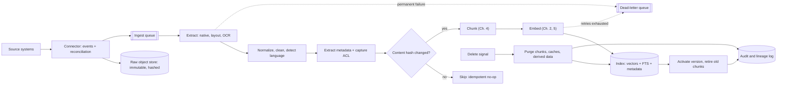
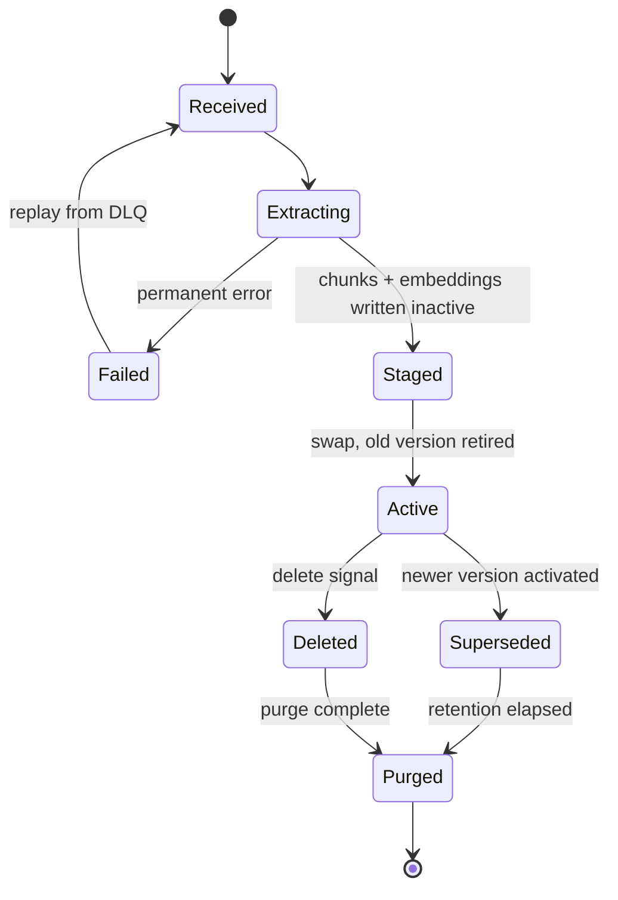

# Chapter 3 — Document Ingestion and Processing

> **Evidence legend.** **[S#]** = supported by a source in References (IDs map to `project-management/RESEARCH-REGISTER.md`). **[E]** = engineering recommendation/reasoning. **[A]** = assumption. **[I]** = illustrative, not executed. **[X]** = executed and verified in this repository. Research date: 2026-11-07. Vendor documents describe vendor products at the stated page date; re-verify before relying on limits (they change).

## 3.1 Learning Objectives

After this chapter you can:

1. Design an ingestion pipeline that is idempotent, incremental, observable and recoverable.
2. Choose extraction approaches per format (native text, scanned/OCR, layout-aware, tables) and know their licensing and operational constraints.
3. Implement change detection, versioning and **deletion propagation** correctly — the part most RAG systems get wrong.
4. Capture metadata, lineage and access-control information at ingest time, when it is cheapest.
5. Handle poison documents with retries and dead-letter queues without blocking the pipeline.
6. Draw the trust boundaries of an enterprise ingestion architecture.

## 3.2 Problem Statement

Retrieval quality is capped by what ingestion put into the index. A perfect retriever cannot return text that was lost in a bad PDF extraction, a table flattened into word soup, a stale version that was never replaced, or a document deleted at the source but still searchable. Ingestion is a distributed-data-integration problem: heterogeneous sources, partial failures, at-least-once delivery, evolving schemas, and consistency between a system of record and a derived index [E]. It deserves the same rigor as any ETL or event-sourced projection you already run.

## 3.3 Why It Matters in Production

| Concern | What goes wrong without discipline [E] |
|---|---|
| Correctness | Stale policy versions answered with citations that look authoritative |
| Security | Deleted or de-permissioned documents remain retrievable; ACLs not captured |
| Cost | Re-embedding the whole corpus on every run; duplicate chunks inflating index and prompts |
| Reliability | One malformed file stalls a batch or retries forever |
| Auditability | No answer to "which version of which file produced this chunk?" |

## 3.4 Core Concepts

### 3.4.1 Connectors

A connector brings documents and *change signals* from a system of record (SharePoint-like stores, object storage, wikis, ticketing, code hosts, databases, file shares). Patterns [E]:

| Pattern | How | Strength | Weakness |
|---|---|---|---|
| **Pull / crawl** | Scheduled scan comparing source state to index state | Simple; works for any source | Latency; scan cost; misses deletes unless it diffs listings |
| **Push / webhook / event** | Source emits create/update/delete events | Low latency; cheap | Events can be lost, duplicated, reordered — need reconciliation |
| **Change feed / CDC** | Source exposes ordered change log | Reliable ordering | Source-specific; retention windows |
| **Hybrid** (events + periodic reconciliation) | Events for speed, periodic full diff for correctness | Recommended default for enterprise [E] | Most moving parts |

Every connector must produce, at minimum: a **stable source ID**, a **content or version signal**, the **bytes or extracted text**, the **source ACL / owner / classification** where available, and a **deleted** signal.

The managed alternative is an indexer. Azure AI Search indexers over Azure Storage detect changed content automatically using storage timestamps, but **do not track deletions** [S32] — a concrete illustration of why deletion must be designed rather than assumed.

### 3.4.2 Formats and extraction

| Format | Extraction approach | Pitfalls [E unless marked] |
|---|---|---|
| **PDF (born-digital)** | Text-layer extraction + layout analysis | Reading order in multi-column pages; headers/footers repeated on every page; hyphenation |
| **PDF (scanned) / images** | OCR (+ layout) | OCR errors on tables, stamps, low resolution; confidence scores matter |
| **DOCX / PPTX / XLSX** | Native parsers or layout service | Tracked changes, comments, hidden slides/sheets; spreadsheets are data, not prose |
| **HTML** | DOM parsing, boilerplate removal | Navigation/ads dominate text; dynamic content needs rendering |
| **Markdown** | Parse headings/lists/code | Easiest structure-aware source; front-matter metadata |
| **CSV / JSON** | Treat as records, not prose | Row-per-chunk or schema-aware serialization (Chapter 29 for analytics) |

**Layout-aware services.** Azure AI Document Intelligence's Layout model (API v4.0, 2024-11-30 GA) accepts PDF; JPEG/PNG/BMP/TIFF/HEIF images; and DOCX, XLSX, PPTX, HTML. PDFs and TIFFs can have up to 2,000 pages, file size limit 500 MB on the paid tier and 4 MB on the free tier, and Office text is limited to 8 million characters [S30]. It returns paragraphs with **roles** (`title`, `sectionHeading`, `pageHeader`, `pageFooter`, `footnote`, `pageNumber`), tables with row/column spans, selection marks, figures and sections, and can emit **Markdown** via `outputContentFormat=markdown` [S30]. The documentation recommends using paragraph roles with unstructured documents for richer semantic analysis [S30] — practically, this lets you *drop* repeated headers/footers and *use* section headings for structure-aware chunking (Chapter 4). Limits worth designing around [S30]: no table analysis for XLSX; embedded images are not supported in Office/HTML inputs; and for tables spanning pages, Microsoft suggests splitting the PDF into pages and merging tables in post-processing.

**Open-source/self-hosted.** Docling converts PDF, DOCX, PPTX, XLSX, HTML, images and more to Markdown/JSON through a unified `DoclingDocument`, with OCR for scanned inputs; its codebase is MIT-licensed while individual models follow their own licenses [S36]. PyMuPDF is dual-licensed (AGPL or commercial via Artifex) [S37] — an architect must involve legal review before embedding an AGPL component in a distributed product or hosted service [E; licensing consequences are a legal question, not settled here].

**Selection criteria [E]:** data boundary (can documents leave your network?), accuracy on *your* worst documents, throughput and cost, license, operational footprint (GPU for OCR/layout models?), output structure (Markdown/JSON with roles vs. flat text).

### 3.4.3 Scanned documents, OCR, tables and images

- **OCR** converts pixels to text and is the dominant error source for scans; measure it on a labelled sample from your corpus instead of trusting vendor accuracy claims [E]. Persist OCR confidence where the engine exposes it, and route low-confidence pages to review.
- **Tables** carry facts (limits, prices, country-specific values). Flattening a table destroys the column↔value relation. Extract as structured data or Markdown/HTML and keep header context (Chapter 4 table-aware chunking) [E].
- **Images and figures.** Layout services detect figures and may link captions [S30]. Whether to describe images with a vision model, index only captions, or skip is a cost/benefit decision; multimodal handling is Chapter 28.
- **Selection marks / forms** are extracted with state (`selected`/`unselected`) [S30].

### 3.4.4 Metadata extraction, normalization, cleaning

Capture at ingest, not at query time [E]:

| Metadata class | Examples | Used for |
|---|---|---|
| Identity | `tenant_id`, `source_id`, `source_uri`, `content_sha256`, `version` | Idempotency, citations, deletion |
| Provenance | connector, extractor name+version, ingest time, source modified time | Lineage, debugging, reprocessing |
| Authorization | ACL principals, owner, classification | Permission-aware retrieval (Chapters 8, 13) |
| Descriptive | title, author, doc type, language, effective date, region | Filters (Chapter 13), ranking |
| Structural | page, section path, table/figure IDs | Citations, chunking |

**Normalization** makes equivalent inputs hash equal: Unicode normalization, line-ending normalization, whitespace trimming, removal of volatile fields (timestamps in footers) [E]. The exercise below shows that a CRLF/trailing-space change is skipped as "unchanged" **[X]**.

**Cleaning** removes boilerplate (repeated headers/footers, nav menus, cookie banners, signature blocks). Over-cleaning deletes meaning (legal footers can matter); keep the raw artifact in object storage and make cleaning a versioned, re-runnable step [E].

**Language detection** supports language-specific analyzers, tokenization and embedding-model choice; store it as metadata and handle mixed-language documents at section level [E]. Library choice was not researched.

### 3.4.5 Deduplication

- **Exact duplicates:** equal normalized-content hash within a tenant — skip or link.
- **Near duplicates** (same policy in two folders, boilerplate-differing copies): detection techniques exist but were not researched for this chapter, so none is endorsed; treat as an evaluation-driven decision (duplicate chunks waste prompt budget and can crowd out diverse evidence — see Chapter 6 diversity) [E].
- **Version duplicates** are not duplicates: v1 and v2 of a policy are different retrievable states; policy decides which are searchable (current only vs. as-of dates).

### 3.4.6 Versioning, incremental ingestion and change detection

Define the **document** as the stable identity `(tenant_id, source_id)` and the **version** as a function of normalized content (hash) [E]. The pipeline decision for each event:

| Observation | Action |
|---|---|
| Unknown source ID | Create v1 |
| Known ID, same hash | No-op (idempotent skip) |
| Known ID, different hash | Create v(n+1); retire v(n) chunks **in the same transaction/swap** as activating v(n+1) |
| Delete signal | Remove or tombstone all chunks (see 3.4.7) |

Change signals from sources are imperfect. Azure indexers rely on storage `LastModified` timestamps, which creates edge cases: restoring a soft-deleted blob does not update `LastModified`, so it may not be reindexed until the timestamp is bumped; renaming an ADLS Gen2 directory doesn't update blob timestamps, so blobs under new URLs aren't reindexed [S32]. Lesson [E]: timestamps are hints; **content hashes are the arbiter**, and a periodic reconciliation (full listing diff) catches what signals miss.

### 3.4.7 Deletion propagation

The source of truth deleted a document; the index must stop returning it. This is both correctness and compliance (right-to-erasure, revoked access) [E]. Facts from Azure's documentation [S32]:

- Deletion is **not** tracked by the indexer by default; to avoid orphan search documents, implement a *soft-delete strategy* that deletes search documents first and physical files second.
- The deletion policy must be in place **from the first indexer run**; documents deleted before the policy exists remain in the index, and the suggested remedy is a new index with a new indexer.
- Native blob soft delete requires that blob versioning is not enabled, and the retention should be much longer than the indexer interval.
- Soft-delete approaches don't apply to one-to-many indexing; there you must send explicit delete requests to the index.

Architectural rules [E]: (1) every chunk carries `tenant_id`, `source_id`, `version` so deletion is a keyed operation; (2) deletion is an **event** in the pipeline, processed idempotently; (3) cached answers, semantic caches and derived artifacts (summaries, parent chunks, embeddings) must also be purged; (4) record the deletion in an audit log; (5) test: "delete → query → zero results" is a mandatory integration test (see Chapter 21 for failure-mode testing).

### 3.4.8 Data lineage

Persist, per chunk, the chain: `source_uri → raw object (hash) → extractor+version → normalized text hash → chunker+version → embedding model+dimensions → index version` [E]. Lineage answers audit questions, scopes reprocessing after an extractor bug fix ("re-run everything extracted by v1.3"), and underpins the model-migration approach from Chapter 2.

### 3.4.9 Failure handling: retries, dead letters, poison messages

Use a durable queue between stages. Azure Service Bus illustrates the standard semantics: messages exceeding the maximum delivery count (default 10) or expiring by TTL move to the dead-letter queue; there is **no automatic cleanup** of the DLQ; applications may dead-letter explicitly for malformed payloads; and in peek-lock mode you must settle messages before closing the receiver or they will be redelivered and eventually dead-lettered [S33]. Design rules [E]:

1. **Classify errors:** transient (network, throttling → retry with backoff and jitter), permanent (corrupt file, unsupported format → dead-letter immediately with reason), poison (crashes the worker → delivery-count limit catches it).
2. **Bound retries** — unbounded retry is an outage amplifier.
3. **DLQ is an operational queue, not a graveyard:** alert on depth/age; provide a replay tool (edit-and-resubmit is a standard pattern [S33]); record reason codes.
4. **Never let one document block a partition:** isolate per-document work.

### 3.4.10 Idempotency

Because queues deliver at least once [E], every stage must be safe to run twice. Techniques: deterministic IDs (`tenant:source:vN:cK`), content hashing, upserts keyed by natural identity, "stage then swap" activation of a version, and unique constraints **scoped to live versions** (a constraint over *all* versions rejects a legitimate revert A → B → A — found by executing the schema, §3.8.2). Verified behaviour in the exercise: re-ingesting the same event creates no additional chunks **[X]**.

## 3.5 Internal Mechanics: The Pipeline

<!-- figure:03-ingestion-pipeline -->


*Figure 3.1: Internal Mechanics: The Pipeline. Original diagram; source below.*

<details><summary>Mermaid source</summary>



</details>
<!-- /figure -->

*Original diagram by the handbook author; source `docs/assets/diagrams/03-ingestion-pipeline.mmd`.*

Document version lifecycle:

<!-- figure:03-document-lifecycle -->


*Figure 3.2: Internal Mechanics: The Pipeline. Original diagram; source below.*

<details><summary>Mermaid source</summary>



</details>
<!-- /figure -->

*Original diagram by the handbook author; source `docs/assets/diagrams/03-document-lifecycle.mmd`.*

## 3.6 Architecture: Enterprise Ingestion

Component responsibilities [E]:

| Component | Responsibility | State |
|---|---|---|
| Connector workers | Discover, diff, emit events; own cursors/checkpoints | Cursor per source |
| Raw object store | Immutable copy of originals; hash-addressed | Durable, lifecycle-managed |
| Ingest queue + DLQ | Decouple, retry, isolate poison | Durable |
| Extractor workers | Run parsers/OCR/layout in a sandbox | Stateless |
| Enrichment | Metadata, language, classification, ACL | Stateless |
| Indexer | Chunk, embed, upsert, activate/retire | Writes to index |
| Reconciler | Periodic full diff source ↔ index; repairs drift | Scheduled |
| Audit/lineage store | Who/what/when/which versions | Append-only |

**Trust boundaries [E]:** (1) source documents are *untrusted input* — extractors run with least privilege, no network egress, CPU/memory/time limits; (2) the queue and index are trusted internal; (3) ACL metadata is **security-critical data** and must be validated at the connector, not inferred by the LLM; (4) provider calls (OCR, embeddings) cross the external boundary and need data-handling review.

**Managed vs. self-built [E]:** Azure AI Search indexers + skillsets provide change detection, scheduling and integrated chunking/vectorization, but with the deletion caveats above [S31, S32]; a self-built pipeline over Postgres gives transactional versioning and RLS-aligned deletion (ADR-001) at the cost of operating workers and queues. Both belong in the architect's toolbox.

## 3.7 Practical Example (Illustrative)

**Scenario [I]:** A 20,000-person company ingests HR policies (DOCX), scanned legacy PDFs, a country-allowance spreadsheet, and an intranet HTML wiki.

| Source | Connector | Extraction | Special handling |
|---|---|---|---|
| HR DOCX | Events + nightly reconcile | Native → Markdown | ACL: HR-only vs. all staff |
| Legacy scanned PDFs | One-time batch | OCR + layout | Low-confidence pages to human review; mark `quality=ocr` |
| Allowance XLSX | Daily pull | Treat as records | Table analysis unsupported for XLSX in the layout service [S30] → custom row serialization |
| Wiki HTML | Crawl | DOM + boilerplate strip | Delete detection by listing diff |

## 3.8 Implementation

### 3.8.1 Executed model of the control flow [X]

`docs/exercises/ch03_ingestion_idempotency.py` implements the decision table of §3.4.6–3.4.10 on an in-memory store and asserts: idempotent re-ingestion; cosmetic changes skipped; new version replaces old with no mixed versions present; delete removes only that tenant's chunks (same `source_id` in another tenant untouched); a poison document is dead-lettered after 3 attempts while the rest of the batch proceeds. Run 2026-11-07 on Python 3.14.2: all assertions passed.

```bash
python -I docs/exercises/ch03_ingestion_idempotency.py
```

This is a teaching model of control flow, **not** a production implementation: it has no real transaction, concurrency control, durable queue, or error classification.

### 3.8.2 Schema [X — executed in the SQL verification suite; **corrected after testing**]

The first draft of this schema guarded idempotency with `UNIQUE (tenant_id, document_id, content_sha256)`. Executing it against PostgreSQL 16.12 (`scripts/verify-sql/04-hybrid-fts-schema.sql`, run by `python -I scripts/verify-sql.py`) **confirmed a design flaw**: content that goes A → B → A (for example, a policy change that is later reverted) produces a third version whose hash equals the first, and the plain unique constraint rejects it, so a legitimate rollback could not be ingested. The corrected design allows at most one **live** (`staged` or `active`) version per content hash, via a partial unique index; superseded versions are outside it. The suite verifies that the revert is accepted as version 3, that re-ingesting the *current* content is still rejected (and ignored by `ON CONFLICT ... DO NOTHING` with the partial-index predicate), and that the `CHECK` constraint rejects an invalid state.

```sql
-- Executed in the suite (PostgreSQL 16.12). Corrected idempotency guard: partial unique index.
CREATE TABLE documents (
  tenant_id       uuid        NOT NULL,
  document_id     uuid        NOT NULL DEFAULT gen_random_uuid(),
  source_id       text        NOT NULL,           -- stable ID in system of record
  current_version int         NOT NULL,
  status          text        NOT NULL CHECK (status IN ('active','deleted')),
  acl_principals  text[]      NOT NULL DEFAULT '{}',
  PRIMARY KEY (tenant_id, document_id),
  UNIQUE (tenant_id, source_id)
);

CREATE TABLE document_versions (
  tenant_id       uuid        NOT NULL,
  document_id     uuid        NOT NULL,
  version         int         NOT NULL,
  content_sha256  text        NOT NULL,
  raw_object_uri  text        NOT NULL,
  extractor       text        NOT NULL,           -- name@version (lineage)
  state           text        NOT NULL CHECK (state IN ('staged','active','superseded','failed')),
  ingested_at     timestamptz NOT NULL DEFAULT now(),
  PRIMARY KEY (tenant_id, document_id, version)
);

-- Idempotency guard: at most one LIVE version per content hash. A plain UNIQUE over all versions
-- would block reverting to earlier content (A -> B -> A).
CREATE UNIQUE INDEX document_versions_live_hash
  ON document_versions (tenant_id, document_id, content_sha256)
  WHERE state IN ('staged','active');
```

**Before production [E]:** row-level security and a non-owner application role (ADR-001, ADR-006; behaviour verified in Chapter 8); retention/purge jobs; indexes from real access patterns; migrations; concurrency tests (two workers racing on the same document — the suite is single-session); tests against the real schema.

## 3.9 Trade-offs

| Decision | Option A | Option B | Trade-off |
|---|---|---|---|
| Managed indexer vs. custom pipeline | Less code, scheduling built-in [S31, S32] | Full control of versioning/deletion | Time-to-value vs. correctness control |
| Events vs. polling | Low latency | Simple, robust | Combine with reconciliation |
| Hosted layout/OCR vs. self-hosted | Quality, little ops [S30] | Data stays inside; license-driven [S36, S37] | Boundary/cost vs. operations |
| Aggressive cleaning | Less noise | Risk of deleting meaning | Keep raw; make cleaning re-runnable |
| Keep all versions searchable | As-of answers | Conflicting evidence in context | Default to current-only; version filter when needed |

## 3.10 Failure Modes

| Failure | Root cause | Symptom | Detection | Mitigation / recovery |
|---|---|---|---|---|
| Orphaned chunks | Deletes not propagated; policy added late [S32] | Deleted content still cited | Reconciler diff; "delete→query" test | Reconcile; rebuild index if policy missing at start |
| Stale index | Missed events/timestamps [S32] | Old policy answered | Freshness lag metric (source modified − indexed) | Periodic hash reconciliation |
| Mixed versions | Non-atomic swap | Contradictory chunks from v1 and v2 | Query-time version audit | Stage-then-swap in one transaction [X] |
| Poison document | Corrupt/unsupported file | Worker crash loop | Redelivery count; DLQ depth [S33] | Bounded retries, DLQ, replay tool |
| Duplicate ingestion | At-least-once delivery | Duplicate chunks, double cost | Unique constraint violations; dedupe metrics | Idempotent keys, hash guard [X] |
| Silent OCR damage | Low-quality scans | Wrong numbers in answers | OCR confidence; sampled review | Confidence routing; human review |
| Table destruction | Flat text extraction | Values without labels | Golden queries on tables | Layout-aware extraction [S30] |
| Header/footer pollution | No role filtering | Repeated boilerplate in every chunk | Chunk frequency analysis | Drop roles `pageHeader/pageFooter` [S30] |
| ACL drift | ACL changed at source, not re-synced | Revoked user still retrieves | ACL-sync lag metric; audit | ACL change events trigger metadata-only update |
| Partial ingestion | Crash between steps | Document without embeddings | State machine audit (staged without active) | Resume from `staged`; idempotent steps |

## 3.11 Security Considerations

- **Documents are attacker-controlled input** [E]. Run extractors sandboxed (no network, constrained filesystem, CPU/memory/time quotas). Reject or quarantine encrypted/password-locked files (the layout service requires locks to be removed first [S30]). Scan for malware where policy requires. Resource-exhaustion files (decompression bombs, giant pages) are mitigated by size/page limits — the managed service itself enforces limits like 2,000 pages and 500 MB [S30], and you should set your own lower ones.
- **Indirect prompt injection starts here.** Instructions hidden in documents (white text, metadata, alt text, comments) enter the index. Ingestion should preserve provenance so the prompt layer can mark content as data (Chapter 22). Do not claim ingestion can *remove* injections reliably [E].
- **Capture ACLs at ingest** and treat them as authoritative inputs to retrieval filters (Chapters 8, 13). Fail closed: if ACL cannot be determined, quarantine, don't default to "public" [E].
- **PII/classification:** detect and tag at ingest; decide whether to redact, restrict, or exclude [E]. Don't log document text in error messages (CLAUDE.md §10.3).
- **Deletion is a security control** (see 3.4.7).
- **Third-party processing:** hosted OCR/embedding services see document content; review data-handling terms per deployment. Azure's indexer documentation carries a notice that connections to other services may result in data processing or storage outside the Azure compliance boundary and that the customer is responsible for managing this [S32]; verify the equivalent for every service in your own pipeline.

## 3.12 Performance Considerations

- Parallelize per document, not within an ordered stream of versions of the *same* document (serialize by `(tenant, source_id)` key) [E].
- Batch embeddings within provider limits (Chapter 2: 2,048 inputs / 300,000 tokens per Azure request [S29]).
- Hash before extracting when possible (hash raw bytes first; skip extraction if bytes unchanged) [E].
- Throughput numbers are intentionally absent; Chapter 20 gives a measurement method (docs/min per worker, p95 extraction time per format, embedding tokens/s).

## 3.13 Cost Considerations

Cost drivers [E]: extraction/OCR per page (pricing not researched), embedding tokens per chunk, storage of raw + derived data, re-processing on extractor/chunker/model changes, and DLQ operations. The biggest avoidable cost is **needless reprocessing**: change detection by content hash and lineage-scoped reprocessing keep a chunker fix from triggering a full OCR re-run [E]. No figures are stated.

## 3.14 Production Recommendations

1. Hybrid connectors: events for freshness plus scheduled reconciliation for correctness.
2. Store originals immutably; make every derived artifact reproducible from them.
3. Key everything by `(tenant_id, source_id, version)`; make every stage idempotent.
4. Activate versions atomically (stage → swap); never serve mixed versions.
5. Implement deletion as a first-class pipeline event from day one, including caches and derived data; test it.
6. Capture ACL and classification at ingest; fail closed.
7. Classify errors; bound retries; operate the DLQ (alerts, replay, reason codes).
8. Record lineage (extractor/chunker/embedder versions) per chunk.
9. Sandbox extractors; enforce size/page/time limits.
10. Track freshness lag, DLQ depth/age, extraction failure rate per format, OCR confidence distribution.

## 3.15 Architecture Decision Guidance

Choose a **managed indexer** when sources are supported, deletion semantics fit (soft-delete from the first run), and you accept its chunking options [S31, S32]. Choose a **custom pipeline** when you need transactional versioning with row-level tenancy, custom ACL logic, or non-standard sources. Choose **hosted layout/OCR** when quality on complex layouts and low ops matter and the data boundary allows it [S30]; choose **self-hosted** (e.g., Docling, after license review of every model used) when documents cannot leave your environment [S36]. Reconsider when reconciliation shows persistent drift, DLQ rates climb, or extraction quality on the golden set falls below target.

## 3.16 Interview Questions

1. **How do you handle document deletion in a RAG pipeline?** *Short:* Treat delete as an idempotent pipeline event keyed by `(tenant, source_id)` that purges chunks, caches and derived data, backed by reconciliation. *Deep:* Azure's blob indexers don't track deletions; soft-delete must be configured from the first run or orphans remain [S32]. *Follow-up:* How do you prove it works? (Delete→query integration test; audit log.) *Wrong answer:* "Re-index nightly and it'll disappear" (no guarantee, leaves a window, misses derived data).
2. **Design idempotent ingestion.** Deterministic IDs, content-hash guard, unique constraints scoped to live versions (so reverts still work), stage-then-swap [X]; at-least-once queues imply duplicates [E].
3. **A PDF extraction returns garbled tables. What do you do?** Switch to layout-aware extraction with table structure [S30], preserve header context at chunking (Ch. 4), add golden table queries, and route low-confidence pages to review.
4. **One bad file keeps crashing workers. Fix?** Bounded delivery count → DLQ with reason; alert; replay tool [S33].
5. **Why store the raw document?** Reproducibility, reprocessing after extractor/chunker/model changes, audit.
6. **How do you keep ACLs correct?** Capture at ingest, re-sync on ACL-change events, fail closed, test revoked-user cases.
7. **What breaks timestamp-based change detection?** Restores and directory renames don't bump `LastModified` [S32]; use content hashes and reconciliation.

## 3.17 Knowledge Checkpoint / Exercises

1. Run `ch03_ingestion_idempotency.py`. Add a test where two events for the same `source_id` arrive out of order (older content after newer). What guard is needed? (Hint: source version/etag ordering.)
2. Extend the model with an `acl_principals` change event that updates metadata without re-embedding. Assert no chunk text changes.
3. Add a "tombstone retained for N days" mode and decide what queries must see during that window.
4. Draft the freshness-lag SLO for a policy corpus (target, measurement point, alert).
5. List five defences for malicious documents and map each to the pipeline stage where it runs.

## 3.18 Summary

Ingestion is a data-integration system with security consequences. Make it event-driven with reconciliation, idempotent at every stage, version-atomic, deletion-aware, ACL-capturing and lineage-recording. Use layout-aware extraction where structure matters [S30], respect license and data-boundary constraints [S36, S37], and operate dead-letter queues as first-class operational surfaces [S33]. The exercise verifies the control flow; M5 verifies it against a real database.

## References

- [S29] Microsoft, *Generate embeddings with Azure OpenAI* (2026-07-22). https://learn.microsoft.com/en-us/azure/foundry/openai/how-to/embeddings
- [S30] Microsoft, *Document layout analysis — Document Intelligence* (2026-05-01). https://learn.microsoft.com/en-us/azure/ai-services/document-intelligence/prebuilt/layout (read via saved output)
- [S31] Microsoft, *Chunk documents — Azure AI Search* (2026-06-08). https://learn.microsoft.com/en-us/azure/search/vector-search-how-to-chunk-documents
- [S32] Microsoft, *Changed and deleted blobs — Azure AI Search* (2026-03-25). https://learn.microsoft.com/en-us/azure/search/search-how-to-index-azure-blob-changed-deleted
- [S33] Microsoft, *Service Bus dead-letter queues* (2026-07-16). https://learn.microsoft.com/en-us/azure/service-bus-messaging/service-bus-dead-letter-queues
- [S36] Docling project, GitHub repository. https://github.com/docling-project/docling (summary-level)
- [S37] Artifex, *PyMuPDF — About/licensing*. https://pymupdf.readthedocs.io/en/latest/about.html (summary-level)
