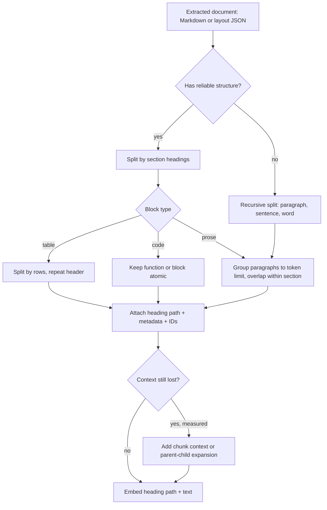

# Chapter 4 — Text Chunking Strategies

> **Evidence legend.** **[S#]** = supported by a source in References (IDs map to `project-management/RESEARCH-REGISTER.md`). **[E]** = engineering recommendation/reasoning. **[A]** = assumption. **[I]** = illustrative. **[X]** = executed and verified in this repository. **[V]** = vendor-reported result, not independently reproduced. Research date: 2026-11-07. Papers reviewed at abstract level only (OI-011).

## 4.1 Learning Objectives

After this chapter you can:

1. Explain why chunking exists and what it trades away.
2. Compare fixed, token, recursive, sentence/paragraph, structure-aware, Markdown-aware, table-aware, semantic, sliding-window, parent-child and hierarchical chunking on mechanism, strengths, weaknesses and cost.
3. Recognise bad chunking from symptoms and fix it with concrete techniques.
4. Choose chunk size, overlap and boundaries with a method (evaluation), not folklore.
5. Design chunk metadata and IDs that support citations, deletion, reprocessing and permission filters.
6. Use a selection framework to pick a baseline strategy and know when to deviate.

## 4.2 Problem Statement

Embedding models and LLMs both have input limits (Chapter 2), and a single vector for a long document blurs distinct topics. So documents are cut into **chunks**, each embedded, indexed and retrieved independently. The cut points decide what evidence can be retrieved at all: a fact split across two chunks may be retrieved by neither; a table row separated from its header is meaningless; a chunk with no heading context may be impossible to match or cite. Azure's chunking guidance states the two reasons directly: chunking is required when documents exceed model input limits, and beneficial when content is poorly represented as one vector — for example a wiki page covering many sub-topics [S31].

## 4.3 Why It Matters in Production

- **Retrieval quality:** boundaries determine recall and precision before any ranking (Chapters 6, 9, 12).
- **Cost and latency:** chunk count drives embedding cost, index size and candidate volume; chunk length drives prompt tokens [E].
- **Citations:** chunks are the unit you cite; unstable chunk IDs break citations and deletion [E].
- **Operational blast radius:** changing chunking changes every vector, so it is as disruptive as changing the embedding model (Chapter 2 migration) [E].

## 4.4 Core Concepts

### 4.4.1 The strategies

| Strategy | Mechanism | Strengths | Weaknesses | Cost |
|---|---|---|---|---|
| **Fixed-size (characters/words)** | Cut every N units | Trivial, predictable, fast | Cuts sentences, tables, code; ignores structure | Lowest |
| **Token-based** | Cut every N *model tokens* | Respects model limits exactly; predictable cost | Same structural blindness as fixed-size | Low (needs tokenizer) |
| **Sentence-based** | Group whole sentences up to a limit | Never splits a sentence; Azure's `sentences` mode makes one chunk per sentence [S31] | Language-dependent boundary detection [S31]; tiny chunks lose context (sample: 13,361 chunks vs 34–216 for page modes [S31]) | Low |
| **Paragraph-based** | Group paragraphs up to a limit | Natural units in prose | Paragraph sizes vary wildly; lists/tables break the assumption | Low |
| **Recursive** | Try large separators first (paragraph), fall back to smaller (sentence, word) until it fits | Good default for unstructured text; keeps larger units intact when possible [S38] | Structure-blind beyond separators | Low |
| **Structure-aware (headings, sections)** | Use document structure (Markdown/HTML headings; layout roles such as `sectionHeading` [S30]) | Chunks align with topics; heading path becomes metadata | Needs reliable structure extraction (Chapter 3) | Low–medium |
| **Markdown-aware** | Split by `#`/`##`/`###` headers; code blocks atomic [S38] | Cheap structure when source is Markdown | Deep sections still need secondary splitting | Low |
| **Table-aware** | Keep tables intact or split by rows **repeating the header** | Preserves column↔value meaning **[X]** | Wide/huge tables still need strategy; extraction quality dependent [S30] | Low–medium |
| **Semantic** | Split where embedding similarity between adjacent sentences drops | Can follow topic shifts without markup | Requires embedding every sentence at ingest; evidence says gains are not consistent [S34] | High |
| **Sliding window** | Fixed windows with stride < size (overlap) | Reduces boundary loss | Duplicates content; inflates index and candidates | Medium |
| **Parent-child / hierarchical** | Index small child chunks; return larger parent for context | Precise matching + rich context | Two granularities to store/version; detail in Chapter 14 | Medium |
| **Chunk-with-context (contextual)** | Prepend an LLM-generated or rule-based context line to each chunk before indexing | Restores context lost by cutting [S28] | LLM call per chunk at ingest; vendor-reported gains only [S28][V] | Medium–high |
| **Late chunking** | Embed the whole long text, then pool per chunk | Chunk vectors carry document context [S35] | Needs long-context embedding model; research-stage [S35] | Medium |

Mechanism notes behind a few rows:

- **Recursive splitters** keep paragraph-level units whole when they fit and fall back to sentences and then words when they don't [S38]. The page fetched did not state default separators or the length unit — confirm both in the library version you pin before relying on behaviour [S38].
- **Azure's Text Split skill** avoids breaking sentences in `pages` mode, so actual chunk length varies with sentence boundaries; its overlap must be less than half the maximum page length [S31].
- **Late chunking** changes *where* splitting happens: all tokens pass through the transformer once, and the split happens after the transformer and before mean pooling, so each chunk embedding reflects its surroundings [S35].

### 4.4.2 Chunk size

There is no universally correct size; there is a **feasible range** and an **evaluated optimum** [E].

*Hard constraints:* the embedding model's max input (8,192 tokens on Azure's current embedding models [S29]; 2K for the local `embeddinggemma` candidate [S16]) and the prompt budget for K chunks. Azure's page quotes 8,191 for `text-embedding-3-small` while other Azure pages say 8,192 [S31 vs S29] — a reminder to treat documented limits as values to re-verify at implementation time.

*Vendor starting points (not research results):* Azure recommends starting with **512 tokens (~2,000 characters)** and **25% overlap (128 tokens)**, adjusting by content type; elsewhere on the same page a fixed-size table cites ~200 words / 600 characters with 10–15% overlap, and the Text Split skill suggests 2,000 characters with 500 overlap as defaults [S31]. These differ, which itself shows there is no consensus number.

*Trade-off intuition [E]:*

| Smaller chunks | Larger chunks |
|---|---|
| Precise matching; less irrelevant text per chunk | More self-contained context; fewer chunks |
| Lose surrounding context; more fragments to rank | Vector blends several topics; dilute matching |
| More chunks → higher embedding and index cost | Fewer chunks → more prompt tokens per retrieved chunk |

*Method:* build the golden dataset (Chapter 18), sweep size × overlap on **Recall@K and answer faithfulness**, and choose the knee of the curve for your content type. Evaluate per document class (policies vs. runbooks vs. code), because optimal sizes differ [E].

### 4.4.3 Overlap and sliding windows

Overlap repeats the end of one chunk at the start of the next so that facts straddling a boundary appear whole in at least one chunk [E]. Costs are real: in Azure's sample (a 200-page PDF), going from 1,000/0 to 1,000/200 (size/overlap in characters) raised the chunk count from 172 to 216 (+25.6%); 2,000/0 → 2,000/500 raised 85 to 113 (+32.9%); 5,000/0 → 5,000/500 raised 34 to 38 (+11.8%) [S31] (percentages are arithmetic on the vendor's one-document sample [V]). Duplicate content also appears twice in candidate lists, so deduplicate or diversify at retrieval (Chapter 6) [E].

Guidance [S31, E]: highly structured data needs less overlap; conversational or narrative text more; overlap should apply **within** a section, not across unrelated sections. The executed demo applies overlap only inside a section **[X]**.

### 4.4.4 Boundaries and context fragmentation

*Context fragmentation* is the loss of meaning caused by cutting: pronouns lose antecedents ("it", "the policy"), headings separate from bodies, table rows from headers, list items from the sentence introducing them, code from its signature [E]. Anthropic's write-up describes the same failure with a chunk reading "The company's revenue grew by 3% over the previous quarter," which names neither company nor period, and proposes prepending short chunk-specific context before embedding and before BM25 indexing [S28].

Fixes, in order of cost [E]: (1) cut on natural boundaries (sections, paragraphs, rows); (2) prepend the **heading path** and document title to the text used for embedding and keyword indexing (cheap, deterministic); (3) overlap; (4) LLM-generated context per chunk [S28]; (5) parent-child expansion at retrieval (Chapter 14).

*Contextual retrieval evidence [V].* In Anthropic's experiments, using Gemini Text 004 embeddings and measuring the top-20 retrieval failure rate (1 − recall@20) averaged across codebases, fiction, ArXiv papers and science papers: baseline 5.7%; contextual embeddings 3.7% (−35%); contextual embeddings plus contextual BM25 2.9% (−49%); adding a Cohere reranker over the top 150 → top 20, 1.9% (−67%) [S28]. These are vendor-reported on chosen datasets; independent replication is needed before assuming similar gains on your corpus [S28]. The same post generated ~50–100 tokens of context per chunk with a small model, and estimated a one-time cost of $1.02 per million document tokens under stated assumptions (800-token chunks, 8k-token documents, 50-token instructions, 100 tokens of context per chunk, with prompt caching) [S28]; prices change, so recompute. The post also says that if a knowledge base is under about 200,000 tokens you may simply include it all in the prompt [S28] — consistent with Chapter 1's "when RAG is unnecessary".

*Semantic chunking evidence.* Qu et al. compared semantic chunking with fixed-size chunking across document retrieval, evidence retrieval and answer generation and concluded that its computational costs "are not justified by consistent performance gains" [S34]. One study with its own setup — but it supports a conservative default: do not pay for semantic chunking until your golden-set evaluation shows a benefit [E].

### 4.4.5 Table-aware chunking

Tables are fact stores. Rules [E]: (1) never split a row; (2) if a table must be split, split between rows and **repeat the header row (and caption/heading path) in every piece**; (3) keep small tables whole; (4) consider serializing rows as sentences ("Germany: 14 weeks, paid") for lexical/dense matching if golden queries show misses; (5) preserve units. Multi-page tables arrive split from extraction; merge them before chunking (Microsoft's own suggestion is to post-process pages into a single table [S30]). The executed demo splits a table under a tight limit and asserts that every piece repeats the header and no row is lost **[X]**.

### 4.4.6 Parent-child and hierarchical chunking (preview)

Index **child** chunks small enough to match precisely; at retrieval, expand to the **parent** (section or document) for the generator. This decouples "unit of matching" from "unit of reading". Chapter 14 covers mechanism, schema, and failure modes; here the requirement is only that chunk metadata carry `parent_id` and `section_path` [E].

### 4.4.7 Chunk metadata and identity

| Field | Purpose |
|---|---|
| `chunk_id` | Stable citation and deletion key |
| `tenant_id`, `document_id`, `version` | Isolation, versioning (Chapter 3) |
| `section_path` / `heading_path` | Context, citations, structure filters |
| `page`, `char_start`, `char_end` | Source highlighting, previews |
| `parent_id`, `ordinal` | Parent-child expansion, neighbour fetch |
| `content_sha256` | Change detection, dedup |
| `chunker_version`, `extractor_version` | Lineage; selective reprocessing |
| `token_count` | Budgeting; embed-limit checks |
| ACL / classification (inherited) | Permission-aware retrieval |

**ID design [E]:** position-based IDs (`doc:v2:c7`) are stable within a version and give ordering but change when a paragraph is inserted; content-hash IDs survive insertions but need an ordinal for order. The demo uses `doc:index:hash8` — deterministic across runs **[X]**; choose deliberately in M5 and record in ADR-003.

## 4.5 Internal Mechanics: Structure-Aware Chunking

```text
structure_aware(doc):
  sections = split Markdown/layout output by headings  → (heading_path, body)
  for each section:
     if body is a table  → split by rows, repeat header in each piece
     else                → group paragraphs up to max size, overlap tail within the section
                            (hard-wrap a single oversized paragraph as a last resort)
  assign deterministic chunk IDs; attach heading_path and metadata
  embedding_text = heading_path + "\n" + chunk_text     (store both)
```

<!-- figure:04-chunking-strategy-selection -->


*Figure 4.1: Internal Mechanics: Structure-Aware Chunking. Original diagram; source below.*

<details><summary>Mermaid source</summary>



</details>
<!-- /figure -->

*Original diagram by the handbook author; source `docs/assets/diagrams/04-chunking-strategy-selection.mmd`.*

## 4.6 Architecture

The chunker is a **pure, deterministic, versioned function**: `(normalized_document, config) → [Chunk]` [E]. Properties: no network calls (except an optional, cached context-generation step), idempotent, and parameterized by `chunker_version` and config hash so that identical input yields identical IDs. Place it behind a `Chunker` interface (ADR-003), downstream of extraction and upstream of embedding (pipeline in Chapter 3 §3.5). Any change to chunking is a **re-embedding event** and must trigger regression evaluation (CLAUDE.md §12) [E].

## 4.7 Bad Chunking vs. Improved Chunking [X]

Input (excerpt of the executed demo's document): a "Parental leave" section with two paragraphs, followed by a "Leave allowances by country" section containing a four-row table.

**Naive fixed-size (30 words) — actual output of the demo:**

| Chunk | What it contains | Defect |
|---|---|---|
| 0 | starts at `# Leave Policy ## Parental lea…`, **ends "…split into two blocks within"** | Sentence cut mid-phrase |
| 1 | starts "**12 months of the birth or adop…**", ends "…## Leave allowances by country \| Country \| Weeks \| Paid" | Continues the cut sentence; the next section's **heading and table header are glued to the previous section's text** |
| 2 | starts "**\| \|---------\|-------\|------\| …**" and holds all four data rows | **Header row detached from its rows**; no heading context at all |

A query "How many weeks of parental leave in Germany?" would retrieve chunk 2: rows with numbers but without column names or the section title.

**Structure-aware (max 45 words, 10-word overlap) — actual output:** two chunks, `leave-policy:0:…` with heading path "Leave Policy > Parental leave" and `leave-policy:1:…` with heading path "Leave Policy > Leave allowances by country", the latter containing the full table with its header. Under a tight 16-word limit the policy text splits into three chunks, all under the same heading path, and the table splits into four chunks that **each repeat the header row**; the demo asserts that all four rows appear across them and that chunk IDs are identical across runs **[X]**.

Run: `python -I docs/exercises/ch04_chunking_demo.py` (2026-11-07, Python 3.14.2: all assertions passed). Sizes there are **words as a proxy for tokens**; real chunkers must count tokens with the embedding model's tokenizer (Chapter 2).

## 4.8 Implementation

The runnable implementation is `docs/exercises/ch04_chunking_demo.py` **[X]**; the production `Chunker` lands in M5 under `reference-implementation/`. The table-splitting function, executed verbatim in the demo:

```python
def split_table(body: str, max_words: int) -> list[str]:
    """Split a Markdown table by rows, repeating header + separator in every chunk."""
    lines = [ln for ln in body.splitlines() if ln.strip()]
    header, rows = lines[:2], lines[2:]
    chunks, cur = [], []
    for row in rows:
        if cur and words("\n".join(header + cur + [row])) > max_words:
            chunks.append("\n".join(header + cur))
            cur = []
        cur.append(row)
    if cur:
        chunks.append("\n".join(header + cur))
    return chunks
```

Known limits of the demo **[E]**: Markdown tables only; words not tokens; a header wider than the limit would still produce an over-limit chunk; no code-block, list or HTML handling; no embedding of the heading path; no token-aware overlap. These must be addressed in M5.

## 4.9 Selection Framework

Start with the content, not the technique [E]:

| Content type | Baseline | Add if evaluation shows misses |
|---|---|---|
| Policies, manuals (Markdown/DOCX with headings) | Structure-aware sections → paragraph grouping, heading path in embedding text | Chunk context; parent-child |
| Scanned/OCR'd text with weak structure | Recursive split with modest overlap | Layout roles from the extractor [S30] |
| Tables, spreadsheets | Table-aware, header repeated; row-as-record for lookup tables | Row serialization to sentences |
| Code | Syntax-aware (functions/classes) — Chapter 27 | Symbol context; parent file path |
| Chat/ticket threads | Message-group windows with thread metadata | Summaries |
| Short FAQs | One Q&A per chunk | — |
| Small corpus (< ~200k tokens, single-tenant) | Consider no RAG at all [S28, Ch. 1] | — |

Decision rules [E]: prefer deterministic structure over learned boundaries; prefer metadata context (heading path) over LLM-generated context until measured; do not adopt semantic chunking without evidence on your corpus [S34]; treat any chunking change as a migration.

## 4.10 Trade-offs

| Decision | Option A | Option B | Trade-off |
|---|---|---|---|
| Small vs. large chunks | Precision | Self-contained context | Evaluate; parent-child can have both |
| Overlap | Fewer boundary losses | Index/prompt bloat (+11.8% to +32.9% chunks in vendor sample [S31]) | Overlap within sections only |
| Semantic vs. structural | Topic-following | Cheap, deterministic | Evidence favours structural unless proven otherwise [S34] |
| LLM chunk context | Better retrieval [S28][V] | LLM cost + latency at ingest, extra failure mode | Measure; cache; version the prompt |
| Late chunking | Context in vectors [S35] | Long-context embedding model required | Research-stage; evaluate before adopting |
| Position vs. content-hash IDs | Ordering | Stability under edits | Combine ID + ordinal |

## 4.11 Failure Modes

| Failure | Root cause | Symptom | Detection | Mitigation |
|---|---|---|---|---|
| Boundary loss | Fact straddles a cut | Answer missing despite doc ingested | Golden queries on boundary facts | Overlap within section; structure-aware cuts |
| Header detachment | Table split without header | Numbers without labels | Table golden queries **[X]** | Repeat header in each piece |
| Context-free chunk | Pronouns/headings lost | Right text never matched or mis-cited | Low recall on contextual queries | Heading path; chunk context [S28] |
| Over-large chunk | Limit mis-measured | Truncated embedding; tail unsearchable | Token count > model max | Count with real tokenizer; reject [S29] |
| Tiny-chunk explosion | Sentence-level splitting | Huge index; fragments dominate results | Chunk count / doc | Group sentences; minimum size [S31] |
| Duplicate crowding | Overlap + near-duplicate docs | Top-K filled with the same text | Diversity metric | MMR/dedup at retrieval (Ch. 6) |
| Unstable IDs | Position-only IDs | Citations/deletes break after edit | ID churn per re-ingest | Hash + ordinal IDs; versioned replace |
| Silent re-chunk drift | Config change without re-embed | Mixed chunkers in one index | `chunker_version` audit | Version, migrate via shadow index |

## 4.12 Security Considerations

- Chunk text is **untrusted input** that will be inserted into prompts; carry provenance so the prompt builder can delimit it as data (Chapter 22) [E].
- Chunks **inherit** the document's ACL; never create a chunk that outlives or outranks its parent's permissions [E]. Parent-child expansion must re-check the parent's ACL.
- LLM-generated chunk context sends document text to a model at ingest — apply the same data-boundary review as embedding calls (Chapter 3) and treat the output as untrusted derived data [E].
- Do not log chunk text in error paths (CLAUDE.md §10.3).

## 4.13 Performance Considerations

- Chunking itself is cheap; the costly steps are extraction, embedding and optional context generation [E]. Semantic chunking adds an embedding pass per sentence at ingest [E; cost motivation in S34].
- Chunk count affects ANN index size, build time and memory (Chapter 5) and the number of candidates to rerank (Chapter 12).
- No timings are claimed; benchmark with the Chapter 20 method.

## 4.14 Cost Considerations

Chunk count × embedding price = ingest embedding cost, repeated on every chunker or model change [E]. Overlap multiplies it: using the vendor-sample ratios above, +25.6% to +32.9% chunks implies roughly the same relative increase in embedding tokens and vectors for those settings [E: arithmetic on S31 sample; your ratio will differ]. LLM-generated context adds per-chunk generation cost; Anthropic's stated estimate is $1.02 per million document tokens under its assumptions [S28][V] — recompute with current prices and your chunk sizes. Storage: chunks × dimensions × bytes (Chapter 2).

## 4.15 Production Recommendations

1. Make the chunker a pure, versioned, deterministic component with a config hash.
2. Default to **structure-aware, token-limited chunking** with heading paths; add overlap only within sections.
3. Embed `heading_path + text`; store both so citations show clean text.
4. Count tokens with the target embedding model's tokenizer; reject over-limit chunks loudly.
5. Table-aware handling is mandatory for corpora containing tables.
6. Evaluate every chunking change on the golden set (Recall@K, faithfulness) before rollout; never change in place — shadow index.
7. Keep `chunker_version`, `extractor_version`, `content_sha256` on every chunk.
8. Treat semantic chunking and LLM chunk context as **experiments with a measured hypothesis**, not defaults [S34, S28].

## 4.16 Architecture Decision Guidance

See ADR-003. Adopt structure-aware chunking as the baseline; tune size and overlap per content class via evaluation; escalate to chunk context or parent-child only when failure analysis traces misses to lost context. Reverse or revise when: golden-set recall for boundary-straddling facts is below target; structure extraction is unreliable for a source class (fallback to recursive); a long-context embedding model makes late chunking worth testing [S35].

## 4.17 Interview Questions

1. **How do you choose a chunk size?** *Short:* constraints first, then evaluate. *Deep:* hard limits (embedding max input [S29]; prompt budget for K chunks), vendor starting points such as 512 tokens/25% overlap [S31] only as a baseline, then sweep on a golden dataset measuring Recall@K and faithfulness per content class. *Wrong answer:* "500 tokens, everyone uses that."
2. **Why not always use semantic chunking?** It costs embeddings at ingest and one study found the cost not justified by consistent gains over fixed-size [S34]; structure-aware chunking is cheaper and deterministic [E].
3. **What does overlap buy and cost?** Protects boundary-straddling facts; inflates chunks (+11.8% to +32.9% in a vendor sample [S31]) and causes duplicate candidates.
4. **A table's numbers are retrieved without labels. Diagnose.** Header detached by chunking [X]; use table-aware chunking repeating headers; check extraction quality [S30].
5. **Explain contextual retrieval and when you'd use it.** Prepend chunk-specific context before embedding/BM25; vendor-reported failure-rate reductions of 35–67% depending on configuration [S28][V]; adopt after measuring on your data; costs an LLM call per chunk.
6. **What is late chunking?** Embed the whole text then pool per chunk so vectors carry document context; needs a long-context embedding model [S35].
7. **How do chunk IDs interact with deletion and citations?** Stable, versioned IDs keyed to `(tenant, document, version)`; deletes are keyed operations (Chapter 3).

## 4.18 Knowledge Checkpoint / Exercises

1. Run `ch04_chunking_demo.py`. Change `max_words` to 30 and 60; record chunk counts and which sections split. Predict first.
2. Extend `structure_aware` to treat fenced code blocks as atomic (never split mid-block unless over the limit). Add assertions.
3. Add the heading path to the text used for embedding and show, with a hand-made keyword-overlap score, that the "Germany" query now matches the table chunk through "Leave allowances by country".
4. Write five golden queries that probe boundary loss, header detachment and pronoun loss in your own documents.
5. Design the migration plan from chunker v1 to v2: shadow index, evaluation gate, cutover, retirement.

## 4.19 Summary

Chunking trades matching precision against self-contained context, and its defects — cut sentences, detached table headers, context-free fragments — silently cap retrieval quality. Prefer deterministic, structure-aware, token-limited chunking with heading paths and header-repeating table splits; apply overlap within sections; evaluate size and overlap per content class; and treat semantic chunking, LLM chunk context and late chunking as measured experiments [S28, S34, S35]. Version the chunker like a schema, because changing it re-embeds everything.

## References

- [S16] Ollama library, *embeddinggemma*. https://ollama.com/library/embeddinggemma (summary-level)
- [S28] Anthropic, *Introducing Contextual Retrieval* (2024-09-19). https://www.anthropic.com/engineering/contextual-retrieval (vendor-reported results)
- [S29] Microsoft, *Generate embeddings with Azure OpenAI* (2026-07-22). https://learn.microsoft.com/en-us/azure/foundry/openai/how-to/embeddings
- [S30] Microsoft, *Document layout analysis — Document Intelligence* (2026-05-01). https://learn.microsoft.com/en-us/azure/ai-services/document-intelligence/prebuilt/layout
- [S31] Microsoft, *Chunk documents — Azure AI Search* (2026-06-08). https://learn.microsoft.com/en-us/azure/search/vector-search-how-to-chunk-documents
- [S34] Qu, Tu, Bao, *Is Semantic Chunking Worth the Computational Cost?*, arXiv:2410.13070 (2024). https://arxiv.org/abs/2410.13070 (abstract)
- [S35] Günther et al., *Late Chunking: Contextual Chunk Embeddings Using Long-Context Embedding Models*, arXiv:2409.04701 (2024). https://arxiv.org/abs/2409.04701 (abstract)
- [S38] LangChain, *Text splitters* (integrations index). https://docs.langchain.com/oss/python/integrations/splitters/index (summary-level)
