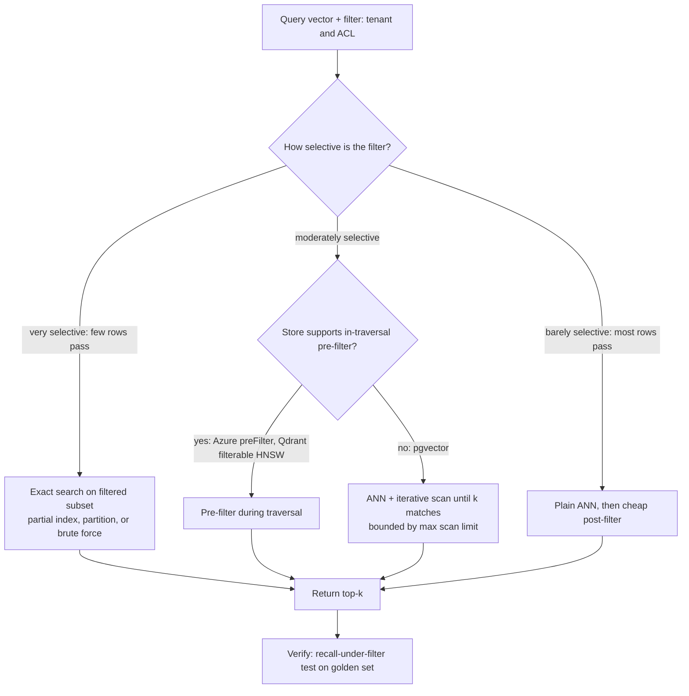
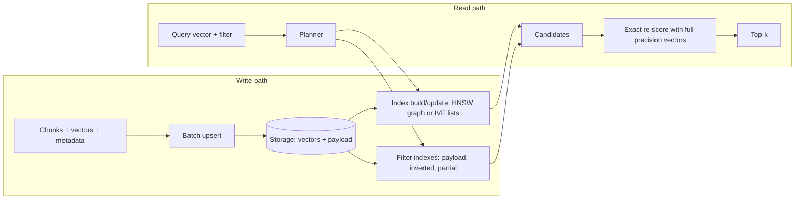
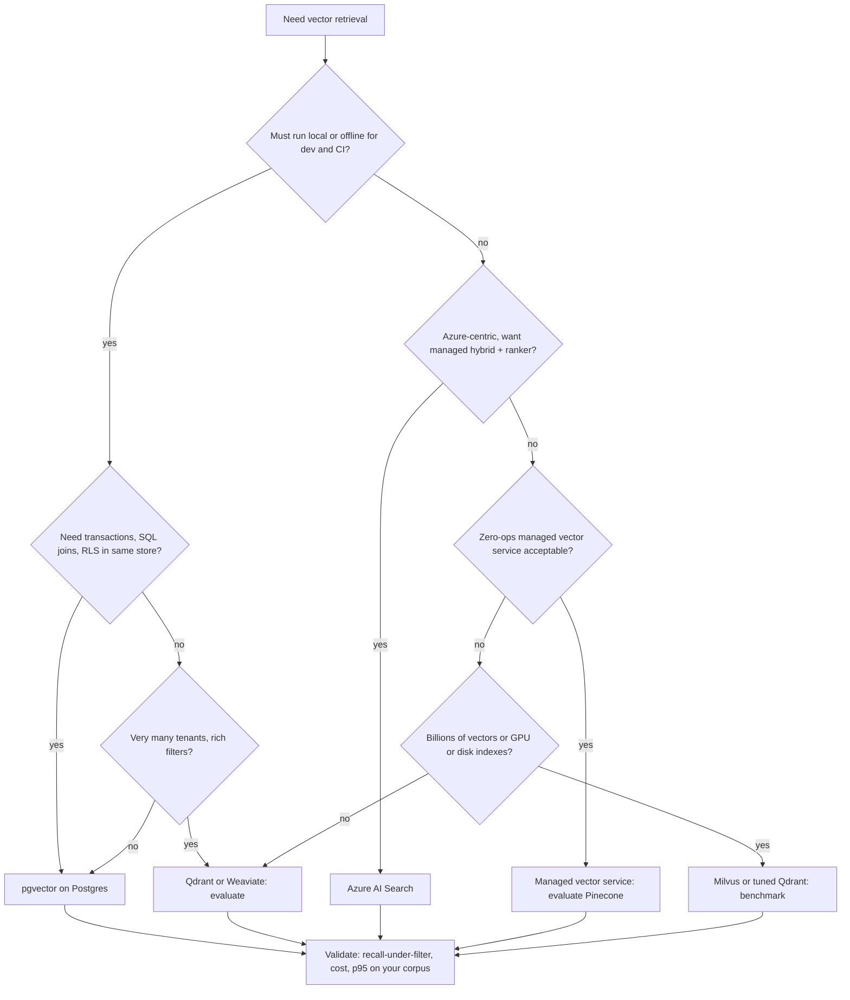

# Chapter 5 — Embeddings and Vector Databases

> **Evidence legend.** **[S#]** = supported by a source in References (IDs map to `project-management/RESEARCH-REGISTER.md`). **[E]** = engineering recommendation/reasoning. **[A]** = assumption. **[I]** = illustrative arithmetic or example on assumed inputs. **[X]** = executed and verified in this repository. **[V]** = vendor-reported, not independently reproduced. **[N]** = not researched. Research date: 2026-11-07. Vendor features, limits and defaults change quickly; re-verify before committing to a design (Research Register, version-sensitive items).

Chapter 2 covered what embeddings are and how to choose a model. This chapter covers what happens **after** you have vectors: how they are indexed, filtered, partitioned by tenant, sized, and operated — and how to choose a store.

## 5.1 Learning Objectives

After this chapter you can:

1. Explain exact vs. approximate nearest-neighbour search and the recall/latency/memory trade-off.
2. Describe how HNSW, IVF, product quantization and scalar/binary quantization work, and which knobs control recall and speed.
3. Explain why **filtered** vector search is the hard case, and compare pre-filtering, post-filtering, iterative scanning and brute-force fallback.
4. Choose a multi-tenancy pattern (shared index with filter, partition per tenant, shard per tenant) with its isolation and performance consequences.
5. Do capacity planning for storage and memory with explicit assumptions.
6. Compare stores against selection criteria and justify a choice — including when **not** to use each.

## 5.2 Problem Statement

Given *N* vectors of dimension *d* and a query vector, return the *k* nearest. Exact search compares the query to every vector: cost grows linearly with *N* and *d*. At millions of chunks, per-query latency and compute budgets force **approximate** methods that examine a small fraction of the data and accept occasionally missing a true neighbour. In enterprise RAG there is a second constraint that textbook ANN ignores: every query is **restricted** — to a tenant, to documents the caller may read, to a date range, to a document type. Combining restriction with approximate search is where recall quietly collapses [S1, S7].

## 5.3 Why It Matters in Production

- **Recall is invisible.** A missed neighbour produces no error; the LLM simply answers from worse evidence (Chapter 1). You find out through evaluation (Chapter 18), not logs.
- **Index parameters are capacity decisions.** Memory, build time and recall all move with parameters like `m`, `ef_construction`, `lists` and `probes` [S1].
- **Tenancy is a security and cost decision.** The partitioning pattern determines both blast radius and per-tenant cost (§5.9).
- **Re-indexing is expensive.** Changing model, dimension, distance function or index type usually rebuilds the index [S1, S44].

## 5.4 Core Concepts

### 5.4.1 Exact vs. approximate search

**Exact (brute-force / FLAT):** compare against every vector; always correct; cost ∝ *N·d*. It remains the right choice for small corpora, for tiny filtered subsets, and as the *ground truth* when measuring ANN recall [E]. Documentation from several vendors agrees on when exact wins: Elastic notes exact kNN suits small datasets or pre-filtered subsets [S48]; Redis suggests FLAT for datasets under about 1M vectors or when perfect accuracy outweighs latency [S50]; Milvus recommends brute-force when the filter ratio exceeds ~95% (i.e., the filter leaves very few candidates) [S46].

**Approximate (ANN):** examine a subset chosen by an index structure. **Recall@k** = fraction of the true top-*k* that the ANN returns. You tune parameters to buy recall with latency and memory.

### 5.4.2 HNSW (graph index)

HNSW builds a multi-layer stack of proximity graphs. Each element is assigned a maximum layer at random with exponentially decaying probability; search starts at the top layer and descends, with links separated by characteristic distance scale; a neighbour-selection heuristic improves recall on clustered data. The authors claim logarithmic complexity scaling and note the similarity to skip lists [S39]. Redis' description matches: the lowest layer holds all points, higher layers hold subsets, and search traverses top-to-bottom [S50].

Distributed-systems analogy [E]: a skip list over a metric space — coarse long-range hops first, fine local hops last.

Parameters (names vary by product; defaults are product-specific and version-sensitive):

| Parameter | Effect | pgvector [S1] | Redis [S50] | Elastic [S49] |
|---|---|---|---|---|
| Max links per node (`m` / `M`) | ↑ recall, ↑ memory, ↑ build time | 16 | 16 | 16 |
| Build candidate list (`ef_construction`) | ↑ graph quality, ↑ build time | 64 | 200 | 100 |
| Query candidate list (`ef_search` / `EF_RUNTIME`) | ↑ recall, ↑ latency | 40 | 10 | via `num_candidates` (not read) |

The same parameter has different defaults in different products, so never port tuned values between systems; re-tune against your golden set (Chapter 18) [E].

**Measured on real pgvector [X].** The suite file `02-hnsw-recall-and-filtering.sql` builds an HNSW index (`m = 16`, `ef_construction = 64`) over 20,000 distinct 16-d uniform-random vectors (pgvector 0.8.7 on PostgreSQL 16.12) and measures recall@10 against exact search for 50 random queries at different `hnsw.ef_search` values (suite run, 2026-11-07): **0.894** (10), **0.968** (20), **0.988** (40, the default), **0.998** (100), **1.000** (200). The documented defaults were also confirmed on this build (`ef_search` 40, `iterative_scan` off, `max_scan_tuples` 20,000, `ivfflat.probes` 1) in `01-pgvector-basics.sql`. **Caveat:** 16-dimensional uniform data is far easier than real 768–3072-dimensional embeddings, so these recalls are optimistic; they show the shape and the mechanics, and they are not a sizing guide.

### 5.4.3 IVF (inverted-file index)

IVF clusters vectors (k-means) into *lists*; at query time it finds the nearest centroids and scans only the vectors in the `probes` closest lists. FAISS's own documentation calls IVF "the key to non-exhaustive search in large datasets" [S41]. pgvector's IVFFlat: build after the table has data; `lists` ≈ rows/1000 up to 1M rows, ≈ √rows above that; `probes` ≈ √lists; setting probes = lists gives exact search, and the README adds that the planner then won't use the index [S1] — the first half reproduced in my measurement below, the second half **did not** (see "Measured on real pgvector"). It builds faster and uses less memory than HNSW but has lower query performance for the same speed-recall trade-off [S1].

**Executed illustration [X].** `docs/exercises/ch05_ann_demo.py` builds a toy IVF index on 3,000 synthetic 16-d Gaussian vectors with 30 lists and measures recall@10 against exact search over 30 queries:

| probes | recall@10 | avg distance computations / query |
|---|---|---|
| 1 | 0.330 | 136 |
| 2 | 0.467 | 236 |
| 4 | 0.647 | 436 |
| 8 | 0.840 | 846 |
| 16 | 0.977 | 1,656 |
| 30 (all lists) | 1.000 | 3,030 (exact scan = 3,000) |

Two lessons from the toy: (1) recall rises monotonically with probes while work rises roughly linearly — the dial is real; (2) in this toy's own cost model, probing every list costs *more* than an exact scan (3,030 vs. 3,000 distance computations). **Caveat:** i.i.d. Gaussian data has no cluster structure — the worst case for IVF. Real embeddings are clustered, so absolute recall values will differ; only the shape of the trade-off transfers.

**Measured on real pgvector [X].** The SQL verification suite (`scripts/verify-sql/05-ivfflat-quantization-sizes.sql`, run by `python -I scripts/verify-sql.py`) builds a real IVFFlat index (`lists = 100`) over 20,000 distinct synthetic 16-d uniform-random vectors in PostgreSQL 16.12 with pgvector 0.8.7 and compares against exact search for 50 queries. Suite run, 2026-11-07:

| `ivfflat.probes` | recall@10 |
|---|---|
| 1 | 0.214 |
| 3 | 0.464 |
| 10 | 0.804 |
| 30 | 0.986 |
| 100 (= lists) | 1.000 |

Values vary with the random data and the k-means build: an earlier ad-hoc run on different random data gave 0.318, 0.550, 0.838, 0.990 and 1.000 for the same probes, so treat these as ranges, not constants. Two checks on documented behaviour: probes = lists returned **exact results** (recall 1.000), as the README says; but the README's parenthetical that the planner then won't use the index **did not reproduce** — `EXPLAIN` still showed an `Index Scan using items_ivf` at probes = 100 on this 20,000-row table. Do not rely on the planner to fall back to a sequential scan; if you need exact search, use an explicit exact path (for example, a query that cannot use the index, or a different table/partition without one). This is a measurement on one small synthetic table, not a general statement about the planner.

### 5.4.4 Quantization and compression

Quantization stores smaller approximations of vectors, trading accuracy for memory and speed; **re-ranking** the shortlist with original vectors restores accuracy [S46, S1].

| Technique | What it does | Evidence |
|---|---|---|
| **Scalar quantization (SQ)** | Each dimension stored in fewer bits (e.g. 8) | Milvus: SQ8 cuts memory ~75% vs. 32-bit floats [S46]; Elastic `int8_hnsw` −75%, `int4_hnsw` −87% [S49] |
| **Binary quantization (BQ)** | 1 bit per dimension | Elastic `bbq_hnsw` −96% with larger accuracy cost, requires dims > 64 [S49]; pgvector example indexes `binary_quantize(embedding)` with Hamming distance, takes top 20, then re-ranks by cosine on original vectors [S1] |
| **Product quantization (PQ)** | Splits vector into sub-vectors and quantizes each against a learned codebook | FAISS describes PQ as "a lossy compression technique for high-dimensional vectors" [S41]; Milvus reports 4–32× compression at marginally reduced recall, and that PQ typically offers better recall than SQ at similar compression [S46] (original PQ paper could not be retrieved; mechanism here is as summarised by [S41, S46]) |
| **Half precision** | 16-bit floats | pgvector `halfvec` = 2·d + 8 bytes vs. 4·d + 8 for `vector`, indexable to 4,000 dims [S1] |

**Verified on pgvector 0.8.7 [X]:** the `halfvec` size formula (a 1,536-d `vector` occupies 6,152 bytes, a `halfvec` 3,080) and the 4,000-dimension `halfvec` index limit; a `halfvec` *expression* index over a `vector` column builds and is half the size; the README's binary-quantization pattern (expression index on `binary_quantize(e)::bit(n)` with `bit_hamming_ops`, Hamming top-20, then re-rank by cosine on the original vectors) executes as documented. Its measured recall in the suite (0.344 recall@5 on 16-bit codes over 16-d centred data) says **nothing** about real use — 16 bits is far too coarse — it only shows the pattern works mechanically.

Quantized originals are usually **kept for re-ranking**: Elastic notes raw float vectors stay on disk, adding ~25% (int8), ~12.5% (int4) and ~3.1% (bbq) to disk use [S49]. Savings apply to the **search structure's memory**, not necessarily to total storage [E, S49].

### 5.4.5 Index choice by constraint

Milvus' decision matrix, as published by one vendor [S46] (treat as guidance, not law): raw data fits in memory → HNSW or IVF with refinement (HNSW for low-*k*, high recall); data on SSD and latency-sensitive → DiskANN; limited RAM → IVF-PQ/SQ with mmap; filter ratio > 95% → brute force; large *k* (≥1% of dataset) → IVF; recall > 99% → brute force with GPUs. Redis offers FLAT, HNSW and SVS-VAMANA, noting that some SVS compression features rely on Intel-specific optimisations unavailable in Redis Open Source (falling back to 8-bit scalar quantization) [S50].

### 5.4.6 Index construction and maintenance

From pgvector's documentation [S1]:

- **Load data first, then build** the index; use `COPY` for bulk loads.
- HNSW builds are much faster when the graph fits in `maintenance_work_mem`; do not set it so high that the server runs out of memory; parallel build via `max_parallel_maintenance_workers`.
- In production, **`CREATE INDEX CONCURRENTLY`** to avoid blocking writes.
- Indexes need not fit in memory but perform better if they do; use half-precision indexing or binary quantization to shrink them.
- Vacuuming HNSW indexes can be slow — reindex concurrently first, then vacuum.
- Debug with `EXPLAIN (ANALYZE, BUFFERS)`.

Qdrant illustrates another maintenance coupling: filter-aware HNSW edges only help if the graph is built **after** payload indexes exist; adding a payload index to existing data requires rebuilding the HNSW index [S44] — so create payload indexes before ingestion [S43, S44].

Generic rules [E]: treat index parameters, distance function, dimension and embedding model as one versioned unit (`index_version`); build new indexes alongside old ones and cut over after evaluation (shadow index); budget rebuild time into every model or chunker change (Chapters 2, 4).

### 5.4.7 Filtered vector search — the hard case

Every system must reconcile the filter with the graph or list traversal. The documented strategies differ materially:

| System | Behaviour | Consequence |
|---|---|---|
| **pgvector** | Filter applied **after** the approximate index scan. With default `ef_search` 40, a condition matching 10% of rows yields about 4 matches on average [S1] | Fewer than *k* results; silent recall loss. Mitigations: iterative scans (`strict_order`/`relaxed_order`; `hnsw.max_scan_tuples` default 20,000), partial indexes for few distinct values, partitioning for many values, exact search when the filter is very selective [S1] |
| **Azure AI Search** | `preFilter` (filter during HNSW traversal; maximises recall, costs more for selective filters), `postFilter` (can return fewer than *k*), `strictPostFilter` (preview; highest false-negative risk) [S7]; vector fields themselves are not filterable; filter targets other fields [S51] | Prefilter is the documented recommended default for recall; vendor benchmark reports prefilter slower, especially at high selectivity [S7][V] |
| **Redis** | Heuristic choice between *batches mode* (page through nearest neighbours, yield those passing the filter, until *k* found) and *ad-hoc brute force* (score every vector that passes the filter — always exact), switching mid-query as estimates update [S50] | Auto-selected, overridable (`HYBRID_POLICY`); brute force when few documents pass |
| **Qdrant** | Payload indexes accelerate filters and provide cardinality estimates that inform query planning; filterable HNSW adds filter-aware edges when built after payload indexes [S43, S44] | Index filtered fields before ingestion; details of planner not read |
| **Milvus** | Recommends brute-force when the filter ratio is very high (>95%) [S46] | Same idea: tiny candidate sets → exact |
| **Elastic** | Docs read describe exact kNN suitability for pre-filtered subsets; internals of filtered approximate kNN not in the portion read [S48] | [N] for details |

**Executed simulation [X].** Part C of `ch05_ann_demo.py` simulates the documented post-filter behaviour: a fixed candidate list of 40, then a filter matching 10% of rows (attribute independent of similarity). Result: **3.99 of 10** requested results on average, while an iterative "keep scanning until *k* matched" strategy returned **10.00 of 10**.

**Measured on real pgvector [X] — the simulation was right.** Suite file `02-hnsw-recall-and-filtering.sql`, HNSW index over 20,000 vectors where 1,958 rows (~10%) belong to tenant `acme`, 40 random queries with `WHERE tenant = 'acme' ORDER BY e <-> q LIMIT 10`: with default settings the average number of results returned was **4.00 of 10** (the README's documented example is "about 4"), with `hnsw.iterative_scan = relaxed_order` it was **10.00 of 10**, and an exact scan returned 10.00. The same starvation appears under row-level security: in `03-rls.sql`, a tenant holding ~5% of rows (`tenant_id` + `acl_groups` policy, queried as a non-owner role) got **2.03 of 10** results by default and **10.00** with iterative scan; `EXPLAIN` shows the RLS predicates as a `Filter:` on the HNSW `Index Scan`, i.e. RLS behaves as a **post-index filter** and inherits the same starvation. This closes OI-020 for this synthetic regime; real embeddings and real tenant skew still need the M5 benchmark.

Why it matters for RAG [E]: tenant and ACL filters are applied to **every** query. A tenant holding 1% of the vectors in a shared post-filtered index gets starved results. Design for it: partition or index by tenant for large tenants, enable iterative scans, set candidate/scan limits consciously, and include a **recall-under-filter test** in the golden set (ADR-004).

<!-- figure:05-filtered-search-strategies -->


*Figure 5.1: Filtered vector search — the hard case. Original diagram; source below.*

<details><summary>Mermaid source</summary>



</details>
<!-- /figure -->

*Original diagram by the handbook author; source `docs/assets/diagrams/05-filtered-search-strategies.mmd`.*

## 5.5 Vector Database Architecture

A vector store combines [E]: (1) **storage** of vectors, payload/metadata and (often) text; (2) **ANN index(es)**; (3) **filter/inverted indexes** for metadata and keywords; (4) a **query planner** reconciling them; (5) **distribution** (sharding, replication); (6) **durability and write path**.

Architectural archetypes seen in the reviewed docs:

| Archetype | Example | Notes |
|---|---|---|
| **Extension to a relational DB** | pgvector [S1], also on Azure Database for PostgreSQL Flexible Server (allow-list the extension, then `CREATE EXTENSION vector` per database) [S52] | Transactions, SQL joins, RLS; scale-up first; you own tuning |
| **Search engine with vector fields** | Azure AI Search [S51], Elasticsearch [S48, S49] | Hybrid text+vector in one request is a core capability for Azure [S5]; managed operations |
| **Purpose-built vector DB (self-host or cloud)** | Qdrant [S42–44], Weaviate [S45], Milvus [S46] | Rich index/quantization options; separate operational surface |
| **Managed serverless vector service** | Pinecone [S47] | Namespaces; data in immutable slabs on object storage; writes logged then processed in the background, with reads checking an in-memory memtable so fresh writes are immediately searchable [S47] |
| **In-memory data store with query engine** | Redis [S50] | In-memory performance; memory cost; filter modes [S50] |
| **Library, not a database** | FAISS [S41] | In-RAM index you embed in your own service; supports ID-predicate filtering, GPU algorithms; durability, tenancy, replication are yours [S41] |

<!-- figure:05-vector-store-architecture -->


*Figure 5.2: Vector Database Architecture. Original diagram; source below.*

<details><summary>Mermaid source</summary>



</details>
<!-- /figure -->

*Original diagram by the handbook author; source `docs/assets/diagrams/05-vector-store-architecture.mmd`.*

## 5.6 Multi-tenancy in Vector Stores

| Pattern | How | Evidence | Strength | Weakness |
|---|---|---|---|---|
| **Shared index + tenant filter** | One collection/table, tenant ID predicate on every query | Qdrant recommends this default (payload field with `is_tenant` index) for many small, similarly sized tenants [S42] | Lowest overhead; scales to many tenants | Isolation depends on every query carrying the filter [S42]; pgvector warns that shared approximate indexes let one tenant's vectors affect others' recall [S1] |
| **Partition per tenant (same DB)** | List-partition by tenant or separate tables | pgvector suggests list partitioning or separate tables for isolation [S1] | Per-tenant indexes; cheap per-tenant delete/maintenance | Many partitions/tables add planner and operational overhead [E] |
| **Shard per tenant** | Dedicated shard (own vector index) | Weaviate: one shard per tenant with its own vector index; deleting a tenant deletes its shard; vendor claims 50,000+ active shards per node and 1M active tenants on ~20 nodes [S45][V]. Qdrant: user-defined sharding "works best for a modest number of large tenants," ~1,000 dedicated shards per cluster guidance [S42] | Strong performance isolation; fast tenant deletion | Resource overhead per shard; new nodes don't rebalance existing tenants in Weaviate [S45] |
| **Collection per tenant** | Separate collections | Qdrant: "rarely the most efficient"; only for a limited number of tenants needing strict isolation; Cloud default cap 1000 collections [S42] | Hard separation | Poor scalability |
| **Tiered** | Small tenants share, large tenants promoted to dedicated shards | Qdrant tiered multitenancy; suggests promoting around ~20,000 points [S42] | Matches reality of skewed tenant sizes | Promotion/migration logic |
| **Namespace** | Logical partition inside an index | Pinecone: every read/write targets one namespace [S47] (page does not define a tenancy feature; using namespaces for tenancy is [E]) | Simple routing | Provider semantics |

Cross-cutting [E]: (1) **a payload filter is not an isolation boundary by itself** — pair it with database-level enforcement where available (Postgres RLS, ADR-004); (2) sparse/BM25 statistics can leak across tenants in shared indexes — Qdrant scopes IDF statistics to a tenant via a search parameter (v1.19.0) [S42]; (3) include tenant ID in cache keys; (4) test cross-tenant access explicitly (Chapter 22).

## 5.7 Capacity Planning

**Inputs [E]:** number of chunks *N* (documents × chunks per document, including overlap — Chapter 4), dimension *d*, element size, index overhead, replicas, growth, tenants.

**Raw vector storage** = *N × (d × bytes_per_element + per-row overhead)*. Documented per-row figures: pgvector `vector` = 4·d + 8 bytes, `halfvec` = 2·d + 8 [S1].

**Worked example [I — assumed inputs; arithmetic executed in `ch05_ann_demo.py` for the first two lines [X]]:**

| Scenario | Raw vector data |
|---|---|
| 1M vectors × 128 d, float32 | 512.0 MB (Milvus lists IVF_FLAT at ~515 MB for the same shape — consistent with raw vectors plus small overhead [S46][V]) |
| 10M vectors × 1,536 d, pgvector `vector` | 61.5 GB |
| 10M vectors × 1,536 d, pgvector `halfvec` | 30.8 GB (50.1% of `vector`) |
| 10M vectors × 1,536 d, int8 elements only | ≈15.4 GB of element data (−75% vs float32 per [S49]); original floats typically retained for re-ranking [S49] |

**Index overhead — one vendor figure and one measurement.** One vendor's calculation for 1M × 128 d: HNSW 640 MB vs. 512 MB raw (+25%) and HNSWPQ 136 MB, IVF-PQ 11.0 MB (no refinement) or 62.2 MB with 10% raw refinement [S46][V]. **Measured on real pgvector [X]** (suite file `05-ivfflat-quantization-sizes.sql`; 3,000 distinct 1,536-d vectors, HNSW `m = 16`, `ef_construction = 64`, cosine): the HNSW index on the `vector` column was **24,584,192 bytes** against **18,456,000 bytes** of raw vector data (3,000 × (4·1,536 + 8)), a ratio of **1.33**; an HNSW *expression* index on `e::halfvec(1536)` was **12,296,192 bytes**, exactly **0.500** of the `vector` index. So at these settings the index holds a full copy of each vector plus roughly a third again for graph links; the halfvec expression index halves it. This is one configuration on 3,000 rows: graph overhead depends on `m`, dimension and data, so **re-measure at your scale** in M5 rather than extrapolating either number [E].

**Also plan [E]:** text and metadata storage, FTS index size, WAL/backup, replicas (×), index build memory (`maintenance_work_mem`), peak memory during rebuild or shadow-index migration (two indexes coexist), and growth headroom. Re-embedding cost comes from Chapter 2.

**Memory vs. disk [S1, S46, S49]:** graph indexes prefer RAM; disk-oriented options exist (DiskANN [S46], Elastic `bbq_disk` which requires an Enterprise subscription [S49]); pgvector indexes need not fit in memory but perform better if they do [S1].

## 5.8 Technology Comparison and Selection Criteria

Qualitative, from the reviewed documentation only; **[N]** = not researched. No performance ranking is implied — no cross-system benchmark was run.

| Store | Model | Filtering (documented) | Tenancy (documented) | Quantization / compression | Choose when [E] | Avoid when [E] |
|---|---|---|---|---|---|---|
| **PostgreSQL + pgvector** [S1, S52] | Managed or self-hosted DB extension | Post-index filter; iterative scans, partial indexes, partitioning | Partitions/tables; RLS available in Postgres (ADR-004) | `halfvec`, binary quantization | Single store, transactions, governance, moderate scale, local-first dev | Very large/high-QPS ANN with highly selective filters unless tuned and measured |
| **Azure AI Search** [S5, S7, S51] | Managed search service | preFilter/postFilter modes | Filter-based security trimming (ACL pattern) [S8] | Vector compression is mentioned (it requires an index created with the newer defaults) [S7]; details not read [N] | Managed hybrid + semantic ranking; Azure-centric; no vector-DB ops | Offline/local requirement; cost-sensitive dev; strict portability |
| **Qdrant** [S42–44] | Purpose-built, self-host or cloud | Payload indexes; filterable HNSW | Payload partitioning (default), sharding, tiered | Quantization exists (details not read) [N] | Many tenants + rich filtering; self-hosting acceptable | Need relational joins/transactions in the same store |
| **Weaviate** [S45] | Purpose-built, self-host or cloud | Filter indexes exist (details not read) [N] | Shard per tenant; tenant states incl. offload | Compression per named vector (details not read) [N] | Very many tenants needing dedicated indexes and cheap tenant delete | Unclear: page read doesn't cover index types [N] |
| **Milvus** [S46] | Purpose-built, distributed | Brute-force at high filter ratios | [N] | SQ, PQ, many index types | Large scale; wide index menu; disk/GPU options | Small teams wanting minimal ops [E] |
| **Pinecone** [S47] | Managed serverless | [N] | Namespaces | [N] | Zero-ops managed vector service; fresh-write searchability documented | Data residency or deployment-control constraints [E]; the architecture page describes a managed service on AWS, GCP and Azure and does not describe self-hosting [S47] |
| **Elasticsearch** [S48, S49] | Search engine with `dense_vector` | Exact kNN suits pre-filtered subsets; internals not read | [N] | `int8/int4/bbq` HNSW; `bbq_disk` needs Enterprise | Already operating Elastic; hybrid text+vector; quantization options | Dimensions > 4,096 (hard limit) [S49]; license/tier features vary by version |
| **OpenSearch** | k-NN plugin | **[N — docs could not be retrieved]** | [N] | [N] | [N] | [N] |
| **Redis** [S50] | In-memory DB + query engine | Batches vs. ad-hoc brute force | [N] | Scalar quantization fallback; Intel-specific compression not in OSS | Latency-critical, working set fits in memory; Redis already present | Large corpora where RAM cost dominates [E] |
| **FAISS** [S41] | Library | ID-predicate filtering | Yours | PQ, IVF, GPU algorithms | Embedded index inside your own service; research/batch; GPU | Need durability, replication, multi-tenant access control out of the box |

**Selection criteria (ordered) [E]:** (1) data boundary and deployment constraints (managed vs. self-hosted vs. local); (2) filtering/tenancy fit — *does it keep recall under your tenant and ACL filters?* (3) hybrid search needs (Chapter 9); (4) scale and growth (N, QPS, update rate); (5) operational capacity of your team; (6) cost model; (7) ecosystem and portability; (8) licence and vendor risk.

<!-- figure:05-vector-store-selection -->


*Figure 5.3: Technology Comparison and Selection Criteria. Original diagram; source below.*

<details><summary>Mermaid source</summary>



</details>
<!-- /figure -->

*Original decision aid by the handbook author; it narrows candidates, it does not replace the benchmark. Source `docs/assets/diagrams/05-vector-store-selection.mmd`.*

## 5.9 Practical Example (Illustrative)

**Scenario [I]:** a SaaS vendor serves 2,000 customer tenants; 1,950 are small (≤ 5,000 chunks), 50 are large (≥ 500,000 chunks); each query must be tenant-filtered and ACL-filtered.

| Option | Assessment [E] |
|---|---|
| Single shared HNSW index + tenant post-filter (pgvector default) | Starves small tenants (they are ≪ 10% of rows: with the documented post-filter behaviour, expect few results unless iterative scans reach them) [S1] |
| Shared index + iterative scans | Works for medium selectivity; scan limits (default 20,000 tuples in pgvector) may still cap recall for tiny tenants [S1] |
| Partition large tenants, share small | Tiered pattern; mirrors Qdrant tiered multitenancy [S42]; large tenants get dedicated indexes; small tenants served by exact search on their subset (cheap at ≤5,000 vectors) |
| Shard per tenant for all | Overhead for 1,950 small tenants unless the store is built for it (Weaviate claims it is [S45][V]) |

Chosen for the reference implementation (ADR-001/004): Postgres, list-partition or separate indexes for large tenants, exact search for small ones, RLS as the boundary, and a recall-under-filter benchmark.

## 5.10 Implementation

`docs/exercises/ch05_ann_demo.py` **[X]** implements the three experiments in this chapter (storage arithmetic, IVF recall-vs-probes, post-filter shortfall). Run:

```bash
python -I docs/exercises/ch05_ann_demo.py
```

(2026-11-07, Python 3.14.2; all assertions passed; ~7 s.) The **SQL verification suite** (`python -I scripts/verify-sql.py`, files under `scripts/verify-sql/`, needs Docker) runs against a throw-away PostgreSQL 16.12 + pgvector 0.8.7 container with assertions that fail the run: operator semantics (`<#>` is the *negative* inner product), storage sizes (`vector` = 4·d + 8, `halfvec` = 2·d + 8 bytes), the 2,000/4,000-dimension HNSW limits with their exact error messages, operator-class matching (an `<=>` query does **not** use a `vector_ip_ops` index — it plans a sequential scan + sort even with sequential scans disabled, closing OI-013), the measured recall/filter results above, and index sizes. Production schema and RLS arrive in M5. DDL showing how the documented pgvector knobs map to SQL — **the table and the non-concurrent HNSW index were executed in the suite (same options); `CREATE INDEX CONCURRENTLY` and the `SET LOCAL` lines were not run**:

```sql
-- Illustrative. Dimension 1536 fits a plain vector index (limit 2,000).
CREATE TABLE chunks (
  tenant_id uuid NOT NULL,
  chunk_id  text NOT NULL,
  embedding vector(1536) NOT NULL,
  model_id  text NOT NULL,
  PRIMARY KEY (tenant_id, chunk_id)
);
-- One index per distance function you query; match the operator class.
CREATE INDEX CONCURRENTLY chunks_hnsw_cos
  ON chunks USING hnsw (embedding vector_cosine_ops) WITH (m = 16, ef_construction = 64);
-- Per-query recall/latency dial, scoped to the transaction:
--   SET LOCAL hnsw.ef_search = 100;
--   SET LOCAL hnsw.iterative_scan = relaxed_order;   -- when filters are selective
```

## 5.11 Trade-offs

| Decision | Option A | Option B | Trade-off |
|---|---|---|---|
| HNSW vs. IVF | Higher QPS at given recall [S46, S1] | Faster build, less memory [S1] | Memory/build time vs. query performance |
| Quantization | −75% to −96% search-structure memory [S49] | Accuracy loss; need re-rank and keep originals [S49, S1] | RAM cost vs. recall + extra disk |
| Prefilter vs. postfilter | Recall guarantee [S7] | Predictable latency [S7] | Selectivity-dependent |
| Shared vs. dedicated tenant index | Low overhead [S42] | Isolation, simple delete [S45] | Cost vs. blast radius |
| Single store vs. dedicated vector DB | Transactions, simplicity (Postgres) | Specialised features/scale | Operations vs. capability |
| Higher `ef_search`/`probes` | Recall ↑ [S1] | Latency ↑ | Tune per query class |

## 5.12 Failure Modes

| Failure | Root cause | Symptom | Detection | Mitigation |
|---|---|---|---|---|
| Starved filtered results | Post-filter after fixed candidate list [S1] [X] | Fewer than *k* hits; tenant-dependent quality | Recall-under-filter test; result-count histogram | Iterative scans, partial/partitioned indexes, exact search for small subsets |
| Wrong operator class | Query uses a different distance than the index | Seq scan, high latency | `EXPLAIN` [S1] | One index per distance function |
| Index larger than RAM | Growth, no capacity plan | Latency cliff | Cache hit ratio, p95 | Halfvec/BQ [S1], more RAM, partition |
| Cross-tenant recall interference | Shared approximate index [S1] | Tenant A's data degrades B's recall | Per-tenant recall monitoring | Partition/separate indexes for large tenants |
| Stale or mixed embeddings | Model change without rebuild (Ch. 2) | Recall collapse, no errors | `model_id` audit | Shadow index migration |
| Filter-aware index not used | Payload index created after ingest (Qdrant) [S44] | Slow/low-recall filtered search | Query plan/latency | Rebuild HNSW after payload index |
| Blocking index build | Plain `CREATE INDEX` in prod [S1] | Write stalls | Lock monitoring | `CREATE INDEX CONCURRENTLY` |
| Silent default drift | Upgrade changes defaults | Recall/latency shift | Golden-set regression | Pin versions; explicit parameters |
| Redis `LIMIT` gotcha | KNN k=50 but default LIMIT 10 [S50] | Only 10 results | Result counts | Set `LIMIT 0 k` |
| Over-trusted vendor claims | Using marketing scale numbers | Capacity shortfall | Own load test | Treat [V] numbers as hypotheses |

## 5.13 Security Considerations

- **Vectors are derived from sensitive text**; protect the store like the source documents (Chapter 2 §2.11; inversion risk unresearched, OI-012).
- **Tenant filter ≠ boundary** unless enforced below the application (RLS) or by physical partitioning [S1, S4, E]. Qdrant's payload-partitioning guidance itself notes isolation relies on every query including the filter [S42].
- **Postgres RLS caveats** apply to chunk tables: owners/superusers/`BYPASSRLS` bypass; referential-integrity checks bypass RLS [S4].
- **Managed identity** for service-to-service auth: Azure documents Entra ID as recommended for embeddings (no long-lived keys) [S29]; Azure Container Apps supports system/user-assigned identities [S18].
- **Deletion:** indexes must support purging by tenant/document; Weaviate's shard-per-tenant makes tenant deletion a shard drop [S45]; in shared indexes, deletions need vacuum/reindex attention (HNSW vacuum can be slow [S1]).
- **Exposure:** private networking, no public vector endpoints; audit access (Chapter 22).

## 5.14 Performance Considerations

- Tune per query class: interactive Q&A (low latency, moderate recall) vs. evaluation/batch (high recall) [E].
- Keep the hot index in memory; shrink with half precision/quantization; re-rank a small shortlist with originals [S1, S49].
- Parallelize index builds within memory limits [S1]; build off-peak; use shadow indexes.
- Measure with the Chapter 20 methodology: recall@k versus exact search, p50/p95/p99 latency, QPS under concurrency, build time, memory. This chapter reports **no latency benchmarks**; the only quantitative experiments are the executed toy demonstrations above, using distance computations as a proxy [X].

## 5.15 Cost Considerations

Cost drivers [E]: memory (dominant for graph indexes), storage, replicas, build compute, re-embedding on model change, managed-service pricing (not researched; Azure AI Search vector search carries no extra charge on any tier, while embedding generation may be charged by the model provider [S51]), and engineering time. Quantization and half precision trade a small quality risk for large memory savings [S49, S1]; the correct trade is found by golden-set evaluation, not by percentage alone.

## 5.16 Production Recommendations

1. Treat `(embedding model, dimension, distance, index type, parameters)` as one versioned unit; migrate via shadow index.
2. Pick the distance function once; index it with the matching operator class; check plans with `EXPLAIN`.
3. Start with defaults, measure recall against exact search on your own data, then tune `ef_search`/`probes`.
4. Make **recall under tenant/ACL filters** a first-class metric; alert on shrinking result counts.
5. Choose a tenancy pattern by tenant-size distribution; do not default to collection-per-tenant.
6. Create filter/payload indexes before bulk ingestion where the store requires it [S44].
7. Plan capacity from measured per-vector index size, not published ratios.
8. Build indexes concurrently; run production index builds with memory limits set deliberately [S1].
9. Pin versions and parameters; defaults differ between products and releases.
10. Keep exact search available as ground truth and fallback for small filtered subsets.

## 5.17 Architecture Decision Guidance

**Updating ADR-001.** Option C (dedicated vector databases) is now researched at documentation level (Qdrant, Weaviate, Milvus, Pinecone, Elasticsearch, Redis, FAISS), but **no benchmark** was run, so the decision is unchanged: pgvector + Postgres FTS remains the reference default for the reasons in ADR-001 (single transactional store, RLS, local-first), behind a `VectorStore` port. The comparison adds concrete **reversal triggers**: (1) recall-under-filter or latency targets cannot be met with iterative scans, partitioning and partial indexes; (2) tenant count and skew make per-tenant indexes unmanageable in Postgres; (3) scale needs disk/GPU/quantized indexes beyond pgvector's options; (4) Azure AI Search becomes the mandated platform. Move to Azure AI Search when you want managed hybrid retrieval with semantic ranking [S5, S51]; to Qdrant/Weaviate when tenancy and filter selectivity dominate; to Milvus when scale and index variety dominate; to Pinecone when zero-ops is the priority and the data boundary allows it.

## 5.18 Interview Questions

1. **Why can't we just use exact search?** Cost ∝ *N·d* per query; ANN trades small recall loss for large speedups; exact remains right for small corpora, tiny filtered subsets and as ground truth [S46, S48, S50].
2. **Explain HNSW in an interview.** Layered proximity graphs, random exponentially-decaying layer assignment, top-down greedy search, logarithmic scaling claim [S39]; parameters `m`, `ef_construction`, `ef_search` trade recall for build time, memory and latency [S1]. *Wrong answer:* "It's a tree index."
3. **HNSW vs. IVF?** HNSW typically higher QPS at a given recall but more memory/build time; IVF builds faster, smaller [S1, S46]. IVF with probes = lists is just a slower exact scan [X, S1].
4. **A tenant with 1% of the data gets poor results in a shared pgvector index. Why and what do you do?** Filter applied after the ANN scan; 10% selectivity yields ~4 of 40 candidates [S1][X]; fix with iterative scans, partial/partitioned indexes, exact search on the subset, or a different tenancy pattern.
5. **How does quantization affect recall and storage?** Smaller search structure (−75% int8, −96% BBQ in Elastic's documented figures [S49]) at an accuracy cost, mitigated by re-ranking with original vectors, which must still be stored [S49, S1].
6. **Design multi-tenant vector storage for 2,000 tenants with skewed sizes.** Tiered: shared for small (or exact search), dedicated indexes/partitions for large; RLS as the boundary [S42, S1, S4].
7. **How do you size a vector index?** *N × (d × bytes + overhead)* plus measured index overhead, replicas, headroom, rebuild peak (two indexes coexist) [S1, E]; don't extrapolate a vendor's ratio.
8. **When would you choose Azure AI Search over pgvector?** Managed hybrid with semantic ranking and prefilter semantics, Azure-aligned operations; not for offline/local dev or tight cost control [S5, S7, S51, E].
9. **What breaks when you change the embedding model?** All vectors incomparable; rebuild required; run shadow index and evaluate (Ch. 2) [S9].

## 5.19 Knowledge Checkpoint / Exercises

1. Run `ch05_ann_demo.py`. Change `lists` to 10 and 60; predict how recall vs. probes shifts, then check.
2. Modify Part C so the filter attribute is *correlated* with similarity (e.g. matching rows are near the query). How do the plain post-filter and iterative results change, and what does that say about tenant filters on clustered data?
3. Compute raw storage for your corpus at 768, 1,536 and 3,072 dimensions in float32 and half precision. State assumptions on chunk count.
4. Write the recall-under-filter test: for each of 10 tenants of different sizes, compare ANN top-10 with exact top-10 under the same filter.
5. Draft the shadow-index migration runbook for changing `m` from 16 to 32.
6. Using the selection criteria, pick a store for a 200-user internal policy bot and for a 5M-user SaaS assistant; justify differences.

## 5.20 Summary

ANN indexes trade recall for speed and memory: HNSW through layered graphs, IVF through clustered lists, quantization through smaller representations that need re-ranking [S39, S41, S46, S49]. The executed demonstrations show the recall-vs-work dial and that a fixed-candidate post-filter returns about 4 of 10 results at 10% selectivity [X, S1]. Filtering and tenancy — not raw ANN speed — decide enterprise suitability: stores differ in whether they pre-filter, post-filter, iterate, or fall back to brute force, and in whether tenants share an index, a partition, or a shard [S1, S7, S42, S45, S50]. Plan capacity from measured data, version every index parameter with the embedding model, and select a store by filter/tenancy fit, hybrid needs, scale, operations, cost and licence. The reference implementation keeps Postgres + pgvector by default, with explicit triggers for moving to alternatives.

## References

- [S1] pgvector README (v0.8.7). https://github.com/pgvector/pgvector (reviewed 2026-11-07; summary-level)
- [S4] PostgreSQL 18 docs, *Row Security Policies*. https://www.postgresql.org/docs/current/ddl-rowsecurity.html
- [S5] Microsoft, *Hybrid search overview — Azure AI Search* (2026-08-31). https://learn.microsoft.com/en-us/azure/search/hybrid-search-overview
- [S7] Microsoft, *Vector query filters — Azure AI Search* (2026-04-27). https://learn.microsoft.com/en-us/azure/search/vector-search-filters
- [S9] Microsoft, *Foundry Models sold by Azure — Embeddings* (2026-09-21). https://learn.microsoft.com/en-us/azure/ai-foundry/openai/concepts/models
- [S18] Microsoft, *Managed identities in Azure Container Apps*. https://learn.microsoft.com/en-us/azure/container-apps/managed-identity
- [S29] Microsoft, *Generate embeddings with Azure OpenAI* (2026-07-22). https://learn.microsoft.com/en-us/azure/foundry/openai/how-to/embeddings
- [S39] Malkov & Yashunin, *Efficient and robust approximate nearest neighbor search using Hierarchical Navigable Small World graphs*, arXiv:1603.09320. https://arxiv.org/abs/1603.09320 (abstract)
- [S40] Johnson, Douze, Jégou, *Billion-scale similarity search with GPUs*, arXiv:1702.08734. https://arxiv.org/abs/1702.08734 (abstract; background for GPU/PQ search, not cited for specific claims above)
- [S41] FAISS wiki. https://github.com/facebookresearch/faiss/wiki (summary-level)
- [S42] Qdrant docs, *Multitenancy*. https://qdrant.tech/documentation/guides/multiple-partitions/ (summary-level)
- [S43] Qdrant docs, *Filtering*. https://qdrant.tech/documentation/concepts/filtering/ (partial)
- [S44] Qdrant docs, *Indexing*. https://qdrant.tech/documentation/concepts/indexing/ (partial)
- [S45] Weaviate docs, *Data model concepts*. https://docs.weaviate.io/weaviate/concepts/data (summary-level; vendor scale claims)
- [S46] Milvus docs, *Index explained*. https://milvus.io/docs/index-explained.md (summary-level; vendor calculations)
- [S47] Pinecone docs, *Database architecture*. https://docs.pinecone.io/guides/get-started/database-architecture (summary-level)
- [S48] Elastic docs, *kNN search*. https://www.elastic.co/docs/solutions/search/vector/knn (partial)
- [S49] Elastic docs, *dense_vector field type*. https://www.elastic.co/docs/reference/elasticsearch/mapping-reference/dense-vector (summary-level)
- [S50] Redis docs, *Vector search concepts*. https://redis.io/docs/latest/develop/ai/search-and-query/vectors/ (read)
- [S51] Microsoft, *Vector search overview — Azure AI Search* (2026-08-05). https://learn.microsoft.com/en-us/azure/search/vector-search-overview
- [S52] Microsoft, *Vector search in Azure Database for PostgreSQL Flexible Server* (2026-07-10). https://learn.microsoft.com/en-us/azure/postgresql/extensions/how-to-use-pgvector
