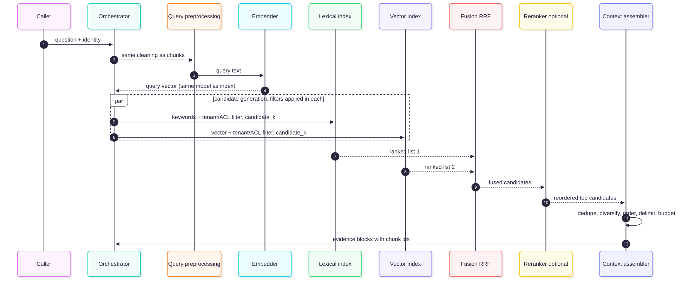
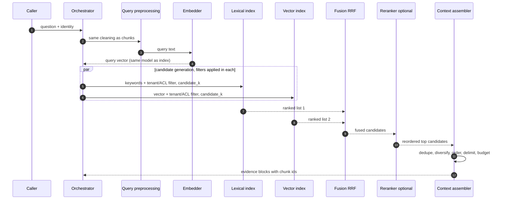

# Chapter 6 — Retrieval Mechanisms and Workflows

> **Evidence legend.** **[S#]** = supported by a source in References (IDs map to `project-management/RESEARCH-REGISTER.md`). **[E]** = engineering recommendation/reasoning. **[A]** = assumption. **[I]** = illustrative. **[X]** = executed and verified in this repository. **[V]** = vendor-reported, not independently reproduced. Research date: 2026-11-07.

## 6.1 Learning Objectives

After this chapter you can:

1. Trace a query through the retrieval workflow — preprocessing, embedding, candidate generation, fusion, filtering, ranking, and context assembly — and say what each stage optimises.
2. Choose K, candidate-set size, and thresholds, and explain why scores from different stages are not interchangeable.
3. Compute and interpret Precision@K, Recall@K, MRR, and nDCG, and know what each hides.
4. Diagnose the common retrieval failures from symptoms.
5. Assemble context under a token budget: select, de-duplicate, diversify, order and delimit.
6. Read the executed end-to-end example and explain what it does and does not show.

## 6.2 Problem Statement

The retrieval stage must hand the generator a **small set of chunks** that together contain the answer, from a corpus of millions, under tenant and permission constraints, within a latency budget. It fails in two opposite ways: **missing** the evidence (low recall) or **burying** it in noise (low precision). The generator cannot repair either; it can only use what it is given (Chapter 1). Retrieval is therefore usually the highest-leverage place to invest in a RAG system, and the place where measurement matters most.

## 6.3 Why It Matters in Production

- **Failure here is silent.** A retrieval miss produces a fluent, wrong or hedging answer, not an exception [E].
- **Retrieval has its own SLO.** Azure's guidance recommends evaluating each phase independently while remembering that the customer experiences the end result [S53]; retrieval quality must be measured on its own before generation is blamed [S55, S56].
- **Cost scales with K.** Every chunk passed on costs input tokens and adds position-sensitivity risk (Chapter 1; [S19]).
- **Security applies here.** Filters must be applied during retrieval (Chapters 8, 13); retrieved text is untrusted input to the prompt (Chapter 22).

## 6.4 Core Concepts

### 6.4.1 The retrieval request

A retrieval request is more than a string [E]:

```text
RetrievalRequest(
  query_text, conversation_context?,
  caller: (tenant_id, user_id, groups),     # drives filters
  filters: (doc_type, date range, ...),     # optional business filters
  mode: dense | lexical | hybrid,
  candidate_k, final_n, deadline )
```

The **caller identity** is part of the request, not an afterthought: tenant and ACL predicates are built from it inside the data layer (ADR-004).

### 6.4.2 Query preprocessing and embedding

Azure's guidance is explicit and easy to violate: *before you embed the query, run the same cleaning operations that you performed on chunks* (their example: if chunks were lower-cased, lower-case the query), and use the same embedding model that embedded the chunks [S55]. Ollama's embedding documentation also says to use the same model for indexing and querying [S15]. A query-side preprocessing mismatch degrades recall without raising any error [E].

**Query-to-document asymmetry [E].** A query is short and interrogative; a chunk is long and declarative. Dense retrieval bridges this because embedding models are trained for it (Chapter 2, DPR [S20]), but the gap is the reason for query-side techniques: rewriting and augmentation ("*Compare the earnings of Microsoft*" → add time frames), decomposition of multi-part questions, and HyDE, which asks a model to write a hypothetical answer and embeds *that* so the search becomes answer-to-answer [S55]. Chapter 10 treats these with their costs and failure modes.

### 6.4.3 Candidate generation and top-K

Retrieval optimises for **recall**; later stages optimise for **precision** [S55]. Hence two different numbers:

| Parameter | Meaning | Guidance |
|---|---|---|
| `candidate_k` | How many chunks each retriever returns | Start moderate (20–50) and adjust against evaluation metrics [S55]; Azure's example pipeline retrieves a large set such as top 50 [S55] |
| `final_n` | How many chunks reach the LLM | Azure example: keep the top 5 or 10 after reranking [S55]; Anthropic's contextual-retrieval experiment found passing 20 chunks beat 10 and 5 *in their setup* [S28][V]. The right N is workload-specific: tune on completeness/utilization (§6.4.8) |

Run candidate generators **in parallel** and merge. Azure AI Search does exactly this for hybrid queries: full-text and vector queries run in parallel and are merged with Reciprocal Rank Fusion [S5, S6]; with manual multiple queries you implement the merge yourself [S55].

### 6.4.4 Fusion: Reciprocal Rank Fusion

RRF merges ranked lists using ranks, not scores: `RRF(d) = Σ over lists 1 / (c + rank(d))`, with *c* commonly 60 [S55, S6]. Because it uses only rank positions, it sidesteps the fact that BM25-style scores and cosine similarities live on different scales [S55]. Azure notes the fused score is bounded by the number of lists and *c* (each list contributes at most about 1/*c*), so fused scores are not comparable to raw similarity scores [S6].

**Executed check [X]** (`docs/exercises/ch06_retrieval_pipeline.py`): for lists `[a,b,c]` and `[c,a,d]` with *c* = 60, `a` scores 1/61 + 1/62 = 0.03252, `c` scores 1/63 + 1/61 = 0.03227, `b` scores 1/62 = 0.01613 — so `a > c > b`: agreement across lists beats a single top rank. Also, an item ranked 2nd in two lists beats items ranked 1st in only one list.

**Fusion is not a free win [X].** In the executed toy example, for the query "queue dead letter" the lexical scorer reached nDCG@3 = 0.50, the (stand-in) dense scorer 1.00, and the fused ranking 0.63 — between the two. With four queries and a toy dense stand-in, this proves nothing about hybrid search in general, but it demonstrates the principle: **fusion's value must be measured; it can land between its inputs** [E]. This does not contradict the original RRF paper, which I read in full for Chapter 9: its claim is that RRF "almost invariably improved on the best of the combined results" when fusing *many diverse, reasonably strong* rankers, measured by MAP on average over TREC collections, with one exception where the best run involved a human [S67]. One query, two heterogeneous legs and a toy stand-in is a different regime from averages over many queries and systems. Chapter 9 treats fusion in depth.

### 6.4.5 Similarity thresholds

Teams often want "return nothing if nothing is good enough." Be careful what score you threshold [E]:

- **Raw cosine/dot scores** are model-specific; a threshold that works for one embedding model is meaningless for another. Calibrate per model and per query class on the golden set.
- **RRF scores** reflect rank agreement only; absolute values depend on the number of lists and *c* [S6].
- **Cross-encoder/reranker scores** are relative: Azure advises using them for ordering, not for thresholding, and says that if you need a threshold you should establish it empirically against your test data [S55].
- Include **negative test queries** (questions your corpus cannot answer) in evaluation and expect metrics near 0 for them; this is how you tune the "insufficient evidence" path [S55].

### 6.4.6 Retrieval metrics

Definitions as given in Azure's retrieval-evaluation guidance [S55]:

| Metric | Definition | What it hides |
|---|---|---|
| **Precision@K** | Share of the top-K results that are relevant | Ignores relevant items not retrieved |
| **Recall@K** | Share of all relevant items that appear in the top-K | Ignores noise and order inside K |
| **MRR** | Mean over queries of 1 / rank of the first relevant result | Cares only about the first hit — poor when answers need several chunks |
| **Hit rate@K** | Fraction of queries with at least one relevant item in top-K [E: standard definition] | Same as above, binary |
| **nDCG@K** | DCG / ideal DCG, with DCG = Σ rel_i / log₂(i+1) (linear gain) or Σ (2^rel_i − 1) / log₂(i+1) (exponential gain); 0–1 [S63, Tier 3] | Needs graded judgments; sensitive to gain variant |

**Executed verification [X].** For binary relevance judgments with relevant docs d1 and d3 and ranking `[d1, d2, d3]`: Precision@3 = 2/3, Recall@3 = 1.0, DCG = 1/log₂2 + 0 + 1/log₂4 = 1.5, ideal DCG = 1 + 1/log₂3 = 1.6309, **nDCG@3 = 0.9197**; ranking `[d2, d1]` has reciprocal rank 0.5; the ideal ordering gives nDCG = 1.0. The script asserts all of these.

**Reading metrics together [E]:** high recall with low precision means good coverage but noisy context (add reranking, lower K); high precision with low recall means the retriever is too narrow (raise candidate_k, add lexical or query expansion). Evaluate against **exact-search ground truth** where possible to separate ANN approximation loss from model/chunking quality (Chapter 5 §5.4.1).

### 6.4.7 Context assembly

After ranking, assemble what the LLM sees:

1. **Select** within a token budget; never truncate mid-chunk (the demo skips chunks that do not fit) **[X]**.
2. **De-duplicate** near-identical chunks. In the executed example, two chunks with token-Jaccard 0.92 (the same ADR copied to two folders) both occupied the top 3. MMR **demoted** the duplicate from rank 2 to rank 3 but kept it, and — more importantly — placed an *irrelevant* chunk ahead of it. Explicit near-duplicate removal (Jaccard > 0.8) removed it and freed the slot **[X]**. Lesson: **MMR trades relevance for novelty (λ controls the balance) and degrades when the candidate pool is weak; for true duplicates, dedupe first.**
3. **Diversify (optional).** Maximal Marginal Relevance combines query-relevance with information-novelty to reduce redundancy [S62]; the usual formulation is greedy selection of `argmax_d [ λ·rel(d) − (1−λ)·max_{s∈selected} sim(d,s) ]` [E; the abstract page reviewed does not print the formula]. The original paper's clearest advantage was non-redundant multi-document summaries, with only preliminary results for retrieval [S62].
4. **Order.** Position matters: models can use information at the beginning or end of a long input better than in the middle [S19]. A defensible pattern is to place the strongest chunks at both ends (**"edge ordering"** in the demo, verified to put rank 1 first and rank 2 last **[X]**), but whether it helps for *your* model is an empirical question [E].
5. **Delimit and label.** Wrap each chunk with its ID and source; Anthropic's guidance recommends XML-style tags with `<source>` metadata for multiple documents, and placing long documents above the question, noting that putting the query at the end can improve quality by up to 30% in their tests [S58][V]. Chapter 7 shows the delimiting contract and its limits.
6. **Budget.** Context tokens = system prompt + evidence + question + expected output; leave headroom for output [E].

### 6.4.8 Context-window utilisation

Azure's end-to-end evaluation pairs two metrics: **completeness** (does the response answer all parts of the query) and **utilization** (how much of the response comes from the supplied chunks) [S56]. Their diagnostic matrix: high completeness + low utilization → irrelevant chunks are being returned, consider reducing top-K; low completeness + high utilization → the chunks used do not fully answer, review chunking, raise top-K or check why relevant chunks were not retrieved; low both → revisit chunking and prompts [S56]. Treat these as signals to investigate, not automatic fixes; model responses are non-deterministic, so use target ranges, not single numbers [S56].

## 6.5 Internal Mechanics: The Workflow

<!-- figure:06-retrieval-workflow -->


*Figure 6.1: Internal Mechanics: The Workflow. Original diagram; source below.*

<details><summary>Mermaid source</summary>



</details>
<!-- /figure -->

*Original diagram by the handbook author; source `docs/assets/diagrams/06-retrieval-workflow.mmd`.*

Stage objectives: preprocessing and embedding (comparability), candidate generation (recall under filters), fusion (merge without score calibration), reranking (precision, at extra latency — Azure cautions that reranking adds latency beyond standard, vector or hybrid search [S55]), assembly (usable, budgeted, safe context).

## 6.6 Architecture

The retrieval service is a **stateless, tenant-aware component** with explicit stage interfaces so each can be tested and swapped [E]:

```text
Retriever.search(request) -> RankedCandidates
Fuser.fuse(list[RankedCandidates]) -> RankedCandidates
Reranker.rerank(query, candidates) -> RankedCandidates          # optional
ContextAssembler.build(candidates, budget) -> EvidenceBlocks
```

Each stage emits a trace span with counts and timings but **not** raw query text by default (§6.11; OpenTelemetry's retrieval span treats `query.text` as opt-in and warns it may contain sensitive information [S61]). Chapter 7 places this service in the overall architecture.

## 6.7 Practical End-to-End Example [X]

`docs/exercises/ch06_retrieval_pipeline.py` runs the full workflow on a ten-chunk toy corpus with four queries. Components: a toy term-overlap scorer (**not BM25**), a character-trigram hashing "dense" stand-in (captures spelling similarity, **not meaning**), RRF, MMR, near-duplicate removal, budgeted assembly, and metrics. Output for the query *"why did we drop kafka"*:

| Stage | Result |
|---|---|
| Lexical top | c1, c2 |
| Dense stand-in top | c1, c7, c9, c4 |
| RRF fused | c1, c2, c7, c9 |
| Plain top-3 | c1, c2, c7 |
| MMR (λ = 0.5) top-3 | c1, c7, c2 |
| After near-duplicate removal | c1, c7, c9 |
| Edge-ordered, 40-word budget | c1, c7, c4, c9 (c2 does not fit) |

Metrics @3 on all queries (toy data; **illustrates computation, not method quality**):

| Query | Method | P@3 | R@3 | RR | nDCG@3 |
|---|---|---|---|---|---|
| why did we drop kafka | lexical | 0.67 | 0.67 | 1.00 | 0.87 |
| | dense* | 0.33 | 0.33 | 1.00 | 0.53 |
| | fused | 0.67 | 0.67 | 1.00 | 0.87 |
| E-4471 | lexical / dense* / fused | 0.33 | 0.50 | 1.00 | 0.76 |
| parental leave for contractors | all three | 0.67 | 1.00 | 1.00 | 1.00 |
| queue dead letter | lexical | 0.33 | 1.00 | 0.33 | 0.50 |
| | dense* | 0.33 | 1.00 | 1.00 | 1.00 |
| | fused | 0.33 | 1.00 | 0.50 | 0.63 |

\* character-trigram stand-in, not a real embedding model.

What the example **does** show: how stages compose; that weak candidates (c7, c9 here) flow into context when K exceeds the number of good chunks; that diversity re-ranking can displace a relevant duplicate with noise; and that fusion can land between its inputs. What it **does not** show: anything about real embeddings, real lexical ranking, or how hybrid search performs on your corpus.

## 6.8 Implementation

The reference implementation (M5) implements `Retriever`, `Fuser`, `Reranker`, and `ContextAssembler` against Postgres (ADR-004). Until then the executed script is the specification of the stage contracts. Run:

```bash
python -I docs/exercises/ch06_retrieval_pipeline.py
```

(2026-11-07, Python 3.14.2: all assertions passed; the script initially failed twice during authoring — a mislabelled "near-duplicate" pair and an MMR expectation that the data contradicted — and both were corrected in the code and in this chapter, not hidden.)

## 6.9 Trade-offs

| Decision | Option A | Option B | Trade-off |
|---|---|---|---|
| Large vs. small `candidate_k` | Recall | Latency/cost of fusion and rerank | Start 20–50 [S55] |
| Large vs. small `final_n` | Coverage | Tokens, noise, position effects [S19] | Tune on completeness/utilization [S56] |
| Rank-based fusion (RRF) | No score calibration [S55] | Discards score magnitude | Weighted variants exist [S6]; measure |
| Reranking | Precision [S55] | Latency + cost [S55] | Use when hybrid, large candidate sets, varied content [S55] |
| MMR | Less redundancy [S62] | May displace relevant chunks [X] | Dedupe first; tune λ |
| Thresholding | Fewer bad answers | More refusals | Calibrate per model on golden set; never threshold reranker scores blindly [S55] |

## 6.10 Failure Modes

| Failure | Root cause | Symptom | Detection | Mitigation |
|---|---|---|---|---|
| Recall miss | Evidence not in candidate set | Confident wrong or "I don't know" | Recall@K vs. golden set; exact-search comparison | Raise candidate_k; hybrid; chunking fixes; query expansion |
| Noise flood | K too high, weak ranking | Low utilization, off-topic answers [S56] | Precision@K; utilization | Rerank; lower N; threshold calibrated |
| Filter starvation | Post-filter ANN with selective ACL (Ch. 5) | Fewer than K results for small tenants | Result-count histogram per tenant | Iterative scan/pre-filter/partition |
| Query/chunk preprocessing mismatch | Cleaning differs between index and query [S55] | Silent recall drop | Compare embeddings of identical text via both paths | Shared preprocessing function and tests |
| Identifier miss | Dense-only retrieval | Exact codes not found | Identifier subset in golden set | Hybrid (Ch. 9) |
| Duplicate crowding | Copies/overlap | Same fact repeated; slots wasted [X] | Duplicate rate in top-K | Dedupe before diversify |
| Position burial | Evidence in the middle of long context [S19] | Answer ignores a retrieved fact | Faithfulness on position-shuffled tests | Fewer chunks; edge ordering; reranking |
| Stale index | Missed updates (Ch. 3) | Old facts retrieved | Freshness lag | Reconciliation |
| Score-threshold drift | Model change; thresholds untouched | Sudden refusals or noise | Threshold hit-rate monitoring | Recalibrate on each model change |
| Negative query hallucination | No relevant chunk exists; weakest chunk still passed on | Fabricated answer | Negative test set [S55] | Insufficient-evidence policy; threshold; rerank score gate empirically set |

## 6.11 Security Considerations

- **Authorization in the retrieval query**, not after (Chapters 8, 13, 22). The caller's tenant and groups are inputs to every candidate generator; limits apply after filtering (executed in Chapter 7's demo **[X]**).
- **Retrieved text is untrusted.** Delimiting reduces but does not eliminate injection risk; OWASP states it is unclear whether fool-proof prevention exists and recommends separating untrusted content, deterministic output validation and least privilege [S57]. Chapter 22 treats this fully.
- **Query text is sensitive.** Do not log it by default; log a hash and counts. The OTel retrieval span makes query text and retrieved document ids/scores opt-in for this reason [S61].
- **Caches** must be keyed by tenant and permission set (Chapter 7).
- **Reranking and external APIs** send query and chunks to a third party; Azure advises checking that security and compliance requirements permit it [S55].

## 6.12 Performance Considerations

- Latency path: preprocess → embed → [lexical ‖ vector] → fuse → rerank → assemble. Parallelise candidate generators; fusion is lightweight and adds negligible latency, while model-based reranking is the main added cost [S55].
- Bound each stage with a deadline (Chapter 7) and degrade gracefully (skip rerank, reduce K) rather than fail [E].
- Cache query embeddings for repeated queries; key by model id (Chapter 20) [E].
- No latency figures are claimed. Chapter 20 gives the benchmark method.

## 6.13 Cost Considerations

Drivers [E]: embedding the query (per query), candidate-generation compute, reranker calls (priced per document or per pair for hosted rerankers; pricing not researched), input tokens for N chunks, and evaluation runs. Reducing N is usually the largest lever on model cost; reranking is how you reduce N without losing recall [S55]. Static prompt prefixes can be cached by some providers (Chapter 7) [S59].

## 6.14 Production Recommendations

1. Treat retrieval as its own service with its own SLOs, tests and dashboards.
2. Share one preprocessing function between ingestion and query paths; test equality [S55].
3. Use hybrid candidate generation with RRF as the baseline; add reranking only when measurement shows precision problems [S55].
4. Evaluate against a golden set with positive **and** negative queries; track Recall@K, Precision@K, MRR and nDCG separately [S55, S63].
5. Compare against exact search to isolate ANN loss (Chapter 5).
6. Dedupe before diversify; use MMR only with a healthy candidate pool [X].
7. Calibrate thresholds per model and per query class; recalibrate on every model change.
8. Apply tenant/ACL filters inside each candidate generator; test filter starvation.
9. Log counts, ids and hashes; keep raw query text out of logs by default.
10. Budget context explicitly; never truncate mid-chunk; keep stable content first for provider caching.

## 6.15 Architecture Decision Guidance

Default pipeline (ADR-004): hybrid candidates (Postgres FTS + pgvector) → RRF → optional rerank → dedupe → budgeted, delimited, ordered assembly. Add query transformation (Chapter 10) only against measured failures; add multi-hop or agentic retrieval (Chapters 11, 15) only when single-pass retrieval fails on multi-step questions. Reconsider fusion method if weighted fusion beats RRF on the golden set; reconsider K and N whenever the model, chunker or corpus changes.

## 6.16 Interview Questions

1. **Why retrieve 50 and send 5?** Retrieval optimises recall; reranking restores precision; the LLM gets a small, high-quality set, reducing tokens and noise [S55].
2. **Why use RRF instead of adding scores?** Scores from different retrievers are on incompatible scales; RRF uses ranks only; fused scores aren't comparable to raw ones [S55, S6]. *Follow-up:* When can fusion hurt? When one retriever is much better than the other for a query class — it can land between them [X].
3. **Compute nDCG@3 for relevance [1,0,1].** DCG = 1 + 0 + 1/log₂4 = 1.5; IDCG = 1 + 1/log₂3 = 1.6309; nDCG = 0.9197 [X].
4. **MRR vs. Recall@K — when is each misleading?** MRR ignores everything after the first hit; Recall@K ignores order within K.
5. **Your answers ignore a retrieved fact. Why?** Position effects in long contexts [S19], low utilization [S56], noisy chunks, or injection-like text; test with shuffled order and fewer chunks.
6. **How do you decide to answer "I don't know"?** Negative queries in the golden set, empirical thresholds per model, and an insufficient-evidence path; never threshold reranker scores without empirical calibration [S55].
7. **What does MMR do and what can go wrong?** Balances relevance and novelty [S62]; with weak candidates it can promote irrelevant chunks over relevant duplicates [X]; dedupe duplicates explicitly.
8. **A tenant with a small corpus gets few results. Why?** Post-filtering after ANN (Chapter 5) — filter starvation.

## 6.17 Knowledge Checkpoint / Exercises

1. Run `ch06_retrieval_pipeline.py`. Change λ to 0.3 and 0.9; record how the MMR top-3 changes and explain.
2. Add a fifth query that has **no** relevant chunk. What do all metrics report, and what policy should the system apply?
3. Replace the toy lexical scorer with a different weighting (e.g., prefer rare terms) and see whether fusion's nDCG on "queue dead letter" moves.
4. Implement weighted RRF (weight per list) and show a case where weights help and one where they hurt.
5. Write the preprocessing-equality test: given any text, `preprocess_for_index(text)` equals `preprocess_for_query(text)` — and list which differences are *allowed* (e.g., question marks).
6. Define the retrieval dashboard: five metrics, their sources, and alert thresholds (with the method to calibrate them).

## 6.18 Summary

Retrieval is a funnel: broad, filtered candidate generation for recall; rank-based fusion to merge incompatible scores; optional reranking for precision at a latency cost; then deduplicated, ordered, delimited, budgeted context assembly. Metrics (Precision@K, Recall@K, MRR, nDCG) measure different things and must be read together on positive and negative queries. The executed example verified the arithmetic of RRF and nDCG, and showed three uncomfortable truths — fusion can land between its inputs, diversity re-ranking can displace relevant chunks, and weak candidates fill the context when K is generous — all of which make measurement, not defaults, the basis for design.

## References

- [S5] Microsoft, *Hybrid search overview — Azure AI Search* (2026-08-31). https://learn.microsoft.com/en-us/azure/search/hybrid-search-overview
- [S6] Microsoft, *Hybrid search scoring (RRF) — Azure AI Search* (2026-06-08). https://learn.microsoft.com/en-us/azure/search/hybrid-search-ranking
- [S15] Ollama docs, *Embeddings*. https://docs.ollama.com/capabilities/embeddings
- [S19] Liu et al., *Lost in the Middle*, arXiv:2307.03172. https://arxiv.org/abs/2307.03172 (abstract)
- [S20] Karpukhin et al., *Dense Passage Retrieval*, arXiv:2004.04906. https://arxiv.org/abs/2004.04906 (abstract)
- [S28] Anthropic, *Introducing Contextual Retrieval* (2024-09-19). https://www.anthropic.com/engineering/contextual-retrieval (vendor-reported)
- [S53] Microsoft, *Design and develop a RAG solution* (Azure Architecture Center). https://learn.microsoft.com/en-us/azure/architecture/ai-ml/guide/rag/rag-solution-design-and-evaluation-guide
- [S55] Microsoft, *Develop a RAG solution — information-retrieval phase* (2026-06-22). https://learn.microsoft.com/en-us/azure/architecture/ai-ml/guide/rag/rag-information-retrieval
- [S56] Microsoft, *Develop a RAG solution — language model end-to-end evaluation phase*. https://learn.microsoft.com/en-us/azure/architecture/ai-ml/guide/rag/rag-llm-evaluation-phase
- [S57] OWASP GenAI Security Project, *LLM01: Prompt Injection*. https://genai.owasp.org/llmrisk/llm01-prompt-injection/ (summary-level)
- [S58] Anthropic, *Prompting best practices* (long-context and XML sections). https://platform.claude.com/docs/en/build-with-claude/prompt-engineering/claude-prompting-best-practices (vendor guidance)
- [S59] Anthropic, *Prompt caching*. https://platform.claude.com/docs/en/build-with-claude/prompt-caching
- [S67] Cormack, Clarke, Büttcher, *Reciprocal Rank Fusion outperforms Condorcet and individual Rank Learning Methods*, SIGIR 2009. http://cormack.uwaterloo.ca/cormacksigir09-rrf.pdf (full text read)
- [S61] OpenTelemetry, *GenAI semantic conventions — retrieval span* (status: Development). https://github.com/open-telemetry/semantic-conventions-genai/blob/main/docs/gen-ai/retrieval.md
- [S62] Carbonell & Goldstein, *The Use of MMR, Diversity-Based Reranking for Reordering Documents and Producing Summaries*, SIGIR 1998. https://people.eng.unimelb.edu.au/ammoffat/sigir98/abstracts/carbonell.html (abstract)
- [S63] Wikipedia, *Discounted cumulative gain* (Tier 3; formula verified by hand computation). https://en.wikipedia.org/wiki/Discounted_cumulative_gain
