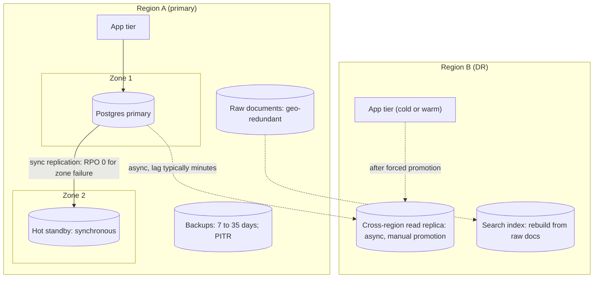
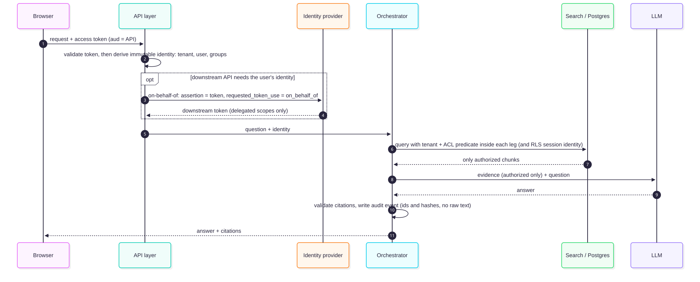
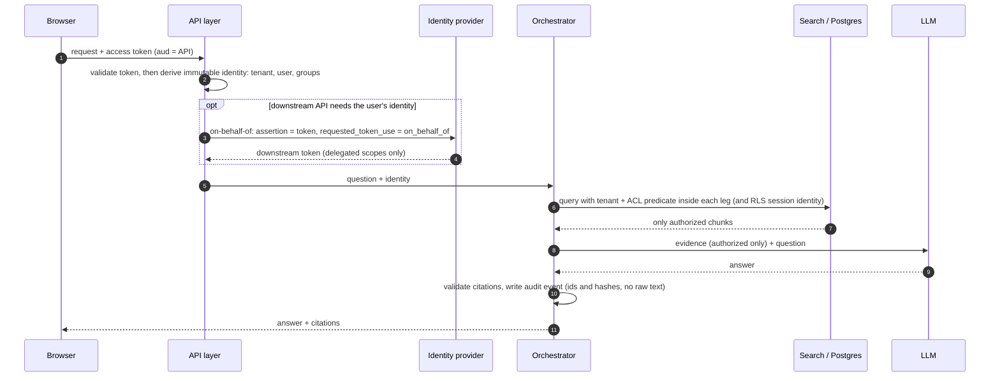
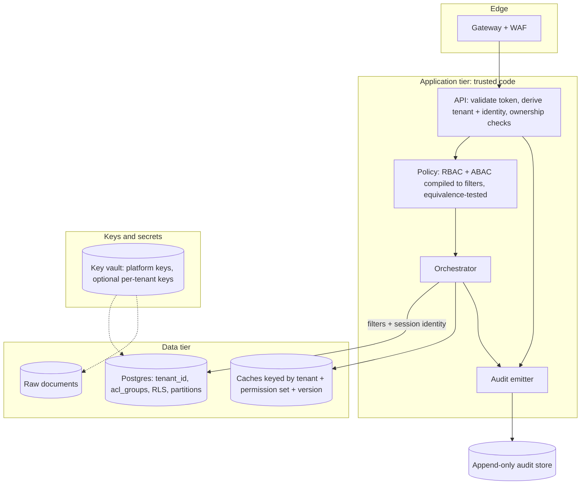

# Chapter 8 — Enterprise RAG Architecture

> **Evidence legend.** **[S#]** = supported by a source in References (IDs map to `project-management/RESEARCH-REGISTER.md`). **[E]** = engineering recommendation/reasoning. **[A]** = assumption. **[I]** = illustrative, not executed. **[X]** = executed and verified in this repository. **[V]** = vendor-reported. **[N]** = not researched. Research date: 2026-11-07. **Nothing in this chapter is legal advice.** Regulatory statements are limited to the provisions quoted from the cited texts; compliance decisions need legal review.

## 8.1 Learning Objectives

After this chapter you can:

1. Choose between single-tenant and multi-tenant designs and between shared and isolated indexes, and justify the choice with isolation, cost and operational consequences.
2. Layer tenant isolation (identity, API, retrieval, data tier, network, cryptography, caches, logs) so that no single control is the only boundary.
3. Distinguish RBAC from ABAC, implement document-level permissions, and **prove** that your search filter matches your policy.
4. Propagate the end user's identity from the browser to the data layer without forwarding tokens unsafely.
5. Explain why security filtering must happen **during retrieval** and cannot be bolted on after generation.
6. Map GDPR and India DPDP obligations to architectural mechanisms (erasure, retention, security, accountability) and know where the mapping needs legal input.
7. Design availability, backup and disaster recovery for both the relational store and the search index, using documented service behaviour.

## 8.2 Problem Statement

A prototype RAG system serves one team's documents. An enterprise system serves many tenants (customers or business units) and many users inside each tenant, over documents with different owners, classifications, regions and retention rules, while meeting audit, residency and recovery requirements. The failure that ends careers is not a wrong answer; it is **a right answer from a document the caller was never allowed to read**. Everything in this chapter exists to make that structurally difficult, detectable when it happens, and recoverable.

## 8.3 Why It Matters in Production

- Retrieval turns an authorisation problem into a **content-disclosure** problem: anything placed in a prompt can appear in the answer (Chapters 1, 7).
- Tenancy choices are **expensive to reverse**: moving between index topologies means re-ingesting or copying data (Azure AI Search cannot move an index between services; data must be copied [S76]).
- Regulators and customers ask for evidence: who accessed what, can it be erased, where is it processed, can you restore it.
- Reliability and security interact: a DR failover that drops access-control metadata is a security incident.

## 8.4 Core Concepts

### 8.4.1 Tenancy models and index topology

**Single-tenant vs. multi-tenant.** A multi-tenant application provides the same capabilities to many tenants who cannot see or share each other's data [S76]. Single-tenant deployments (one stack per tenant) give the strongest isolation and the highest per-tenant cost and operational load [E]; they suit few, large, regulated tenants.

**Index topologies.** Azure AI Search documents four patterns, a useful vocabulary even for other engines [S76]:

| Model | Isolation | Cost / density | Operational notes |
|---|---|---|---|
| **One index per tenant** (shared service) | Per-index boundary — but the index name in a request is **not** an authorization boundary; use index-scoped roles or route through a trusted app tier that derives the tenant's index from authenticated context [S76] | Good density; can oversubscribe capacity across tenants with uneven load [S76] | S3 High Density mode supports many small indexes; total index count per service is limited by tier [S76] |
| **One service per tenant** | Strongest data and workload separation [S76] | Highest cost per tenant; each service counts against tier, subscription and region limits [S76] | Maximum isolation; plan quotas, regions, subscriptions [S76] |
| **Hybrid** (large tenants on dedicated services, small tenants share) | Mixed | Matches skewed tenant sizes | Needs a **tenant-placement catalog** mapping tenants to service and index, and migration procedures [S76] |
| **One index for many tenants** (tenant id filter) | Weakest: shared capacity, schema, relevance scoring; a trusted app layer must derive the tenant id from authenticated context and apply the filter to **every** operation; never accept a tenant id from an untrusted client [S76] | Highest density | Shared scoring statistics are not tenant-scoped, so other tenants' documents can affect relevance scores [S76] |

Two warnings from the same source apply to any design: **do not give tenants API keys for a shared service** (keys grant service-level access, not tenant-aware authorisation), and note that **indexes cannot be moved between services — data must be copied** [S76]. The vector-store patterns of Chapter 5 (shared index with filter, partitions, shard per tenant, tiered) map onto this table [S42, S45].

**Data partitioning [E].** Partition by `tenant_id` first, then by something that bounds growth (time, collection) for large tenants. In Postgres, list partitioning or separate tables for large tenants, plus partial or per-tenant vector indexes (Chapter 5, [S1]).

**Selection guidance [E].**

| Situation | Default topology |
|---|---|
| Many small tenants, low regulatory pressure | Shared tables with `tenant_id` + RLS; exact search for small tenants; shared statistics acceptable |
| Skewed sizes; a few very large tenants | **Tiered**: shared for the long tail, dedicated partitions/indexes (or services) for large tenants |
| Strict contractual/regulatory isolation or residency per tenant | Per-tenant database or service in the tenant's region |
| Internal enterprise assistant (one tenant) | Single tenant; the isolation problem becomes **document-level permissions** |

### 8.4.2 Isolation as layers (defence in depth)

No single control is trusted alone [E]:

| Layer | Control | Fails if… |
|---|---|---|
| Identity | Authenticated user; tenant derived from token, not from request body | Client can choose its tenant |
| API | Object-level authorization on conversation/document ids (BOLA) [S54] | Ownership not checked |
| Retrieval | Tenant + ACL filters inside each retrieval leg, before limits (Ch. 5–9) | Filter applied after limit or in one leg only |
| Data tier | Postgres RLS / partitions / separate indexes [S4] | App connects as owner/superuser |
| Network | Private endpoints, single public entry, egress allow-list [S54, S75] | Public endpoints left on |
| Cryptography | TLS in transit; encryption at rest; optional customer-managed keys [S75] | Keys shared across tenants when per-tenant keys are required |
| Cache | Keys include tenant, permission set, index version (Ch. 7) | Key omits tenant/permissions |
| Logs/telemetry | No raw prompts/documents; hashes and ids (Ch. 7) | Logs become a side channel |
| Evaluation | Cross-tenant and ACL regression tests in CI | Isolation silently regresses |

### 8.4.3 RBAC, ABAC and document-level permissions

**Definitions.** NIST SP 800-162 defines ABAC as a logical access-control methodology where authorization for operations is determined by evaluating **attributes associated with the subject, object, requested operations and, in some cases, environment conditions** against policy, rules or relationships [S74] (the page reviewed is a withdrawn 2014 version superseded by a later revision; its abstract does not compare ABAC with RBAC). **RBAC** grants permissions to roles and roles to users — simple and auditable, but coarse; ABAC expresses rules such as "clearance ≥ classification" or "EU-resident data only for EU staff" [E].

**Practical hybrid [E]:** use RBAC for *coarse* entitlements (which application features, which tenant) and ABAC-style attributes plus group-based ACLs for *document* decisions.

**Document-level permission designs on Azure AI Search [S72]:**

| Approach | Status | Notes |
|---|---|---|
| **Security filters** | GA, API-agnostic | Your app passes the caller's user/group identity strings into a filter; "string comparison" only — no authentication by the index [S72, S8] |
| **POSIX-like ACL / RBAC scopes** | **Preview** | The Entra principal behind the query token is compared to permission metadata (ADLS Gen2 ACLs; RBAC scopes for ADLS Gen2 and blobs) [S72] |
| **Purview sensitivity labels** | **Preview** | Labels extracted by the indexer and enforced against the caller's Entra token and Purview policy; single-tenant only; RBAC auth required [S72] |
| **SharePoint ACLs** | **Preview** | Indexer extracts permission metadata for query-time checks [S72] |

For the token-based native approaches, the caller's Entra token is attached in the `x-ms-query-source-authorization` header and Azure AI Search trims results to documents whose **synchronized** permission metadata allows access [S72]. Features marked preview carry no SLA and are not recommended for production workloads [S72]. If chunking is used, permission metadata must be projected to **each chunk row** or chunk-level references are not filtered [S72].

**Synchronization lag is a security property [S72, X].** Azure states plainly that permission changes in the source (Entra group membership, ADLS ACLs, Purview labels, SharePoint ACLs) are reflected in results only after the metadata is synchronised to the index (indexer run, push update, or refresh); for SharePoint, changes inherited from parent scopes require an explicit refresh [S72]. Design implications:

1. **Store group identifiers in the document ACL, not expanded user lists, and resolve the caller's groups at query time from the current token.** Executed [X]: when the ACL lists groups and the caller's groups come from the token, removing a user from a group takes effect immediately; when the ACL was expanded to user ids at ingest, the removed user keeps access until the next sync (`docs/exercises/ch08_authz_model.py`, scenario 4). Azure's guidance also prefers groups over individual users [S72].
2. Measure and alert on **ACL-sync lag**; define a maximum revocation window as a requirement.
3. **Fail closed**: documents with missing or unparseable ACL metadata are not returned [E, X scenario 5].

**Prove the filter matches the policy [X].** Policy engines (the "decision point") and search filters (the "enforcement point") drift apart over time. The executed demo defines a reference ABAC policy (tenant must match; clearance ≥ classification; EU-bound documents only for EU users; public documents readable in-tenant; otherwise group ACL or owner-department for internal-or-below; missing ACL denies), **compiles it into a filter over stored document attributes only**, and runs a randomized property test: the compiled filter and the policy evaluator agreed on **20,000** generated (user, document) pairs. The test has teeth: five injected defects in the compiled filter (tenant check removed; region rule removed; clearance off-by-one; owner rule broadened; missing-ACL allowed) were each caught **[X]**. Run it as a CI test whenever policy or schema changes [E]. It tests the *logic*, not a real search engine or database.

### 8.4.4 Identity propagation

The OAuth 2.0 **on-behalf-of (OBO)** flow lets a middle-tier web API call a downstream API using the user's identity; delegation passes the user's identity and permissions through the request chain [S73]. Key points from Microsoft's documentation [S73]:

- The middle tier requests a token for the downstream API with `grant_type=urn:ietf:params:oauth:grant-type:jwt-bearer`, `requested_token_use=on_behalf_of`, and an `assertion` that is the access token it received, whose audience must be the middle tier itself.
- OBO uses **delegated scopes only**; *roles* remain attached to the user and never to the application acting on the user's behalf, to avoid the user gaining permissions they should not have.
- **Do not send tokens issued to the middle tier to anywhere except the intended audience**; relaying them to clients risks interception, defeats Conditional Access step-up (such as MFA) and device-based policies.
- When the downstream API has Conditional Access (for example MFA), the middle tier must surface the error to the client as HTTP 401 with a `WWW-Authenticate` header carrying the claims challenge; clients must not retry with a cached token.
- OBO works for **user principals** only; consent is gathered up front (known client applications, `.default`, preauthorised applications, admin consent).
- The documentation also warns not to read or validate tokens for APIs you do not own.

**Architecture rules [E]:**

1. Validate the incoming token (issuer, audience, signature, expiry) at the API layer; derive an **immutable identity object** `(tenant_id, user_id, groups, attributes)` and pass it to every stage (Chapter 7).
2. **Tenant comes from the token (or a verified mapping), never from the request.**
3. When calling data services, use the **user's identity where the service supports it** (e.g., Azure AI Search native token-based trimming via OBO-obtained tokens — an inference joining [S72] and [S73]), or pass the identity into filters you control (security filters, RLS session variables). Never query as an all-powerful service identity without applying the caller's filters.
4. Service-to-service credentials: managed identity with least privilege; prefer Entra over keys [S54, S18].
5. For background jobs without a user (ingestion), use a service identity with narrow, separate permissions and **no retrieval rights**.

### 8.4.5 Row-level security in PostgreSQL

RLS applies per-user filtering on top of privileges: once enabled, all normal access must be allowed by a policy and the default is **deny**; `USING` governs which existing rows are visible or targetable, `WITH CHECK` governs rows that may be written (defaulting to `USING`); permissive policies combine with OR, restrictive with AND [S4]. Caveats [S4]:

- **Bypass:** superusers and roles with `BYPASSRLS` always bypass; table owners bypass by default unless `FORCE ROW LEVEL SECURITY` is set. The application must connect as a **non-owner, non-superuser, non-BYPASSRLS** role [S4, ADR-001].
- **Referential-integrity checks bypass RLS**, so they can act as covert channels; schema and policy design must account for this [S4].
- **Policies with sub-selects** can create race conditions under `READ COMMITTED`; the docs show a case where a user briefly sees a row after a privilege change; fixes include `SELECT ... FOR SHARE` in the sub-select or locking, with performance costs [S4].
- **Performance:** policies that check only the current row's values are the simplest and fastest — prefer that design [S4].
- `row_security = off` does not bypass RLS; it raises an error whenever a policy would filter rows, so backups don't silently omit data [S4].

**Design for RAG [E]:** denormalise `tenant_id` and `acl_groups` onto the `chunks` table so the policy is a **current-row predicate** (e.g., `tenant_id = current_setting('app.tenant_id')::uuid AND acl_groups && string_to_array(current_setting('app.groups'), ',')`). Setting per-request session variables is a common pattern; with **connection pooling** it must be done per transaction (`SET LOCAL` / `set_config(..., true)`) and verified by a test that a pooled connection never carries the previous request's identity. RLS is a *backstop*: the application still adds explicit predicates for index-friendliness (ADR-004), and both are tested separately.

**Executed against PostgreSQL 16.12 + pgvector 0.8.7 [X]** (`scripts/verify-sql/03-rls.sql`, run by `python -I scripts/verify-sql.py`; 20,000 chunk rows across three tenants; table owned by a separate non-login role; application role is not owner, not superuser, no `BYPASSRLS`; policy exactly as above). Results, suite run 2026-11-07:

| Check | Observed |
|---|---|
| Superuser and table owner (no `FORCE`) | See all 20,000 rows — bypass confirmed |
| Owner after `FORCE ROW LEVEL SECURITY`, no identity set | Subject to the policy; the query **errors** (`unrecognized configuration parameter "app.groups"`) — fails closed, noisily |
| Application role, tenant 1, groups `eng,hr` | **673 rows = exactly** what a direct `WHERE` predicts |
| Application role after the `SET LOCAL` transaction commits | The identity is gone; the next query **errors** (`invalid input syntax for type uuid: ""`) — fails closed |
| Cross-tenant `INSERT` as the application role | Rejected: `new row violates row-level security policy` (`WITH CHECK` defaults to `USING`, as documented) |
| `row_security = off` as the application role | **Errors** (`query would be affected by row-level security policy`) instead of bypassing — as documented |
| **Session-level** `set_config(..., false)`, then a second request that never set an identity | The second request still saw **2,962 rows of another tenant** — **identity leaks** across transactions on a pooled connection |
| RLS + HNSW, tenant with ~5% of rows, `LIMIT 10`, default settings | **2.03 of 10** results on average; **10.00** with `hnsw.iterative_scan = relaxed_order`; `EXPLAIN` shows the policy predicates as a `Filter:` on the `Index Scan` |

Three design consequences [E, from these measurements]: (1) **never use session-scoped identity settings with a connection pool** — use transaction-scoped settings (`SET LOCAL`) so a forgotten identity fails closed instead of leaking; (2) a missing identity *errors* rather than returning zero rows (good for detection: alert on those errors), and wrapping the setting in `current_setting(name, true)` would turn it into a silent empty result — a deliberate choice; (3) **RLS does not protect you from filter starvation** — as a post-index filter it inherits the problem from Chapter 5, so large-tenant partitions, iterative scans and a recall-under-filter test remain necessary (ADR-006). Not tested here: behaviour under real pooler software (PgBouncer transaction pooling), policy cost at scale, partitioned tables, and the referential-integrity covert channel the documentation warns about.

### 8.4.6 Private networking, encryption and key management

- **Network.** Azure's baseline puts Application Gateway with WAF as the only internet-facing entry and uses private endpoints and egress control [S54]; Azure AI Search supports private endpoints (private-endpoint connections are described as internal traffic using Private Link) [S75]. When Azure Storage and Azure AI Search are in the same region, traffic uses a private IP over the Microsoft backbone, and you cannot configure IP firewalls or a private endpoint on the storage account for those connections [S75] — a detail that surprises teams relying on storage firewalls.
- **In transit.** Azure AI Search enforces TLS 1.2 or 1.3 on port 443; TLS 1.0/1.1 are unsupported [S75].
- **At rest.** Service-managed 256-bit AES encryption (FIPS 140-2) is automatic on all tiers; **customer-managed keys** add a second encryption layer on top of service-managed encryption [S75]. Postgres backups on Azure are encrypted [S77].
- **In use.** Azure AI Search offers confidential computing for hardware protection of data in use, with limited regional availability, restricted features and higher cost [S75].
- **Key management [E].** Keys in a managed vault with rotation and access auditing; managed identity to reach keys; decide **per-platform keys vs. per-tenant keys**: per-tenant keys give crypto-shredding and customer control but multiply operational complexity (rotation, outage blast radius) and are not offered uniformly across services — per-tenant key support in the specific services is **[N] not researched**.

### 8.4.7 Data residency

Azure AI Search stores and processes data within the chosen **geography**, may replicate within that geography for availability (Brazil South stays within the region), and data can leave the geography if you enable features that write to Azure Storage elsewhere (enrichment cache, debug sessions, knowledge stores); **object names** (indexes, fields, indexers) may be processed outside the region in telemetry, so avoid sensitive data in names [S75]. Microsoft states it does not use Azure AI Search customer data to train or improve models [S75]. For model endpoints and embeddings, residency depends on the deployment type and provider terms — **[N] not researched** (OI-033); every external call in the pipeline (OCR, embeddings, reranking, LLM) must be mapped to a region and a data-handling term (Chapters 2, 3, 7) [E]. Residency is a **routing** problem: tenant → region → stack, with no cross-region fallbacks that violate the tenant's constraint [E].

### 8.4.8 GDPR and DPDP considerations (architecture mapping)

*Not legal advice. Provisions below are quoted from the cited texts as read; the GDPR page was read in excerpts and the DPDP text only through a third-party copy (OI-028, OI-029).*

| Obligation (source) | Architectural mechanism |
|---|---|
| **GDPR Art 5(1)(e) storage limitation**: kept in identifiable form no longer than necessary [S78] | Retention policies on raw documents, chunks, embeddings, conversations, logs; automated purge jobs (Chapter 3 lifecycle) |
| **Art 5(1)(f)** appropriate security; **Art 32(1)(a)–(d)**: pseudonymisation and encryption; ongoing confidentiality, integrity, availability and resilience; ability to restore availability and access in a timely manner; regular testing of measures [S78] | Encryption, access controls, HA/DR (§8.4.10), restore drills, security tests in CI |
| **Art 5(2) accountability**: controller must be able to demonstrate compliance [S78] | Audit records (§8.4.9), policy-as-code tests, documented data maps |
| **Art 17(1) erasure** where one of several grounds applies, e.g. data no longer necessary for the purposes, consent withdrawn, unlawfully processed [S78] | **Deletion propagation** across source, raw store, chunks, embeddings, caches, derived summaries, conversation history (Chapter 3 §3.4.7); delete→query tests |
| **Art 25(1) data protection by design**: appropriate technical and organisational measures, such as pseudonymisation, to implement principles such as data minimisation [S78] | Minimise what is embedded/logged; avoid indexing unnecessary personal data; classify at ingest |
| **DPDP s.8(5)** reasonable security safeguards; **s.8(6)** breach intimation to the Board and affected Data Principals; **s.8(7)** erase on withdrawal of consent or when the purpose is no longer served, subject to legal retention [S79, Tier 3 copy] | Same mechanisms; incident response procedure; erasure workflow |

**Hard problems the mapping exposes [E]:** (1) **Backups vs. erasure** — Azure Postgres backups are retained 7 days by default and up to 35 days [S77]; how erased personal data in backups is treated is a legal and policy question, not something this handbook can settle. (2) **Embeddings are derived data**: whether they count as personal data is **not researched** (OI-012); treat them as such unless counsel advises otherwise. (3) **Transfers** between regions/providers (GDPR Chapter V; DPDP s.16) were not read (OI-029). (4) The DPDP Act's commencement is phased and unverified (OI-028).

### 8.4.9 Auditability

Do not rely on the platform to tell you who read what: Azure AI Search logs create/read/update/delete operations and query text but **does not log user identities**, and resource logs don't record individual user identities or detailed document content [S75]. Your application must produce the audit trail [E]:

```text
audit_event(
  time, request_id, tenant_id, user_id, action = query|upload|delete|admin,
  question_hash, evidence = [(chunk_id, doc_id, doc_version)], policy_version,
  prompt_version, model_id, status, token_counts )
```

Properties [E]: append-only; tamper-evident; separate retention from content stores; **no raw prompt text or document text**; access to the audit store is itself audited; record *denials* (a blocked cross-tenant attempt is the most valuable event you have). Chapter 23 covers governance use.

### 8.4.10 High availability, backup and disaster recovery

**PostgreSQL (Azure Database for PostgreSQL) — documented behaviour [S77]:**

| Configuration | Documented SLA | Failure behaviour |
|---|---|---|
| Zone-redundant HA | 99.99% | Standby in another zone; synchronous replication; zone failure → automatic failover, typically 60–120 s, zero data loss |
| Zonal HA | 99.95% | Primary and standby in one zone; protects node failures, not a zone outage |
| No HA | 99.9% | Single server |

Further facts [S77]: HA requires General Purpose or Memory Optimized tiers; the standby is billed like the primary; **HA replicates user errors** (an accidental `DROP`) — recover with point-in-time restore from backup; backups are automatic, retained 7 days by default and up to 35 days, with geo-redundant option; **cross-region read replicas** (up to five) are asynchronous, promotion is **manual** (Azure does not promote automatically even in a region failure), forced promotion typically completes in 1–3 minutes and loses unreplicated data, and replication lag is typically at least several minutes; a promoted replica has no HA until you configure it.

**Search index (Azure AI Search) [S54, S76]:** zone redundancy needs at least three replicas in the baseline architecture [S54]; the availability SLA requires at least two replicas for query-only workloads or three for workloads that include indexing [S76]; the baseline notes AI Search has **no native restore**, so keep a source of truth and **rebuild** the index [S54]; a search service is a single-region resource, so regional resilience needs separate regional deployments [S76].

**DR design for RAG [E]:**

1. **Source of truth hierarchy:** raw documents (object store, geo-redundant) → derived chunks/embeddings (rebuildable) → conversations/audit (not rebuildable; back up). Rebuild cost and time **are** the DR plan for the index.
2. Document **RPO/RTO per data class** (documents, ACL metadata, index, conversations, audit) using the figures above only as inputs, not promises.
3. Include **ACL metadata** in whatever you restore; a restored index with stale ACLs is a leak. Prefer rebuilding ACLs from the identity source after failover [E].
4. **Test**: forced failover drills, point-in-time restore drills, index rebuild timing, and "after restore, run the cross-tenant test suite" [E, S77 recommends regular DR drills].
5. Single-region baselines have no regional failover [S54]; make that explicit in your risk register until multi-region is funded.

<!-- figure:08-ha-dr-topology -->


*Figure 8.1: High availability, backup and disaster recovery. Original diagram; source below.*

<details><summary>Mermaid source</summary>



</details>
<!-- /figure -->

*Original diagram by the handbook author, using facts from [S77, S54, S76]; source `docs/assets/diagrams/08-ha-dr-topology.mmd`.*

### 8.4.11 Why security filtering must happen during retrieval

Consider the three places a filter can sit [E]:

| Where | What happens | Verdict |
|---|---|---|
| **After generation** ("ask the model not to reveal X", or scrub the answer) | The prompt already contained the unauthorised text; the model may paraphrase, partially quote, or be induced to reveal it; scrubbing cannot reliably recognise paraphrase; logs/traces/caches may already contain it | **Unsafe.** The prompt is not an authorization boundary (OWASP: untrusted content and model output must be treated as untrusted [S57]) |
| **After retrieval, before the prompt** (filter the candidate list) | Unauthorised chunks never reach the model, but top-K was spent on them: authorised users get **fewer or worse** results (filter starvation; Ch. 5) and unauthorised chunks sat in memory, caches and traces | Safe-ish, **degrades quality**; acceptable only as a second line |
| **Inside retrieval** (predicate in each leg, before the candidate limit) | Only authorised chunks are scored, ranked and limited | **Required.** Executed: with limit-after-filter the authorised user gets the right two documents, while the unfiltered pipeline would have returned an unauthorised one first **[X]** (`ch08_authz_model.py` scenario 3; `ch07_orchestrator_contracts.py` scenario 1) |

<!-- figure:08-identity-propagation -->


*Figure 8.2: Why security filtering must happen during retrieval. Original diagram; source below.*

<details><summary>Mermaid source</summary>



</details>
<!-- /figure -->

*Original diagram by the handbook author, informed by [S73, S72]; source `docs/assets/diagrams/08-identity-propagation.mmd`.*

## 8.5 Architecture

<!-- figure:08-enterprise-isolation-architecture -->


*Figure 8.3: Architecture. Original diagram; source below.*

<details><summary>Mermaid source</summary>



</details>
<!-- /figure -->

*Original diagram by the handbook author; source `docs/assets/diagrams/08-enterprise-isolation-architecture.mmd`.*

## 8.6 Practical Example (Illustrative)

**Scenario [I]:** a SaaS vendor with 2,000 customer tenants (1,950 small, 50 large), EU customers requiring EU-only processing, and per-user permissions inside each tenant.

| Decision | Choice | Why [E] |
|---|---|---|
| Topology | Tiered: shared Postgres tables with RLS for small tenants; dedicated partitions/indexes for the 50 large; EU tenants in an EU-region stack | Matches skew (Ch. 5 §5.9) and residency (§8.4.7) |
| Document ACL | `acl_groups` array of group ids from the tenant's identity source; resolved at query time from the token | Immediate revocation [X]; Azure also prefers groups [S72] |
| Policy | Group-based ACL + classification/clearance ABAC attributes, compiled to filters | Equivalence-tested [X] |
| Identity | OIDC token → immutable identity object; OBO only where a downstream service needs the user [S73] | §8.4.4 |
| Search | Hybrid (Ch. 9) with filters in both legs; per-tenant evaluation of recall | Shared statistics risk [S76] |
| DR | Zone-redundant HA Postgres; geo-redundant raw documents; index rebuilt from raw; ACL rebuilt from identity source | §8.4.10 |
| Audit | Application-level, append-only, denials recorded | Platform does not log users [S75] |

## 8.7 Implementation

Executed: `docs/exercises/ch08_authz_model.py` **[X]** (2026-11-07, Python 3.14.2; all assertions passed; five injected defects all caught). Run:

```bash
python -I docs/exercises/ch08_authz_model.py
```

It verifies: explicit ABAC decisions with deny-by-default, tenant-first and fail-closed behaviour; policy↔filter equivalence on 20,000 randomised pairs; limit-after-filter; group-id vs. user-expanded revocation behaviour; and missing-ACL exclusion. It does **not** use a real identity provider, token validation, a search engine, or Postgres. Chapter 7's contracts demo [X] covers cache isolation and prompt confinement. The RLS policy and the transaction-scoped session-variable pattern **were executed** against a real PostgreSQL + pgvector container (§8.4.5, `scripts/verify-sql/03-rls.sql`); that suite checks Postgres' documented behaviour on a synthetic table, not your production schema. M5 implements the real schema and tests it (cross-tenant tests, pooled-connection identity tests with the actual pooler, policy-as-code tests).

## 8.8 Trade-offs

| Decision | Option A | Option B | Trade-off |
|---|---|---|---|
| Shared vs. dedicated index per tenant | Density, simplicity [S76] | Isolation, noisy-neighbour protection, simple deletion [S76, S45] | Cost vs. blast radius |
| Group ACLs vs. user-expanded ACLs | Instant revocation, small metadata [X, S72] | Faster/simpler filters in some engines | Revocation window |
| Native token-based trimming (preview) vs. security filters (GA) | Less custom code; Entra-aligned [S72] | GA, API-agnostic [S72] | Maturity/SLA vs. integration |
| RLS | Backstop independent of app bugs [S4] | Policy complexity, performance, role discipline [S4] | Defence in depth vs. complexity |
| Per-tenant keys | Crypto-shredding, customer control | Operational complexity, uneven service support [N] | Per tenant requirement |
| Single region vs. multi-region | Simplicity; baseline [S54] | Resilience; cost; residency complexity | RTO/RPO targets |

## 8.9 Failure Modes

| Failure | Root cause | Symptom | Detection | Mitigation / recovery |
|---|---|---|---|---|
| Cross-tenant retrieval | Missing predicate in one leg/path | Another tenant's text in answers | Cross-tenant CI tests; audit denials | Predicates in every leg; RLS backstop; tests per leg |
| Policy–filter drift | Policy changed, filter not [X] | Over/under-sharing | Equivalence property test | CI gate on policy/schema changes |
| Stale ACL after revocation | User-expanded ACLs; sync lag [S72, X] | Revoked user still retrieves | ACL-sync lag metric; revocation test | Group ACLs; max-lag SLO; re-sync triggers |
| RLS bypass | App connects as owner/superuser/BYPASSRLS [S4] | Policies silently ignored | Startup role check; test as app role | Dedicated role; `FORCE RLS` |
| Pooled-connection identity leak | Session identity not reset per request | Previous user's identity applied | Pooling tests | `SET LOCAL` in transaction; reset |
| Client-chosen tenant | Tenant read from request | Horizontal escalation | Authorization tests | Derive from token [S76] |
| Token misuse | Middle-tier tokens forwarded [S73] | Bypassed Conditional Access | Review of token flows | OBO; never relay tokens |
| Sensitive object names | Tenant data in index/field names [S75] | Data processed outside region | Naming review | Opaque names |
| Restore without ACLs | DR restore of index only | Leak or lockout after failover | Post-restore test suite | Rebuild ACL from identity source |
| HA replicates a destructive error | Accidental DROP replicated [S77] | Data loss on both nodes | Change controls | PITR; restricted DDL |
| Forced promotion data loss | Async cross-region lag [S77] | Missing recent writes | Lag monitoring | Accept RPO or add synchronous strategy; replay from queue |
| Erasure incomplete | Derived data missed (embeddings, caches, backups) | Subject data remains | Delete→query test; data map | Deletion propagation (Ch. 3); policy for backups [legal] |

## 8.10 Security Considerations

This chapter is the security architecture's foundation; Chapter 22 builds the threat model on it. Key points: no single-layer isolation (§8.4.2); filters inside retrieval (§8.4.11); never forward tokens [S73]; do not hand tenants service keys [S76]; keep raw lexical/vector scores out of responses (shared-statistics side channel, Ch. 9 [S76]); treat ACL metadata as security-critical data with integrity controls; separate service identities for ingestion and retrieval; log denials; prefer preview features only after a risk review (no SLA, not recommended for production [S72]).

## 8.11 Performance Considerations

- Policy complexity trades against latency: current-row predicates are the fastest RLS form [S4]; push complex logic to **ingest-time denormalisation** (compute `acl_groups`, classification, region once) [E].
- Per-request identity resolution (group lookup) adds latency; cache group membership per token lifetime with a short TTL, accepting a bounded revocation window you define [E].
- Dedicated partitions/indexes for large tenants improve ANN recall under filters and isolate noisy neighbours (Ch. 5) [E].
- HA adds a small commit-latency increase for synchronous replication; its impact varies by workload, SKU and region [S77]. No benchmark figures are claimed here.

## 8.12 Cost Considerations

Standby servers are billed at the primary's rate; cross-region replicas add compute, storage and transfer costs [S77]. Service-per-tenant has the highest per-tenant cost, index-per-tenant a variable cost model, and S3 HD can reduce per-tenant cost for many small indexes [S76]. Customer-managed keys and confidential computing add cost and constraints [S75]. Dedicated per-tenant stacks multiply operations cost [E]. Zone-redundant AI Search needs at least three replicas [S54]. Pricing was not researched; no figures are given.

## 8.13 Production Recommendations

1. Pick the tenancy topology per tenant-size distribution and regulatory needs; document the **tenant-placement catalog** and migration procedure [S76].
2. Derive tenant and identity from validated tokens; build one immutable identity object; never trust client-supplied tenant ids.
3. Enforce tenant + ACL predicates inside every retrieval leg; back them with RLS or physical partitioning; connect as a restricted role.
4. Store group ids in ACLs; resolve caller groups at query time; define and monitor a maximum revocation window.
5. Compile policy to filters and gate CI on a policy↔filter equivalence test.
6. Use OBO for downstream user-context calls; never relay middle-tier tokens; surface claims challenges.
7. Fail closed on missing ACL metadata; include permission fields on every chunk row.
8. Implement application-level, append-only audit including denials; no raw content in logs.
9. Map every external call to a region and a data-handling term; enforce residency by routing.
10. Define RPO/RTO per data class; rebuild the index from raw documents; rebuild ACLs from the identity source; run restore and failover drills, then the cross-tenant suite.
11. Treat deletion as an end-to-end feature (documents, chunks, embeddings, caches, conversations) with tests; take legal advice on backups and derived data.

## 8.14 Architecture Decision Guidance

See **ADR-006** (Multi-tenancy and isolation, Proposed). Default for the reference implementation: shared Postgres with `tenant_id`, group-based `acl_groups` on every chunk, RLS as backstop, partitions or dedicated indexes for large tenants, policy-to-filter equivalence tests in CI, application-level audit, and an explicit HA/DR plan on Azure Database for PostgreSQL with the index rebuilt from raw documents. Move to per-tenant stacks when contracts demand physical isolation or residency per tenant; to Azure AI Search native document-level trimming when preview features reach GA for your sources and you accept the Entra-token integration; to per-tenant keys when a tenant requires crypto-shredding and your services support it [N].

## 8.15 Interview Questions

1. **Why must security filtering happen during retrieval rather than after generation?** The prompt already contains unauthorised text; paraphrase defeats output scrubbing; top-K starvation if filtered after retrieval; filters inside each leg before the limit are the only safe option [S57, X].
2. **Shared index vs. index-per-tenant vs. service-per-tenant?** Density vs. isolation vs. cost; the index name is not an auth boundary; don't give tenants API keys; scoring statistics are shared in a shared index; indexes can't be moved between services [S76].
3. **How would you implement document-level permissions?** Group-id ACLs on every chunk, caller groups from the token at query time, compiled filters with an equivalence test, RLS backstop; fail closed [X, S72, S4].
4. **A user is removed from a group; when do they lose access?** Immediately if ACLs hold group ids and groups are resolved from the current token; after the next sync if ACLs were expanded to users [X, S72]. State the max revocation window.
5. **Explain OBO and when you'd use it.** Middle tier obtains a downstream token as the user (delegated scopes only); don't relay tokens; surface Conditional Access claims challenges as 401 [S73].
6. **RBAC vs ABAC?** Roles vs. attribute-based rules evaluated against policy [S74]; hybrid in practice.
7. **What are the RLS pitfalls?** Owner/superuser/BYPASSRLS bypass; RI checks bypass; sub-select races under READ COMMITTED; policy performance; `FORCE RLS` [S4].
8. **How do you design DR for a RAG system?** Raw docs as source of truth; rebuild index; rebuild ACLs; PITR for relational data; HA doesn't protect from user error; cross-region replicas promoted manually with data-loss risk; drills [S77, S54].
9. **How does GDPR's right to erasure affect the architecture?** Deletion propagation to chunks, embeddings, caches, conversations; retention limits; backups are a legal question [S78, E].
10. **What do you audit, and why does the platform's logging not suffice?** Who asked what, which evidence ids and versions, denials; Azure AI Search doesn't log user identities [S75].

## 8.16 Knowledge Checkpoint / Exercises

1. Run `ch08_authz_model.py`. Add a new ABAC rule ("legal hold documents readable only by `legal`") to both the evaluator and the compiled filter; extend the property test and confirm it still passes. Then introduce a deliberate discrepancy and confirm the test fails.
2. Write the RLS policy and the `chunks` DDL for your own schema (do not run it yet) and list five tests it needs, including a pooled-connection test.
3. Define the maximum revocation window for your organisation and the metric that proves you meet it.
4. Draw your tenant-placement catalog schema and the procedure to move a tenant from shared to dedicated.
5. Build a data map for one tenant: every store that holds derived personal data; then design the deletion sequence and its verification query.
6. Write the RPO/RTO table for documents, ACLs, index, conversations and audit; identify which are rebuildable.

## 8.17 Summary

Enterprise RAG is a multi-layer isolation problem: tenancy topology chosen by tenant-size distribution and residency, identity propagated from validated tokens (OBO where a downstream service needs the user), permissions modelled with group-based ACLs and attribute policies **compiled into retrieval filters and proven equivalent by test**, RLS as a backstop under a restricted role, and filters applied **inside** every retrieval leg before limits — never after generation. Platform capabilities matter and have caveats: preview-only native ACL trimming, synchronization lag as a security property, shared scoring statistics, no user identities in platform logs, no native index restore, manual cross-region promotion. Regulatory obligations translate into deletion propagation, retention, encryption, resilience and accountability mechanisms, with explicit legal gaps for backups, derived data and transfers. The executed demonstrations verified the policy–filter equivalence, revocation behaviour, limit-after-filter and fail-closed logic — and are explicit that they exercise logic, not a real database or identity provider.

## References

- [S1] pgvector README. https://github.com/pgvector/pgvector
- [S4] PostgreSQL 18 docs, *Row Security Policies*. https://www.postgresql.org/docs/current/ddl-rowsecurity.html
- [S8] Microsoft, *Security filter pattern — Azure AI Search* (2026-08-21). https://learn.microsoft.com/en-us/azure/search/search-security-trimming-for-azure-search
- [S18] Microsoft, *Managed identities in Azure Container Apps*. https://learn.microsoft.com/en-us/azure/container-apps/managed-identity
- [S42] Qdrant docs, *Multitenancy*. https://qdrant.tech/documentation/guides/multiple-partitions/
- [S45] Weaviate docs, *Data model concepts*. https://docs.weaviate.io/weaviate/concepts/data
- [S54] Microsoft, *Baseline Microsoft Foundry chat reference architecture*. https://learn.microsoft.com/en-us/azure/architecture/ai-ml/architecture/baseline-azure-ai-foundry-chat
- [S57] OWASP GenAI Security Project, *LLM01: Prompt Injection*. https://genai.owasp.org/llmrisk/llm01-prompt-injection/
- [S72] Microsoft, *Document-level access control — Azure AI Search* (2026-08-08). https://learn.microsoft.com/en-us/azure/search/search-document-level-access-overview
- [S73] Microsoft, *OAuth 2.0 On-Behalf-Of flow* (updated 2026-06-15). https://learn.microsoft.com/en-us/entra/identity-platform/v2-oauth2-on-behalf-of-flow
- [S74] NIST, *SP 800-162 Guide to ABAC Definition and Considerations* (2014; this version withdrawn 2019, superseded). https://csrc.nist.gov/pubs/sp/800/162/final (abstract)
- [S75] Microsoft, *Data, privacy, and built-in protections — Azure AI Search* (2026-02-24). https://learn.microsoft.com/en-us/azure/search/search-security-built-in
- [S76] Microsoft, *Multitenancy and Azure AI Search* (2026-10-27). https://learn.microsoft.com/en-us/azure/search/search-modeling-multitenant-saas-applications
- [S77] Microsoft, *Reliability in Azure Database for PostgreSQL* (2026-03-24). https://learn.microsoft.com/en-us/azure/reliability/reliability-database-postgresql
- [S78] European Union, *Regulation (EU) 2016/679 (GDPR)*, EUR-Lex. https://eur-lex.europa.eu/legal-content/EN/TXT/?uri=CELEX:32016R0679 (excerpts: Art 5(1)(e),(f), 5(2), 17(1), 25(1), 32(1)(a)–(d))
- [S79] India, *Digital Personal Data Protection Act 2023*, section 8 — third-party copy (Tier 3), https://www.dpdpa.com/dpdpa2023/chapter-2/section8.html (official text not retrieved; not legal advice)
