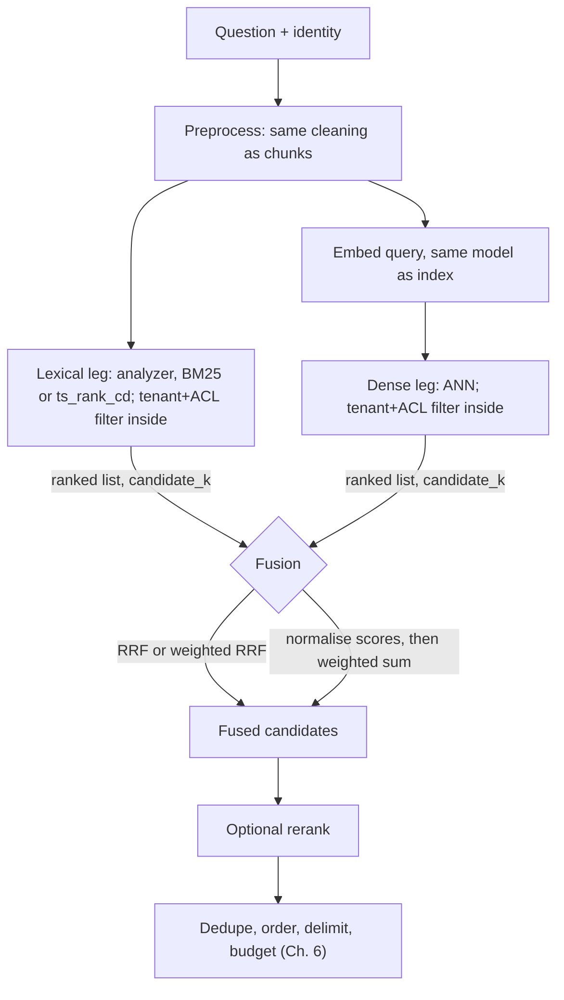

# Chapter 9 — Hybrid Search

> **Evidence legend.** **[S#]** = supported by a source in References (IDs map to `project-management/RESEARCH-REGISTER.md`). **[E]** = engineering recommendation/reasoning. **[A]** = assumption. **[I]** = illustrative, not executed. **[X]** = executed and verified in this repository. **[V]** = vendor-reported. **[N]** = not researched. Research date: 2026-11-07.

## 9.1 Learning Objectives

After this chapter you can:

1. Explain BM25 well enough to tune it: IDF, term-frequency saturation (k1), length normalisation (b).
2. State what PostgreSQL's built-in ranking does and does not do compared with BM25, and list the options for BM25 in Postgres with their licensing consequences.
3. Choose a fusion method — Reciprocal Rank Fusion, weighted RRF, or score normalisation — and explain why each behaves as it does.
4. Explain why exact identifiers, morphology and jargon are lexical problems and how analyzers and field weights address them.
5. Build a hybrid query that applies tenant and ACL filters inside both retrieval legs.
6. Tune hybrid search methodically instead of by folklore.

## 9.2 Problem Statement

Dense retrieval matches meaning; lexical retrieval matches terms. Enterprise questions need both: *"why did we drop Kafka?"* is semantic (the ADR may say "rejected the broker for operational reasons"), while *"E-4471"* or *"Policy 14.2(b)"* is an exact token. Each method fails where the other succeeds (Chapter 2 §2.4.5). The problem is to combine two rankings produced by incompatible scoring functions into one ranking that is better than either — and to do so under tenant and permission filters, inside a latency budget.

## 9.3 Why It Matters in Production

- **Azure's guidance**: scenarios such as product codes, specialised jargon, dates and people's names perform better with keyword search because it identifies exact matches, while vector search finds conceptually similar content; hybrid combines both in one request [S5].
- **Baselines matter.** BEIR evaluated 10 systems (lexical, sparse, dense, late-interaction, re-ranking) on 18 datasets and reports that BM25 is a robust baseline, while re-ranking and late-interaction models perform best zero-shot on average but at high computational cost [S64]. DPR, by contrast, reported beating a Lucene-BM25 baseline by 9–19% absolute top-20 accuracy on its QA datasets [S20]. These two results do not contradict each other: one is in-domain QA with training, the other is zero-shot across heterogeneous domains. **Do not assume dense beats BM25 on your corpus; measure** [E].
- **Failure is silent**: a missing identifier match returns plausible but wrong chunks (Chapter 6).

## 9.4 Core Concepts

### 9.4.1 BM25

BM25 scores a document for a query as a sum over query terms of **IDF × saturated term frequency with length normalisation**. Elastic's explanation of the components [S65]:

- **IDF** measures how often a term occurs across all documents and penalises common terms; it is computed from the document count and the number of documents containing the term, so rarer terms get a higher weight.
- **k1** limits how much a single query term can affect a document's score ("term-frequency saturation"). Higher k1 lets repeated occurrences keep adding more; at k1 = 0 only IDF affects the score. Default **1.2**.
- **b** scales the field-length ratio. Higher b amplifies the effect of a document being longer or shorter than average; b = 0 removes the length effect. Default **0.75**.
- Each additional occurrence of a term raises the score with diminishing returns.

The article shows the formula as an image. The standard textbook/Lucene form, which the demo implements, is **[E — formula text not verified against [S65]]**:

```text
score(q,d) = Σ_t IDF(t) · f(t,d)·(k1+1) / ( f(t,d) + k1·(1 − b + b·|d|/avgdl) )
IDF(t)     = ln( 1 + (N − n_t + 0.5) / (n_t + 0.5) )
```

**Executed verification of the described behaviours [X]** (`docs/exercises/ch09_hybrid_search.py`, Part A): with k1 = 0, a document's score equals IDF and is identical for 1 and 8 occurrences; with b = 0, a 2-term document and a 62-term document containing the same query terms score equally, whereas with b = 0.75 the shorter one scores higher; with default parameters, scores for 1, 2, 4, 8 occurrences were 0.428, 0.586, 0.718, 0.809 — gain per additional occurrence 0.158, 0.066, 0.023 — saturating; and a rarer term has a higher IDF than a common term. These confirm the *behaviours* the article describes, not the formula text.

**Important property for multi-tenant systems [E, S76].** IDF and average length are *collection statistics*. In a shared index they are computed over all tenants' documents; Azure notes that when tenants share an index, other tenants' documents can affect relevance scores because scoring statistics are not tenant-scoped [S76]. Qdrant offers a search parameter that scopes IDF statistics to a tenant (v1.19.0) [S42]. Consequences: ranking quality for a small tenant depends on other tenants' data, and (a security-hygiene inference [E]) scores are a weak side channel — never expose raw lexical scores to users.

### 9.4.2 Keyword search and analyzers

Lexical retrieval is only as good as the **analyzer**: tokenisation, case folding, stop words, stemming, synonym handling. The same document and query must pass through the same analysis [E; analogous to Azure's embedding-side rule of identical preprocessing, S55].

**Executed example [X] of an analyzer mismatch.** In the toy corpus of Part C, the query *"contractor leave"* ranks the less relevant policy document d3 ("…16 weeks of paid leave") **above** the fully relevant d4 ("Contractors are not covered by the parental leave policy…") under BM25: the tokeniser does no stemming, so "contractor" does not match "contractors", and d4 matches only on "leave". The character-trigram stand-in for dense retrieval got the order right (nDCG@3 1.00 vs. 0.86). The lesson is about analyzers, not about dense vs. lexical: a stemming analyzer would fix this lexical miss. **And real PostgreSQL does:** executed against PostgreSQL 16.12 [X] (`scripts/verify-sql/04-hybrid-fts-schema.sql`), `to_tsvector('english', 'Contractors are not covered') @@ websearch_to_tsquery('english', 'contractor')` is **true**, and the query `contractor leave` becomes `'contractor' & 'leav'` (the English configuration stems both words). So the BM25 miss above is an artifact of the *toy tokenizer*, not a property of Postgres full-text search; it is a good reminder to test your actual analyzer, not a toy one (Supabase's hybrid example likewise uses the English configuration [S71]).

**Exact identifiers** (error codes, policy numbers, SKU, ticket ids) need an analyzer that keeps them intact or matches them as phrases; default tokenisers may split `E-4471` into pieces that match many unrelated documents. **Measured in PostgreSQL 16.12 [X]**: the `english` configuration turns `E-4471` into the two lexemes `'e'` and `'-4471'` — the parser reads `-4471` as a *negative integer* — and `websearch_to_tsquery('english', 'E-4471')` yields the phrase query `'e' <-> '-4471'`. That matches the literal text `E-4471` (adjacent tokens) but will **not** match `E4471` or a bare `4471`, and the lexeme `e` carries almost no discriminating power by itself. Check what your own parser does with every identifier format in your corpus (`ts_debug` shows the token types). Practical options: a dedicated identifier field with exact matching, a regex-based extraction at ingest into a keyword field, and identifier-heavy queries in the golden set.

**Field weighting.** PostgreSQL lets you label lexemes with weights A–D (the default weight array for ranking functions is {D,C,B,A} = {0.1, 0.2, 0.4, 1.0}) [S3]; Azure AI Search uses scoring profiles for weighted fields (non-vector fields) [S55]; Weaviate sets per-property weights with `^` (e.g., `question^2`) [S70]. Put titles, headings and identifier fields in higher-weight fields [E].

### 9.4.3 Sparse retrieval beyond BM25

"Sparse" covers any retrieval over high-dimensional, mostly-zero term vectors. BM25 is the classic; learned-sparse models exist that expand terms with a neural model — **[N] not researched for this handbook**; pgvector supports a `sparsevec` type, which is relevant to storing such vectors [S1].

### 9.4.4 Lexical ranking in PostgreSQL

What the reviewed documentation says:

- PostgreSQL provides `ts_rank` (frequency of matching lexemes) and `ts_rank_cd` (cover density; also considers proximity of matches and needs positional information) with a normalisation bit-mask; the page states the ranking functions use **no global information**, so they cannot produce a true 0–100% score, and does not mention BM25 [S3].
- BM25's IDF uses collection statistics (document count, documents containing the term) [S65].

**Verified [X] — the structural difference is real.** In PostgreSQL 16.12 (`scripts/verify-sql/04-hybrid-fts-schema.sql`), a document containing a *rare* term once (document frequency 1) and a document containing a *common* term once (document frequency 3) received **identical** scores: `ts_rank` = 0.06079271 and `ts_rank_cd` = 0.1 in both cases. The built-in ranking functions therefore cannot down-weight common terms the way BM25's IDF does.

**Inference [E, still to be measured — OI-030]:** that structural difference *suggests* Postgres' built-in ranking may rank less well than BM25 on queries mixing rare and common terms, but how large the effect is on realistic queries is **not measured**. Treat "Postgres FTS is weaker" as a hypothesis for the M5 benchmark; the identical scores above show *why* it could be, not *that it is*.

**Options for BM25 on Postgres [S66]:**

| Option | Notes |
|---|---|
| `ts_rank_cd` (built-in) | No extra dependency; no global statistics [S3] |
| **pg_search** (ParadeDB) | BM25 over heap tables, built on Tantivy via pgrx; supports official PostgreSQL versions from 14; licensed **AGPL-3.0 or commercial**; PG < 17 needs `shared_preload_libraries = 'pg_search'` (otherwise index creation can crash or hang the connection); **Windows not supported**; README gives no index/query SQL and the docs URL tried returned 404 [S66] |
| Application-side BM25 | Compute BM25 in the service over candidate sets or an external index; more code, more moving parts [E] |
| External engine (Azure AI Search, Elasticsearch, OpenSearch) | BM25 built in [S5, S65]; adds a second datastore |

Licensing is an architectural input: AGPL components in a hosted product require legal review (the same caution as in Chapter 3 for PyMuPDF) [E].

### 9.4.5 Hybrid search

Azure defines hybrid search as a single query request configured for both full-text and vector queries, executed in parallel and merged with RRF [S5]. In generic terms: run a lexical leg and one or more vector legs, each returning ranked candidates, then **fuse**. Engines that cannot do it natively need manual multiple queries — run, aggregate, rerank yourself [S55].

<!-- figure:09-hybrid-search-flow -->


*Figure 9.1: Hybrid search. Original diagram; source below.*

<details><summary>Mermaid source</summary>



</details>
<!-- /figure -->

*Original diagram by the handbook author; source `docs/assets/diagrams/09-hybrid-search-flow.mmd`.*

### 9.4.6 Fusion methods

**Reciprocal Rank Fusion (RRF).** `RRFscore(d) = Σ_lists 1 / (k + rank_list(d))`. I read the original paper in full (two pages): RRF "consistently yields better results than any individual system, and better results than the standard method Condorcet Fuse" in the authors' experiments; **k = 60 was fixed during a pilot investigation and not altered**; in the pilot, fusing 30 configurations on TREC topics, MAP was 0.2145 at k = 60, versus 0.2072 at k = 0 and 0.2098 at k = 500, leading the authors to say k = 60 was near-optimal "but that the choice was not critical"; across the pilot and TREC experiments RRF outperformed Condorcet, CombMNZ and the best single system by **4–5% on average**, except TREC 9 where the best run used a human in the loop; the authors' intuition is that top ranks matter more but lower ranks' importance "does not vanish" as it would with an exponential, and that *k* "mitigates the impact of high rankings by outlier systems"; RRF needs no training and combines ranks "without regard to the arbitrary scores" of particular systems [S67].

*Reading this honestly:* the evidence is for fusing **many, diverse, reasonably strong** rankers on classic IR test collections, measured by MAP **on average** [S67]. It does not guarantee that RRF of one BM25 list and one dense list beats the better of the two on *every query class in your corpus*. In Chapter 6's toy example, fused nDCG landed between the inputs for one of four queries [X]. Both statements can be true: averages over many queries/systems vs. one query. **Measure per query class.**

**Engine implementations.** Azure: RRF merges parallel results; each list contributes at most about 1/k; vector queries can be weighted [S6]. Elasticsearch: `rrf` retriever with `rank_constant` (default 60) and `rank_window_size` (default = `size`), no weights to tune; caveats include no scroll/sort/rescore, and pagination consistent only while `rank_window_size` is unchanged [S69]. Supabase's Postgres pattern uses `1/(rrf_k + rank)` with per-leg weights (default 1) and `rrf_k` default 50, with candidate caps [S71].

**Executed properties of RRF [X]** (Part B): (1) **Consensus vs. top-rank**: with k = 0 a document ranked 1st in one list (score 1.0) beats one ranked 3rd in both (2/3); with k = 60 the consensus document wins (0.0317 vs. 0.0164). So *k* controls how much a single list's top rank can dominate. (2) **Robust to score outliers**: see below. (3) **Weights** change the fused order: with weights [2, 1] the first list's top item wins where equal weights give a different order.

**Score-based fusion (normalise, then combine).** BM25 scores are unbounded; cosine scores are bounded and tightly clustered; **naive addition is dominated by the larger-scale list**. Executed: with BM25 {9.0, 8.5, 3.0, 2.0} and cosine {0.30, 0.35, 0.90, 0.88}, the naive sum's order equals the BM25 order exactly [X]. Engines therefore normalise each list first: OpenSearch's normalization processor offers `min_max` (default; rescales each clause to [0,1]; a normalised 0.0 is replaced by 0.001), `l2`, and `z_score` (arithmetic mean only), normalises each query clause **independently**, and treats a document missing from one clause as contributing 0 there, which lowers its combined score [S68]. Weaviate's default since v1.24 is **relative score fusion** (uses scores, not ranks; required for autocut), with an `alpha` where 1 = pure vector and 0 = pure keyword; ranked fusion uses ranks only [S70] (its normalisation details are not on the page read — OI-031).

**Outlier sensitivity of min–max, executed [X].** Four documents a–d with lexical scores {5.0, 4.5, 1.0, 0.5} and dense scores {0.2, 0.9, 0.85, 0.8}. Min-max fusion ranks them b, c, a, d. Add **one** outlier document z with lexical score 50: min-max compresses every other lexical score toward 0, and the order of the original four becomes b, c, **d, a** — `a` falls below `d`. RRF over the same inputs ranks the four b, a, c, d **both with and without** the outlier. Score-based fusion gives you tunable magnitude sensitivity (useful when scores are well-calibrated) at the price of sensitivity to outliers and score distributions; rank-based fusion is robust but discards magnitude.

| Method | Uses | Strength | Weakness | Tune |
|---|---|---|---|---|
| **RRF** | ranks | No calibration; robust to outliers; simple [S67, S55] | Ignores score magnitude | `k` (60 default, not critical [S67]), candidate window, per-leg weights |
| **Weighted RRF** | ranks + weights | Bias toward a leg [S6, S71] | Weights need evaluation | weights per query class |
| **Min–max / L2 / z-score + weighted sum** | scores | Preserves magnitude; tunable `alpha` [S68, S70] | Outlier- and distribution-sensitive; missing docs score 0 [S68] | normalisation, weights |
| **Learned fusion / rerank** | features | Highest ceiling | Needs data, cost [S64, S55] | Chapter 12 |

### 9.4.7 Search tuning

Order of levers [E]:

1. **Golden dataset first** with identifier, morphology, paraphrase, negation and negative queries (Chapter 18).
2. **Analyzers** (stemming, identifier handling, synonyms) — usually the biggest lexical gain.
3. **Field weights** (titles, headings, identifier fields) [S3, S55, S70].
4. **`candidate_k` per leg** and the fusion window (Elastic's `rank_window_size`) [S69]: larger windows can improve relevance but cost performance [S69].
5. **Fusion method and weights**; start with unweighted RRF, k = 60 [S67, S69].
6. **BM25 k1, b** only if your corpus has unusual length distribution or repetition [S65].
7. **Reranking** (Chapter 12) after fusion [S55].
8. **Query routing**: identifier-looking queries can weight the lexical leg higher [E].

Evaluate each change against the golden set; never tune on a handful of anecdotes (our own toy runs show how easy it is to be fooled).

## 9.5 Architecture

Both legs run **in parallel**, each applying tenant and ACL filters **inside the leg** before its candidate limit (Chapters 5, 7, 8). Fusion is a small, pure, testable function in the application tier, or a built-in engine feature (Azure `search + vectorQueries`; Elastic `rrf` retriever) [S5, S69]. In Postgres, the two legs are two CTEs plus a `FULL OUTER JOIN` (§9.7). The orchestrator owns candidate limits, deadlines and degradation (lexical-only if embeddings are unavailable; dense-only never for identifier-looking queries [E]).

## 9.6 Practical Example (Illustrative, Executed [X])

Part C of the script runs BM25, the trigram dense stand-in, RRF and min-max fusion over eight toy chunks and four queries. **The corpus is too easy to separate the methods**: for three of four queries all methods tie at the same nDCG@3 (0.76 for "why did we drop kafka" and "E-4471", 1.00 for "dead letter queue"), because each query has exactly one fully relevant document found at rank 1 and the partially relevant one is not retrieved by any method. The informative case is "contractor leave": BM25 0.86 (morphology miss), dense stand-in 1.00, RRF 0.86, min-max 0.86 — fusion *did not* repair the lexical miss. The reason is arithmetic, and I first mis-explained it: the lexical leg ranked d3 first and d4 second, the dense leg ranked d4 first and d3 second, so under RRF each document scores 1/61 + 1/62 = 0.032522 — **an exact tie**, which my script broke by document id (d3 before d4). Min-max fusion scored d3 at 1.62 and d4 at 1.00 (d3 is the top lexical score, normalised to 1, while d4's lexical score normalises to 0). Lesson: with two legs that disagree symmetrically, RRF has no information to break the tie, so tie-breaking must be a deliberate design decision (for example, prefer the leg that is more trustworthy for the query class, or break ties with a reranker) rather than an accident of sort order. **No conclusion about real hybrid search follows from four toy queries** — the example demonstrates mechanics and the importance of analyzers.

## 9.7 Implementation

Executed: `docs/exercises/ch09_hybrid_search.py` **[X]** (2026-11-07, Python 3.14.2; all assertions passed). Run:

```bash
python -I docs/exercises/ch09_hybrid_search.py
```

A Postgres hybrid function following the structure of Supabase's documented pattern (full-text CTE ranked by `ts_rank_cd`, vector CTE ranked by inner product, joined and fused with weighted RRF) [S71], adapted with tenant and ACL filters inside each leg. **[X — executed** in `scripts/verify-sql/04-hybrid-fts-schema.sql` against PostgreSQL 16.12 + pgvector 0.8.7 with a 7-row, 3-dimensional test table; the test asserts that the other tenant's chunk and the ACL-restricted chunk never appear, that `d4` ranks first with RRF score 2/61 = 0.0327869 (rank 1 in both legs), and that the restricted chunk appears when the caller holds `hr-admins`. This shows the function is syntactically valid and logically correct on a tiny dataset; it says nothing about index usage or performance — `EXPLAIN` on 7 rows chose a sequential scan, as a planner should.**]**:

```sql
-- Illustrative only. Assumes: chunks(tenant_id uuid, chunk_id text, acl_groups text[],
--   embedding vector(1536), fts tsvector GENERATED ALWAYS AS (to_tsvector('english', content)) STORED)
-- Indexes: GIN on fts; HNSW on embedding with vector_ip_ops (query uses <#>); RLS enabled.
CREATE FUNCTION hybrid_search(
  p_tenant uuid, p_groups text[], q_text text, q_vec vector(1536),
  cand int DEFAULT 50, n int DEFAULT 10,
  rrf_k int DEFAULT 60, w_lex float DEFAULT 1.0, w_vec float DEFAULT 1.0)
RETURNS TABLE (chunk_id text, score float) LANGUAGE sql STABLE AS $$
  WITH lex AS (
    SELECT c.chunk_id,
           row_number() OVER (ORDER BY ts_rank_cd(c.fts, websearch_to_tsquery('english', q_text)) DESC) AS r
    FROM chunks c
    WHERE c.tenant_id = p_tenant AND c.acl_groups && p_groups
      AND c.fts @@ websearch_to_tsquery('english', q_text)
    ORDER BY ts_rank_cd(c.fts, websearch_to_tsquery('english', q_text)) DESC
    LIMIT cand),
  vec AS (
    SELECT c.chunk_id,
           row_number() OVER (ORDER BY c.embedding <#> q_vec) AS r
    FROM chunks c
    WHERE c.tenant_id = p_tenant AND c.acl_groups && p_groups
    ORDER BY c.embedding <#> q_vec
    LIMIT cand)
  SELECT chunk_id,
         COALESCE(w_lex / (rrf_k + lex.r), 0) + COALESCE(w_vec / (rrf_k + vec.r), 0) AS score
  FROM lex FULL OUTER JOIN vec USING (chunk_id)
  ORDER BY score DESC
  LIMIT n;
$$;
-- Per Chapter 5: enable iterative scans (SET LOCAL hnsw.iterative_scan = relaxed_order) when the
-- tenant/ACL filter is selective, and run a recall-under-filter test. BM25 via pg_search is a
-- separate decision (license, OI-030).
```

**Before production [E]:** verify at realistic data volume that both legs use their indexes (GIN, HNSW) and that iterative-scan settings behave under the ACL filter (`EXPLAIN (ANALYZE, BUFFERS)`); decide the lexical ranker (OI-030); add an identifier-aware field; add per-leg timeouts; unit-test the fusion function against the Part B properties; add golden-set evaluation.

## 9.8 Trade-offs

| Decision | Option A | Option B | Trade-off |
|---|---|---|---|
| Fusion | RRF (robust, no calibration) [S67] | Normalised score fusion (magnitude-aware) [S68, S70] | Robustness vs. tunability |
| Lexical ranker in Postgres | `ts_rank_cd`: zero dependency [S3] | pg_search BM25: stronger ranking hypothesis, AGPL/commercial, Windows-unsupported [S66] | Dependency/licence vs. measured quality (OI-030) |
| Single hybrid engine vs. manual two-query | Built-in (Azure, Elastic) [S5, S69] | Manual (Postgres) [S55] | Convenience vs. control and portability |
| Larger candidate window | Recall; fusion sees more [S69] | Latency/cost | Tune per leg |
| Weighting legs | Handles known query classes | Weights drift with model/corpus | Evaluate per query class; revisit after model changes |

## 9.9 Failure Modes

| Failure | Root cause | Symptom | Detection | Mitigation |
|---|---|---|---|---|
| Morphology miss | No stemming; "contractor" ≠ "contractors" [X] | Relevant doc ranked low or absent | Morphology golden queries | Stemming analyzer; hybrid |
| Identifier fragmentation | Tokeniser splits `E-4471` | Wrong docs for exact codes | Identifier queries | Identifier field/phrase match |
| Score-scale dominance | Naive sum of BM25 + cosine [X] | Hybrid = BM25 | Compare fused vs. single rankings | Normalise or use RRF |
| Outlier collapse | Min-max with one extreme score [X] | Ranking jumps when one doc added | Rank stability tests | RRF; robust normalisation; clip outliers |
| Missing-leg penalty | Doc in one list only scores 0 elsewhere [S68] | Good single-leg hits suppressed | Per-leg recall | Larger windows; RRF |
| Pagination drift | Window changes between pages [S69] | Duplicates/skips | Paging tests | Fixed window |
| Cross-tenant score effects | Shared collection statistics [S76] | Quality depends on others' data | Per-tenant evaluation | Tenant-scoped stats (Qdrant param [S42]) or partitions |
| Filter starvation in dense leg | Post-filter ANN (Ch. 5) | Hybrid collapses to lexical for small tenants | Per-tenant result counts | Iterative scan, partitions |
| Over-trusted constants | `k = 60` copied blindly | Sub-optimal on your data | Sweep k on golden set | Treat as starting point [S67] |
| Reranker/fusion mismatch | Reranker threshold on fused scores | Erratic cut-offs | Calibration plots | Never threshold RRF scores (Ch. 6) |

## 9.10 Security Considerations

- **Both legs enforce tenant and ACL filters.** A lexical leg without the filter is a leak even if the dense leg is correct [E]; test each leg separately (Chapter 8's equivalence test pattern).
- **Scores can leak.** Shared collection statistics and visible raw scores are weak side channels; do not expose raw scores [S76, E].
- **Lexical search over untrusted text** can be abused with expensive queries (very long query strings, wildcard-heavy syntax); cap query length and use safe query parsers (`websearch_to_tsquery`-style parsing rather than raw operator syntax) [E, S71 uses websearch_to_tsquery].
- **Index-time attacks**: keyword stuffing in documents can inflate BM25 scores (retrieval poisoning, Chapters 21–22) [E].
- **License risk**: AGPL components (pg_search [S66]) require legal review before adoption [E].

## 9.11 Performance Considerations

- Run both legs in parallel; total latency ≈ max(leg) + fusion [E]. Fusion itself (RRF) is negligible [S55].
- Cap `candidate_k` per leg; larger windows cost performance [S69]. Supabase's example caps candidates at roughly twice the requested match count with a ceiling [S71].
- GIN (lexical) and HNSW (dense) indexes serve different legs [S71]; size both.
- No latency figures are claimed (Chapter 20 method).

## 9.12 Cost Considerations

Hybrid adds a second index (inverted/FTS) and a second query per request but no extra embedding calls [E]. Engine-native hybrid may be included in the service price (Azure AI Search vector search carries no extra charge, S51), while semantic ranking/reranking is separate (pricing not researched). Storage for FTS indexes scales with text volume; BM25 external engines add infrastructure cost [E].

## 9.13 Production Recommendations

1. Start with hybrid (lexical + dense) + unweighted RRF (k = 60); evaluate per query class before tuning [S67, S55].
2. Invest in analyzers (stemming, identifiers, synonyms) before touching fusion math.
3. Keep the fusion function pure and unit-tested with the Part B properties.
4. Apply tenant/ACL filters inside each leg; add per-leg tests and a recall-under-filter test.
5. Decide the lexical ranker by measurement (OI-030); review licences first.
6. Sweep `k`, `candidate_k` and weights on the golden set; version the chosen values with the index/model version.
7. Never threshold on fused scores; use rerank scores only with empirical calibration (Chapter 6).
8. Cap query length; parse user queries with a safe query parser.
9. Monitor per-leg recall, fused overlap, and result-count histograms per tenant.
10. Re-evaluate whenever the embedding model, analyzer, chunker or corpus changes.

## 9.14 Architecture Decision Guidance

**Amendment to ADR-004 (2026-11-07).** Keep hybrid retrieval with RRF as the default (the original RRF evidence supports rank-based fusion of heterogeneous rankers and a non-critical constant near 60 [S67]); add: (1) the lexical leg starts with `ts_rank_cd` and an English (or language-appropriate) configuration, with BM25 (pg_search or application-side) as a **measured** alternative — the documented difference is the absence of collection statistics in Postgres' built-in ranking [S3, S65]; (2) pg_search is subject to licence review (AGPL-3.0/commercial) and cannot be developed on native Windows [S66]; (3) fusion weights default to 1.0 and are tuned per query class only with evidence; (4) tenant-scoped statistics or partitioning are options if shared-statistics effects show up in per-tenant evaluation [S76, S42]. **Reversal triggers:** golden-set results show normalised score fusion beating RRF by a margin that survives outlier tests; `ts_rank_cd` trails BM25 materially on identifier/jargon queries; engine-native hybrid (Azure AI Search) becomes the mandated platform [S5].

## 9.15 Interview Questions

1. **Why hybrid search?** Different failure modes: dense handles paraphrase; lexical handles exact codes, jargon, dates, names; Azure documents this split [S5]. BEIR reports BM25 is a robust baseline across 18 datasets [S64].
2. **Explain BM25's parameters.** IDF weights rare terms; k1 (default 1.2) caps term-frequency gains; b (default 0.75) controls length normalisation; k1 = 0 → IDF only; b = 0 → no length effect [S65] — verified behaviourally [X].
3. **Why not just add cosine and BM25 scores?** Different scales; the larger scale dominates — executed: naive sum order == BM25 order [X]. Normalise or use RRF.
4. **RRF vs. min-max fusion?** RRF is rank-based, robust to outliers, no calibration; min-max preserves magnitude but one extreme score compresses the rest and flipped a-vs-d in our example [X, S68].
5. **Why k = 60?** Fixed in a pilot, near-optimal but not critical in the original paper's experiment (MAP 0.2145 at 60 vs. 0.2072 at 0 and 0.2098 at 500) [S67]; sweep on your data.
6. **What does Postgres full-text ranking lack relative to BM25?** Documented: no global information in `ts_rank`/`ts_rank_cd` [S3]; BM25's IDF uses collection statistics [S65]. The quality impact must be measured.
7. **How do you keep hybrid search tenant-safe?** Filter inside both legs; scope or avoid shared statistics; test each leg; never expose scores [S76, E].
8. **Your fused results are worse than dense-only for some queries. What do you check?** Per-query-class metrics; analyzer mismatches [X]; leg weights; candidate windows; whether the lexical leg is filtered correctly; RRF consensus arithmetic [X].
9. **When would you pick score-based fusion?** Well-calibrated scores, need for an `alpha` slider, engine-native support (Weaviate default relative score fusion [S70]), after testing outlier behaviour.

## 9.16 Knowledge Checkpoint / Exercises

1. Run `ch09_hybrid_search.py`. Add a stemming step (strip a trailing "s") to the tokeniser and re-run Part C; what happens to "contractor leave" under BM25, RRF and min-max?
2. Implement `z_score` normalisation and repeat the outlier experiment; compare its stability with min-max and RRF.
3. Sweep RRF `k` in {1, 10, 60, 200} on the Part C queries; plot or tabulate nDCG@3. Is the choice "not critical" on this toy data?
4. Write the SQL `EXPLAIN` checklist you will use in M5 to verify that both legs use their indexes and that the ACL filter is applied inside the legs.
5. Design the golden queries (10) that distinguish analyzer problems, identifier problems, and fusion problems from each other.
6. Draft the licence-review checklist for adopting pg_search.

## 9.17 Summary

Hybrid search combines a lexical leg (BM25 or Postgres' `ts_rank_cd`) with dense retrieval, and the design questions are the analyzer, the fusion method, and the filters. BM25's behaviour — IDF, saturation, length normalisation — is verified; Postgres' built-in ranking lacks collection statistics, a documented difference whose quality impact remains to be measured, and pg_search brings BM25 with AGPL/commercial licensing. RRF, read in its original paper, is a simple, robust, rank-based fuser with a constant that is near-optimal at 60 but not critical; score-based fusion keeps magnitude but is sensitive to outliers and scale. The executed demonstrations verified these mechanics and surfaced one concrete, practical failure (morphology without stemming); they prove nothing about hybrid search quality on real data, which is why evaluation on a golden dataset — per query class — is the basis for every decision in this chapter.

## References

- [S1] pgvector README (v0.8.7). https://github.com/pgvector/pgvector
- [S3] PostgreSQL 18 docs, *Controlling Text Search* (ranking). https://www.postgresql.org/docs/current/textsearch-controls.html
- [S5] Microsoft, *Hybrid search overview — Azure AI Search* (2026-08-31). https://learn.microsoft.com/en-us/azure/search/hybrid-search-overview
- [S6] Microsoft, *Hybrid search scoring (RRF)* (2026-06-08). https://learn.microsoft.com/en-us/azure/search/hybrid-search-ranking
- [S20] Karpukhin et al., *Dense Passage Retrieval*, arXiv:2004.04906. https://arxiv.org/abs/2004.04906 (abstract)
- [S42] Qdrant docs, *Multitenancy*. https://qdrant.tech/documentation/guides/multiple-partitions/
- [S51] Microsoft, *Vector search overview — Azure AI Search* (2026-08-05). https://learn.microsoft.com/en-us/azure/search/vector-search-overview
- [S55] Microsoft, *Develop a RAG solution — information-retrieval phase* (2026-06-22). https://learn.microsoft.com/en-us/azure/architecture/ai-ml/guide/rag/rag-information-retrieval
- [S64] Thakur et al., *BEIR*, arXiv:2104.08663. https://arxiv.org/abs/2104.08663 (abstract)
- [S65] Elastic, *Practical BM25 — Part 2* (2018-04-19). https://www.elastic.co/blog/practical-bm25-part-2-the-bm25-algorithm-and-its-variables (formula shown as image in source)
- [S66] ParadeDB, *pg_search README* (via PGXN). https://api.pgxn.org/src/pg_search/pg_search-0.21.9/pg_search/README.md
- [S67] Cormack, Clarke, Büttcher, *Reciprocal Rank Fusion outperforms Condorcet and individual Rank Learning Methods*, SIGIR 2009. http://cormack.uwaterloo.ca/cormacksigir09-rrf.pdf (full text read)
- [S68] OpenSearch docs, *Normalization processor*. https://docs.opensearch.org/latest/search-plugins/search-pipelines/normalization-processor/ (partial)
- [S69] Elastic docs, *Reciprocal rank fusion*. https://www.elastic.co/docs/reference/elasticsearch/rest-apis/reciprocal-rank-fusion
- [S70] Weaviate docs, *Hybrid search*. https://docs.weaviate.io/weaviate/search/hybrid
- [S71] Supabase docs, *Hybrid search* (Tier 2). https://supabase.com/docs/guides/ai/hybrid-search
- [S76] Microsoft, *Multitenancy and Azure AI Search* (2026-10-27). https://learn.microsoft.com/en-us/azure/search/search-modeling-multitenant-saas-applications
