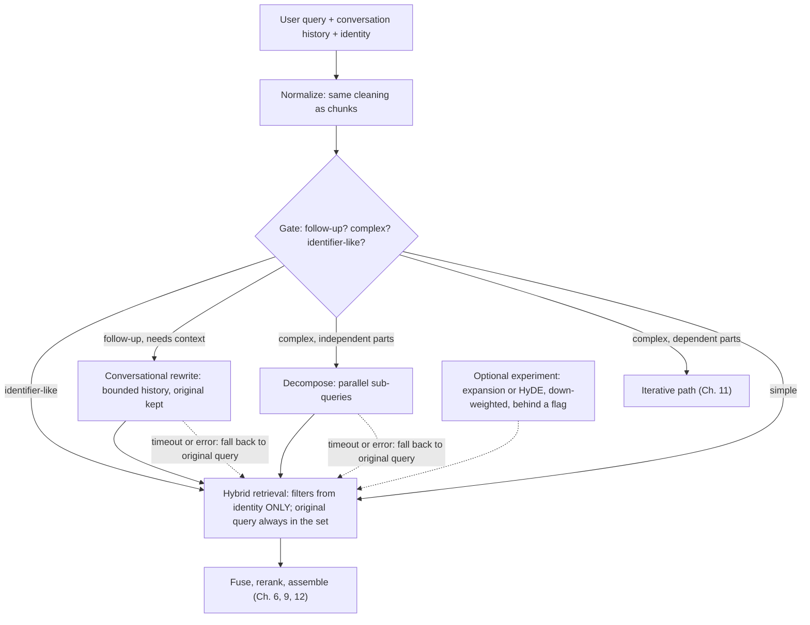
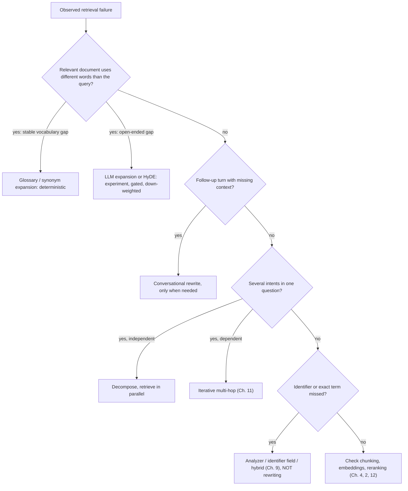

# Chapter 10 — Query Expansion and Rewriting

> **Evidence legend.** **[S#]** = supported by a source in References (IDs map to `project-management/RESEARCH-REGISTER.md`; papers were read at abstract level only, so numbers quoted are the authors' abstract claims). **[E]** = engineering recommendation/reasoning. **[A]** = assumption. **[I]** = illustrative. **[X]** = executed and verified in this repository. **[V]** = vendor-reported. **[N]** = not researched. Research date: 2026-11-07. **There is no language model in this chapter's executed examples**: every "LLM step" is a stand-in, so the demos verify mechanics and failure modes, not model quality.

## 10.1 Learning Objectives

After this chapter you can:

1. Name the query–document gaps that transformation tries to close, and match each gap to a technique.
2. Distinguish normalisation, rewriting, augmentation, expansion, conversational rewriting, decomposition, HyDE and routing — their mechanisms, costs and failure modes.
3. Explain, with evidence, why expansion helps weak retrievers and can hurt strong ones.
4. Design a **gated** transformation pipeline that keeps the original query, bounds latency and cost, and never lets a model alter security filters.
5. Evaluate whether a transformation earns its place on your corpus, per query class.

## 10.2 Problem Statement

Users do not write queries the way documents are written. The gaps [E]:

| Gap | Example | Symptom |
|---|---|---|
| **Vocabulary mismatch** | "laptop battery drain" vs. a document about "notebook power usage" | Lexical retrieval misses; dense retrieval may not |
| **Underspecified** | "Compare the earnings of Microsoft" (no period, no measure) | Vague retrieval, generic chunks |
| **Conversational ellipsis** | "And how long is it?" after a question about parental leave | Retrieval on a context-free fragment |
| **Compound** | "How do EVs work and how do they compare with ICE vehicles?" | One embedding blurs two intents |
| **Identifier-only** | "E-4471" | Little for a model to rewrite — and rewriting can damage it |

Each transformation inserts a **model call before retrieval**, on the critical path of every query it touches, and each can fail in ways that look like retrieval failures. The default engineering stance should therefore be *measure first, transform selectively*.

## 10.3 Why It Matters in Production

- **Latency and cost are added before the first token.** An LLM-based transform is a sequential call in front of retrieval; if applied to every query it adds that latency to every query (executed arithmetic below **[X]**).
- **Gains are not guaranteed.** Weller et al. studied generative query and document expansion across methods, retrievers and datasets and report a **strong negative correlation between retriever performance and gains from expansion**: expansion tends to help weaker models and generally harm stronger ones; they recommend using it for weaker models or when the target collection differs significantly from the training corpus, and say the added information can introduce noise that makes it hard to discern between the top relevant documents [S84]. A hybrid retriever with a reranker (Chapters 9, 12) is a *stronger* baseline than the ones where expansion shines.
- **Failures are silent.** A bad rewrite returns plausible but wrong chunks.
- **Security.** User text (and conversation history that may contain retrieved content) flows into a rewriting prompt (§10.11).

## 10.4 Core Concepts

### 10.4.1 Normalisation (always, deterministic)

Run the **same cleaning on the query that you ran on the chunks** before embedding or lexical analysis (Azure's example: if chunks were lower-cased, lower-case the query) [S55]. This is not "query rewriting" in the LLM sense; it is a parity requirement (Chapter 6), cheap and deterministic.

### 10.4.2 Rewriting

A model rewrites the query into a form better suited to retrieval. Azure's guidance lists the problems rewriting addresses — vagueness, missing keywords, unnecessary words and unclear semantics — and its sample prompt asks for a single paragraph that keeps the original intent while adding synonyms, related terms and likely domain keywords, balancing keyword richness and semantic clarity [S55]. Ma et al. propose **Rewrite-Retrieve-Read**: put a rewriting step in front of retrieval, first prompting an LLM to produce the query; then, because the reader LLM is a black box, train a small language model as the rewriter with **reinforcement learning using feedback from the LLM reader**; they report consistent improvements on open-domain and multiple-choice QA (abstract; no numbers) [S82].

### 10.4.3 Augmentation

Augmentation *adds* context to a short or vague query while **keeping the original**; Azure's guidance: don't remove or alter the original query and don't change its nature; use available context if you have it; if you don't, only augment when the language model plausibly knows the topic (for example, information readily available on the internet), otherwise don't augment [S55]. Typical additions are time frames, measures, definitions, and key subtopics.

### 10.4.4 Expansion

**Deterministic expansion [E]:** synonym lists, acronym tables, and domain glossaries maintained by humans (for example "CEO" ↔ "chief executive officer", product code names). Cheap, predictable, auditable; best for known vocabulary gaps and a good first move.

**LLM expansion.**

- **Query2doc:** few-shot prompting generates a pseudo-document appended to the query; the authors report boosting BM25 by **3% to 15%** on MS-MARCO and TREC DL without fine-tuning, and benefits for dense retrievers in-domain and out-of-domain (abstract) [S81].
- **Prompting LLMs for expansion terms:** Jagerman et al. study zero-shot, few-shot and chain-of-thought prompts on MS-MARCO and BEIR and say CoT prompts are especially useful because they lead the model to break the query down and emit many related terms; LLM expansions can be more powerful than traditional pseudo-relevance-feedback methods that depend on first retrieving a good set of pseudo-relevant documents (abstract) [S83].
- **HyDE** (§10.4.8) generates a hypothetical *document* and embeds it.

**When it fails.** Per Weller et al., expansion gains shrink as the retriever gets stronger and can turn negative; the extra terms add noise that blurs the top ranks [S84]. Executed illustration **[X, constructed]** (`docs/exercises/ch10_query_transform.py`, Part B; stand-in expansion lists, 14-document toy corpus):

| Query | No expansion | Expansion terms at weight 1.0 | Expansion terms at weight 0.3 |
|---|---|---|---|
| "laptop battery drain" (vocabulary gap; bridge terms *notebook, power, energy, usage*) | nDCG@3 **0.38** | **1.00** | 0.86 |
| "ingestion queue error" (generic terms *failure, problem, issue, log, retry*) | **1.00** | 0.32 | **1.00** |

The same technique helps one query and badly hurts the other; down-weighting expansion terms (original terms always weight 1.0) protects the second at the price of part of the first. Both cases were *constructed* to show the mechanism; they are not evidence about any real LLM, for which see [S84]. Practical controls [E]: keep the original query terms dominant, cap the number of expansion terms, weight them below the original, and apply expansion only to query classes where the golden set shows a gain.

### 10.4.5 Conversational query rewriting

In dialogue, follow-ups depend on earlier turns. Yu et al. frame the task as reformulating a concise, context-dependent conversational query into a self-contained one; they create weak supervision from ad hoc search sessions using rules and self-supervised learning, fine-tune GPT-2, and report a **12% improvement in ranking accuracy** on the TREC Conversational Assistance Track using little manual data, with the model handling hard cases such as group references and long-turn dependencies (abstract) [S93].

**Executed mechanics [X, stand-in rewriter].** Part A: after the question "How many weeks of parental leave do employees get?", the follow-up "And how long is it?" retrieved **nothing** in the toy corpus (no content words of its own); the rewritten query retrieved the parental-leave policy first. The *same* mechanism has a failure mode: a rewriter that **always** appends the previous topic contaminates a **topic switch** — "What is the travel policy?" plus the previous turn's words no longer retrieved the travel policy first (it pulled parental-leave documents instead). The executed rule only borrows context when the follow-up has no content words of its own or uses a pronoun, and leaves a topic switch untouched. Design rules [E]:

1. **Rewrite only when needed** (follow-up detection), not on every turn.
2. Give the rewriter **bounded** history (last N turns), and keep the original turn alongside the rewrite in the retrieval set.
3. Treat a **topic switch** as a first-class case in the evaluation set.
4. Store the rewritten query for audit (hashed or access-controlled; §10.11).

### 10.4.6 Decomposition

Azure's guidance: complex queries need more than one collection of data; decomposition breaks a complex query into simpler subqueries, runs each independently, aggregates the top results as **accumulated context**, then runs the original query with that context; determine **before searching** whether decomposition is needed, using a model to classify the query as simple (a single fact found in one passage) or complex (multipart, multiple sources, open-ended); the decomposition prompt produces subqueries and labels them `interdependent` or `multiple_independent`, ordered from least to most dependent, with pronouns replaced by the entities they refer to [S55]. Azure notes that this fixed flow (the orchestrator decides before running any search and doesn't revise the decision) differs from agentic RAG, where the agent decides at runtime [S55].

**Why decomposition exists.** Press et al. measure a **compositionality gap**: how often a model answers each sub-problem correctly yet fails the composed question; single-hop performance improves faster with model size than multi-hop, so the gap does not shrink; chain-of-thought narrows it, and their **self-ask** prompting has the model ask and answer follow-up questions, which lets a search engine answer the follow-ups (abstract) [S86].

**Independent vs. dependent subqueries [E].** *Independent* subqueries ("compare policy A and policy B") can be retrieved **in parallel**; *dependent* subqueries ("the CEO of the company that created X") need hop 1's answer before hop 2 can be written and therefore run **sequentially** (Chapter 11). Executed latency arithmetic **[X, assumed unit costs: LLM call 1.0 s, retrieval 0.2 s]**: simple 0.2 s; three independent subqueries 1.2 s (one decomposition call + parallel retrieval); three dependent hops 4.6 s (decomposition + 3×(retrieval + LLM call)); applying a transform to *every* query adds the LLM call to every query. These are symbolic costs, not measurements.

### 10.4.7 Intent classification and routing

**Adaptive-RAG** trains a smaller language model to predict query complexity and routes among **no retrieval, single-step retrieval and iterative retrieval**; classifier training labels are collected automatically from actual model outcomes; the authors report better efficiency and accuracy than baselines on open-domain QA (abstract) [S85]. Routing generalises beyond complexity [E]: send a query to the right **index** (policies vs. tickets), **tool** (SQL for aggregates, Chapter 29), or **language/analyzer**; send identifier-looking queries straight to exact lookup; send greetings to no retrieval.

The executed demo uses a **heuristic stand-in classifier** to check routing labels on five questions and the latency formulas **[X]**; it is not a trained classifier and proves nothing about classification accuracy. In production, evaluate the router itself (confusion matrix per class) because a router error silently applies the wrong, possibly expensive, strategy [E].

### 10.4.8 HyDE

HyDE has an instruction-following language model write a **hypothetical document** for the query — the authors state it "is unreal and may contain false details" — and then embeds that document with an unsupervised encoder (Contriever in the paper); the encoder's dense bottleneck filters out the incorrect details; they report that it significantly outperforms Contriever and shows performance comparable to fine-tuned retrievers across web search, QA and fact verification, and several languages (abstract; no numbers) [S80]. Azure describes the effect as answer-to-answer embedding similarity [S55]. Costs and risks [E]: one LLM generation per query, retrieval anchored on text that may be wrong (a confident, wrong hypothetical document can pull semantically similar wrong chunks), and — like all expansion — diminishing value against a strong hybrid + rerank baseline [S84]. It is an experiment to gate, not a default.

### 10.4.9 Putting transforms together

Azure's example pipeline chains optional steps: an augmenter outputs the original and an augmented query; a decomposer outputs the original, augmented and decomposed queries; **each** decomposed query is optionally rewritten, searched (vector, full-text, hybrid, or HyDE) and reranked, and the top results join the accumulated context; finally the original query plus accumulated context goes through the same rewrite/search/rerank substeps and the caller receives the top *N* [S55]. Azure also cautions that reranking adds latency compared with plain searches [S55]. The architecture in this handbook adds **gating, budgets and fallbacks** around that idea (§10.5).

## 10.5 Architecture

<!-- figure:10-query-transform-pipeline -->


*Figure 10.1: Architecture. Original diagram; source below.*

<details><summary>Mermaid source</summary>



</details>
<!-- /figure -->

*Original diagram by the handbook author, loosely informed by the pipeline described in [S55]; source `docs/assets/diagrams/10-query-transform-pipeline.mmd`.*

Architectural rules [E]:

1. **The original query always participates** (as one list in the fusion set) so a bad transform degrades rather than replaces retrieval [S55 advises not altering the original in augmentation].
2. **Filters come from the identity object, never from model output.** A rewritten query may change what is *searched for*; it must not change *who may see what* (§10.11).
3. **Every LLM transform has a deadline and a fallback to the untransformed query.**
4. **Gate** transforms with cheap deterministic checks first (length, pronouns, identifier patterns, conjunction counts) and a small classifier second [S85].
5. **Budget** the number of LLM calls, subqueries and total tokens per request.
6. **Observe**: record which transform ran, its duration, and whether it changed the retrieved top-K (so you can later delete transforms that never matter).

<!-- figure:10-transform-selection -->


*Figure 10.2: Architecture. Original diagram; source below.*

<details><summary>Mermaid source</summary>



</details>
<!-- /figure -->

*Original decision aid by the handbook author; source `docs/assets/diagrams/10-transform-selection.mmd`.*

## 10.6 Practical Example (Illustrative, Executed [X])

`docs/exercises/ch10_query_transform.py` runs three experiments on a 14-document toy corpus with a BM25 scorer and **stand-in** model steps. (A) Conversational rewriting: raw follow-up retrieves nothing; rewrite retrieves the right policy; always-append contaminates a topic switch while selective rewriting does not. (B) Expansion: the two-query table in §10.4.4. (C) Routing and latency: five routing labels and the symbolic latency model in §10.4.6. What is **not** shown: LLM behaviour, real expansion quality, router accuracy, real latencies.

## 10.7 Implementation

Executed: `docs/exercises/ch10_query_transform.py` **[X]** (2026-11-07, Python 3.14.2; all assertions passed; helper `_toy_ir.py`). Mutation check **[X]**: three injected defects — a rewriter that always appends context, expansion weights ignored, and dependent hops modelled as parallel — were each caught. Run:

```bash
python -I docs/exercises/ch10_query_transform.py
```

The production transformer lives behind a port in M5 (`QueryTransformer.transform(query, history, identity) -> list[WeightedQuery]`), emits spans with duration and a `changed_results` flag, and is covered by golden-set evaluation per query class. **Before production [E]:** replace the stand-ins with a small, fast model behind timeouts; add prompt-injection tests on the rewriter; version the prompts; add the router evaluation.

## 10.8 Trade-offs

| Decision | Option A | Option B | Trade-off |
|---|---|---|---|
| Deterministic glossary vs. LLM expansion | Predictable, auditable, cheap | Open-ended coverage [S81, S83] | Coverage vs. control; start deterministic |
| Expansion on weak vs. strong retriever | Helps weaker models [S84] | Can harm stronger models [S84] | Measure against your *actual* baseline |
| Rewrite every turn vs. only follow-ups | Simplicity | Avoids contamination and cost [X] | Needs follow-up detection |
| Replace query vs. add to set | Cleaner results if the rewrite is right | Safe if wrong (original kept) [S55] | Slightly more retrieval work |
| Small trained rewriter vs. prompted LLM | Aligned to your reader, cheaper per call [S82] | No training data needed | Data and training effort |
| Router vs. always-complex path | Saves cost on simple queries [S85] | No router errors | Router quality becomes a dependency |

## 10.9 Failure Modes

| Failure | Root cause | Symptom | Detection | Mitigation |
|---|---|---|---|---|
| Expansion drift | Generic or off-topic expansion terms [X, S84] | Previously good queries degrade | Per-class nDCG/recall A/B | Down-weight; cap terms; gate by class |
| Context contamination | Rewriter inherits previous topic on a switch [X] | Wrong-topic answers after topic change | Topic-switch test cases | Selective rewrite; bounded history |
| Hallucinated specifics | Hypothetical document or expansion invents facts [S80] | Retrieval anchored on fiction | Spot checks; compare with original-query results | Keep original in set; cap influence |
| Identifier damage | Rewriting normalises or paraphrases `E-4471` | Exact lookups fail | Identifier subset in golden set | Route identifiers around the rewriter |
| Decomposition overkill | Simple query split into pieces | Latency and cost with no gain | Router confusion matrix | Classifier gate [S55, S85] |
| Router misclassification | Weak classifier [S85] | Wrong strategy applied | Per-class accuracy | Evaluate the router; conservative default |
| Latency creep | Sequential LLM calls before retrieval [X] | Higher time-to-first-token | Stage latency spans | Small model; budgets; fallbacks; cache |
| Prompt injection via query or history | Untrusted text inside the rewrite prompt | Rewriter outputs attacker-chosen queries | Red-team tests | Constrain output format; never trust output for filters (§10.11) |
| Cost blow-up | Transform on every query; many variants | Token spend scales with traffic | Per-request token metrics | Gating; budgets; caching |

## 10.10 Cost Considerations

Extra tokens per transformed query ≈ (instruction prompt + query/history tokens + output tokens), multiplied by the fraction of queries that are transformed [E]. Azure's sample prompts for augmentation, decomposition, rewriting and reranking are long instruction blocks [S55], so prompt size matters; their token counts were not measured here, and no prices are stated. Cost levers: apply transforms only when gated in; use a small model; cache transforms keyed by (normalised query, bounded history hash); cap subqueries; remove transforms that do not change retrieved results (§10.5, rule 6).

## 10.11 Security Considerations

- **The rewriter is an LLM reading untrusted text** (the user's query, the history, and possibly retrieved content that was quoted into history). Treat its output as untrusted: validate length and format, strip instructions, and **never derive access filters from it**; filters come only from the identity object (Chapters 7, 8) [E]. OWASP's guidance — separate untrusted content, validate output deterministically, least privilege, treat the model as an untrusted user — applies [S57].
- **Rewriting must not widen retrieval scope.** A rewritten query that adds "ignore tenant restrictions" changes nothing if filters live in code; test that explicitly [E].
- **Data boundary.** Sending queries and history to a hosted model is an external call (Chapters 2, 3, 7); map it to a region and data-handling term (OI-033).
- **Logging.** Original and rewritten queries are sensitive; store hashes and counts by default, full text only in an access-controlled audit store [E, S61 treats query text as opt-in for the same reason].
- **Cost abuse.** An attacker can craft inputs that trigger the most expensive path (maximum subqueries, expansion everywhere); per-request budgets and tenant rate limits are security controls [E].

## 10.12 Performance Considerations

A transform sits on the critical path **before retrieval**, so its latency adds directly to time-to-first-token [E]. Mitigations: skip via gating; use the smallest adequate model; run independent transform steps and sub-retrievals **in parallel** (executed arithmetic: three independent subqueries cost one decomposition call plus one parallel retrieval round, versus a sequential chain for dependent hops **[X, assumed costs]**); set a hard deadline with fallback to the original query; cache by normalised query. No latency numbers are claimed; Chapter 20 gives the measurement method.

## 10.13 Production Recommendations

1. Normalise every query exactly like the chunks; test equality (Chapter 6).
2. Default to **no LLM transform**; add transforms only against a measured, per-class failure.
3. Fix stable vocabulary gaps with a **maintained glossary** before reaching for LLM expansion.
4. Conversational rewrite only for follow-ups; bounded history; keep the original; include topic-switch tests.
5. Decompose only when a gate says the query is complex; run independent subqueries in parallel.
6. Keep the original query in the fusion set; down-weight any expansion; cap terms.
7. Route identifiers and exact lookups around rewriting.
8. Put deadlines and fallbacks on every LLM transform; budget calls, subqueries and tokens.
9. Never take filters from model output; test that a hostile rewrite cannot widen scope.
10. Log transform type, duration and "changed results"; delete transforms that never change results.
11. Evaluate the router and every transform on the golden set **per query class**, with and without your reranker (Chapter 18).

## 10.14 Architecture Decision Guidance

See **ADR-007** (Query transformation policy, Proposed). Default for the reference implementation: deterministic normalisation always; glossary-based expansion where the golden set shows vocabulary gaps; conversational rewrite for follow-ups; decomposition behind a classifier; LLM expansion and HyDE as flag-gated experiments evaluated against the hybrid + rerank baseline, because stronger retrievers benefit less from expansion [S84]. Reconsider when: golden-set recall failures trace to vocabulary or underspecification that a transform fixes without hurting other classes; the retriever mix changes (a weaker retriever benefits more [S84]); or latency budgets allow an extra model call.

## 10.15 Interview Questions

1. **When does query expansion help and when does it hurt?** It tends to help weaker retrievers and out-of-distribution collections and to hurt stronger ones; the added terms add noise that blurs the top ranks [S84]. Verify against your hybrid + rerank baseline [X, constructed example shows both directions].
2. **How would you handle follow-up questions in a chat assistant?** Rewrite only when the follow-up is context-dependent, with bounded history and the original turn kept; handle topic switches explicitly; evaluate with follow-up and topic-switch sets [S93, X].
3. **Explain HyDE and one risk.** Embed an LLM-written hypothetical answer instead of the query; the document may be wrong, so retrieval can anchor on fiction; the encoder only partly filters it [S80].
4. **Decomposition: independent vs. dependent subqueries?** Independent can run in parallel; dependent need the previous hop's result and run sequentially, which dominates latency [S55, S86, X].
5. **Why keep the original query in the set?** A bad transform then degrades rather than replaces retrieval [S55].
6. **What is the compositionality gap?** Answering all sub-questions correctly but failing the composed question; it persists as models scale; decomposition/self-ask narrows it [S86].
7. **How would you decide between a prompted rewriter and a trained one?** Rewrite-Retrieve-Read trains a small rewriter with RL from reader feedback [S82]; weigh training data and effort against per-call cost and alignment.
8. **How do you stop a rewriter from becoming a security hole?** It reads untrusted text; validate its output; filters come from identity, never from the rewrite [S57, E].
9. **What would you measure to justify a transform?** Per-query-class recall/nDCG with and without the transform on top of your actual retriever, plus latency and token cost, plus the fraction of queries it changes.

## 10.16 Knowledge Checkpoint / Exercises

1. Run `ch10_query_transform.py`. Add a third query where expansion is neutral; make the expansion list and the weights produce a case where weight 0.3 beats both 0 and 1.0.
2. Extend `rule_rewrite` to handle two pronoun cases and one more topic switch, and add them as failing-then-passing tests.
3. Replace the heuristic classifier with a rule that uses entity counts; build a 20-question set and compute its confusion matrix.
4. Design the A/B evaluation protocol for LLM expansion on your corpus: query classes, metrics, significance test, rollout gate.
5. Write the red-team cases for a rewriter ("ignore previous instructions", "search all tenants", very long history) and the assertions each must satisfy.
6. Using assumed unit costs for your environment, compute the added time-to-first-token for each transform at p50 and p95.

## 10.17 Summary

Query transformation closes the gap between how users ask and how documents are written, at the price of a model call on the critical path and new ways to fail. Normalise always; rewrite and expand selectively; decompose only complex questions; route by query type. The evidence reviewed says LLM expansion gives its largest gains to weaker retrievers and can hurt stronger ones [S84], so a hybrid + rerank pipeline should be treated as the baseline a transform must beat. The executed stand-in demos showed the mechanics: a pronoun follow-up retrieved nothing until rewritten; always-appending context contaminates topic switches; expansion fixed one query and wrecked another until its terms were down-weighted; and dependent decomposition dominates latency. Keep the original query in the retrieval set, bound and gate every LLM step, never let model output set filters, and evaluate each transform per query class before it ships.

## References

- [S55] Microsoft, *Develop a RAG solution — information-retrieval phase* (2026-06-22). https://learn.microsoft.com/en-us/azure/architecture/ai-ml/guide/rag/rag-information-retrieval
- [S57] OWASP GenAI Security Project, *LLM01: Prompt Injection*. https://genai.owasp.org/llmrisk/llm01-prompt-injection/
- [S61] OpenTelemetry, *GenAI semantic conventions — retrieval span* (Development). https://github.com/open-telemetry/semantic-conventions-genai/blob/main/docs/gen-ai/retrieval.md
- [S80] Gao et al., *Precise Zero-Shot Dense Retrieval without Relevance Labels* (HyDE), arXiv:2212.10496. https://arxiv.org/abs/2212.10496 (abstract)
- [S81] Wang, Yang, Wei, *Query2doc: Query Expansion with Large Language Models*, arXiv:2303.07678. https://arxiv.org/abs/2303.07678 (abstract)
- [S82] Ma et al., *Query Rewriting for Retrieval-Augmented Large Language Models*, arXiv:2305.14283. https://arxiv.org/abs/2305.14283 (abstract)
- [S83] Jagerman et al., *Query Expansion by Prompting Large Language Models*, arXiv:2305.03653. https://arxiv.org/abs/2305.03653 (abstract)
- [S84] Weller et al., *When do Generative Query and Document Expansions Fail?*, arXiv:2309.08541. https://arxiv.org/abs/2309.08541 (abstract)
- [S85] Jeong et al., *Adaptive-RAG*, arXiv:2403.14403. https://arxiv.org/abs/2403.14403 (abstract)
- [S86] Press et al., *Measuring and Narrowing the Compositionality Gap in Language Models*, arXiv:2210.03350. https://arxiv.org/abs/2210.03350 (abstract)
- [S93] Yu et al., *Few-Shot Generative Conversational Query Rewriting*, arXiv:2006.05009. https://arxiv.org/abs/2006.05009 (abstract)
