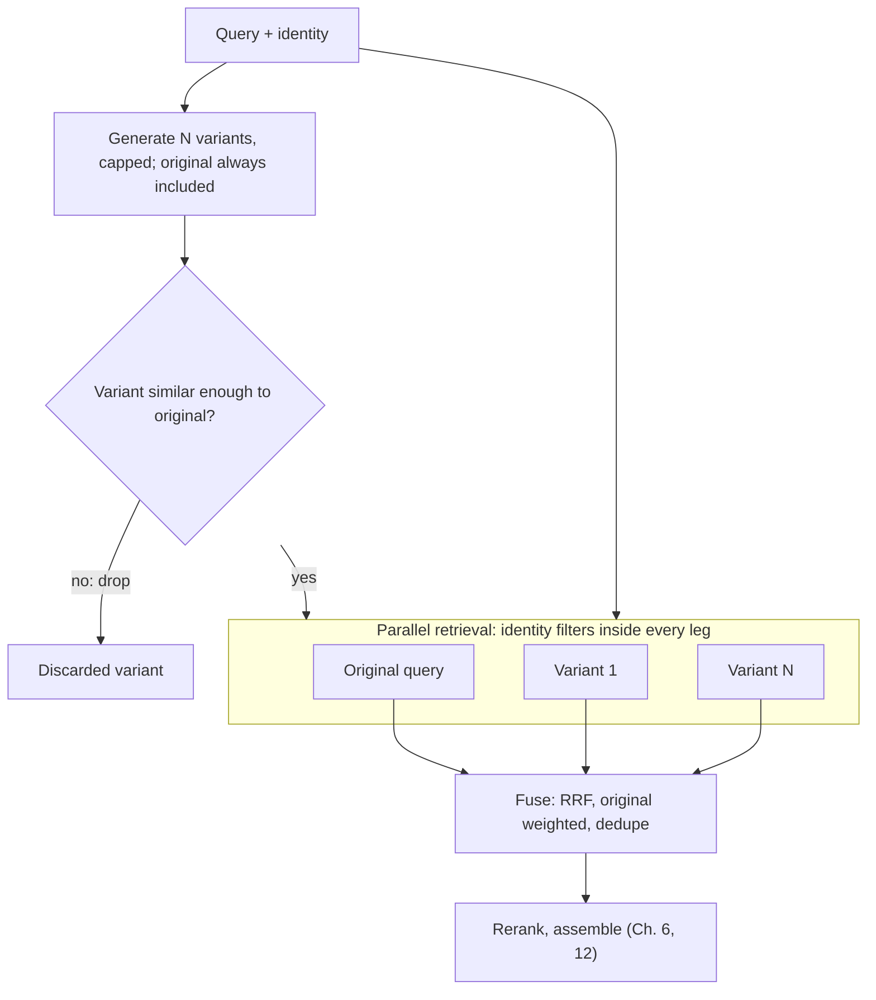
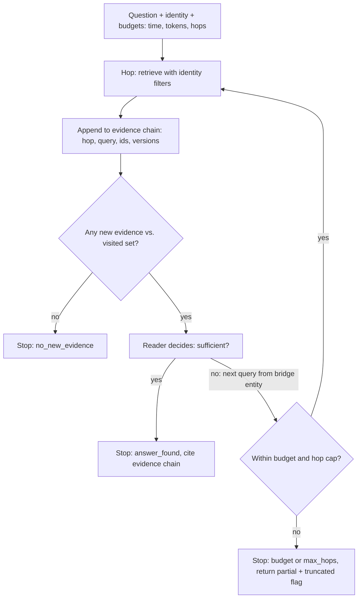

# Chapter 11 — Multi-Query and Multi-Hop Retrieval

> **Evidence legend.** **[S#]** = supported by a source in References (IDs map to `project-management/RESEARCH-REGISTER.md`; papers were read at abstract level only, so numbers quoted are the authors' own abstract claims, not independently confirmed). **[E]** = engineering recommendation/reasoning. **[A]** = assumption. **[I]** = illustrative. **[X]** = executed and verified in this repository. **[V]** = vendor-reported. **[N]** = not researched. Research date: 2026-11-07. **The executed examples contain no language model**: query variants, the "reader" that extracts the next entity, and entity tags are hand-written stand-ins. They verify mechanics and failure modes on tiny constructed corpora, not the quality of any real system.

## 11.1 Learning Objectives

After this chapter you can:

1. Explain multi-query retrieval (query fan-out) and fuse its result lists, and describe its failure modes (consensus bias, drift).
2. Distinguish fan-out from decomposition, independent from dependent sub-questions.
3. Explain why multi-hop questions defeat single-pass retrieval and why many multi-hop benchmarks can be "solved" without multi-hop reasoning.
4. Design an iterative retrieval loop with an evidence chain and **explicit stopping criteria** that cannot run forever.
5. Describe graph-based retrieval and the Personalized PageRank mechanism, and the permission risks of traversing a graph.
6. Budget latency and cost for fan-out and iteration.

## 11.2 Problem Statement

Chapter 10 transformed one query into a better single query. Two situations need *more than one retrieval*:

1. **One intent, many phrasings.** The user's wording shares no vocabulary with any relevant chunk, and one rewrite is a single bet. Generating several variants and fusing their results spreads the bet (**multi-query / fan-out**).
2. **One question, several facts that depend on each other.** *"Who is the CEO of the company that created Zephyr?"* needs a fact (the creator) before the second query can even be written (**multi-hop**). A single embedding of the whole question rarely lands on the second fact, because that document does not mention the product.

Both multiply cost and latency, and both add ways to fail, so they must be justified by measured failures of single-pass hybrid retrieval (Chapters 6, 9, 12).

## 11.3 Why It Matters in Production

- **Single-pass retrieval has a hard ceiling on dependent questions.** Executed: for the toy chain question, the single-pass top-3 contained the first-hop document and a distractor but **not** the second-hop document **[X]**.
- **Models are better at facts than at composing them.** Press et al. measure a *compositionality gap* — answering all sub-questions correctly but failing the composed question — and find single-hop performance improves faster with model size than multi-hop performance; they report that eliciting reasoning narrows the gap and that having the model ask and answer follow-up questions (self-ask) lets a search engine answer them (abstract) [S86].
- **Iteration and fan-out multiply cost.** Each hop is typically a model call plus a retrieval; each variant is a retrieval; both are controllable only if budgets exist (§11.4.7).
- **Evaluation is treacherous.** Many multi-hop benchmarks can be solved by shortcuts (§11.4.3), so apparent gains may not mean what they seem.

## 11.4 Core Concepts

### 11.4.1 Multi-query retrieval and fan-out

**Mechanism [E].** An LLM (or rules) produces *N* variants of the user's query — different wordings, sub-aspects, or hypothetical answers (Chapter 10). Each variant is retrieved (in parallel), and the ranked lists, together with the original query's list, are **fused**, typically with Reciprocal Rank Fusion (RRF, Chapter 9 [S67]). Cost: one model call to generate variants plus *N* parallel retrievals.

**RAG-Fusion** packages this: generate multiple queries, rerank them with reciprocal scores, and fuse the documents and scores; its author reports a deployment context at Infineon, evaluated the answers manually for accuracy, relevance and comprehensiveness, and reports accurate and comprehensive answers; the abstract also states that some answers strayed off topic when the generated queries were not sufficiently relevant to the original (abstract; single-author manual evaluation) [S87]. Treat it as a pattern with a documented failure mode, not as a measured improvement you can assume.

**Executed mechanics [X, stand-in variants]** (`docs/exercises/ch11_multi_query_multi_hop.py`, Part A; nine-document toy corpus, vocabulary-gap query *"what happens when someone quits"*, three hand-written good variants):

| Strategy | recall@3 | nDCG@3 | top-3 |
|---|---|---|---|
| Original query only | 0.33 | 0.47 | `o2` |
| Fan-out (original + 3 variants), RRF | **0.67** | 0.53 | `o8, o2, o1` |
| Same + one **off-topic** variant | 0.67 | 0.53 | `o8, o2, o1` (but `o10`, a hiring document, enters the top 5 and relevant `o3` slides from 4th to 5th) |
| Same, original query weighted ×3 | 0.67 | 0.70 | `o2, o8, o1` |

Four observations, all from the run:

1. **Fan-out recovered relevant documents the original query missed** (recall@3 0.33 → 0.67). The original query's *only* hit came from the incidental word "when" — an accident worth knowing about when you read a "baseline".
2. **Consensus bias.** The top result `o8` is an *irrelevant* onboarding document. It shares ordinary words (*accounts*, *laptops*, *staff*) with several good variants and appears in **four of the five lists**, and RRF rewards appearing in many lists. Fusion measures agreement, not relevance.
3. **Drift.** An off-topic variant contributes documents that only it can reach (`o10`, `o9`) and displaces a relevant one by a slot.
4. **Reweighting is not a drift control.** Up-weighting the original query ×3 helped the relevant `o2` reach rank 1 (nDCG@3 0.53 → 0.70) but left the drift document's position unchanged, because a rank-1 hit in a single list ties with every other single-list rank-1 hit. Controls that work at the source [E]: **limit the number of variants**; **gate each variant** by similarity to the original (for example an embedding-similarity threshold, evaluated empirically — a purely lexical gate cannot separate good from drifting variants in this toy corpus because the original shares no words with any of them); **deduplicate** variants; **reserve** fusion weight for the original; and *measure* per-query-class results with and without fan-out.

### 11.4.2 Fan-out vs. decomposition

| | Fan-out (multi-query) | Decomposition (Ch. 10) |
|---|---|---|
| Question shape | One intent, uncertain phrasing | Several distinct sub-questions |
| Sub-queries | Paraphrases/aspects of the *same* need | Different needs |
| Dependency | None | Independent (parallel) or dependent (sequential) |
| Fusion | Fuse into one ranking (RRF) | Accumulate evidence per sub-question, then answer |
| Main risk | Drift, consensus bias | Wrong decomposition, lost context, latency for dependent chains |

Azure's decomposition guidance labels subqueries `interdependent` or `multiple_independent`, orders them from least to most dependent, runs each, and accumulates the top results as context before running the original query [S55]. The labelling matters operationally: independent parts parallelise; dependent parts do not.

### 11.4.3 Multi-hop questions

A multi-hop question needs evidence from **several documents** combined. HotpotQA formalised this with **113k Wikipedia-based question–answer pairs**, sentence-level **supporting facts** so systems can explain their predictions, and comparison questions that require extracting and comparing facts (abstract) [S88].

**Beware shortcuts.** Trivedi et al. state that existing multihop benchmarks are largely solvable via shortcuts, construct MuSiQue bottom-up from *connected* pairs of single-hop questions, and report a 3× larger human–machine gap and a **30-point F1 drop for a single-hop model** (abstract) [S90]. The implication for your own evaluation set [E]: for every "multi-hop" question in the golden set, **verify that a single-document system cannot answer it** (run a single-hop baseline and check that it fails); otherwise you will credit multi-hop machinery for gains it did not cause.

### 11.4.4 Iterative retrieval and evidence chains

**Mechanism [E].** Retrieve → read → decide whether the evidence suffices; if not, form the next query from what was learned and retrieve again, recording an **evidence chain** `(hop, query, retrieved ids)`.

**IRCoT** interleaves retrieval with the steps (sentences) of a chain of thought: retrieval is guided by the chain-of-thought so far, and the retrieved results improve the next reasoning step; on HotpotQA, 2WikiMultihopQA, MuSiQue and IIRC the authors report that with GPT-3 it substantially improves retrieval (up to 21 points) and downstream QA (up to 15 points), with similar gains out-of-distribution and with smaller models such as Flan-T5-large, without additional training (abstract; authors' claims) [S89]. **FLARE** retrieves *during* generation: it predicts the upcoming sentence, uses it as a query, and regenerates the sentence with retrieved evidence if it contains low-confidence tokens; the authors report superior or competitive performance on four long-form knowledge-intensive generation tasks (abstract) [S92]. **Adaptive-RAG** decides per query whether to skip retrieval, retrieve once, or iterate, using a trained complexity classifier [S85].

**Executed mechanics [X, stand-in reader]** (Part B; eight-document chain corpus). Question: *"Who is the CEO of the company that created Zephyr?"*

| Step | What happened |
|---|---|
| Single pass (top-3 requested) | Returned the first-hop document `m1` (Zephyr, created by Nimbus Labs) and a distractor `m5` (Zephyr winds). The second-hop document `m2` was **not** retrieved: it says "chief executive officer" (not "CEO") and never mentions Zephyr |
| Hop 1 | query = the question → `m1`; the stand-in reader extracts the bridge entity *Nimbus Labs* |
| Hop 2 | query = "chief executive officer Nimbus Labs" → `m2`; reader extracts *Dana Ortiz* → stop: **answer found** |

The evidence chain `(1, question, [m1, m5]) → (2, "chief executive officer Nimbus Labs", [m2, m6])` is exactly the audit record you want per answer. **Stopping criteria [X]** were tested on a *cyclic* corpus (Alpha owned by Beta, Beta by Gamma, Gamma by Alpha): the loop stopped after 3 hops with `no_new_evidence` (a visited-set rule) and never returned an answer; with the hop cap set to 1 it stopped with `max_hops`. Mutation check **[X]**: removing the no-new-evidence rule, ignoring the hop cap, disabling the time-budget check, and removing propagation from the graph demo were each caught by the demo's assertions.

### 11.4.5 Graph-based retrieval

**Why graphs.** Vector similarity retrieves passages near the query; multi-hop and corpus-wide questions need *relationships*. In Chapter 1, GraphRAG was introduced as extracting an entity graph with community summaries to answer global questions [S26]. **HippoRAG** takes a different route: combine an LLM, a knowledge graph and **Personalized PageRank (PPR)**, inspired by hippocampal indexing theory; the authors report outperforming state-of-the-art methods by up to 20% on multi-hop QA and, with single-step retrieval, comparable or better performance than iterative retrieval such as IRCoT while being **10–30× cheaper and 6–13× faster**; integrating it into IRCoT adds further gains (abstract; authors' claims) [S91]. These are the authors' numbers on their benchmarks; treat them as hypotheses for your data.

**The PPR mechanism, executed [X, toy].** Part C builds an entity graph from hand-tagged entities per document (a stand-in for NER/OpenIE extraction), runs Personalized PageRank from the single seed entity *Zephyr*, and ranks documents by the PageRank mass of their entities. Entity scores: Nimbus Labs 0.321, Zephyr 0.286, Dana Ortiz 0.182, Orion Systems 0.108, Lisbon 0.072, Portugal 0.031 — decaying with graph distance, and above unrelated entities. The top-3 documents were `m1, m2, m3`: the **second-hop document is reachable in a single retrieval step** without iterating. This verifies the *mechanism* (seed influence propagates through relationships) on a hand-built graph; it says nothing about entity-extraction quality, scale, or HippoRAG's reported gains.

**Costs and risks [E].** Entity/relation extraction needs a model pass over the corpus (indexing cost); the graph must be updated on every document change and **purged on deletion** (Chapter 3); extraction errors become wrong edges; and — critically — **a graph can leak across permission boundaries**: an edge or entity derived from a document the caller may not read can surface a fact through traversal even if the source chunk is never returned. Every node, edge and score must carry provenance to source documents and be filtered by the caller's permissions *before* traversal or at scoring time (Chapter 8) [E].

### 11.4.6 Stopping criteria and loop prevention

An iterative loop needs several independent guards [E; executed in part B]:

| Guard | Stops when | Why |
|---|---|---|
| **Answer/sufficiency** | The reader judges the evidence sufficient (or an answer pattern is found) | The goal |
| **No new evidence** | A hop retrieves nothing not already seen (visited set) | Prevents cycles and repetition **[X]** |
| **Max hops** | Hop count reaches a hard cap | Backstop if every other guard fails **[X]** |
| **Budget** | Elapsed time, tokens or LLM calls exceed the request budget | Bounds cost and latency; return partial results flagged `truncated` **[X]** |
| **Diminishing returns** | Marginal gain (new relevant evidence) falls below a threshold | Avoids spending a hop for nothing |
| **Confidence** | Generation confidence is high enough (FLARE-style) [S92] | Skip retrieval when not needed |

Always return **why** the loop stopped (`answer_found | no_new_evidence | max_hops | budget | reader_found_nothing`) so you can monitor the distribution; a rising `max_hops` rate is a quality alarm.

### 11.4.7 Latency management

Executed arithmetic **[X, assumed unit costs]** (Part D): four sub-retrievals of 0.20, 0.35, 0.25, 0.30 s take **0.35 s in parallel** (the maximum) versus **1.10 s sequentially**; four iterative hops at 1.2 s each (an assumed LLM call plus retrieval) under a **3.0 s budget** complete 2 hops, use 2.4 s and report `truncated`. These are symbolic, not measurements. Strategies [E]:

1. **Parallelise** everything independent (fan-out variants, independent sub-questions).
2. **Route**: send simple queries down the single-pass path (Adaptive-RAG-style classification [S85]).
3. **Budget** each request (time, tokens, hops, variants) and degrade gracefully with partial results and an explicit flag.
4. **Cache** variant generation and per-hop retrievals keyed by tenant, permission set and index version (Chapter 7).
5. **Stream** progress/partial answers where UX allows, but do not stream an answer that depends on an unfinished hop [E].
6. **Prefer single-step graph retrieval** over iteration when the question class and corpus justify the indexing cost — the authors of HippoRAG argue for large cost and speed advantages over iterative retrieval [S91] (verify on your data).

## 11.5 Architecture

<!-- figure:11-multi-query-fanout -->


*Figure 11.1: Architecture. Original diagram; source below.*

<details><summary>Mermaid source</summary>



</details>
<!-- /figure -->

*Original diagram by the handbook author; source `docs/assets/diagrams/11-multi-query-fanout.mmd`.*

<!-- figure:11-iterative-retrieval-loop -->


*Figure 11.2: Architecture. Original diagram; source below.*

<details><summary>Mermaid source</summary>



</details>
<!-- /figure -->

*Original diagram by the handbook author; source `docs/assets/diagrams/11-iterative-retrieval-loop.mmd`.*

Component responsibilities [E]: **variant generator** (capped, deduplicated, gated), **retrieval legs** (always identity-filtered, parallel), **fusion** (pure function, original-weighted), **reader/sufficiency check** (a model call or rule; its output is untrusted), **loop controller** (visited set, hop cap, budgets, stop reason), **evidence chain recorder** (audit and citations), and, optionally, a **graph index** whose nodes/edges carry document provenance and ACLs.

## 11.6 Practical Example (Illustrative, Executed [X])

Everything above is drawn from `docs/exercises/ch11_multi_query_multi_hop.py`: fan-out with RRF on a vocabulary-gap query; a two-hop chain solved by iteration where single-pass retrieval missed hop 2; a cyclic corpus that terminates; Personalized PageRank on a hand-tagged entity graph; and latency/budget arithmetic. Corpora have 8–9 documents; variants, reader and entity tags are hand-written. The demo establishes mechanics and failure modes, **not** how often multi-hop machinery beats single-pass hybrid retrieval on a real corpus.

## 11.7 Implementation

Executed: `docs/exercises/ch11_multi_query_multi_hop.py` **[X]** (2026-11-07, Python 3.14.2; helper `_toy_ir.py`; all assertions passed; four mutants killed). Run:

```bash
python -I docs/exercises/ch11_multi_query_multi_hop.py
```

Production notes [E]: the orchestrator's loop controller is a small state machine with the guards above; each hop re-applies the identity filters (never reuses a previous hop's candidate set without re-checking permissions); the reader's extracted entity is **untrusted text** and is length-checked and sanitised before being used in the next query; the evidence chain is persisted with chunk and document versions for audit and citation; graph retrieval, if adopted, is behind the same `Retriever` port (ADR-004/005) and is evaluated against the single-pass baseline.

## 11.8 Trade-offs

| Decision | Option A | Option B | Trade-off |
|---|---|---|---|
| Fan-out vs. single query | Recall on vocabulary gaps [X, S87] | Latency, cost, drift/consensus risk [X] | Gate and measure per class |
| RRF weighting of original | Anchors on the user's words [X] | Fewer gains from variants | Not sufficient against drift alone [X] |
| Iterative retrieval vs. single-pass | Solves dependent chains [X, S89] | Multiple model calls and retrievals; loop risks | Route by complexity [S85] |
| Iterative vs. graph single-step | No graph index to build | Graph indexing cost and maintenance; claimed 10–30× cheaper/6–13× faster at query time [S91] | Indexing cost vs. query cost; verify claims |
| Parallel vs. sequential | Latency = max | Sequential unavoidable for dependent hops [X] | Dependency structure decides |
| Hard budget vs. best effort | Predictable latency/cost [X] | May return partial answers | Make truncation explicit |

## 11.9 Failure Modes

| Failure | Root cause | Symptom | Detection | Mitigation |
|---|---|---|---|---|
| Consensus bias | Off-topic doc overlaps several variants [X] | Irrelevant document ranks first | Compare fused vs. original-only top-K; relevance labels | Variant gating; reranker after fusion (Ch. 12) |
| Variant drift | Off-topic or hallucinated variant [X, S87] | Off-topic answers; relevant docs displaced | Per-variant contribution analysis | Cap and gate variants; dedupe |
| Infinite/long loops | Cycles, ever-new but useless evidence | Latency spikes, cost blow-up | Stop-reason histogram; hop counts | Visited set, hop cap, budget [X] |
| Error propagation | A wrong bridge entity in hop 1 | Confident wrong chain | Evidence-chain audit; faithfulness checks | Sufficiency check; verify bridge entity against source |
| Shortcut-inflated evaluation | Benchmarks solvable by single-hop shortcuts [S90] | Overestimated multi-hop gains | Single-hop baseline on the golden set | Build/validate questions that need multiple documents |
| Permission leak via graph | Edges/entities from unreadable documents [E] | Facts surface through traversal | Cross-tenant/ACL tests on graph retrieval | Provenance + ACL on every node/edge; filter before scoring |
| Cost abuse | Crafted inputs trigger maximum fan-out/hops | Token and compute spikes | Per-request cost metrics | Per-request/tenant budgets; rate limits |
| Stale graph | Documents changed or deleted, graph not updated | Deleted facts still retrievable | Delete→query tests including graph | Deletion propagation to graph (Ch. 3) |
| Hidden dependency on query wording | Hop 2 query built from reader's phrasing | Fragile recall | Variation tests | Multiple formulations per hop; hybrid retrieval |

## 11.10 Security Considerations

- **Re-apply identity filters on every hop and every variant leg** [E]; an iterative loop that reuses an earlier candidate set can carry unauthorised chunks forward.
- **Bridge entities are untrusted text** extracted from documents. They can carry injected instructions (Chapter 22) and can *leak information across hops* (a sensitive entity from hop 1 placed into a query sent to an external tool or logged). Sanitise, length-limit, and treat them like any untrusted input; never use them to select filters [E, S57].
- **Graph retrieval needs ACL-aware graphs** (§11.4.5); a graph that ignores permissions is a cross-tenant leak primitive [E].
- **Cost-amplification attacks.** Fan-out and iteration let a single request consume many model calls; enforce per-request caps and tenant quotas [E].
- **Audit.** Persist the evidence chain (hops, queries as hashes, document ids and versions, stop reason); do not log raw query text by default (Chapter 7 [S61]).

## 11.11 Performance Considerations

Fan-out latency is the **maximum** of its legs (plus variant generation, plus fusion); iterative latency is the **sum** of hops, each including a model call [E, X assumed costs]. Typical controls: parallelism, routing simple queries to single-pass, hop/time budgets with partial results, caching, and smaller models for variant generation and reading. Graph single-step retrieval trades indexing work for query-time speed [S91 claims, verify]. No latency figures are claimed; use the Chapter 20 methodology (p50/p95/p99 per stage, per path).

## 11.12 Cost Considerations

Per request [E]: fan-out ≈ 1 generation call + *N* retrievals + fusion; iteration ≈ *h* × (retrieval + reader call) plus any final generation; graph ≈ one-time extraction over the corpus + graph storage + per-query PPR. Token cost scales with hops × (query + retrieved context read by the reader). The HippoRAG abstract claims single-step retrieval is 10–30× cheaper than iterative retrieval such as IRCoT at comparable or better multi-hop QA performance [S91]; that excludes the offline extraction cost and was measured by the authors on their benchmarks, so your costs must be modelled from your corpus size and update rate. No prices are stated.

## 11.13 Production Recommendations

1. Make single-pass hybrid retrieval + rerank the baseline; add multi-query/multi-hop only for **measured** failure classes.
2. Route queries by complexity (heuristics first, a small trained classifier second) [S85]; evaluate the router.
3. Cap and gate query variants; dedupe; keep the original query in the fusion set; add a reranker after fusion.
4. Run independent legs in parallel; run dependent hops sequentially with a hop cap, visited set, and time/token budget; always record the stop reason.
5. Persist the evidence chain with chunk/document versions; use it for citations and audit.
6. Re-apply identity filters on every leg and hop; sanitise bridge entities; never derive filters from model output.
7. Validate multi-hop questions in your golden set with a single-hop baseline so you are not rewarded for shortcuts [S90].
8. If you adopt graph retrieval, carry provenance and ACLs on every node/edge, propagate deletions, and measure extraction quality and index cost first.
9. Enforce per-request and per-tenant budgets; monitor stop-reason distribution, hop counts, variant counts and cost per request.
10. Re-evaluate whenever the retriever, reranker, model or corpus changes; benefits shrink as the baseline gets stronger [S84].

## 11.14 Architecture Decision Guidance

See **ADR-007** (Query transformation policy), extended here. Default: single-pass hybrid + rerank. Add **multi-query fan-out** when failure analysis traces misses to vocabulary gaps that a glossary cannot close, with capped, gated variants and a reranker after fusion. Add **iterative retrieval** only for dependent multi-hop classes confirmed by a shortcut-free evaluation set, behind a complexity router with hop and time budgets. Consider **graph-based retrieval** when relational or corpus-wide questions dominate and extraction cost and ACL-aware graph maintenance are acceptable [S91, S26]. Move to **agentic** control (Chapter 15) only when these deterministic loops cannot meet quality targets. Reversal triggers: a stronger baseline erases the gains [S84]; stop-reason monitoring shows frequent `max_hops`; cost per answer exceeds its value; graph maintenance cannot keep pace with document change.

## 11.15 Interview Questions

1. **What is multi-query retrieval and what can go wrong?** Generate several variants, retrieve in parallel, fuse (RRF); risks are drift from off-topic variants and *consensus bias*, where an irrelevant document that overlaps many variants wins [S87, X]. Control by capping/gating variants and reranking after fusion.
2. **Why does single-pass retrieval fail on multi-hop questions?** The second-hop document may share no vocabulary or entities with the question; you need the first hop's result to write the second query [X].
3. **How do you stop an iterative retrieval loop?** Answer/sufficiency, no new evidence (visited set), hop cap, time/token budget, diminishing returns; always record the stop reason [X].
4. **A vendor claims 20% better multi-hop QA. What do you ask?** Which benchmark, whether it can be solved by shortcuts [S90], baseline strength, indexing and query cost, and whether it holds on your data [S91 claims are the authors' own].
5. **Fan-out vs. decomposition?** Fan-out = paraphrases of one need, fused; decomposition = different sub-questions, independent (parallel) or dependent (sequential) [S55].
6. **What is the compositionality gap?** Getting every sub-question right but the composed question wrong; it persists with scale; self-ask-style follow-up questions narrow it [S86].
7. **What are the security risks of graph retrieval?** Edges/entities from unreadable documents leak facts through traversal; require ACL-aware graphs with provenance and deletion propagation [E].
8. **How would you bound cost and latency for agent-like retrieval?** Routing, parallelism, per-request budgets, caps on variants and hops, caching, partial results flagged as truncated [X, S85].
9. **IRCoT vs. FLARE in one sentence each.** IRCoT interleaves retrieval with chain-of-thought steps [S89]; FLARE retrieves during generation when upcoming-sentence tokens have low confidence [S92].

## 11.16 Knowledge Checkpoint / Exercises

1. Run `ch11_multi_query_multi_hop.py`. Add a similarity gate that drops the off-topic variant using token overlap with *any* good variant (not the original); show it removes the drift document, then explain why this gate is cheating in real life.
2. Add a third hop (Dana's previous employer → its headquarters) and verify the evidence chain, stop reason and that the hop cap triggers when `max_hops` is set to 2.
3. Add a "visited bridge entities" check so the loop cannot ask the same bridge twice; write a test where the reader flips between two entities.
4. Build a 10-question multi-hop set for your domain; for each, run a single-hop baseline and keep only the questions it fails.
5. Add ACL tags to the entity graph in Part C and make PPR ignore any edge whose provenance document the caller cannot read; assert that a restricted fact never appears.
6. Model the latency of fan-out (N variants) and iteration (h hops) with your own measured stage costs and find the break-even where a graph index pays for itself.

## 11.17 Summary

Multi-query retrieval spreads one intent across several phrasings and fuses the results; multi-hop retrieval chains retrievals when facts depend on each other; graph retrieval encodes relationships so a second hop can be reached in one step. The executed stand-in demos verified the mechanics and exposed the failure modes: fan-out raised recall@3 from 0.33 to 0.67 yet promoted an irrelevant document through consensus and let an off-topic variant displace a relevant one (reweighting the original did not fix that); a two-hop question missed its second document in a single pass but succeeded iteratively; a cyclic corpus terminated by a visited-set rule with a hop cap as backstop; and Personalized PageRank carried influence from a seed entity to the second-hop document. The literature reviewed (at abstract level) supports iterative and graph methods on multi-hop QA but also warns that many benchmarks are solvable by shortcuts [S90]. Adopt these techniques only for measured failure classes, behind routing, budgets, guarded loops, identity filters on every leg and hop, and ACL-aware graphs.

## References

- [S26] Edge et al., *From Local to Global: A Graph RAG Approach to Query-Focused Summarization*, arXiv:2404.16130. https://arxiv.org/abs/2404.16130 (abstract)
- [S55] Microsoft, *Develop a RAG solution — information-retrieval phase* (2026-06-22). https://learn.microsoft.com/en-us/azure/architecture/ai-ml/guide/rag/rag-information-retrieval
- [S57] OWASP GenAI Security Project, *LLM01: Prompt Injection*. https://genai.owasp.org/llmrisk/llm01-prompt-injection/
- [S61] OpenTelemetry, *GenAI semantic conventions — retrieval span* (Development). https://github.com/open-telemetry/semantic-conventions-genai/blob/main/docs/gen-ai/retrieval.md
- [S67] Cormack, Clarke, Büttcher, *Reciprocal Rank Fusion*, SIGIR 2009. http://cormack.uwaterloo.ca/cormacksigir09-rrf.pdf (full text read)
- [S84] Weller et al., *When do Generative Query and Document Expansions Fail?*, arXiv:2309.08541. https://arxiv.org/abs/2309.08541 (abstract)
- [S85] Jeong et al., *Adaptive-RAG*, arXiv:2403.14403. https://arxiv.org/abs/2403.14403 (abstract)
- [S86] Press et al., *Measuring and Narrowing the Compositionality Gap in Language Models*, arXiv:2210.03350. https://arxiv.org/abs/2210.03350 (abstract)
- [S87] Rackauckas, *RAG-Fusion: a New Take on Retrieval-Augmented Generation*, arXiv:2402.03367. https://arxiv.org/abs/2402.03367 (abstract; single-author manual evaluation)
- [S88] Yang et al., *HotpotQA*, arXiv:1809.09600. https://arxiv.org/abs/1809.09600 (abstract)
- [S89] Trivedi et al., *Interleaving Retrieval with Chain-of-Thought Reasoning for Knowledge-Intensive Multi-Step Questions* (IRCoT), arXiv:2212.10509. https://arxiv.org/abs/2212.10509 (abstract)
- [S90] Trivedi et al., *MuSiQue: Multihop Questions via Single-hop Question Composition*, arXiv:2108.00573. https://arxiv.org/abs/2108.00573 (abstract)
- [S91] Gutiérrez et al., *HippoRAG: Neurobiologically Inspired Long-Term Memory for Large Language Models*, arXiv:2405.14831. https://arxiv.org/abs/2405.14831 (abstract; authors' claims)
- [S92] Jiang et al., *Active Retrieval Augmented Generation* (FLARE), arXiv:2305.06983. https://arxiv.org/abs/2305.06983 (abstract)
