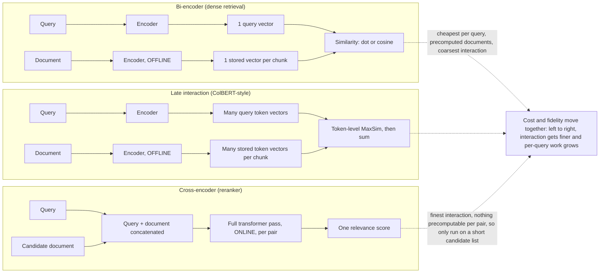
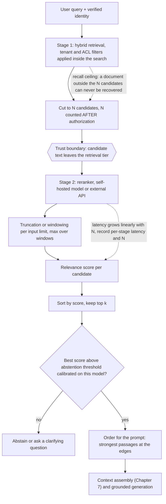

# Chapter 12 — Re-Ranking Techniques

> **Evidence legend.** **[S#]** = supported by a source in References (IDs map to `project-management/RESEARCH-REGISTER.md`; papers were read at abstract level only, so numbers quoted are the authors' own abstract claims, not independently confirmed). **[E]** = engineering recommendation/reasoning. **[A]** = assumption. **[I]** = illustrative. **[X]** = executed and verified in this repository. **[V]** = vendor-reported. **[N]** = not researched. Research date: 2026-11-08. **No neural reranker was run for this chapter.** The executed example uses a hand-written lexical "pair scorer" as a stand-in for a cross-encoder (OI-043). It verifies pipeline mechanics (candidate depth, truncation, score scale, ordering, authorization order), not the quality, latency or cost of any real reranker. Every latency and cost figure below is a formula with assumed parameters, not a measurement.

## 12.1 Learning Objectives

After this chapter you can:

1. Explain why first-stage retrieval and re-ranking are separate stages and what each is optimised for.
2. Compare bi-encoders, late-interaction models, cross-encoders and LLM listwise rerankers by where query–document interaction happens and what can be precomputed.
3. Size the candidate set *N* from a measured first-stage recall curve, and explain why a reranker cannot raise recall above that ceiling.
4. Handle reranker input limits (truncation, windowing), score scales (logits vs. calibrated scores vs. 0–4) and abstention thresholds.
5. Place the reranker correctly in a permission-aware pipeline and describe its data-egress and injection risks.
6. Order passages inside the prompt, and decide when diversity (MMR) belongs after reranking.
7. Evaluate a reranker separately from the retriever and decide, with evidence, whether to adopt one.

## 12.2 Problem Statement

First-stage retrieval (BM25, dense, or both fused, Chapters 6 and 9) must be fast over millions of chunks, so it compares a *precomputed* document representation with a query representation. That design cannot look at the query and a document **together**, so it ranks some irrelevant documents above relevant ones: keyword-stuffed pages, topically similar but non-answering passages, near-miss entities. The top-3 you pass to the generator is exactly where those errors cost the most.

Re-ranking adds a second, slower, more discriminating pass over a short candidate list. The questions are: how short can the list be without losing the answer, which kind of model is worth its cost, and what new failure and security modes does the extra hop introduce?

## 12.3 Why It Matters in Production

- **It is the standard quality lever after hybrid retrieval.** Sentence-Transformers documents the pattern directly: a fast first stage (bi-encoder or lexical) collects candidates, a cross-encoder re-ranks them, because scoring every pair in a large collection "would take too long" [S98]. Azure AI Search ships it as a built-in second stage over BM25 or RRF results [S100]. Cohere sells it as a standalone API [S99].
- **Benchmarks show the lift and the price.** BEIR reports that re-ranking and late-interaction models perform best on average in zero-shot evaluation, "at high computational cost" (abstract) [S64]. The earliest BERT re-ranker reported a 27% relative MRR@10 improvement over the then state of the art on MS MARCO (abstract; a 2019 result, not a statement about today's baselines) [S94].
- **The first stage fixes the ceiling.** Executed: with the relevant document at BM25 rank 4, a candidate depth of 3 loses it permanently and a depth of 4 or more keeps it **[X]** (§12.4.2).
- **It sits on the critical path and on the data path.** The reranker adds latency proportional to *N* and, if it is an external API, sends candidate text outside your retrieval tier (§12.10).

## 12.4 Core Concepts

### 12.4.1 Four ways to score a query–document pair

| Approach | Where query and document interact | Precomputable per document? | Per-query work | Typical role |
|---|---|---|---|---|
| **Bi-encoder** (dense retrieval) | Only at the final similarity of two single vectors | Yes: one vector | One query encoding + ANN search | First stage (Chapter 5) |
| **Late interaction** (ColBERT-style) | Token-level similarity between many query and many document vectors | Yes: many token vectors (more storage) | Query encoding + token-level matching | First stage or cheap reranker |
| **Cross-encoder** | Inside the transformer: query and document are one input | No: depends on the pair | One full transformer pass per candidate | Second stage over *N* candidates |
| **LLM listwise** | An LLM reads the query and several candidates and outputs an ordering | No | One or more LLM calls over windows of candidates | Second stage when quality outweighs cost and latency |

*Original summary table by the handbook author; the diagram is `docs/assets/diagrams/12-reranker-architectures.mmd`.*

**Cross-encoder.** The model "outputs a single score between 0 and 1 indicating how relevant the document is for the given query" and, because it attends across both texts, is more accurate than a bi-encoder, but it "must process every (query, document) pair from scratch" [S98]. Nogueira and Cho's BERT re-ranker is the canonical example; the authors report state of the art on TREC-CAR and the top MS MARCO passage-ranking leaderboard entry at the time of writing, a 27% relative MRR@10 improvement (abstract) [S94].

**Late interaction.** ColBERT encodes query and document *independently* with BERT, precomputes document representations offline, and models fine-grained similarity with a lightweight interaction step. The authors report it is competitive with existing BERT-based ranking models while being "two orders-of-magnitude faster" and needing "four orders-of-magnitude fewer FLOPs per query" (abstract; the baselines and measurement conditions are in the full paper, which I did not read) [S95]. The price is storage: many vectors per chunk instead of one **[E]**.

**LLM listwise.** Sun et al. report that properly instructed ChatGPT and GPT-4 can deliver "competitive, even superior results to state-of-the-art supervised methods" on popular IR benchmarks, and that distilling ChatGPT's ranking ability into a 440M-parameter model outperformed a 3B supervised model on BEIR (abstract) [S97]. Whether this holds for your domain, your language, your latency budget and a current baseline is unmeasured here. Note the risk that an LLM reading candidate text is also a prompt-injection target (§12.10).

**Open and managed options (documentation level).**

- *Open weights:* `BAAI/bge-reranker-v2-m3` is a multilingual reranker, Apache-2.0, about 0.6B parameters, that outputs a raw relevance score which "can be mapped to a float value in [0,1] by sigmoid function"; with FlagEmbedding `normalize=True` applies it [S101]. Using it means you operate GPU or CPU inference yourself.
- *Managed, Azure AI Search semantic ranker:* reranks only the **top 50** results of a BM25 or RRF-scored query; per-document input is summarised to at most 2,048 tokens (title and keywords capped at 128 tokens each); `@search.rerankerScore` ranges 0–4; billed by usage with a free allowance; and it "can't rerun the query over the entire corpus" [S100].
- *Managed, Cohere Rerank:* the documentation lists Rerank 5 and Rerank 4 (pro and fast variants) and older v3.x models; Rerank 4 and 5 have a 32k context and v3.x models 4k; when query plus document exceeds the limit, the document is chunked automatically; Rerank 5 returns "calibrated" 0–1 scores; instructions that change relevance judgement are not supported for Rerank 5 [S99]. The page shows no date; verify model names and limits before depending on them **[V]**.

### 12.4.2 The candidate-depth ceiling

A reranker only **reorders what retrieval hands it**. Define *candidate recall@N* as the fraction of relevant documents present in the first-stage top *N*. Final recall can never exceed it. Azure states this as a limitation: the semantic ranker reranks the existing top 50 and cannot find documents outside it [S100].

**Executed [X, stand-in scorer]** (`docs/exercises/ch12_reranking.py`; 12-document constructed corpus; query *"maximum reimbursable hotel rate per night for international travel"*; the relevant document `d03` is at BM25 rank 4):

| Candidate depth *N* | `d03` in final top-3? | Final top-3 |
|---|---|---|
| 3 | **No: absent** | `d01, d08, d11` |
| 4 | Yes (rank 3) | `d01, d08, d03` |
| 8 | Yes (rank 3) | `d01, d08, d03` |
| 12 | Yes (rank 3) | `d01, d08, d03` |

Two observations. First, depth is **necessary, not sufficient**: at *N* = 4 the right document is merely *present*. Second, the stand-in is lexical and so is fooled by the keyword-stuffed guide `d01` exactly as BM25 is: it moved `d03` only from rank 4 to rank 3, and an irrelevant "maximum amount for office supplies" document (`d08`, pair score 0.801 vs. 0.790) still outranks it. A real cross-encoder is expected to behave differently, but that expectation is **[A]** until measured on your data. The lesson for design is the measurement protocol, not the toy outcome: report **candidate recall@N** and **post-rerank nDCG@k** separately, so a poor result can be attributed to the retriever or the reranker.

Choosing *N* [E]: plot candidate recall@N on your golden set (Chapter 18) for N = 10, 20, 50, 100, 200; pick the knee, then check the reranker's latency at that N against your budget. Azure's fixed 50 is a product constraint, not a universal optimum [S100].

### 12.4.3 Input limits: truncation and windowing

Rerankers have a maximum input length; text beyond it is invisible to the score. The model card for `bge-reranker-v2-m3` shows examples with `max_length=512` and truncation, and does not state the model's maximum input length [S101]. Azure summarises each document to at most 2,048 tokens and trims fields in priority order, so "add fields to your semantic configuration in priority order" [S100]. Cohere chunks over-long documents automatically [S99].

**Executed [X]:** a document whose answer sentence sits after 60 tokens of preamble scores **0.790** untruncated, **0.000** when only its first 40 tokens are scored, and **0.790** again when scored as 40-token windows (stride 20) with the **maximum** window score kept. The mechanism is general [E]: chunk-and-max recovers an answer buried deep in a long page. It is also a cost multiplier, because every window is another pair to score. If your chunks are already small (Chapter 4), this problem mostly disappears; if you rerank whole documents or large parents (Chapter 14), it is central.

### 12.4.4 Score scale, thresholds and abstention

Scores are **not portable**. The same ordering can be expressed as raw logits (any real number), as a sigmoid-mapped probability-like value in [0, 1], or on a 0–4 rubric. Executed **[X]**: `sigmoid(-5.65234375) = 0.0034970`, matching the 0.003497… the `bge-reranker-v2-m3` model card prints for its example pair [S101]. A sigmoid is monotone, so it preserves ranking, but a numeric threshold means different things before and after it ("0.5 on probabilities" is "0 on logits").

Consequences [E]:

- Never reuse a cutoff across models, versions or vendors. Azure warns that reranker score distributions "can exhibit slight variations due to conditions at the infrastructure level" and that ranking-model updates can change them, so thresholds should not be made "too granular" [S100].
- A threshold used for **abstention** ("answer only if the best score is high enough") must be calibrated on *your* labelled queries, including queries whose answer is *absent*, and re-calibrated on every model change.
- A score threshold is only as reliable as the scorer. **Executed [X]:** when the permission filter withholds the true answer, the stand-in's best permitted score is **1.164**, *higher* than the true answer's **0.790**, because the stuffed page scores higher. Any threshold low enough to admit the true answer also admits the stuffed page, so abstention would not fire. I expected the opposite when I wrote the test; the data contradicted me. A cross-encoder is less lexical, but "a high score does not prove the passage answers the question" remains true of any scorer.

### 12.4.5 Replace, interpolate or fuse?

After reranking you can (a) use the reranker order alone, (b) interpolate its score with first-stage scores, or (c) fuse ranks (RRF, Chapter 9 [S67]) from both. Replacing is simplest and is what managed rerankers do. Fusing keeps a safety net when the reranker is weak on your domain or language, and avoids mixing incomparable scores **[E]**. I did not execute a comparison; treat (a) as the default and (c) as a hedge to evaluate on your golden set.

### 12.4.6 Ordering passages inside the prompt

Liu et al. find that "performance is often highest when relevant information occurs at the beginning or end of the input context" and degrades in the middle, even for long-context models (abstract) [S96]. The abstract reports the effect and proposes new evaluation protocols; it does not prescribe a mitigation. A common engineering response **[E]** is *edge ordering*: put the strongest passages first and last and the weakest in the middle (rank 1, 3, 5, …, 6, 4, 2). **Executed [X]:** `edge_order([r1..r5]) = [r1, r3, r5, r4, r2]`, with property tests (permutation, best first, second-best last, weakest in the middle). Whether this helps *your* model and prompt is an empirical question; test it with and without on your evaluation set, and also test simply sending fewer passages.

### 12.4.7 Reranking and diversity

Rerankers optimise relevance per passage, not coverage. Near-duplicates all score high. If the final context is redundant, apply deduplication or MMR *after* reranking [S62]; Chapter 6's executed result stands: MMR demotes but does not remove a near-duplicate and can promote noise, so deduplicate explicitly first.

## 12.5 Architecture

<!-- figure:12-reranker-architectures -->


*Figure 12.1: Architecture. Original diagram; source below.*

<details><summary>Mermaid source</summary>



</details>
<!-- /figure -->

*Original diagram by the handbook author; source `docs/assets/diagrams/12-reranker-architectures.mmd`.*

<!-- figure:12-retrieve-rerank-pipeline -->


*Figure 12.2: Architecture. Original diagram; source below.*

<details><summary>Mermaid source</summary>



</details>
<!-- /figure -->

*Original diagram by the handbook author; source `docs/assets/diagrams/12-retrieve-rerank-pipeline.mmd`.*

Component responsibilities [E]: **first stage** (hybrid retrieval with identity filters inside the query, Chapters 8–9); **candidate cutter** (applies *N* after authorization); **rerank adapter** (a port with at least a self-hosted and an API implementation, plus a no-op fallback); **windowing** (when inputs exceed the model limit); **score policy** (scale, threshold, abstention); **context orderer**; **telemetry** (N, per-stage latency, score distribution, abstention rate, fallback rate).

## 12.6 Practical Example (Illustrative, Executed [X])

`docs/exercises/ch12_reranking.py` runs on a 12-document constructed corpus of expense-policy snippets and covers: candidate depth (§12.4.2), the cost formula, score scale (§12.4.4), truncation vs. windowing (§12.4.3), edge ordering (§12.4.6), and the authorization-before-reranker rule (§12.10). `pair_score` is an IDF-weighted query-term coverage plus adjacent-word-pair bonus. It is **not** a language model and has no semantic understanding; it is a scorer that sees the pair jointly, which is the only property the mechanics tests need. Results must not be read as evidence that any reranker improves relevance.

## 12.7 Implementation

Executed: `python -I docs/exercises/ch12_reranking.py --mutants` **[X]** (2026-11-08, Python 3.14.2; stdlib plus `_toy_ir.py`; all assertions passed; five injected defects killed: authorization applied after the rerank, candidate depth ignored, and three broken orderings). Production sketch **[I]**:

```python
# Illustrative: port + fallback. Not executed against a real reranker (OI-043).
from typing import Protocol, Sequence

class Reranker(Protocol):
    def score(self, query: str, passages: Sequence[str]) -> list[float]: ...

def rerank(query, candidates, reranker: Reranker, *, k: int, timeout_s: float):
    """candidates are already tenant/ACL-filtered and already cut to N."""
    try:
        scores = reranker.score(query, [c.text for c in candidates])   # may raise or time out
    except Exception:                                                  # fail soft: keep first-stage order
        record_fallback("reranker_unavailable")                         # metric + log, never the text
        return candidates[:k], True
    order = sorted(range(len(candidates)), key=lambda i: scores[i], reverse=True)
    return [candidates[i] for i in order[:k]], False
```

Notes [E]: set a hard timeout and fall back to first-stage order (and say so in telemetry) rather than failing the request; batch pairs; for self-hosting measure CPU vs. GPU and fp16 vs. fp32 on your hardware (the model card notes `use_fp16=True` speeds computation "with a slight performance degradation" and gives no figures [S101]); cache by `(tenant, permission-set digest, index version, query hash, candidate ids)` per Chapter 7, never by query alone.

## 12.8 Trade-offs

| Decision | Option A | Option B | Trade-off |
|---|---|---|---|
| Add a reranker? | Better ordering of a short list [S94, S64] | Latency, cost, extra failure mode and data path | Adopt only when failure analysis shows ordering errors within the candidate set |
| Cross-encoder vs. late interaction | Finest interaction, no precompute [S98] | Precomputed documents, orders of magnitude cheaper per query, more storage [S95] | Latency budget and storage vs. fidelity |
| Self-hosted vs. managed | Data stays in your boundary, tunable, you operate inference [S101] | No operations, per-call price, text leaves your tier [S99, S100] | Data classification and volume decide |
| Larger N | Higher candidate recall (§12.4.2) | Linear cost and latency | Choose the knee of the measured recall curve |
| Cross-encoder vs. LLM listwise | Predictable cost and latency | Strong zero-shot ranking claims [S97], more variable cost, injection surface | Measure both on your golden set |
| Replace vs. fuse | Simple | Hedge against a weak reranker | Evaluate; default replace |
| Threshold abstention | Fewer ungrounded answers | Miscalibrated thresholds block good answers [X] | Calibrate on absent-answer queries |

## 12.9 Failure Modes

| Failure | Root cause | Symptom | Detection | Mitigation |
|---|---|---|---|---|
| Recall ceiling | Right document outside top N [X] | Reranker "does nothing" on a query class | Candidate recall@N vs. final recall | Raise N, fix first stage (Chapter 9), add query transformation (Chapters 10–11) |
| Lexical-looking reranker | Scorer rewards term overlap (stand-in; some weak models) [X] | Keyword-stuffed pages rank first | Error analysis on hard negatives | Choose/evaluate on adversarial negatives; fuse |
| Buried answer | Input limit truncates [X] | Long pages score low | Position-of-answer analysis | Window and max-aggregate; smaller chunks |
| Score-scale misuse | Threshold copied across models [X] | Sudden abstain spike or silent over-answering after a model update [S100] | Score-distribution monitoring | Re-calibrate per model; relative cutoffs |
| Timeout cascade | Synchronous external call, no budget | p99 spikes, errors under load | Stage latency histograms | Timeout + first-stage fallback, circuit breaker |
| Permission leak via reranker | Unauthorized text sent to or scored by the reranker [X] | Restricted text in an external service or logs | Egress review; test with forbidden docs | Authorize before candidate cut and before the call |
| Rank manipulation | Poisoned document tuned to score high, or an injected instruction targeting an LLM reranker [E] | A malicious page always ranks first | Adversarial tests; anomalous win rate | Source trust tiers; limit LLM-reranker authority; do not follow instructions in candidates |
| Regression after model update | Vendor changes the model [S100] | Quality shifts with no code change | Scheduled golden-set run | Pin versions where possible; alert on score and quality drift |
| Position bias in context | Best passage in the middle [S96] | Answers ignore the best evidence | A/B on ordering | Edge ordering or fewer passages; measure |

## 12.10 Security Considerations

- **Authorize first** [E, X]. Candidate IDs must already be filtered by tenant and ACL, and the cut to *N* must come after the filter. Executed: with the relevant document withheld from the user, the reranker was shown 11 documents, none restricted; at *N* = 4 it was shown 4 permitted documents, not 3 plus a placeholder. A mutant that reranks first and filters afterwards is detected, because the restricted text had already been sent.
- **An external reranker is a data egress path.** Candidate chunk text goes to a third party. Treat it as a sub-processor: data-processing terms, region, retention, training-use terms and logging must be reviewed (Chapters 22–23); I did not review any vendor's terms **[N]**. Where text is classified or contractually restricted, self-host or exclude those sources from external reranking.
- **LLM rerankers read untrusted text.** An instruction embedded in a candidate can try to steer the ordering or the output format (OWASP LLM01 [S57]). Constrain the output to a schema of IDs, validate it, and give the reranker no tools.
- **Reranker scores are not authorization.** A high score never grants access; a low score never excuses leaving a restricted document in the candidate set.
- **Do not log passage text or full queries by default** (Chapter 7 [S61]); log candidate IDs, scores, N, latency, fallback flag.
- **Cache keys** must include tenant and permission digest; a shared rerank cache can serve one tenant's ordering to another **[E]**.

## 12.11 Performance Considerations

Reranker latency is, to first order, **linear in the number of pairs**, divided by the achievable parallelism **[E, theoretical]**. Executed arithmetic **[X, assumed parameter]**: with an *assumed* 4 ms per pair on a single lane, *N* = 50 costs 200 ms, *N* = 100 costs 400 ms, and *N* = 100 over 4 lanes costs 100 ms. The 4 ms is a placeholder for the formula, not a measurement of any model or hardware; measure on yours. Levers: smaller *N*, a smaller or distilled model, fp16/quantisation (accuracy impact to be measured), batching, GPU placement, truncating inputs, running the reranker concurrently with other stages where dependencies allow, and a fast tier of cheap rerankers for easy queries (route by query class, Chapter 10). Late-interaction systems shift cost from query time to storage and indexing [S95].

## 12.12 Cost Considerations

Cost per query [E]: managed APIs bill per call or per document/search unit and a self-hosted model costs accelerator-hours plus operations; the formula is `cost ≈ N × (tokens per pair) × price per token` for token-priced services, or `queries × price per search` for per-search services. I did not retrieve current vendor prices **[N]**, and Azure documents semantic ranking as a premium feature billed by usage with a free allowance [S100]. Include the reranker in the cost model before adopting it, and compare against the cheaper alternatives: improving chunking and hybrid retrieval, or sending fewer passages to a pricier generator.

## 12.13 Production Recommendations

1. Treat reranking as a **measured** addition: show candidate recall@N is high but post-retrieval ordering is poor before adding it.
2. Evaluate retriever and reranker separately (candidate recall@N; nDCG@k and MRR after rerank; faithfulness downstream, Chapter 18).
3. Choose *N* from the measured recall curve and the latency budget, not from a tutorial default.
4. Authorize before the candidate cut and before any reranker call; test with a forbidden document.
5. Put the reranker behind a port with a timeout, a circuit breaker and a first-stage-order fallback; emit a fallback metric.
6. Window long inputs and take the max, or size chunks to the model limit; record the limit as configuration.
7. Calibrate any abstention threshold on labelled queries that include absent-answer cases; re-calibrate on every model change.
8. Pin the reranker version, store it in the index/config version, and run the golden set on every change (Chapter 18 / CLAUDE.md §12).
9. Review data-processing terms before sending text to an external reranker.
10. Test prompt ordering and passage count empirically; do not assume edge ordering helps.

## 12.14 Architecture Decision Guidance

See **ADR-008** (Re-ranking policy). Default: hybrid retrieval first; add a cross-encoder-class reranker when ordering errors are demonstrated within the candidate set; prefer a managed semantic ranker if the stack is Azure AI Search and data classification allows (ADR-001 Option B/C); prefer a self-hosted open-weights model behind the `Reranker` port when text cannot leave the boundary or volume makes per-call pricing unattractive; consider late interaction when the latency budget cannot afford cross-encoders; consider LLM listwise only after measuring it against a cross-encoder. Reversal triggers: first-stage improvements (better chunking, hybrid, query transformation) erase the reranker's lift; vendor model changes cause quality drift you cannot control; the data-egress review fails; cost per answer exceeds value.

## 12.15 Interview Questions

1. **Why separate retrieval from re-ranking?** Different cost/fidelity points: precomputed vectors scan millions of chunks cheaply; a cross-encoder needs a full pass per pair and so only runs on a short list [S98].
2. **A reranker was added and quality did not move. Diagnose.** Compute candidate recall@N; if the relevant document is outside the top N the reranker cannot help [X, S100]. Then check truncation, score handling and domain mismatch.
3. **Cross-encoder vs. ColBERT?** Cross-encoder: query and document in one input, nothing precomputable per pair. ColBERT: independent encodings, precomputed token vectors, token-level matching; the authors report orders-of-magnitude cheaper per query at competitive quality, at the cost of storage [S95, S94].
4. **How do you choose N?** From the first-stage recall@N curve on a golden set, cross-checked against reranker latency per pair [E].
5. **Can you use a fixed score threshold to refuse low-confidence answers?** Only after calibrating on your data including absent-answer queries; scores differ in scale across models and drift with updates [S100, S101, X].
6. **What are the security issues of an external reranker?** Data egress of candidate text, sub-processor terms, and, for LLM rerankers, injection through candidate text; authorize before the call [E, S57].
7. **Where does authorization belong relative to reranking?** Before the candidate cut and before the call, so restricted text is never scored or sent [X].
8. **Where should the best passage go in the prompt?** Evidence says position matters and the middle is weakest for the models tested [S96]; edge ordering is a heuristic to test, not a rule.
9. **How do you stop a reranker outage becoming a user outage?** Timeout, circuit breaker, first-stage-order fallback and a fallback metric [E].

## 12.16 Knowledge Checkpoint / Exercises

1. Run `ch12_reranking.py --mutants`. Add a mutant that applies the candidate cut before the authorization filter and show which assertion kills it.
2. Replace `pair_score` with a stronger stand-in (for example add a synonym map) and report candidate recall@N and top-3 membership; then explain why a stand-in tuned to your toy data proves nothing.
3. On your own corpus, plot candidate recall@N for N = 10…200 and choose the knee; then estimate reranker latency from a measured per-pair time.
4. Install an open reranker (for example the model in [S101]) and compare its top-3 to the stand-in on 20 queries; record the environment and report only measured numbers (this closes OI-043).
5. Calibrate an abstention threshold for one reranker on 50 answerable and 50 unanswerable queries; report precision/recall of abstention.
6. Implement edge ordering and "send only 3 passages" as A/B arms on your generator and compare faithfulness on a golden set.

## 12.17 Summary

Re-ranking trades latency and a new data path for better ordering of a short candidate list. Cross-encoders interact query and document inside one model pass and so cannot be precomputed; late-interaction models precompute document token vectors and are claimed to be orders of magnitude cheaper per query at competitive quality [S95]; LLM listwise methods report strong zero-shot ranking [S97]. Managed rankers (Azure semantic ranker, Cohere Rerank) and open-weights models (for example `bge-reranker-v2-m3`) are options with different data-handling and operational profiles [S99–S101]. The executed stand-in demo verified the mechanics: a reranker can only reorder its candidates (depth 3 lost the relevant document, depth ≥ 4 kept it); a lexical scorer is fooled like BM25 (the stuffed page still ranked first); input limits hide late answers unless windowed (0.000 vs. 0.790); scores are not portable across scales, and a threshold cannot signal "answer absent" when the scorer rates a decoy higher; edge ordering has simple testable properties; and authorization must precede the candidate cut and the rerank call. Evaluate retriever and reranker separately, calibrate thresholds, bound latency with fallbacks, and review data egress before sending text outside your boundary.

## References

- [S57] OWASP GenAI Security Project, *LLM01: Prompt Injection*. https://genai.owasp.org/llmrisk/llm01-prompt-injection/
- [S61] OpenTelemetry, *GenAI semantic conventions — retrieval span* (Development). https://github.com/open-telemetry/semantic-conventions-genai/blob/main/docs/gen-ai/retrieval.md
- [S62] Carbonell and Goldstein, *The Use of MMR, Diversity-Based Reranking* (SIGIR 1998). https://people.eng.unimelb.edu.au/ammoffat/sigir98/abstracts/carbonell.html (abstract)
- [S64] Thakur et al., *BEIR*, arXiv:2104.08663. https://arxiv.org/abs/2104.08663 (abstract)
- [S67] Cormack, Clarke, Büttcher, *Reciprocal Rank Fusion*, SIGIR 2009. http://cormack.uwaterloo.ca/cormacksigir09-rrf.pdf (full text read)
- [S94] Nogueira and Cho, *Passage Re-ranking with BERT*, arXiv:1901.04085. https://arxiv.org/abs/1901.04085 (abstract)
- [S95] Khattab and Zaharia, *ColBERT: Efficient and Effective Passage Search via Contextualized Late Interaction over BERT*, arXiv:2004.12832 (SIGIR 2020). https://arxiv.org/abs/2004.12832 (abstract)
- [S96] Liu et al., *Lost in the Middle: How Language Models Use Long Contexts*, arXiv:2307.03172. https://arxiv.org/abs/2307.03172 (abstract)
- [S97] Sun et al., *Is ChatGPT Good at Search? Investigating Large Language Models as Re-Ranking Agents*, arXiv:2304.09542 (EMNLP 2023). https://arxiv.org/abs/2304.09542 (abstract)
- [S98] Sentence-Transformers documentation, *Retrieve & Re-Rank*. https://www.sbert.net/examples/applications/retrieve_rerank/README.html
- [S99] Cohere documentation, *Rerank*. https://docs.cohere.com/docs/rerank (undated page; accessed 2026-11-08)
- [S100] Microsoft, *Semantic ranking in Azure AI Search* (updated 2026-09). https://learn.microsoft.com/en-us/azure/search/semantic-search-overview
- [S101] BAAI, *bge-reranker-v2-m3* model card. https://huggingface.co/BAAI/bge-reranker-v2-m3 (accessed 2026-11-08)
