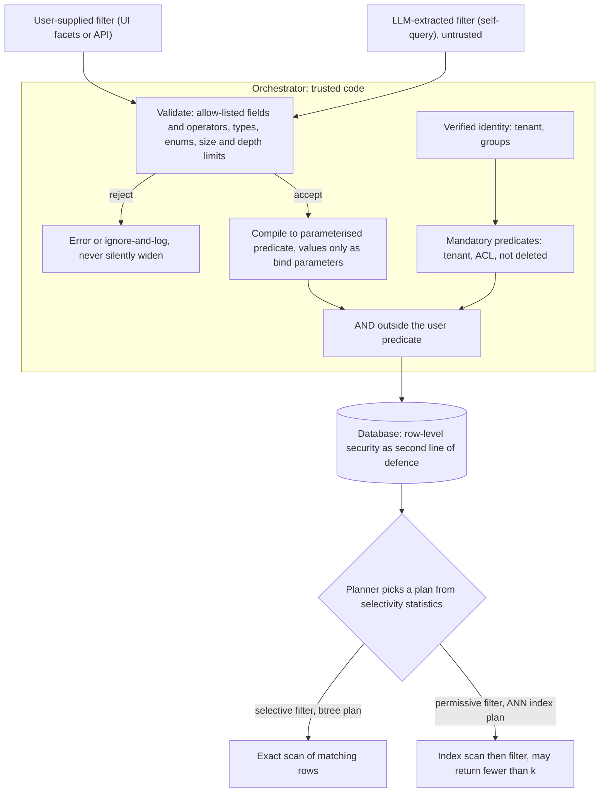
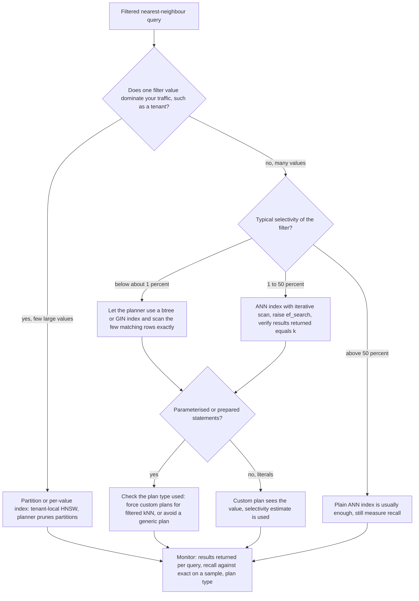

# Chapter 13 — Metadata Filtering

> **Evidence legend.** **[S#]** = supported by a source in References (IDs map to `project-management/RESEARCH-REGISTER.md`; papers were read at abstract level only, so numbers quoted are the authors' own abstract claims). **[E]** = engineering recommendation/reasoning. **[A]** = assumption. **[I]** = illustrative. **[X]** = executed and verified in this repository. **[V]** = vendor-reported. **[N]** = not researched. Research date: 2026-11-08. **Measured results come from PostgreSQL 16.12 + pgvector 0.8.7 (built from source) on small synthetic data**: 20,000 random 16-dimensional vectors, a single table, no connection pooler, no concurrent load (OI-036, OI-037, OI-044). They show *shape and mechanism*; absolute numbers will differ on real embeddings (hundreds to thousands of dimensions), larger tables and other versions.

## 13.1 Learning Objectives

After this chapter you can:

1. Design a metadata schema that separates security, structural, temporal and semantic attributes, and choose typed columns vs. JSON.
2. Explain pre-filtering, post-filtering and in-algorithm filtering, and predict which one an engine applies.
3. Explain why a filter can make an approximate index return **fewer than *k*** results, and use the measured selectivity bands to pick a strategy.
4. Recognise the **generic-plan trap** for prepared statements and prevent it.
5. Choose between a global index with iterative scan, partial indexes and partitions.
6. Treat user-supplied and LLM-extracted ("self-query") filters as untrusted: validate, parameterise, and AND them *outside* the mandatory security predicates.
7. Handle temporal validity, missing values and array-valued metadata correctly.

## 13.2 Problem Statement

Real questions carry constraints that similarity cannot express: *only current HR policies*, *only documents this user may read*, *only English*, *effective in 2024*. Metadata filtering turns those constraints into predicates evaluated during retrieval. Three things make this harder than it looks:

1. **Vector indexes are not built for predicates.** An approximate nearest-neighbour (ANN) index finds neighbours of the query, and a filter applied afterwards can discard most of them (Chapter 5, now measured below).
2. **The best execution strategy depends on the filter's selectivity**, which varies by tenant, by value and over time, and which the planner estimates from statistics.
3. **Filters are a security boundary and an attack surface.** Tenant and ACL predicates must never be skippable, and a filter extracted by an LLM from natural language is untrusted input.

## 13.3 Why It Matters in Production

- **Silent under-retrieval.** Measured **[X]**: with a 10% filter, default HNSW returned **4.10 of the 10** requested results; with iterative scan, 10.00 (§13.4.3). The query "works" and returns something, so nothing alerts.
- **Plan-dependent correctness.** Measured **[X]**: the *same* query for a 1% filter returned **10.00/10** with a custom plan and **0.45/10** with a generic prepared-statement plan, because the generic plan chose the ANN index (§13.4.4).
- **Filters protect tenants.** Chapter 8's isolation model depends on predicates that cannot be omitted (ADR-006).
- **Vendors disagree on defaults.** Azure AI Search recommends and defaults to pre-filtering for newer indexes [S7]; pgvector applies filters to the index scan's results unless iterative scan is enabled [S1, X].

## 13.4 Core Concepts

### 13.4.1 What metadata to store

Group attributes by purpose [E]:

| Group | Examples | Used for | Notes |
|---|---|---|---|
| **Security** | `tenant_id`, `acl_groups`, `classification`, `is_deleted` | Mandatory predicates | Never optional; never user-controlled (§13.4.8, Chapter 8) |
| **Structural** | `source_system`, `doc_type`, `document_id`, `version`, `section_path` | Scoping, parent lookup (Chapter 14), deduplication | Set at ingestion (Chapter 3) |
| **Temporal** | `created_at`, `effective_from`, `effective_to`, `superseded_by` | As-of queries, freshness | §13.4.7 |
| **Semantic** | `department`, `product`, `language`, `region`, `tags` | Facets and user-visible filters | Quality depends on extraction |
| **Trust / quality** | `source_tier`, `reviewed_at`, `ocr_confidence` | Boosting, exclusion, audit | Often soft signals |

Design rules [E]: filterable attributes that appear in most queries become **typed columns** with constraints and, where selectivity warrants, indexes; sparse or long-tail attributes may live in `jsonb`. Record the attribute's **provenance** (`extracted_by`, extraction version) so a change in the extractor can be rolled back, and decide the **missing-value policy** up front (§13.4.9).

**Typed column vs. JSONB, measured [X].** With one skewed key (1% `legal`), the planner's row estimate was **200 for the typed column and 200 for `meta @> '{"dept":"legal"}'` against an actual 200** (a GIN `jsonb_path_ops` index and a btree index respectively). I expected the JSONB estimate to be poor and **did not reproduce that** for a single-key containment predicate. This does not show JSONB is always safe: I tested one key, one skew and one operator, and not multi-key documents, nested paths or range comparisons (OI-044). Prefer typed columns for hot filters because they give you constraints, type checking and straightforward statistics, and verify estimates with `EXPLAIN` before adopting JSON for anything performance-critical.

### 13.4.2 Where the filter is applied

| Strategy | What happens | Result count | Cost |
|---|---|---|---|
| **Pre-filter** | Restrict the candidate set, then search it (exactly, or with an index that honours the predicate) | Up to *k*, if *k* matches exist | Can be slow for permissive filters on exact scan; can traverse much of an ANN graph for selective ones |
| **Post-filter** | Run unfiltered ANN, then discard non-matching hits | **Can be fewer than *k*** | Predictable, but starves under selective filters |
| **In-algorithm** | The index traversal honours the predicate while searching | Up to *k* | Index-specific; may need specialised structures |

What engines say, from their own documentation:

- **Azure AI Search** exposes `vectorFilterMode`: `preFilter` applies the filter *during* HNSW traversal per shard and "guarantees that *k* results are returned if they exist"; `postFilter` runs traversal and filter independently per shard and "can create false negatives for highly selective filters or small *k* values"; `strictPostFilter` (preview) filters the global top-*k* and "can return zero results" for selective filters. `preFilter` is the default for indexes created after about 15 October 2023; older indexes default to `postFilter` and must be recreated to use `preFilter` [S7]. Its own benchmark (vendor-run, not reproduced) found pre-filtering slower than post-filtering at high selectivity, with differences from comparable to "about seven times slower" depending on index size and selectivity **[V]**.
- **pgvector** applies a `WHERE` clause after the approximate index returns its candidates, so a selective filter can return fewer rows than requested; `hnsw.iterative_scan` (and `ivfflat.iterative_scan`) continue scanning until enough rows pass or a limit (`hnsw.max_scan_tuples`, default 20,000, confirmed **[X]**) is reached [S1]. Chapter 5 and the table in §13.4.3 measure this.
- **Qdrant** advises creating payload indexes for the fields you filter on, ideally before ingesting data, and notes that unindexed conditions still return correct results but run slower; some conditions (for example substring match) are rejected in strict mode [S103]. I read only the first 100,000 characters of that page; its filterable-HNSW section is **unread** (OI-045).
- **Pinecone** documents operators (`$eq`, `$in`, `$and`, `$or`, ranges on numbers, `$exists`), caps `$in`/`$nin` arrays at 10,000 values, and gives array-field semantics (a filter matches if *any* element matches; `$ne` and `$nin` exclude a record if *any* element matches). The page does not say whether filtering is applied before or during search [S104].
- **Research:** ACORN extends HNSW with predicate-subgraph traversal to support arbitrary predicates; the authors report "2–1,000× higher throughput at a fixed recall" than prior methods (abstract; authors' claim, benchmark details unread) [S102].

### 13.4.3 Selectivity decides what happens (measured)

**Executed [X]** (`scripts/verify-sql/06-metadata-filtering.sql`, test T6a): 20,000 rows, HNSW index (`m=16`, `ef_construction=64`), `hnsw.ef_search=40`, btree index on `category`; 30 random queries per filter; *k* = 10; recall measured against an exact scan over the filtered rows; the planner chose the plan naturally (literal SQL, so a custom plan per query).

| Filter | Selectivity (rows) | Plan chosen | Returned of 10, default | Returned of 10, `iterative_scan=relaxed_order` | Recall vs. exact, default / iterative |
|---|---|---|---|---|---|
| `c50` | 50% (10,000) | HNSW | 10.00 | 10.00 | 0.987 / 0.993 |
| `c10` | 10% (2,000) | HNSW | **4.10** | 10.00 | **0.410** / 1.000 |
| `c1` | 1% (200) | btree on `category`, exact sort | 10.00 | 10.00 | 1.000 / 1.000 |
| `c01` | 0.1% (20) | btree on `category`, exact sort | 10.00 | 10.00 | 1.000 / 1.000 |

Three observations, all from this run:

1. **Starvation has a middle band.** The planner protected the very selective filters by switching to the btree index and sorting a few hundred rows exactly. It did *not* protect the 10% filter, where the cost estimate favoured HNSW but only about 4 of every 10 candidates survived the filter (`ef_search` 40 × 10% ≈ 4, the same arithmetic as Chapter 5's earlier result of 4.00).
2. **Iterative scan restored full results** wherever the ANN index was used, consistent with the pgvector documentation [S1].
3. **Where the boundaries lie is data-dependent.** These bands (50%, 10%, 1%, 0.1%) belong to this table size, dimensionality, index parameters and statistics. Your crossover will differ; measure it with your own data by sweeping selectivity as above.

### 13.4.4 The generic-plan trap (measured)

PostgreSQL can execute a prepared statement with a *custom plan*, generated for the supplied parameter values, or a *generic plan*, "the same across all executions". By default (`plan_cache_mode = auto`) the first five executions use custom plans; a generic plan is then created and used if its estimated cost is "not so much higher" than the average custom-plan cost. `plan_cache_mode` can force either [S105]. A generic plan cannot use the actual filter value to estimate selectivity.

**Executed [X]** (test T6e, forced modes, `iterative_scan=off`, 20 queries each):

| Filter | `force_custom_plan` | `force_generic_plan` |
|---|---|---|
| `c1` (1%) | btree plan, **10.00/10** returned | HNSW plan, **0.45/10** returned |
| `c01` (0.1%) | btree plan, **10.00/10** returned | HNSW plan, **0.00/10** returned |

The same SQL text, the same data, and a 1% filter returns almost nothing under the generic plan, because the planner, without the value, assumes an average-sized category and prefers HNSW, whose results are then almost all discarded. **What I did not measure:** whether `auto` mode switches to the generic plan for this query in your driver after five executions, or how any specific driver or ORM prepares statements (OI-044). Whether this bites you is therefore something to **test in your own stack**: run the filtered query through your real data-access layer and compare the plan (`EXPLAIN EXECUTE` shows `$n` symbols for a generic plan [S105]) and the returned count.

Mitigations [E]: set `plan_cache_mode = force_custom_plan` for the retrieval session or transaction (`SET LOCAL`), avoid server-side prepared statements for the filtered kNN query, enable iterative scan (§13.4.3), and **monitor results returned per query** against *k*, which turns this silent failure into an alert.

### 13.4.5 Partial indexes

A partial HNSW index covers only rows matching its predicate and is usable only when the query's `WHERE` clause implies it. **Executed [X]** (T6b): with `CREATE INDEX … USING hnsw … WHERE category = 'c10'`, the planner used it for `category = 'c10'` and did **not** use it for `category = 'c50'`; the c10 query returned 10/10 through the natural plan. Use case: a small number of hot, stable filter values (for example a handful of large tenants or a "current documents only" subset). Cost: one index per value to build, store and maintain **[E]**.

### 13.4.6 Partitioning

Declarative **list partitioning** by tenant gives each partition its own HNSW index, and the planner prunes partitions that cannot match. **Executed [X]** (T6c): with three tenant partitions, a query with the tenant predicate referenced **1** partition; without it, **3**; and the 10%-tenant query returned **10/10** with default settings and *no* iterative scan, because its partition-local index contains only that tenant's rows. This is ADR-006's "tenant-local index" pattern realised in SQL. Limits **[E]**: partition count and per-partition index memory grow with tenants (thousands of partitions strain planning and maintenance), a query that spans partitions must merge their results, and the predicate must always be present, which is one more reason the mandatory tenant clause is built by the platform, not by callers.

### 13.4.7 Temporal metadata

Time constraints come in two kinds [E]:

- **Hard validity:** "the policy in force on 2024-03-01" requires `effective_from <= :as_of < effective_to` (half-open intervals avoid overlap bugs) and supersession links so old versions are excluded by default, not deleted.
- **Soft freshness:** "prefer recent" is a ranking signal (boost or decay), not a filter; hard cutoffs silently drop the only relevant document.

Store timestamps in UTC with time zone, record both *document-effective* time and *ingestion* time, and make "as of" an explicit request parameter so audits can reproduce an answer. I executed no temporal-query test in this chapter.

### 13.4.8 Untrusted filters: user input and self-query

Two sources produce filters at runtime: UI facets or API parameters, and an LLM that extracts constraints from the question ("self-query": *"2024 security policies in German"* → `{doc_type: policy, year: 2024, language: de}`). Both are untrusted [E, S57]. The compiler must:

1. accept only **allow-listed fields and operators**, rejecting unknown ones rather than ignoring them;
2. **type-check** values against the schema and enum sets, and bound list sizes, nesting depth and condition count;
3. pass values **only as bind parameters**;
4. **AND the mandatory predicates outside** the user predicate and give the user no way to name `tenant_id`, `acl_groups` or `is_deleted`.

**Executed [X]** (`docs/exercises/ch13_filter_compiler.py`): for `{"doc_type": {"$eq": "policy"}, "created_at": {"$gte": "2025-01-01"}}` the compiler emits `tenant_id = %s AND acl_groups && %s AND is_deleted = false AND (doc_type = %s) AND (created_at >= %s)` with parameters `['tenantA', ['g1'], 'policy', date(2025, 1, 1)]`. Assertions confirm that an `$or` supplied by the user stays inside its own parentheses after the mandatory clause; forbidden fields (`tenant_id`, `acl_groups`, `is_deleted`, and an `$or` that names them) are rejected; an injection-looking string appears only as a parameter; invalid enum values, booleans as integers, bad dates, unknown operators, empty or oversized `$in` lists, over-deep nesting and over-large filters are rejected. **Seven injected defects were detected** (unknown fields allowed, values interpolated into SQL text, deleted or ACL predicates dropped, user filter placed first, depth and size limits removed). The compiler is a teaching artifact for one schema; it supplements, and does not replace, database-enforced isolation (Chapter 8).

For LLM-extracted filters additionally [E]: prefer **suggesting** filters to the user over silently applying them; apply them as soft boosts first; log the extracted filter (not the question) for audit; and measure the extraction accuracy on the golden set, because a wrongly applied hard filter removes the right answer with no error.

### 13.4.9 Missing values and arrays

SQL three-valued logic means `department = 'legal'` excludes rows where `department` is `NULL`, and `department <> 'legal'` excludes them too **[E]**. Decide explicitly whether "unknown" means *include*, *exclude* or *ask*, and encode it (`IS NOT DISTINCT FROM`, an explicit `'unknown'` value, or a separate `has_department` flag). For array fields, define the quantifier: Pinecone documents "any element matches" for positive operators and "excludes the record if any element matches" for `$ne`/`$nin` [S104]; in SQL use `&&` (overlap) or `@>` (contains) deliberately. Qdrant's nested filters exist because separate conditions on an array of objects can otherwise match different elements [S103].

## 13.5 Architecture

<!-- figure:13-filter-compilation -->


*Figure 13.1: Architecture. Original diagram; source below.*

<details><summary>Mermaid source</summary>



</details>
<!-- /figure -->

*Original diagram by the handbook author; source `docs/assets/diagrams/13-filter-compilation.mmd`.*

<!-- figure:13-filter-strategy-decision -->


*Figure 13.2: Architecture. Original diagram; source below.*

<details><summary>Mermaid source</summary>



</details>
<!-- /figure -->

*Original diagram by the handbook author; source `docs/assets/diagrams/13-filter-strategy-decision.mmd`. The percentage bands are the ones observed in the §13.4.3 experiment and must be re-measured for your data.*

Component responsibilities [E]: **filter validator/compiler** (pure, unit-tested, §13.4.8); **identity resolver** (supplies tenant and groups from the verified token, Chapter 8); **index strategy** (global index + iterative scan, partial indexes or partitions, chosen per tenant size class); **statistics owner** (runs `ANALYZE` after bulk loads); **results-returned monitor** (alerts when fewer than *k* are returned while enough matching rows exist); **metadata extractor** (ingestion-time, versioned).

## 13.6 Practical Example (Illustrative, Executed [X])

Two executed artifacts back this chapter. `scripts/verify-sql/06-metadata-filtering.sql` creates a 20,000-row table with deterministic category sizes (50%, 10%, 1%, 0.1%), an HNSW index, a btree on `category`, a partial index, a list-partitioned table and a JSONB column, and asserts the behaviours in §13.4.3–13.4.7 inside the database. `docs/exercises/ch13_filter_compiler.py` verifies the compiler properties in §13.4.8. A first draft of T6a captured the plan from the first query only and ran the measured queries inside a PL/pgSQL block, which itself uses prepared plans; the 1% and 0.1% filters returned almost nothing even though the captured plan said "btree". That inconsistency led to the generic-plan experiment (§13.4.4): the harness had reproduced the trap by accident. The final harness uses dynamic SQL with literals for T6a and explicit `PREPARE` for T6e.

## 13.7 Implementation

Executed: `python -I scripts/verify-sql.py` **[X]** (2026-11-08; Docker Desktop 29.0.1; PostgreSQL 16.12 + pgvector 0.8.7 built from source; all six SQL files pass, including `06-metadata-filtering.sql`) and `python -I docs/exercises/ch13_filter_compiler.py --mutants` **[X]** (all assertions pass; seven defects killed).

Core retrieval predicate pattern **[I, derived from the executed SQL]**:

```sql
-- One transaction per request. Identity is set with SET LOCAL (Chapter 8).
BEGIN;
SET LOCAL app.tenant_id = :tenant;                   -- never session-level (Chapter 8: leaks across requests)
SET LOCAL plan_cache_mode = force_custom_plan;       -- §13.4.4: the planner must see the filter value
SET LOCAL hnsw.iterative_scan = relaxed_order;       -- §13.4.3: keep scanning until k rows pass
SET LOCAL hnsw.ef_search = 100;                      -- tune from a recall sweep, not a default
SELECT id, document_id
FROM chunks
WHERE tenant_id = :tenant AND acl_groups && :groups AND is_deleted = false
  AND doc_type = ANY(:doc_types)                     -- user filter, compiled and parameterised
ORDER BY embedding <=> :query_vec
LIMIT :k;
COMMIT;
```

Note on `relaxed_order`: as the name indicates, results need not be in strict distance order [S1]; if exact order matters use `strict_order` or re-sort the *k* returned rows (a reranker, Chapter 12, reorders them anyway) **[E]**. `<=>` requires an index built with the cosine operator class; an `<=>` query does not use a `vector_ip_ops` index (Chapter 5, **[X]**).

## 13.8 Trade-offs

| Decision | Option A | Option B | Trade-off |
|---|---|---|---|
| Pre- vs. post-filter | Returns *k* if they exist [S7] | Predictable cost, may starve [S7, X] | Correctness for selective filters vs. latency for permissive ones |
| Global index + iterative scan vs. partitions | Simple; one index [X] | Tenant-local recall without iterating [X]; operational overhead | Tenant count and size skew decide |
| Partial index vs. partition | Targets a few hot values [X] | General per-key isolation [X] | Number of distinct values to cover |
| Typed columns vs. JSONB | Constraints, clear statistics | Flexible schema [X, one key measured] | Verify estimates with `EXPLAIN` |
| Hard filter vs. soft boost | Guarantees the constraint | Never excludes the only relevant document | Use hard for security/validity, soft for preference |
| LLM-extracted filter: auto-apply vs. suggest | Fewer clicks | Wrong filter hides the answer silently | Suggest, boost, or require confirmation |
| Literal SQL vs. prepared statements | Custom plan sees the value [X] | Lower planning cost; generic-plan risk [X] | Force custom plans for filtered kNN |

## 13.9 Failure Modes

| Failure | Root cause | Symptom | Detection | Mitigation |
|---|---|---|---|---|
| Silent under-retrieval | Post-filter on ANN index at moderate selectivity [X] | Fewer than *k* results, lower recall | `returned < k` while matches exist; recall vs. exact on a sample | Iterative scan; partitions; raise `ef_search` |
| Generic-plan starvation | Prepared statement planned without the value [X] | Selective filters return ~0 | Plan type in logs; returned count | `force_custom_plan`; avoid prepared statements for this query |
| Stale statistics | No `ANALYZE` after bulk load | Planner picks the wrong plan | `EXPLAIN` estimated vs. actual rows | Analyze after loads; monitor |
| Filter skipped | Mandatory predicate built by callers | Cross-tenant results | Cross-tenant tests; row-level security as backstop | Compiler builds it; RLS (Chapter 8) |
| Injection via filter value | String interpolation [X] | Data exfiltration or errors | Static analysis; tests with hostile values | Bind parameters only |
| Wrong self-query filter | LLM extracted the wrong constraint | Correct document hidden | Extraction accuracy on golden set | Suggest/boost; log; confirm |
| NULL surprise | Three-valued logic | Rows with missing metadata vanish | Count by missing-value class | Explicit unknown policy |
| Index sprawl | Partial index or partition per value | Build/memory/maintenance cost | Index count and size dashboards | Cap; use size classes |
| Inconsistent metadata | Extractor changed between ingestion batches | Facets split or empty | Distribution drift on values | Versioned extractor; backfill |

## 13.10 Security Considerations

- **Mandatory predicates are built by trusted code**, from the verified identity, and AND-ed outside every user filter [E, X]. A user or LLM filter naming `tenant_id` or `acl_groups` is rejected, not merged.
- **Defence in depth:** keep row-level security as a second line (Chapter 8), and remember that RLS shares the starvation behaviour with a plain `WHERE` on an ANN index (Chapter 8, measured **[X]**: a ~5% tenant got about 2 of 10 results by default, 2.03 in the Chapter 8 run and 2.05 in a later re-run of the suite).
- **Parameterise everything** (§13.4.8). Never build filters by string concatenation, including values the model produced.
- **Do not leak through facets.** Counts and facet values computed over documents the user cannot read disclose their existence; compute facets over the *authorised* set only **[E]**.
- **Error messages** from filter rejection should say which field was invalid without echoing other tenants' schema or values.
- **Rate-limit expensive filters** (very large `$in`, deep nesting): the compiler's size and depth caps are cost controls as well as safety controls.
- **Self-query injection.** A document or question can try to induce the model to emit a permissive or malicious filter; the allow-list and mandatory clause make that harmless to isolation, but not to relevance **[E, S57]**.

## 13.11 Performance Considerations

- **Index the predicate fields you filter on** and keep statistics fresh; Qdrant states this explicitly for its payload indexes [S103], and in PostgreSQL the btree on `category` is what let the planner choose an exact scan for selective filters **[X]**.
- **`ef_search` and iterative scan trade latency for recall**; Chapter 5 measured the `ef_search` curve (recall@10 of about 0.89 at `ef_search` 10 rising to 1.000 at 200, **[X]**; the exact third decimal varies between runs because the queries are random). With filters, measure the *returned count* too.
- **Azure's pre-filter vs. post-filter benchmark** (vendor-run, not reproduced): prefiltering was comparable on a 100,000-vector index when the filter kept more than 30% and about 50% slower below 0.1%; about 7× slower on 1 million vectors below 2%; about 7× slower on 1 billion 96-dimensional vectors below 10% **[V]**. The point is the direction (selectivity changes the winner), not the numbers.
- **Partitioning** reduces the work for tenant-scoped queries but multiplies indexes; check planning time with many partitions **[E, N]**.
- **Measure with your own data:** sweep selectivity; capture plan type, returned count, recall vs. exact, p50/p95/p99. I did not measure latency in this chapter's experiments (the SQL asserts correctness and plan shape, not speed).

## 13.12 Cost Considerations

Per-value or per-tenant indexes and partitions trade storage and build time for recall and isolation: a vector index was 1.33× raw vector bytes at 1536-d in Chapter 5's measurement **[X]**, so *N* partial or partition-local indexes cost roughly *N* times their share. A global index with iterative scan costs extra latency at query time instead. Managed engines expose the trade as pricing and mode choices (for example Azure's pre- vs. post-filter [S7]); I did not collect prices **[N]**. Metadata extraction at ingestion (OCR/LLM tagging) can dominate ingestion cost; budget it per document **[E]**.

## 13.13 Production Recommendations

1. Compile all filters in one reviewed component (§13.4.8); never let callers assemble SQL or security predicates.
2. Index every field used in hot filters; run `ANALYZE` after bulk loads and large deletions.
3. Sweep selectivity for your data (as in §13.4.3) and record the bands where the planner switches plans and where results are starved.
4. Enable iterative scan for filtered ANN queries, tune `ef_search` from a recall sweep, and re-sort if you used `relaxed_order` and order matters.
5. Force custom plans (or avoid prepared statements) for the filtered kNN query; test your actual driver/ORM path (§13.4.4).
6. Alert on `returned < k` when enough matching rows exist, and sample recall against an exact scan.
7. Use partitions or per-value indexes for large, stable tenants; use shared indexes with filters for the long tail (ADR-006).
8. Treat self-query filters as suggestions or boosts; log them; measure their accuracy.
9. Define the missing-value policy and array quantifiers per attribute and test them.
10. Keep RLS as a backstop, test cross-tenant access on every retrieval path (Chapter 22), and re-run `verify-sql.py` when schema or index choices change.

## 13.14 Architecture Decision Guidance

See **ADR-009** (Metadata filtering and filter execution). Default: typed metadata columns; mandatory predicates built by the platform; a single filter compiler; global HNSW with iterative scan and forced custom plans for filtered kNN; tenant-local partitions or indexes for tenants above a size threshold (ADR-006); results-returned and recall monitors. Reversal triggers: measured starvation persists despite iterative scan (move to partitions or an engine with in-algorithm filtering such as pre-filtering [S7] or ACORN-style indexes [S102]); partition count or index memory becomes unmanageable; the extraction pipeline's accuracy is too low for hard filters; version upgrades change planner behaviour (re-run the SQL suite).

## 13.15 Interview Questions

1. **Why can a filtered vector query return fewer than *k* results?** Post-filtering on an ANN index discards candidates that do not match; with a 10% filter and 40 candidates, about 4 survive [X, S1, S7].
2. **Pre-filter vs. post-filter?** Pre-filter restricts first and returns *k* if they exist but can be slow; post-filter is predictable but can starve under selective filters; Azure documents both and defaults new indexes to pre-filtering [S7].
3. **A prepared statement works in dev but returns almost nothing in prod for small tenants. Why?** A generic plan chosen without the filter value can prefer the ANN index, whose candidates are then filtered away [X, S105]; force custom plans, enable iterative scan, and alert on returned count.
4. **How do you filter by tenant at scale?** Mandatory predicate plus RLS backstop (Chapter 8); partitions or tenant-local indexes for large tenants; shared index + iterative scan for the tail [X, ADR-006].
5. **Is an LLM-extracted filter safe to apply?** It is untrusted; allow-list and type-check it, parameterise, never let it touch security predicates, and prefer suggesting or boosting [E, X].
6. **Typed column or JSONB for metadata?** Typed for hot filters (constraints, statistics); JSONB for the long tail; verify planner estimates with `EXPLAIN` [E, X].
7. **How do you model "current policy as of date D"?** Half-open validity intervals plus supersession, an explicit as-of parameter, never deleting old versions [E].
8. **How would you detect silent under-retrieval?** `returned < k` while the exact count of matching rows ≥ *k*, and recall against an exact scan on a sampled set of queries [X].
9. **What does a partial index buy you and cost you?** An index only for a predicate, used only when the query implies it; costs one index per value [X].

## 13.16 Knowledge Checkpoint / Exercises

1. Run `verify-sql.py`; change the category sizes in `06-metadata-filtering.sql` so the planner's crossover moves, and report the new bands.
2. Add `hnsw.ef_search = 200` to T6a and report the returned count and recall for the 10% filter without iterative scan; explain the arithmetic.
3. Reproduce T6e with `plan_cache_mode = auto` and a loop of 10 executions; report on which execution (if any) the plan flips and what it does to the returned count.
4. Extend `ch13_filter_compiler.py` with a `$not` operator and write the tests and a mutant that would let `$not` bypass the mandatory clause.
5. Add a temporal validity filter (`effective_from <= :as_of < effective_to`) to the SQL and test an as-of query across a superseded document.
6. Measure query latency for the 10% filter under global-index-plus-iterative-scan vs. a partition-local index, with warm cache and a representative concurrency level.

## 13.17 Summary

Metadata filters express constraints that similarity cannot, and they are both a relevance mechanism and a security boundary. The executed PostgreSQL + pgvector experiments (synthetic data, PG16) showed that filter selectivity determines the outcome: a 10% filter on an HNSW index returned 4.10 of 10 results by default and 10.00 with iterative scan; 1% and 0.1% filters were rescued by the planner choosing a btree plan and an exact sort; and a generic prepared-statement plan reversed that rescue, returning 0.45 and 0.00 of 10. A partial index served only its own predicate, and list partitioning pruned a tenant query to one partition and kept a 10% tenant at 10 of 10 without iteration. Untrusted filters, whether from users or from an LLM, must be allow-listed, type-checked, parameterised and AND-ed outside mandatory predicates; the executed compiler and its seven caught defects demonstrate those properties on a teaching schema. Design metadata deliberately, choose the strategy from measured selectivity bands, force custom plans, monitor returned counts and recall, and keep database-enforced isolation as the backstop.

## References

- [S1] pgvector README (filtering, iterative index scans, HNSW/IVFFlat parameters). https://github.com/pgvector/pgvector
- [S7] Microsoft, *Vector query filters — Azure AI Search* (2026-04-27). https://learn.microsoft.com/en-us/azure/search/vector-search-filters
- [S57] OWASP GenAI Security Project, *LLM01: Prompt Injection*. https://genai.owasp.org/llmrisk/llm01-prompt-injection/
- [S102] Patel, Kraft, Guestrin, Zaharia, *ACORN: Performant and Predicate-Agnostic Search Over Vector Embeddings and Structured Data*, arXiv:2403.04871. https://arxiv.org/abs/2403.04871 (abstract; authors' claims)
- [S103] Qdrant documentation, *Filtering*. https://qdrant.tech/documentation/concepts/filtering/ (first 100,000 characters read)
- [S104] Pinecone documentation, *Filter by metadata*. https://docs.pinecone.io/guides/search/filter-by-metadata
- [S105] PostgreSQL 16 documentation, *PREPARE* (generic and custom plans; `plan_cache_mode`). https://www.postgresql.org/docs/16/sql-prepare.html
