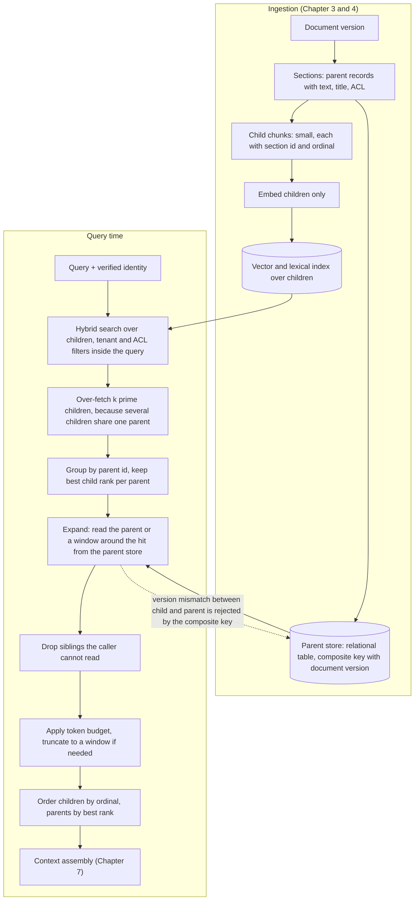
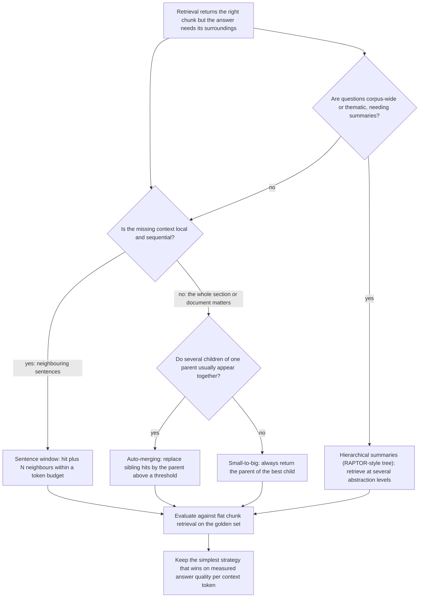

# Chapter 14 — Parent-Child and Hierarchical Retrieval

> **Evidence legend.** **[S#]** = supported by a source in References (IDs map to `project-management/RESEARCH-REGISTER.md`; papers were read at abstract level only, so numbers quoted are the authors' own abstract claims). **[E]** = engineering recommendation/reasoning. **[A]** = assumption. **[I]** = illustrative. **[X]** = executed and verified in this repository. **[V]** = vendor-reported. **[N]** = not researched. Research date: 2026-11-08. **The executed examples use no embedding model and no language model.** The Python exercise is a ten-chunk lexical toy; the SQL experiment uses 6,000 synthetic 16-dimensional vectors clustered around section centroids on PostgreSQL 16.12 + pgvector 0.8.7 (OI-036, OI-047). They verify mechanics, lifecycle and security properties, not retrieval quality on real documents.

## 14.1 Learning Objectives

After this chapter you can:

1. Explain the small-chunk/large-chunk tension and how parent-child ("small-to-big") retrieval resolves it.
2. Choose between whole-parent expansion, sentence-window expansion, auto-merging and hierarchical summaries.
3. Model parent-child data so versions, permissions and deletion stay consistent.
4. Size the child over-fetch needed to obtain *n* distinct parents, and enforce a token budget without discarding the best evidence.
5. Prevent **permission leakage through expansion**.
6. Evaluate a hierarchical strategy against flat chunk retrieval.

## 14.2 Problem Statement

Chapter 4 showed that chunk size pulls two ways: small chunks produce embeddings that match a specific question precisely, while large chunks carry the context needed to answer it. A fact and the sentence that qualifies it often sit in adjacent chunks, so retrieving only the best-matching chunk can return half an answer (§14.6 constructs exactly this case). Parent-child retrieval decouples the two roles: **index small units for matching, return larger units for reading**. LangChain's documentation states the idea as "retrieve small chunks then retrieve their parent documents", where a parent is the full document or a larger chunk [S107].

That introduces new engineering questions: how many children must be fetched to obtain enough distinct parents, how large an expansion the context budget allows, how permissions and versions propagate from parent to child, and what deletion and re-ingestion do to the hierarchy.

## 14.3 Why It Matters in Production

- **Completeness vs. precision.** Executed **[X]** (toy corpus): the top-1 child hit carried only one of two needed facts; its parent section carried both, at **41 words instead of 12** (3.4× the context). At *k* = 3 the plain child ranking already contained both facts, so expansion is not free insurance: it pays off when the needed evidence is adjacent but not co-ranked.
- **Children collapse into few parents.** Executed **[X]** (clustered synthetic vectors): the top-10 child hits spanned only **2.25** distinct parent sections on average, and **11.8** children had to be fetched to reach 3 distinct parents. A retrieval plan that asks for *k* children and expects *k* parents silently returns far fewer.
- **Expansion is a leak path.** Executed **[X]**: naive expansion of one section returned all **6** chunks, including a restricted sibling; the ACL-filtered expansion returned **5** (§14.4.5).
- **Lifecycle bugs live in the hierarchy.** A parent without children, or a child that outlives its document version, produces answers from deleted or stale content (§14.4.6).

## 14.4 Core Concepts

### 14.4.1 Terminology and the basic pattern

A **child** is the unit that is embedded and indexed (a sentence or short chunk); a **parent** is the unit that is returned to the generator (a section, a page, a larger chunk, or the whole document). Query time [E]: (1) retrieve the top *k′* children with identity filters applied; (2) group by parent; (3) read each parent (or a window around the hit) from a parent store; (4) filter out anything the caller cannot read; (5) apply the context budget; (6) order and assemble. Only children are embedded; parents are plain records, which also reduces vector-index size relative to indexing every level.

### 14.4.2 Expansion strategies

| Strategy | What is returned | Strength | Risk |
|---|---|---|---|
| **Small-to-big** | The parent of each top child | Simple; predictable | Large parents waste tokens; many distinct parents blow the budget |
| **Sentence window** | The hit plus *N* neighbours within a token budget | Bounded cost; keeps local context | Misses context outside the window |
| **Auto-merging** | Sibling hits are replaced by their parent once enough siblings are retrieved | Adapts to how much of a section is relevant | Needs a threshold and a hierarchy of sizes |
| **Hierarchical summaries** (RAPTOR-style) | Summary nodes at several abstraction levels | Helps corpus-wide or thematic questions | Index-time LLM cost; summary staleness and provenance |

LlamaIndex documents auto-merging as follows: a hierarchical node parser produces nodes "from top-level nodes with bigger chunk sizes to child nodes with smaller chunk sizes" (defaults 2048, 512, 128); only leaf nodes are indexed in the vector store while all nodes live in a docstore; and the retriever "recursively 'merges' subsets of leaf nodes that reference a parent node beyond a given threshold". In its own notebook the base retriever returned 6 chunks and the auto-merging retriever 3 merged nodes, and the two "scored about the same" in the notebook's evaluation [S108]. Read that as a caution: the mechanism works, and whether it improves answers is an empirical question for your corpus.

**RAPTOR** recursively embeds, clusters and summarises chunks to build a tree from the bottom up and retrieves from the tree at inference; the authors report gains over traditional retrieval-augmented models and that pairing it with GPT-4 "improve[s] the best performance on the QuALITY benchmark by 20% in absolute accuracy" (abstract; authors' claim, full paper unread) [S106]. Graph-based retrieval (Chapter 11, [S26]) is the relational cousin of this idea.

### 14.4.3 Over-fetching children

If *p* distinct parents are wanted and children cluster, the number of children to fetch is not *p*. **Executed [X]** (SQL T7a; 40 queries that are perturbed copies of existing chunks over 1,000 sections of 6 clustered chunks each): **2.25** distinct sections among the top-10 children; **11.8** children needed on average to reach 3 distinct sections. Both numbers are properties of the *synthetic cluster tightness* (chunk = section centroid + small noise) and will differ on real text. The design consequence is general [E]: fetch *k′ > k* children, group by parent, and keep the best *k* parents; choose *k′* from a measured distribution of distinct-parents-per-*k′* on your golden set, and make it a configuration value.

### 14.4.4 Token budgets and truncation

Parents multiply context size. A policy of "skip any parent that does not fit" can discard the **best** evidence. **Executed [X]** (toy corpus, 40-word budget): the best-ranked parent (the termination section, 41 words) was skipped and a weaker one (the payment section) was kept, covering **neither** needed fact. A sentence-window alternative degrades gracefully: at a 40-word budget it kept the hit (`t2`) and its neighbours that fit but not the second fact (`t4`); at 45 words it contained both. The lesson is not the particular numbers but the policy: when a parent exceeds the budget, **truncate it to a window around the hit** rather than dropping it, and make the dropped-evidence rate a metric.

Also order children within a parent by their **ordinal** (reading order), not by storage order or score. Executed **[X]**: rows were deliberately stored in reverse order; a mutant that trusted storage order was caught.

### 14.4.5 Permissions: expansion must not widen access

A child hit is authorised because it passed the ACL filter inside the search (Chapter 8). The parent record is a *different read*: if it joins in sibling content, any sibling the caller cannot read arrives with it. **Executed [X]** (SQL T7b; Python): the naive section read returned all 6 chunks including a restricted one; the ACL-filtered read returned 5; in the toy corpus a restricted chunk was also not retrievable as a child, and not included in window or merge expansion. Rules [E]:

- Evaluate the ACL **per chunk** on the expansion read, not only on the hit.
- If permissions are defined only at document level, still carry them on every child and parent row so the same filter works everywhere (Azure's guidance for index projections is to include ACL fields in the mappings so "every chunk must inherit them for query-time permission filters to apply" [S109]).
- Never cache an expanded parent keyed by parent id alone; the key must include the caller's permission digest (Chapter 7).
- Redacted content must be redacted in the *parent store* too, not only in the index.

### 14.4.6 Lifecycle: versions, updates and deletion

**Executed [X]** (SQL T7c, T7d): with a composite foreign key from chunk to section to document version and `ON DELETE CASCADE`, deleting a document (30 chunks across 5 sections) removed all of its sections and chunks, and a chunk that claimed document version 2 while referencing a section of version 1 was **rejected** by the key. That is the schema-level version of the Chapter 3 rule that a child must never outlive or mismatch its parent version.

Managed engines make different promises. Azure AI Search index projections generate child documents per parent, recommend **repeating parent fields in each child in a single index** (because "index joins aren't supported" in classic search and separate indexes need application-side merging), and delete children for removed content on the next run; but if a parent is deleted from the data source, children are removed "only if the deletion is detected by a `dataDeletionDetectionPolicy`", otherwise you must delete them manually [S109]. That is a deletion-correctness trap for any GDPR-style erasure promise (Chapter 8) **[E]**.

### 14.4.7 When not to use it

If chunks are already self-contained (FAQ entries, tickets, short records), parent expansion adds tokens without adding information. If one source is already a single short document, the parent is the document. Measure answer quality per context token against flat retrieval before adopting a hierarchy **[E]**.

## 14.5 Architecture

<!-- figure:14-parent-child-retrieval -->


*Figure 14.1: Architecture. Original diagram; source below.*

<details><summary>Mermaid source</summary>



</details>
<!-- /figure -->

*Original diagram by the handbook author; source `docs/assets/diagrams/14-parent-child-retrieval.mmd`.*

<!-- figure:14-hierarchy-strategies -->


*Figure 14.2: Architecture. Original diagram; source below.*

<details><summary>Mermaid source</summary>



</details>
<!-- /figure -->

*Original diagram by the handbook author; source `docs/assets/diagrams/14-hierarchy-strategies.mmd`.*

Component responsibilities [E]: **hierarchy builder** (ingestion; emits sections and children with ids, ordinals, version, ACL); **parent store** (relational, constraint-enforced); **expander** (group, over-fetch accounting, ACL filter, windowing, budget, ordering); **merge policy** (threshold and sibling counts); **summariser** (only if hierarchical summaries are adopted; LLM cost and staleness controls); **metrics** (distinct parents per request, expansion tokens, dropped-evidence rate, merge rate).

## 14.6 Practical Example (Illustrative, Executed [X])

Two executed artifacts. `docs/exercises/ch14_parent_child.py` runs a ten-chunk, three-section contractor-policy corpus with BM25 over children and covers: facts covered vs. context tokens, de-duplication, auto-merging (threshold 0.4: the termination section had 3 of its 4 readable chunks hit and merged; the payment section had 1 of 3 and stayed at chunk level), ACL-safe expansion, budget policies, and reading order. `scripts/verify-sql/07-parent-child.sql` builds the section/chunk schema with composite keys and checks distinct-parent statistics, ACL-filtered expansion, cascade deletion and cross-version rejection. A first mutation run exposed a weak test: the storage order happened to equal reading order, so a mutant that ignored `ordinal` survived. I stored the rows in reverse order and the mutant was then killed. The budget experiment also revealed the "skip drops the best parent" behaviour above, which I had not predicted.

## 14.7 Implementation

Executed: `python -I docs/exercises/ch14_parent_child.py --mutants` **[X]** (2026-11-08, Python 3.14.2; all assertions pass; five injected defects killed: expansion ignoring ACL, no de-duplication, budget ignored, storage-order children, retrieval before authorization) and `python -I scripts/verify-sql.py` **[X]** (seven SQL files pass, including `07-parent-child.sql`).

Parent-expansion query pattern **[I, derived from the executed SQL]**:

```sql
-- children: already filtered by tenant/ACL inside the search; over-fetch k' children, then:
WITH hit AS (
  SELECT section_id, min(rank) AS best_rank
  FROM unnest(:child_ids, :child_ranks) AS t(chunk_id, rank)
  JOIN chunks c USING (chunk_id)
  GROUP BY section_id
  ORDER BY best_rank
  LIMIT :n_parents                              -- keep the best n distinct parents
)
SELECT c.section_id, c.ordinal, c.body
FROM hit JOIN chunks c USING (section_id)
WHERE c.acl && :groups AND c.version = :live_version   -- per-chunk ACL on the expansion read; live version only
ORDER BY hit.best_rank, c.ordinal;                      -- parents by rank, children in reading order
```

Notes [E]: keep parent text in the relational store (or the same table) so expansion is one indexed read (the `(section_id, ordinal)` index in the executed schema); never let the model supply a parent id or section id; apply the budget in tokens counted with the generator's tokenizer, not words.

## 14.8 Trade-offs

| Decision | Option A | Option B | Trade-off |
|---|---|---|---|
| Expansion style | Whole parent: simple [X] | Window: bounded cost [X] | Completeness vs. token cost and predictability |
| Budget policy | Skip oversized parents | Truncate to a window around the hit [X] | Skipping can drop the best evidence [X] |
| Auto-merge vs. always-parent | Adaptive; needs thresholds [S108] | Simple | Tuning effort vs. token savings; measure |
| Hierarchical summaries | Corpus-level questions [S106] | Index-time LLM cost, staleness, provenance | Only if thematic questions are measured failures |
| One index (repeat parent fields) | Uniform shape, no joins [S109] | Separate parent index | Storage duplication vs. query complexity |
| Constraint-enforced hierarchy | Integrity by schema [X] | Application-enforced | Migration effort vs. silent corruption risk |

## 14.9 Failure Modes

| Failure | Root cause | Symptom | Detection | Mitigation |
|---|---|---|---|---|
| Too few distinct parents | Children cluster in one parent [X] | Context has one source though *k* was high | Distinct-parents histogram | Over-fetch *k′*; cap children per parent |
| Context bloat | Large parents, many parents | Token cost and latency up; middle-of-context loss (Chapter 12 [S96]) | Expansion tokens per request | Window expansion; budget; fewer parents |
| Best evidence dropped | Skip-if-too-big policy [X] | Answer lacks the key fact | Dropped-evidence rate | Truncate to window |
| Permission leak via siblings | Parent read ignores per-chunk ACL [X] | Restricted text in the answer | Tests with restricted siblings | ACL filter on expansion; cache keys with permission digest |
| Stale parent | Child and parent from different versions [X] | Mixed old/new content | Version-mismatch audit | Composite key; live-version filter |
| Orphans after deletion | Parent deleted without children, or the reverse [S109] | Deleted content still retrievable | Delete→query tests | Cascade; deletion-detection policy; reconciliation job |
| Wrong reading order | Order by score or storage [X] | Incoherent context | Order assertions | Order by ordinal |
| Over-merging | Threshold too low | Whole sections returned for minor hits | Merge rate | Raise threshold; evaluate |
| Summary drift | Summary node stale vs. sources [E] | Answers cite outdated summaries | Summary-to-source diff checks | Rebuild on change; carry provenance |

## 14.10 Security Considerations

- **Filter children before, and parents again after:** the search filter authorises the hit; the expansion read must authorise every sibling it returns (§14.4.5) [E, X].
- **Summaries are derived data.** A summary of a restricted document is itself restricted; a RAPTOR-style node that clusters chunks across ACL boundaries creates a **cross-ACL leak primitive** unless clustering happens within an ACL scope **[E]**.
- **Parent identifiers are not secrets but must not be model-controlled.** Resolve them server-side from authorised hits.
- **Deletion must propagate to every level and every derived artefact** (children, parents, summaries, caches, backups per policy), tested by delete→query checks (Chapter 8, Chapter 23) [S109, X].
- **Treat expanded text as untrusted** for prompt injection, like any retrieved content (Chapter 22, [S57]): bigger parents carry more room for hidden instructions.

## 14.11 Performance Considerations

Expansion adds a relational read per request, typically one indexed query over a few rows **[E]**; I did not measure its latency. Context size is the main cost driver: tokens passed to the generator grow with parent size × number of parents, and long contexts can degrade use of mid-context evidence [S96, Chapter 12]. Child-only embedding keeps the vector index smaller than indexing every level **[E]**. Over-fetching increases the ANN result size modestly (here *k′* ≈ 12 instead of 3) **[X, synthetic]**.

## 14.12 Cost Considerations

Embedding cost is proportional to children, not parents. Generation cost scales with expanded context tokens: estimate `tokens ≈ n_parents × avg_parent_tokens` and compare with flat top-*k* (`k × avg_chunk_tokens`); in the toy corpus a single expansion was 3.4× the child (41 vs. 12 words) **[X, toy]**. Hierarchical summaries add LLM calls at ingestion proportional to corpus size and to the number of levels, plus re-summarisation on change; no prices are stated and none were collected **[N]**.

## 14.13 Production Recommendations

1. Start flat; adopt parent-child only when failure analysis shows answers missing adjacent context.
2. Model the hierarchy relationally with composite keys including document version and cascade deletes; test cascade and cross-version rejection.
3. Over-fetch children from a measured distinct-parents distribution; make *k′*, parent count and window size configuration.
4. Apply ACL filters on the expansion read per chunk; carry ACL on every level; include the permission digest in any cache key.
5. Enforce a token budget with the generator's tokenizer; truncate to a window around the hit instead of dropping parents; record dropped-evidence rate.
6. Order children by ordinal and parents by best child rank.
7. Evaluate each strategy against flat retrieval on the golden set by answer quality per context token (Chapter 18).
8. Keep summary nodes within one ACL scope, with provenance and a rebuild trigger on source change.
9. Reconcile parents and children periodically and alert on orphans.
10. Re-run the SQL verification suite when schema or index choices change.

## 14.14 Architecture Decision Guidance

See **ADR-003** (chunking baseline, amended here) and **ADR-004** (retrieval architecture). Default: child-level hybrid retrieval with a relational parent store, window expansion within a token budget, and whole-section expansion only for document types where sections are the natural answer unit. Adopt auto-merging only if the merge rate and answer quality justify the tuning; adopt hierarchical summaries only for measured corpus-level question classes and within ACL scopes. Reversal triggers: no quality gain over flat retrieval at equal tokens; expansion tokens dominate cost; permission or deletion tests fail; summary staleness cannot be controlled.

## 14.15 Interview Questions

1. **What problem does parent-child retrieval solve?** The conflict between small chunks (precise matching) and large chunks (sufficient context): index small, return large [S107].
2. **You ask for 10 children and get answers from 2 documents. Why?** Children cluster in few parents; over-fetch and group, sized from a measured distinct-parents distribution [X].
3. **How can parent expansion leak data?** The parent read returns siblings the caller cannot read; filter ACL per chunk on the expansion read and key caches by permission digest [X].
4. **A parent is bigger than the remaining token budget. What do you do?** Truncate to a window around the hit rather than skip it; skipping can drop the best evidence [X].
5. **What does auto-merging do and what is its main risk?** Replaces sibling hits by their parent above a threshold; risk is threshold tuning and no guaranteed gain (the vendor notebook shows similar scores) [S108].
6. **When would you use RAPTOR-style summaries?** Thematic or corpus-wide questions that chunk retrieval cannot answer, accepting index-time LLM cost and staleness risk; keep summaries inside ACL scopes [S106, E].
7. **How do you keep parents and children consistent across versions?** Composite keys including the version, cascade deletes, live-version filters, reconciliation [X].
8. **How does a managed index handle deletion of a parent?** Azure index projections delete children only when deletion detection is configured; otherwise delete manually [S109].
9. **How do you evaluate a hierarchical strategy?** Compare answer quality per context token against flat retrieval on the golden set [E].

## 14.16 Knowledge Checkpoint / Exercises

1. Run `ch14_parent_child.py --mutants`. Add a sixth mutant that applies the ACL filter to hits but not to window expansion, and show which assertion kills it.
2. Change the merge threshold in the exercise from 0.4 to 0.25 and 0.75; tabulate which sections merge and the resulting token counts.
3. In `07-parent-child.sql`, tighten and loosen the cluster noise (0.03) and report how the distinct-parents statistic and the required child fetch change.
4. Add a `superseded_by` column and write the expansion query so only live versions are returned; test an update that re-chunks a document.
5. Implement a dropped-evidence metric (best-ranked parent excluded by the budget) and report it for three budgets.
6. On your own corpus compare flat top-5, small-to-big and window expansion by faithfulness and tokens per answer (requires the Chapter 18 harness).

## 14.17 Summary

Parent-child retrieval indexes small units for precise matching and returns larger units for reading. The executed toy and SQL experiments verified the mechanics that decide whether it works in production: children cluster into few parents, so the child fetch must exceed the parent count (2.25 distinct parents among 10 children in clustered synthetic data); expansion costs context (41 vs. 12 words) and is not needed when the child ranking already covers the facts; a skip-if-too-big budget policy can discard the best evidence, so truncate to a window; naive expansion leaks restricted siblings (6 vs. 5 chunks); reading order must come from ordinals; and composite keys with cascade rules keep versions and deletions consistent. Managed engines offer one-to-many indexing but leave deletion detection and ACL propagation to configuration [S109]. Hierarchical summaries address corpus-level questions at index-time cost [S106]. Adopt a hierarchy only where measurement shows a quality gain per context token over flat retrieval.

## References

- [S26] Edge et al., *From Local to Global: A Graph RAG Approach to Query-Focused Summarization*, arXiv:2404.16130. https://arxiv.org/abs/2404.16130 (abstract)
- [S57] OWASP GenAI Security Project, *LLM01: Prompt Injection*. https://genai.owasp.org/llmrisk/llm01-prompt-injection/
- [S96] Liu et al., *Lost in the Middle*, arXiv:2307.03172. https://arxiv.org/abs/2307.03172 (abstract)
- [S106] Sarthi et al., *RAPTOR: Recursive Abstractive Processing for Tree-Organized Retrieval*, arXiv:2401.18059. https://arxiv.org/abs/2401.18059 (abstract; authors' claims)
- [S107] LangChain reference, *ParentDocumentRetriever*. https://reference.langchain.com/python/langchain-classic/retrievers/parent_document_retriever/ParentDocumentRetriever (class description only; splitter and docstore details not on the page)
- [S108] LlamaIndex documentation, *Auto Merging Retriever*. https://developers.llamaindex.ai/python/examples/retrievers/auto_merging_retriever/
- [S109] Microsoft, *Define index projections — Azure AI Search* (2026-07-28). https://learn.microsoft.com/en-us/azure/search/search-how-to-define-index-projections
