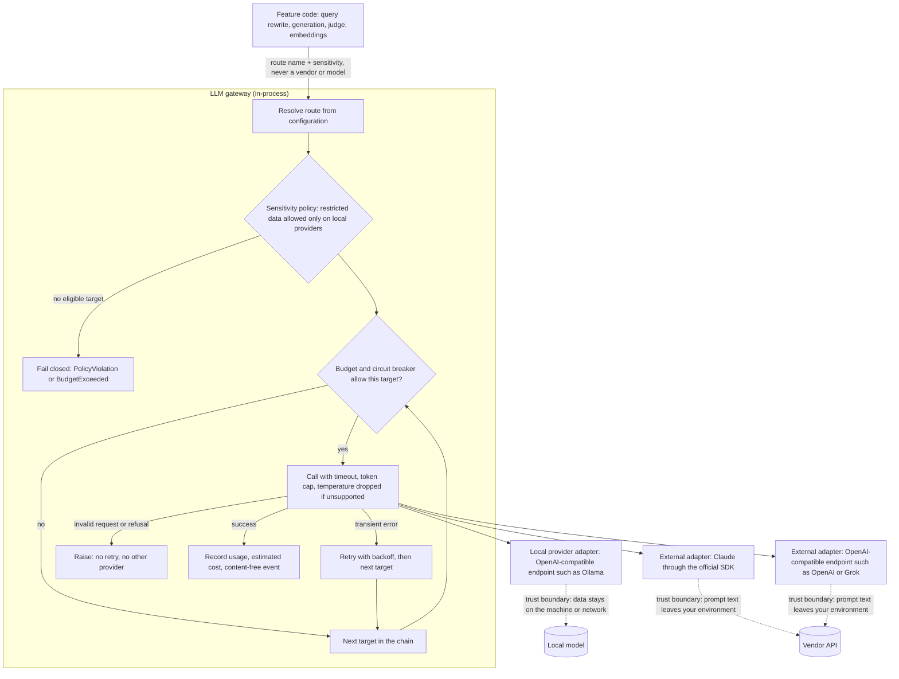
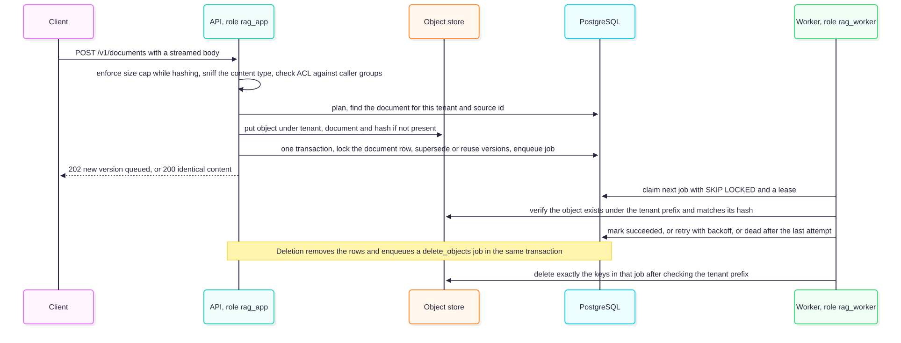
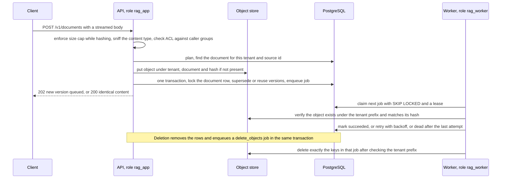
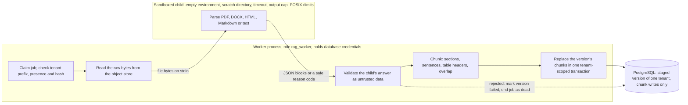
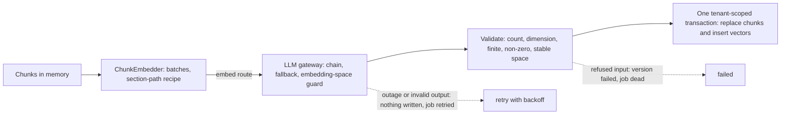

# Chapter 16 — Build a Complete Enterprise RAG Application

> **Status: IN PROGRESS (living chapter).** This chapter is written alongside the reference implementation and is extended after each of the 20 components in CLAUDE.md §4 is built and verified. It currently covers **component 1 of 20 (project foundation)** the cross-cutting **LLM gateway** (§16.5), **component 2, the database schema, roles and migrations** (§16.6) and **component 3, document ingestion, object storage and the job queue** (§16.7). It is not complete and does not yet satisfy the chapter completion gate. **Evidence legend.** **[S#]** = source in References. **[E]** = engineering reasoning. **[X]** = executed and verified in this repository. **[V]** = vendor-reported. **[N]** = not researched. Date of work: 2026-11-08. Everything in "Verified results" was executed on the Windows dev host (Python 3.14.2, Docker Desktop 29.0.1) and in Linux containers.

## 16.1 Learning Objectives

By the end of the completed chapter you will be able to build, run, test and deploy the handbook's reference implementation, and reproduce every claim it makes. For the part written so far you can:

1. Explain the target architecture and the build order of the 20 components.
2. Bring up the local stack (PostgreSQL 16 + pgvector 0.8.7, API) and verify it with health probes and tests.
3. Justify the foundation decisions: structure, configuration, error model, logging, container hardening.
4. Reproduce the verification evidence and read the known limitations.

## 16.2 Scope and Build Order

The implementation is built **one component at a time, each tested before the next** (CLAUDE.md §9.4). The order follows the M1 roadmap:

| # | Component | Status |
|---|---|---|
| 1 | Foundation (layout, config, Docker Compose, health checks) | **Built and verified (2026-11-08)** |
| — | **LLM gateway** (cross-cutting; provider-neutral access to Claude, OpenAI, Grok and local models) | **Built and verified (2026-11-08)**, see §16.5 |
| 2 | Database schema and migrations (roles, RLS, indexes) | **Built and verified (2026-11-09)**, see §16.6 |
| 3 | Document ingestion API, object storage, job queue and worker | **Built and verified (2026-11-09)**, see §16.7 |
| 4 | Extraction and chunking | **Built and verified (2026-11-09)**, see §16.8 |
| 5 | Embeddings (provider adapters) | Pending |
| 6 | Vector and full-text indexing | Pending |
| 7 | Hybrid retrieval (RRF) | Pending |
| 8 | Metadata/ACL filtering with recall-under-filter tests | Pending |
| 9 | Re-ranking | Pending |
| 10 | Context assembly | Pending |
| 11 | Grounded generation | Pending |
| 12 | Citation validation | Pending |
| 13 | Authentication | Pending |
| 14 | Tenant-isolation tests | Pending |
| 15 | Frontend (Next.js) | Pending |
| 16 | Observability (OpenTelemetry) | Pending |
| 17 | Evaluation (golden set, Recall@K, MRR, nDCG) | Pending |
| 18 | Security tests (prompt injection, cross-tenant) | Pending |
| 19 | Infrastructure as code (authored; not deployable from the dev host) | Pending |
| 20 | CI/CD | Pending |

Technology: Python and FastAPI, Pydantic, PostgreSQL with pgvector, Next.js and TypeScript, OpenTelemetry, Docker, Azure as the documented target (ADR-001). Decisions made while building are recorded in ADRs; the foundation conventions are in ADR-011.

## 16.3 Target Architecture (summary)

The reference architecture is the one developed in Chapters 7–9: an orchestrator exposing ports for retrieval, generation and storage; identity-bound retrieval with tenant and ACL filters applied inside the query; PostgreSQL as the single store with row-level security as the isolation backstop (ADR-006); provider-abstracted embeddings and generation (ADR-002); guarded query transformation, re-ranking and context assembly (ADR-007, ADR-008, Chapters 10–15). The complete component diagram will be added when the application is assembled; until then the earlier chapters' diagrams are the authoritative design.

## 16.4 Component 1 — Foundation

### 16.4.1 What was built

| Piece | Where | Purpose |
|---|---|---|
| Settings | `core/config.py` | Single source of configuration (`RAG_` environment, `SecretStr` secrets) |
| Logging | `core/logging.py` | JSON logs, request correlation, key-based redaction and free-text credential scrubbing |
| Errors | `core/errors.py` | RFC 9457 problem+json, deliberate `AppError`, no echo of input values |
| Middleware | `core/middleware.py` | Request id, security headers, access log, unhandled-exception to generic 500 |
| Events | `core/events.py` | Analytics events through a port (default: log line) |
| Health | `features/health/` | `/health/live` and `/health/ready` with concurrent, time-boxed dependency checks |
| App factory | `main.py` | Wiring and injection points |
| Stack | `docker-compose.yml`, `backend/Dockerfile`, `docker/postgres/Dockerfile` | PostgreSQL + pgvector and the API, hardened |
| Quality gate | `scripts/check.py` | ruff, ruff format, mypy strict, pytest |

### 16.4.2 Verified results (executed)

| Check | Result |
|---|---|
| `scripts/check.py` | ruff clean, format clean, mypy strict: no issues in 14 source files, **30 tests passed, 0 skipped** (with the compose database for the integration tests) **[X]** |
| Compose build | Both images built; the API image installs the pinned requirements on Python 3.13 **[X]** |
| `GET /health/live` | 200 `{"status":"ok"}` |
| `GET /health/ready` (database up) | 200, postgres check `ok` (latency 32–54 ms in single informal samples, not a benchmark) |
| `GET /health/ready` (database stopped) | **503**, check `failed` with generic detail; liveness stayed 200 |
| Unknown route | 404 `application/problem+json` with the caller's safe `X-Request-ID` echoed |
| Container | uid 10001, root filesystem read-only (write attempt refused); capabilities dropped and ports published on loopback by configuration (not probed from another host) |
| Secret hygiene | The database password did not appear in API logs, including during the database outage |
| API docs | 404 in the container (docs are off by default and never enabled in production) |

### 16.4.3 Findings made during the build

1. **A secret can hide in exception text.** My first test of the unhandled-exception path raised an error containing a connection string. The HTTP response was already generic, but the *log line* contained the password, because key-based redaction cannot see free text. I added a pattern-based scrubber for URL credentials and `password=` pairs, applied to messages and exception text, with tests. It is best-effort, not a proof (ADR-011).
2. **Windows event loop.** psycopg's async API cannot run on Windows' default event loop, so the probe uses synchronous psycopg in a worker thread. The data layer must make this choice deliberately in component 2.
3. **Server banner.** The first container response carried `server: uvicorn`; the image now starts uvicorn with `--no-server-header`, verified by re-running the request.
4. **Image pull flakiness.** Pulling `python:3.13-slim` failed once on a CDN error and succeeded on retry; the base image is pinned by digest. The PostgreSQL image is still built from source (OI-036).
5. **Foundation limitation.** The API connects as the bootstrap superuser. That is acceptable only because no data exists; component 2 introduces a non-owner, non-`BYPASSRLS` application role, as ADR-001 and ADR-006 require.

### 16.4.4 Run it

See `reference-implementation/README.md`. In short: copy `.env.example` to `.env`, set a URL-safe `POSTGRES_PASSWORD`, run `docker compose up -d --build`, then call the health endpoints. For development, create a virtual environment in `backend/`, install `requirements-dev.txt`, and run `python ../scripts/check.py`.

## 16.5 Cross-Cutting Component — The LLM Gateway

**Decision (ADR-012).** Every feature that needs a language or embedding model goes through one in-process gateway. Application code names a *route* (a purpose: `answer`, `rewrite`, `judge`, `embed`); a TOML file maps each route to an ordered chain of `(provider, model)` targets; adapters hide the vendor. Changing from a local model to Claude, adding Grok as a fallback, or upgrading a model id is a configuration change. This implements the owner's principles (cost first, fallback models, local before cloud) and gives the handbook's earlier recommendations (Chapters 7, 10–12, 15) one place to live.

<!-- figure:16-llm-gateway -->

*Figure 16.1: Cross-Cutting Component — The LLM Gateway. Original diagram; source below.*

Mermaid source

<!-- /figure -->

*Original diagram by the handbook author; source `docs/assets/diagrams/16-llm-gateway.mmd`.*

### 16.5.1 What it provides

Per-route timeouts; bounded retries with exponential backoff, jitter and Retry-After (capped); ordered fallback; a circuit breaker per provider with a single half-open probe; a hard output-token cap per route; a **data-sensitivity policy** (`restricted` requests reach only local providers and otherwise fail closed); optional operator-supplied prices, per-call cost estimates and a per-UTC-day external budget; streaming (retry and fallback only before the first token); embeddings with an **embedding-space guard** (all targets of an embed route must declare the same space, so vectors from different models are never mixed); a content-free `llm.call` event per call; and safe HTTP error mapping. The usage guide is `reference-implementation/backend/src/rag_service/features/llm/README.md`; an example configuration is `reference-implementation/config/llm-gateway.example.toml`.

### 16.5.2 Adapters

| Adapter | Covers | Implementation | Verified how |
|---|---|---|---|
| `openai_compat` | Ollama (local), vLLM, OpenAI, xAI Grok | plain `httpx`; chat, streaming (SSE), embeddings | **Ollama: run against a real server [X].** Wire format checked against Ollama's compatibility documentation [S118]. OpenAI and Grok: **not verified against vendor documentation** (OpenAI's page returned HTTP 403; the xAI page documents `/v1/responses`, not chat completions) [S119] |
| `anthropic` | Claude | official `anthropic` SDK (2.6.0), imported lazily, SDK retries off | Against the installed SDK with a mocked transport [X]; **no live call** (no key available) [S120] |
| `fake` | tests, offline development | deterministic, scriptable failures, refused in production | Unit tests [X] |

### 16.5.3 Verified results (executed)

| Check | Result |
|---|---|
| Gateway unit tests (scriptable providers) | 30 tests: retry with backoff, fallback, no retry for invalid requests, refusals not forwarded, auth errors fall back without retry, Retry-After honoured and capped, unexpected exceptions contained, restricted data never reaches external providers (including streaming), token cap, temperature stripping, breaker open/half-open/close, cost estimation, budget exhaustion and daily reset, unpriced external model skipped under a budget, embeddings (batch limit, fallback, space guard, dimension check), streaming fallback only before the first token |
| Adapter tests (mocked HTTP) | Request shape, parsing, status-to-error mapping with **no echo of the response body**, SSE streaming, embeddings ordering, Claude bearer-token auth and `anthropic-version`, **no `temperature` sent to Claude**, SDK retries disabled |
| Real local model (Ollama, `qwen2.5:0.5b`) | A dead endpoint fell back to the real server (2 attempts); reply `pong` in about 442 ms with 36 input and 3 output tokens (one sample, not a benchmark); an over-large request was clamped to the route cap; streaming produced deltas and usage; **an embeddings call to a chat-only model returned HTTP 501 and the gateway fell back to the next target in the same embedding space** |
| Mutation check | **15 of 15** injected policy defects detected (`scripts/mutation_llm.py`); the first run detected 14 and exposed a missing test (inconsistent embedding dimensions), which was added |
| Quality gate | ruff, ruff format, mypy strict clean (26 source files); 103 tests passed, 1 skipped (the optional live Claude test) with the database and Ollama available |
| Image | The API image builds with the new pinned dependencies on Python 3.13 and imports the Claude SDK |

### 16.5.4 Findings made while building

1. **My assumption about Claude authentication was wrong.** I expected an `x-api-key` header; SDK 2.6.0 sends the key as `Authorization: Bearer …` with `anthropic-version: 2026-10-21`. The adapter delegates to the SDK, so the code was right and the test was wrong; I inspected the real request instead of guessing.
2. **Claude rejects `temperature`.** Current guidance for the Messages API is that sampling parameters are rejected, so the gateway models this as a capability flag and drops the parameter per provider.
3. **A real server taught a failure class the mocks did not.** Ollama answers HTTP 501 to embeddings for models without that capability, and 404 for unknown models. Both mean "this target cannot do this": no retry, but the next target may work. This became the `TargetUnsupported` error, found by running against a real server.
4. **No embedding model is installed locally.** All installed Ollama models are chat models, so the local `embed` route cannot yet produce real embeddings; an embedding model must be pulled before component 5 can run end to end locally.
5. **Mutation testing found a test gap** (inconsistent embedding dimensions), then a stale mutation pattern after code was reformatted; both are fixed and the script reports a missing pattern as a failure, not a pass.
6. **Two HTTP stacks.** The Claude SDK is built on `httpx2`, the OpenAI-compatible adapter uses `httpx`; both are pinned and documented.

### 16.5.5 Limits (see OI-049)

No live call to Claude, OpenAI or Grok was made; budget state is per process; streaming cannot change provider after the first token; the common interface has no tool-calling or structured-output abstraction yet; vendor data-processing terms were not reviewed; no load or concurrency tests.

## 16.6 Component 2 — Database Schema, Roles and Migrations

**Decision (ADR-013).** The data layer enforces isolation itself. Two login roles exist: `rag_owner` (owns objects, runs migrations) and `rag_app` (what the API uses); neither is a superuser or can bypass row-level security. The schema `rag` holds `tenants`, `documents`, `document_versions`, `chunks` and `schema_migrations`. Every tenant-owned table carries `tenant_id` in its key and in composite foreign keys, row-level security is **enabled and forced**, and there is one policy per command (read, change and delete require tenant *and* ACL overlap; creation requires the tenant). Identity is written at the start of each transaction with a transaction-local setting and read by two functions that **raise an error when it is missing**. Migrations are plain, forward-only SQL files applied by a small runner with checksums, an advisory lock and one transaction per migration. Compose adds a one-shot `migrate` service before the API; the API connects as `rag_app`. The migration is `database/migrations/0001_core_schema.sql`; the access layer is `backend/src/rag_service/db/`.

### 16.6.1 Verified results (executed)

| Check | Result |
|---|---|
| Real stack | The `migrate` service applied `0001_core_schema` as `rag_owner`; a second run applied 0; readiness shows `postgres` and `schema` checks ok; `pg_stat_activity` shows the API connected as `rag_app`; roles are non-superuser, no `BYPASSRLS`; RLS enabled **and forced** on all four tenant tables **[X]** |
| Isolation tests (26, as the restricted role) | Reads limited to the caller's tenant; cross-tenant INSERT and UPDATE rejected with `row-level security` errors; foreign rows untouchable (0 rows updated or deleted); composite keys forbid cross-tenant references; chunk and document ACLs enforced inside a tenant; versions inherit document visibility; empty ACLs rejected; cascade delete removes versions and chunks; revert A → B → A allowed and duplicate live content rejected; generated full-text column works and is tenant-scoped; statement timeout applied; transactions roll back on error **[X]** |
| Privilege tests | `rag_app` cannot create, alter or drop tables, disable or change RLS or policies, `SET ROLE rag_owner`, write `tenants` or `schema_migrations`, or `TRUNCATE` **[X]** |
| Fail-closed tests | With no identity every table raises an error instead of returning no rows (tested per table); `SET LOCAL row_security = off` does not bypass the policies **[X]** |
| Leak tests | With a pool of exactly one connection, request A's identity is gone in request B; the three identity settings are checked individually after the transaction **[X]** |
| Migration runner (5 tests) | Idempotent; an edited applied migration is rejected without leaking SQL; a missing file for an applied migration is rejected; a failing migration rolls back completely and is not recorded, and can be fixed and re-run; **four concurrent runners apply each migration exactly once** **[X]** |
| Mutation check | **15 of 15** injected defects detected (FORCE removed, RLS not enabled, tenant check removed, ACL check removed, INSERT `WITH CHECK` removed, UPDATE `WITH CHECK` removed, silent-NULL identity, versions not inheriting visibility, missing cascade, non-partial unique index, over-granted app role, session-scoped identity, unsafe identity alphabet, undetected edited migration, re-run of applied migrations) |
| Quality gate | ruff, ruff format, mypy strict clean (32 source files); 153 tests collected, **152 passed, 1 skipped** (opt-in live Claude test) |

### 16.6.2 Findings made while building

1. **Passing tests can hide missing defences.** The first mutation run detected 12 of 15 defects. Three tests had passed for the wrong reason because a second layer masked the first: a foreign key hid a missing UPDATE `WITH CHECK`, the second policy function (`app_groups`) hid a fail-open `app_tenant`, and an unaffected setting (`app.groups`) hid a session-scoped tenant leak. I rewrote the tests to isolate each layer (a childless row, each table separately, each identity setting separately) and re-ran until all 15 were detected.
2. **UPDATE `WITH CHECK` is load-bearing, and the masking is subtle.** I probed the surviving case against a scratch database. With `WITH CHECK (true)`, an UPDATE whose `WHERE` reads a column was still blocked ("new row violates row-level security policy") because PostgreSQL also applies the SELECT policy to the new row when the statement reads columns; an UPDATE that read no column **succeeded and moved the row to another tenant**. This matches the CREATE POLICY documentation, which says SELECT policies apply *in addition to* UPDATE policies when the statement reads columns [S122]. Without a `WITH CHECK` on the UPDATE policy a differently shaped statement escapes the SELECT policy's protection.
3. **INSERT does not imply read-back.** A writer whose groups are not in the ACL of the document they create can insert it, cannot see it afterwards, and cannot use `RETURNING` on it (it errors, as the documentation states). This is documented behaviour and is tested so later components handle it deliberately.
4. **A guard test for future tables.** One test lists every table in the schema with a `tenant_id` column and fails if it lacks forced RLS or a policy per command, so a later migration cannot silently add an unprotected tenant table.
5. **A mutation pattern went stale.** After code was reformatted, a mutation pattern no longer matched; the script now reports a missing pattern as a failure. (The same lesson appeared with the gateway mutation script in §16.5.)
6. **Foundation limitation closed.** The API no longer connects as the bootstrap superuser (OI-048 items a and g are resolved).

### 16.6.3 Limits (see OI-051)

PostgreSQL 16 only; small synthetic data; no concurrency or load tests; no performance measurement of RLS with ACL overlap on large tables (no index on the ACL arrays yet); tenant provisioning is not an application operation, so it has no path yet; role passwords come from environment variables (managed identity is future work); migrations are forward-only; full-text configuration is fixed to `english`; embeddings are stored later.

## 16.7 Component 3 — Document Ingestion, Object Storage and the Job Queue

**Decisions (ADR-014, ADR-015).** Uploads arrive as a streamed raw request body (no multipart dependency). The size cap is enforced on the stream, content is hashed while it is read, and the content type is **detected from the bytes** and must agree with the declared type. Raw files go to an object-store port with a filesystem adapter; keys are constructed (`tenants/<tenant>/<document>/<sha256>`) and validated, never taken from clients. Versioning is idempotent, a Postgres job table with `FOR UPDATE SKIP LOCKED` carries the background work, and a third database role, `rag_worker`, may touch the job table **only**, so the worker can find work across tenants without being able to read any tenant's content. Deletion is an outbox: one transaction removes the rows and enqueues the object cleanup.

<!-- figure:16-ingestion-flow -->

*Figure 16.2: Component 3 — Document Ingestion, Object Storage and the Job Queue. Original diagram; source below.*

Mermaid source

<!-- /figure -->

*Original diagram by the handbook author; source `docs/assets/diagrams/16-ingestion-flow.mmd`.*

### 16.7.1 Behaviour (all executed)

| Behaviour | Result |
|---|---|
| New upload | `202`; a staged version, a queued `ingest_version` job and one object under `tenants/<tenant>/<document>/<sha256>` **[X]** |
| Identical content again | `200`, `duplicate: true`, same version; no new job and no new object **[X]** |
| New content | next version staged; the earlier unfinished version becomes `superseded` **[X]** |
| Revert A → B → A | accepted as a new version (the partial unique index allows it) **[X]** |
| Revert to the *active* version while a newer one is staged | `200` duplicate; the newer staged version is abandoned **[X]** |
| Five concurrent identical uploads | exactly one version, one job and one object; four `200`, one `202` **[X]** |
| ACL | defaults to the caller's groups; naming a group the caller is not in gives `403`; no groups gives `422`; a document that exists but is not visible gives `409` without revealing more **[X]** |
| Content validation | PDF and declared Word documents accepted; PDF bytes declared as text, text declared as PDF, a zip not declared as Word, NUL bytes, executables and disallowed types give `415`; empty gives `422` **[X]** |
| Size limit | enforced on a chunked stream with no `Content-Length`; a rejected upload leaves no object **[X]** |
| Hostile `source_id` (`../../etc/passwd`, backslashes, newlines, 1,000 characters) | stored as data; the only files created are 64-hex-named objects under `tenants/` **[X]** |
| Delete | `204`; rows gone at once; a `delete_objects` job removes the raw objects; queued ingest jobs of the document are cancelled **[X]** |
| Two documents with identical bytes | separate objects; deleting one never removes the other's **[X]** |
| Worker | job claimed with a lease; verifies existence, tenant prefix and hash; marks it succeeded **[X]** |
| Queue | six concurrent workers claimed 24 jobs exactly once each; future jobs wait; failures back off and die after the last attempt; a worker that lost its lease can neither complete nor fail the job; an expired lease is reclaimed; error text never reaches the database or logs (only the exception class name) **[X]** |
| Roles | `rag_worker` has no privilege of any kind on content tables and cannot insert or delete jobs; `rag_app` creates and reads only its own tenant's jobs and cannot update or delete them **[X]** |
| Quality gate | ruff, ruff format, mypy strict clean (44 source files); **223 tests collected, 222 passed, 1 skipped** (opt-in live Claude); 70 new tests for this component (41 unit, 17 API, 12 queue and handler) **[X]** |
| Mutation check | **29 of 29** injected defects detected (`scripts/mutation_ingest.py`) after one mutant was corrected (see finding 4) **[X]** |
| Live stack | against the real compose stack: migrations 0001 and 0002 applied; readiness shows the schema check ok; upload `202`, repeat `200`, disguised executable `415`; the worker container processed the job in 3.7 ms and both containers saw the object on the shared volume; delete `204` and the worker then removed the object; another tenant got `404`; no password in any log **[X]** |

### 16.7.2 Findings made while building

1. **A binary passed my "is it text?" check.** The four bytes `\x7fELF` (an executable's magic number) are valid UTF-8 with no NUL, so they were accepted as text. A test caught it; text detection now rejects NUL, DEL and C0 control characters other than tab, newline, carriage return and form feed. Content sniffing is a first filter, not a security boundary.
2. **A race I found while writing the concurrency test.** Two identical uploads creating the same new document would both plan different document ids; the loser got a spurious `409`, left an orphan object under an id that never existed, and, for an existing document, could trip the unique index with an unhandled error. The fix serialises writers with `FOR UPDATE` on the document row, re-plans when another request created the document first, and deletes objects stored under discarded plans. Three mutants (no lock, no re-plan, no cleanup) are all detected.
3. **My first worker-privilege test asserted the wrong error.** Selecting from `rag.documents` as `rag_worker` failed with an "unrecognized configuration parameter" error instead of "permission denied": the planner pre-evaluates the stable policy function and fails *before* the privilege check. The outcome is still a denial, but the reliable assertions are the privilege catalog (`has_table_privilege`) and refused statements run after an identity is set.
4. **The one surviving mutant was equivalent, not a test gap.** Removing the `$` anchor from the object-key pattern changed nothing because the code also uses `fullmatch`; two overlapping protections. The mutant now removes both, and it is detected. The script gained multi-edit mutants and a name filter.
5. **An image that was not rebuilt hid a missing role.** After I added `rag_worker` to the role bootstrap script, `docker compose up -d db` reused the cached image and the new role did not exist. Rebuild with `--build` (and note that roles are created only when a database volume is first initialised; an existing volume needs the role created manually or recreated).
6. **A shell harness problem, not a product problem.** My first live check ran in a shell that cannot run Python and rewrites `/data/...` paths, so most steps did not test anything; I redid it in PowerShell and only report the second run.

### 16.7.3 Limits (see OI-052)

**There is no authentication yet**: the API reads a development-only identity from headers (refused in production by validation and again at request time). The worker could not read document content by design; component 4 resolved how it may still write chunks (§16.8, ADR-016). No malware scanning, quotas, rate limits or encryption at rest; the Azure Blob adapter is unwritten; lease heartbeats and job priorities are absent; raw files live on a volume shared by two containers; no load or failover tests.

## 16.8 Component 4 — Extraction and Chunking

**The problem.** After component 3 a staged raw file exists and a job points at it. Turning it into chunks needs two things that pull in opposite directions: the worker must *write* chunks for a tenant, yet the design deliberately kept the worker away from content; and the file is hostile input that will be handed to large, complex parsers.

**Decisions (ADR-016).**

<!-- figure:16-extraction-flow -->

*Figure 16.3: Component 4 — Extraction and Chunking. Original diagram; source below.*

Mermaid source

<!-- /figure -->

*Original diagram by the handbook author; source `docs/assets/diagrams/16-extraction-flow.mmd`.*

1. **A narrow write path instead of a read role.** `rag_worker` gets column-level grants and state-gated policies (migration 0003): it can replace the chunks of a *staged* version of the tenant named by the job it holds and mark that version `failed`; it cannot read chunk content, titles or hashes, and it can never activate a version. The tenant is set per transaction from the job row, exactly as the API sets identity.
2. **Parsing happens in a child process with no credentials.** A parser crash, hang or memory blow-up costs the child, not the worker. The child gets an empty environment and a scratch directory; the parent enforces a timeout and an output cap and validates the answer as untrusted data.
3. **Standard library first.** Plain text, Markdown, HTML and DOCX (a zip of XML) use no extra package; PDF uses pypdf 7.0.0 (BSD-3-Clause, no required dependencies on Python 3.11+). One new dependency in total.
4. **Structure-aware chunking.** Sections from headings, sentences/code lines/table rows as the smallest units, a table header repeated when a table continues, overlap only inside a section, every chunk carrying its section path, sizes in estimated tokens.
5. **Failure is classified.** A file that cannot be processed fails its version with a safe reason code and ends the job at once; an infrastructure fault is retried with backoff.

### 16.8.1 Behaviour (all executed)

| Behaviour | Result |
|---|---|
| Markdown with headings | chunks carry paths such as `Handbook > Leave`; chunks inherit the document's ACL exactly **[X]** |
| A visible instruction inside a document ("ignore all previous instructions …") | stored verbatim as ordinary chunk text; nothing interprets it (the control against acting on it is in generation, components 10–12) **[X]** |
| Re-processing a version | chunks are replaced in one transaction; identical input gives identical chunks; a changed chunker configuration replaces the old set completely **[X]** |
| Word documents | headings (`Heading N`, `Title`), numbered lists and tables recovered; hidden (`w:vanish`) text and deleted tracked changes skipped **[X]** |
| PDF | text per page with page numbers carried into chunks; encrypted PDFs rejected; a PDF without text (for example a scan) rejected as `no_text` rather than indexed empty **[X]** |
| HTML | script, style, template, noscript, head, svg, iframe, comments and attribute values contribute nothing; text hidden only by CSS **is extracted** (pinned by a test as a known gap) **[X]** |
| Zip bomb (5 MB of zeros in a ~5 KB file) | refused by declared size without reading it; a high compression ratio is refused; too many members is refused **[X]** |
| A zip header that lies about sizes | the read ends in a CRC failure, mapped to `malformed_docx`; no extra data is returned (observed on Python 3.14.2) **[X]** |
| XML with a DOCTYPE or entities (entity-expansion attack) | refused as `unsafe_xml`; nesting beyond 200 levels refused **[X]** |
| Child process that never answers | killed at the timeout, reported as `timeout`; the test finishes in seconds, not minutes **[X]** |
| Child that floods stdout | killed at the output cap, reported as `output_too_large` **[X]** |
| Child that dies or answers with invalid JSON, unknown block kinds, out-of-range levels, a non-string text or an unsafe failure reason | each is a safe rejection; nothing the child says is trusted **[X]** |
| What the child can see | no `RAG_*`, `ANTHROPIC_*` or database variables (a test sets them in the parent and asks the child to report its environment); a scratch working directory, deleted afterwards **[X]** |
| NUL, bidi overrides, BOM, Unicode tag characters, lone surrogates | removed or replaced; a NUL in a file never reaches PostgreSQL **[X]** |
| Unprocessable files | the version becomes `failed` with a safe code (`encrypted_pdf`, `malformed_pdf`, `malformed_docx`, `unsafe_xml`, `input_too_large`, `timeout`, `no_text`), the job is `dead` after **one** attempt, and no chunks exist **[X]** |
| A database fault during the write | rolled back; the job is retried, not marked permanent **[X]** |
| A job for a superseded, deleted or removed document | writes nothing and succeeds **[X]** |
| The worker's database boundary | cannot see or modify another tenant's rows, cannot insert, update or delete for a non-staged version, cannot set a version to `active`, cannot read `chunks.content`, `documents.title`, hashes or object keys; each of these is tested against the real database **[X]** |

### 16.8.2 Findings made while building

1. **The 0001 policies applied to every role.** Policies created without a `TO` clause apply to `PUBLIC`, and permissive policies are OR-ed [S128]. Adding the worker's policies would have been silently widened by `chunks_insert` (tenant check only), letting the worker insert into *active* versions. I found it while reasoning about the worker's policies, not from a failing test. Migration 0003 binds the old policies to `rag_app`, and a guard test now fails if any policy in the schema applies to PUBLIC.
2. **Hygiene I almost forgot: NUL.** PostgreSQL `text` cannot hold a NUL byte; a single `\x00` in a PDF's text would fail the insert on every retry. Text is cleaned in the child *and again in the parent*, because the parent must not trust the child.
3. **A check that could never fire.** While designing the mutation suite I found that a post-read size check on the DOCX XML was unreachable: the declared sizes are checked first and `zipfile` never returns more bytes than a member declares. Dead defensive code is untestable, so I removed it and kept the test that proves a lying header ends in a CRC failure.
4. **A wrong claim in my own docstring.** I first wrote that reads were "capped by the bytes actually produced". For `zipfile` they are capped by the *declared* size and a lie surfaces as a CRC error; the docstring and chapter now say what was observed, and the library documentation itself warns that header sizes can be falsified [S129].
5. **My first implementation of the failure path lost the reason.** The size check ran in the handler, before the pipeline's `try` block, so an oversized file ended the job but left the version `staged`. A test asserting the version's state caught it; the read moved inside the pipeline.
6. **My own edit script destroyed a file.** A heredoc containing `\ud800` made Python raise while the target was already opened for writing, leaving `model.py` empty. I restored it from the text I had written, and now generate files containing escape sequences with a placeholder. The same tool layer had earlier converted `‪`-style escapes into literal invisible characters in source; both are now checked with a scan for non-ASCII bytes.
7. **An unexplained test failure.** One run of an API test (identical content in two documents) failed once with an extra object left behind; the same test and the whole suite passed in every later run. The assertion now prints the job states if it recurs; I have no explanation and do not claim one.

### 16.8.3 Limits (see OI-052, OI-053)

The child process does not isolate the network or filesystem; POSIX resource limits were written but not yet observed on this Windows host; no throughput, latency or memory measurements; PDFs yield flat paragraphs (no headings, no tables, no OCR); token counts are a character-based estimate, not a model tokenizer; CSS-hidden HTML text is indexed; DOCX headings are recognised by style identifier only; there is no ACL-change endpoint yet, and when one exists it must rewrite chunk ACLs in the same transaction; versions stay `staged` after chunking (activation belongs to indexing, component 6); the worker's tenant claim comes from the job row, so the database cannot detect a *lying* worker process.

## 16.9 Component 5 — Embedding Chunks

**The problem.** Chunks need vectors, but the worker cannot read chunk content (§16.8). The only code that holds the text is the code that has just produced it, and embedding is a network call to a provider that may be slow, down, or external.

**Decision (ADR-017).** Embed *inside* the ingest job, in memory, before the database transaction; then write the chunks and their vectors in **one** transaction. A version is therefore never half-embedded, the worker gains no read right, and a provider outage simply retries the job (re-parsing is cheap and bounded). The rejected alternative, a separate embedding job, would have needed a content-reading role.

<!-- figure:16-embedding-flow -->

*Figure 16.4: Component 5 — Embedding Chunks. Original diagram; source below.*

Mermaid source

<!-- /figure -->

*Original diagram by the handbook author; source `docs/assets/diagrams/16-embedding-flow.mmd`.*

| Behaviour | Result |
|---|---|
| Each chunk gets a vector recording space, model, recipe and dimension | **[X]** with the real gateway and the fake provider |
| The embedded text is the section path plus the content | the stored vector equals the provider's vector for that text **[X]** |
| Provider outage | job retried, no chunks and no vectors written, version still staged; the retry completes **[X]** |
| Refused input | version `failed` (`embedding_rejected`), job `dead` after one attempt **[X]** |
| Provider returns a wrong count, NaN, infinity, a zero vector, a wrong dimension, no space, or a different space mid-version | rejected before anything is stored **[X]** |
| Re-processing | same chunk ids, same vectors, no duplicates **[X]** |
| Deleting a document | its vectors go with its chunks **[X]** |
| Worker role | can insert vectors for staged chunks of its job's tenant; cannot read, update or delete them; cannot add them to active or foreign chunks **[X]** |
| App role | reads only vectors of chunks its tenant and ACL allow; cannot write **[X]** |
| A vector whose length disagrees with its recorded dimension | rejected by the database **[X]** |
| Worker start-up | refuses to start with embedding enabled and no gateway **[X]** |

**Findings while building.** (1) pgvector is not a *trusted* extension, so the migration owner cannot create it; the migration now fails with a clear message and the test harness installs it as administrator, as the init script does. (2) A guard test demanding all four policy commands on every tenant table failed on the new table; the right fix was to document it as deliberately write-limited and add a test pinning its exact policies, not to add unused policies. (3) The mutation run found that my "changed content changes the chunk id" integration test compared two *different documents*, so it could never fail on a content-blind id; a direct unit test now covers every input of the id.

**Limits (OI-054).** No real embedding model has been run, so this proves the plumbing, not retrieval quality; token counts are still estimates; no measurements of throughput, latency or cost; re-embedding an active version needs a new path (component 6); data sensitivity is one setting per route, not per document.

## 16.10 What Comes Next

Component 6 builds the approximate vector indexes per embedding space and the full-text index use, and activates a version only when all of its chunks have vectors; it also needs the re-embedding path for active versions (OI-054d).

## References

- [S122] PostgreSQL 16 documentation, *CREATE POLICY* (research register SRC-122).
- [S123] psycopg documentation, *Connection pools* (research register SRC-123).
- [S118] Ollama documentation, *OpenAI compatibility* (research register SRC-118).
- [S119] xAI API reference (partial; research register SRC-119).
- [S120] Anthropic Python SDK documentation as shipped with the claude-api skill (research register SRC-120); SDK anthropic 2.6.0 inspected locally.
- [S13] FastAPI documentation and release information, version 0.162.x (research register SRC-013).
- RFC 9457, *Problem Details for HTTP APIs* (July 2023). https://www.rfc-editor.org/rfc/rfc9457.html (read 2026-11-08)
- [S131] pgvector README, dimension limits and indexing of unconstrained columns (research register SRC-131).
- ADR-001, ADR-006, ADR-011, ADR-017 (this repository).
