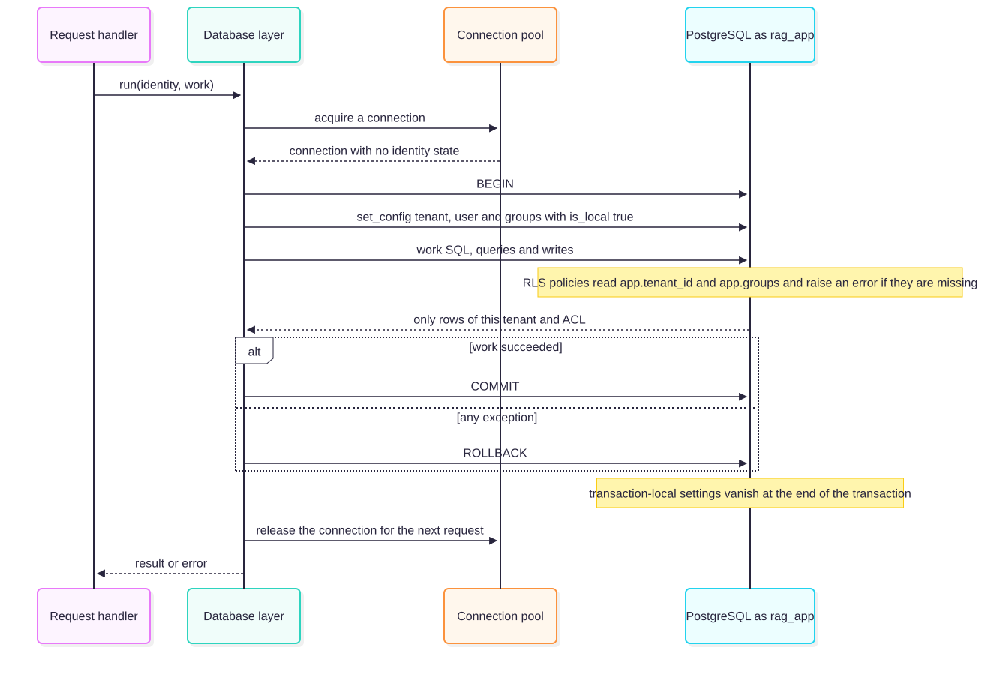
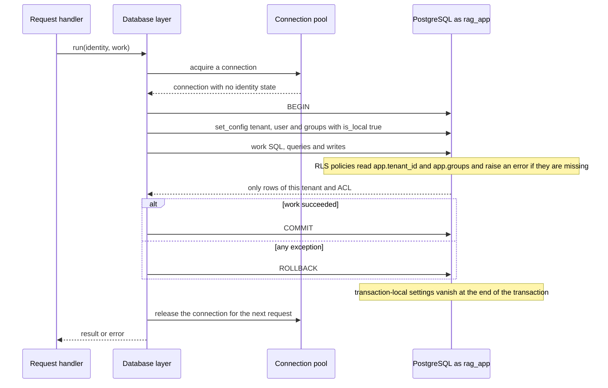

# Chapter 17 — Production-Grade Code Implementation

> **Status: IN PROGRESS (living chapter).** Extended as the reference implementation grows; it currently documents the conventions established by **component 1 (foundation)** and the executed evidence for them. Not complete; the completion gate is not claimed. **Evidence legend.** **[S#]** = source in References. **[E]** = engineering reasoning. **[X]** = executed and verified in this repository. Date of work: 2026-11-08.

## 17.1 Learning Objectives

After the completed chapter you can apply the implementation conventions of the reference code to your own RAG service. For the part written so far you can:

1. Structure a service feature-first with ports and adapters, and wire it through a factory.
2. Configure it safely and keep secrets out of logs and responses.
3. Return a uniform, non-leaking error shape.
4. Write health probes that fail closed.
5. Test web code in-process and database code against a real database, and gate changes with one command.

## 17.2 Problem Statement

Production defects in RAG services rarely come from the retrieval algorithm; they come from the surrounding engineering: secrets in logs, inconsistent errors, probes that lie, tests that need a cluster, configuration scattered across modules. The foundation conventions exist to make those defects hard to introduce and easy to detect.

## 17.3 Conventions and Their Evidence

### 17.3.1 Feature-first structure with ports

Each feature owns `schemas` (Pydantic models), `service` (business logic with no HTTP or driver imports), adapters (the PostgreSQL probe), and a `router`. The service depends on a `Protocol` (`ReadinessCheck`); the adapter implements it; `create_app()` wires them. **Why:** the service is testable with fakes, and the tests prove it: the readiness service is exercised with in-memory checks that succeed, raise, or hang, with no database **[X]**.

### 17.3.2 Configuration

All tunables are fields on one `Settings` class, read from `RAG_`-prefixed environment variables; secrets are `SecretStr`. **Executed tests [X]:** defaults are safe (docs off, no database), environment overrides apply, invalid values are rejected (`LOG_LEVEL=LOUD`, zero timeout), and a database URL containing a password is absent from `repr` and `str` of the settings object.

### 17.3.3 Logging and secret hygiene

Logs are one JSON object per line with a request id. Two layers protect secrets: **key-based redaction** (keys such as `password`, `token`, `authorization`, `database_url` are masked recursively) and **free-text scrubbing** (URL credentials such as `scheme://user:pw@host` and `password=…` pairs are masked in messages and exception text). The second layer exists because of a defect found during the build: an exception message containing a connection string appeared in a log line even though the HTTP response was generic (Chapter 16, finding 1). **Executed tests [X]:** redaction is recursive; the formatter adds the request id; exception text is scrubbed; the live container's logs never contained the database password, including during a database outage. **Limit:** scrubbing is pattern-based and cannot recognise every secret format; the durable control is not to put secrets into exceptions and messages in the first place.

### 17.3.4 Error model

Errors are RFC 9457 problem details served as `application/problem+json`. The RFC defines `type`, `title`, `status`, `detail` and `instance`, allows extension members, allows a non-resolvable `type` URI, and encourages avoiding implementation details such as stack dumps in responses [S117]. The reference service uses `urn:rag:error:<code>` as `type`, adds `code` and `request_id` as extensions, reports validation errors as `loc`/`type`/`msg` **without the offending value**, and turns unhandled exceptions into a generic 500. **Executed tests [X]:** unknown route gives 404 problem+json; a deliberate `AppError` maps to its status and code; a validation failure with a secret-looking path value does not echo it; an exception whose message contains a connection string yields a 500 whose body contains neither the message nor the credentials, while the request id is still returned in header and body.

### 17.3.5 Request middleware

The middleware is pure ASGI rather than `BaseHTTPMiddleware`, so streaming responses (needed for generation in later components) are not buffered or broken by it. It accepts an inbound request id only if it matches a restricted pattern and length, otherwise generates one; adds `X-Content-Type-Options`, `Cache-Control: no-store` and `Referrer-Policy`; logs one line per request with method, path, status and duration but no query string, headers or body; and converts unhandled exceptions into the generic 500 *inside* the middleware so that even error responses carry the request id and security headers. **Executed tests [X]:** safe ids are reused; spaces, over-length, semicolons, non-ASCII and empty ids are replaced; a query-string secret does not reach the access log.

### 17.3.6 Health: liveness and readiness

Liveness never touches dependencies. Readiness runs each registered check concurrently under a timeout, returns 503 if any fails, and reports only generic reasons (`timeout`, `unavailable`). The status-change event is emitted once per transition, not per probe. **Executed [X]:** a failing check leaks no host or credentials; a hanging check times out without delaying the others (the whole request returned in under 2 s with a 0.2 s timeout); in the live stack, stopping the database turned readiness into a 503 while liveness stayed 200.

### 17.3.7 Containers

The API image uses a digest-pinned base, installs pinned requirements, runs as a non-root user with no login shell and no home directory, is started with `--no-access-log --no-server-header`, and has a health check. Compose adds a read-only root filesystem, a `tmpfs` for `/tmp`, dropped capabilities, `no-new-privileges`, memory and process limits, and loopback-only published ports. **Executed [X]:** uid 10001, write to `/app` refused, server banner absent. Ports are published on 127.0.0.1 by configuration; I did not probe them from another host.

### 17.3.8 Testing and the quality gate

Three levels are in use now: **unit tests** run the app in-process through an ASGI transport with fake checks and a recording event sink; **integration tests** run the real probe against the compose PostgreSQL (and check that the `vector` extension is available); and the **gate** `scripts/check.py` runs ruff, ruff format check, mypy strict and pytest. **Executed [X]:** 30 passed, 0 skipped with the database running; 28 passed and 2 skipped without it, and the skip reason is recorded rather than hidden.

### 17.3.9 Provider-neutral access to models (the gateway pattern)

Vendor SDK calls scattered through features couple the code to one provider and duplicate retry, cost and policy logic. The reference code instead exposes a single `LlmGateway` with a provider *port*; features name a route, never a vendor or model, and configuration decides the rest (ADR-012; usage guide in `features/llm/README.md`). Implementation rules demonstrated there [E]: model ids and base URLs only in configuration; secrets referenced by environment-variable *name*; the official SDK for Claude, plain `httpx` for OpenAI-compatible servers; SDK retries disabled so exactly one component owns retries; error messages never copy vendor response bodies (they can echo prompts); a `fake` provider for offline tests that production refuses; a sensitivity policy that fails closed instead of falling back to an external provider. **Executed [X]:** 30 policy tests, adapter tests against mocked HTTP, a real local Ollama server (including a fallback triggered by a real HTTP 501), and **15 of 15** injected defects detected by mutation testing; the first mutation run found a test gap that was then closed.

### 17.3.10 Migrations you can trust

Schema changes are plain SQL files, `NNNN_name.sql`, applied forward-only by a runner of about 150 lines (no ORM, no extra packages). Rules that make them trustworthy [E]: contiguous numbering; a SHA-256 **checksum** recorded per applied migration and re-verified on every run (an edited history is an error); an applied migration whose file vanished is an error; a PostgreSQL **advisory lock** serialises concurrent runners; **one transaction per migration** and a failure is rolled back and not recorded; error messages never include SQL text (it may contain data or secrets); migrations run as the *owner* role while the service runs as a restricted role; deployment applies migrations before the new service version starts, and readiness verifies the schema version equals what the build expects. **Executed [X]:** all of these behaviours, including four concurrent runners applying each migration exactly once.

### 17.3.11 Tenant-scoped transactions

<!-- figure:17-tenant-scoped-transaction -->

*Figure 17.1: Tenant-scoped transactions. Original diagram; source below.*

Mermaid source

<!-- /figure -->

*Original diagram by the handbook author; source `docs/assets/diagrams/17-tenant-scoped-transaction.mmd`.*

Every database call goes through `Database.run(identity, work)`: synchronous psycopg with a connection pool, executed in a worker thread (so it works on Windows and Linux event loops and never blocks the loop), one transaction per unit of work, the identity written with a *transaction-local* setting first, commit on success and rollback on any exception. The pool commits on normal exit and rolls back on exception, as documented [S123]. The identity object is validated against a restricted alphabet because its values are written into database settings, and it comes from authentication, never from a request body or model output.

### 17.3.12 Testing security properties: mutation, not coverage

A passing isolation test proves little if a second defence can mask the first. The database layer was therefore tested the way the gateway was: inject realistic defects and require the tests to fail. The first run caught 12 of 15; three tests had passed for the wrong reason (a foreign key hid a missing UPDATE `WITH CHECK`; a second policy function hid a fail-open tenant function; an unaffected setting hid a session-scoped leak). Each test was rewritten to isolate one layer and all 15 defects are now detected. A probe of one case showed that PostgreSQL applies SELECT policies to an UPDATE's new row only when the statement reads columns, so the UPDATE `WITH CHECK` cannot be omitted [S122]. Practical rules [E]: test each layer separately; assert on error *types and messages*, not merely "an error"; keep a guard test that fails any new tenant table without forced RLS; and treat a mutation pattern that no longer matches as a failure.

### 17.3.13 Safe uploads and idempotent ingestion

Rules demonstrated by the ingestion component [E, X]: **never trust the client** for type, size, name or key. Read the body as a stream, enforce the size cap on the stream (a `Content-Length` header can be absent or false), hash while reading, and detect the type from the first bytes and require it to agree with the declaration. **Construct** storage keys from identifiers and hashes and validate them against an anchored pattern before use; client-supplied names stay in the database as data. Store the object **before** committing the rows that reference it, and remove objects stored for a plan that lost a race. Make the operation **idempotent** by letting the database decide: lock the document row, look for a live version with the same hash, and rely on a partial unique index as the backstop. Make deletion an **outbox**: remove rows and record the object cleanup in the same transaction so a crash cannot lose it. **Executed:** all of these behaviours, plus a race that was found while writing the test (§16.7.2, finding 2).

### 17.3.14 Background jobs without a broker

A Postgres table with `FOR UPDATE SKIP LOCKED` is enough for a first queue (PostgreSQL documents `SKIP LOCKED` as usable "to avoid lock contention with multiple consumers accessing a queue-like table", and warns that `ORDER BY` with a locking clause can return rows slightly out of order at READ COMMITTED, so ordering is best-effort [S124]). The properties that matter [E]: a **lease** so a crashed worker's job returns to the queue; completion and failure apply **only to the lease holder**; **bounded retries with backoff** and a terminal `dead` state; store only the **exception class name**, never the message; handlers must be **idempotent** because delivery is at least once; and give the worker its **own database role** with access to the job table only, so a compromised worker cannot read tenant content. **Executed:** concurrent claiming, lease expiry, retry/backoff/dead, lease-holder rules, error hygiene and the role limits (§16.7.1).

### 17.3.15 Dependency governance

Dependencies are pinned and documented with purpose and license (`DEPENDENCIES.md`). Two items needed attention: `psycopg` is LGPL-3.0 (used unmodified as an installed library; legal review is advised before redistributing images) and `certifi` and `pathspec` are MPL-2.0 (development-only). Pins are versions, not hashes; hash pinning is a CI hardening step.

### 17.3.16 Parsing hostile files: isolate, limit, and distrust the answer

Parsers for PDF and Office formats are large, historically a source of memory and CPU exhaustion, and they run on files an attacker chose. Three controls, each with a test [E, X]. **Isolate:** run the parser in a child process that holds no credentials (empty environment, scratch working directory, no stderr), so a crash or hang costs the child, not the process that owns the database connection. **Limit:** a wall-clock timeout and an output cap enforced by the parent on every platform, plus address-space, CPU and file-size rlimits set by the child on POSIX only [S130]; for zip containers check member count, declared total size and compression ratio *before* reading, refuse XML with a DOCTYPE (which closes entity-expansion attacks), cap nesting depth and stream the parse. **Distrust the answer:** the child's output is data from a possibly compromised process, so the parent validates its shape, kinds, ranges, sizes and failure codes and cleans the text again. What this does **not** give you is network or filesystem isolation (that is a container-level control) and the rlimits were not observed on the Windows development host. A related trap: header sizes in zip files can be falsified [S129]; in `zipfile` a lie ends in a CRC error rather than extra data (observed on Python 3.14.2), but a defence you cannot trigger cannot be tested, and I deleted one such check rather than keep it.

### 17.3.17 Giving a worker a write path without a read path, and the PUBLIC policy trap

A background worker often needs to *write* tenant data it must not *read*. PostgreSQL can express that: column-level grants (the worker reads ACL metadata and version state, never content or titles), `INSERT` and `DELETE` on the chunk table with `SELECT` on only its key columns (a `DELETE ... WHERE` needs read rights on the columns it names [S128]), and row policies that bind every write to the tenant of the job in hand **and** to a version still in the `staged` state, so the worker can leave a version staged or failed but never activate it. The trap: a policy created without `TO` applies to `PUBLIC`, and permissive policies are OR-ed [S128], so a new role's carefully narrow policies are silently widened by older ones. Bind every policy to its role explicitly and add a guard test that lists `pg_policies` and fails on `PUBLIC` [X]. State the residual honestly: the database cannot tell a truthful worker from a lying one that names another tenant, so this narrows what a compromised worker can do (no reads, no activation, no schema changes) without proving which tenant it claims.

### 17.3.18 Chunking as invariants, not parameters

The chunker is pure and deterministic, so its tests are properties over many inputs rather than examples [X]: no chunk exceeds the configured maximum (including a 700-character word with no whitespace, code lines, and table rows); every marker word of the input appears in some chunk (no content lost); the same input and configuration give identical chunks; a chunk never spans two sections; overlap repeats trailing whole units within a section and never crosses a heading; a continuing table repeats its header row exactly once per chunk; ordinals are contiguous. Mutation testing then asks whether those tests would notice a regression, which found that "a header repeated" and "a header shown exactly once" are different assertions. Sizes (512 target, 768 maximum, 50 overlap) are hypotheses from ADR-003 to be tuned against the golden set (component 17), and token counts are a character-based estimate until the embedding model's tokenizer is fixed.

## 17.4 Trade-offs

| Decision | Benefit | Cost |
|---|---|---|
| Parser in a child process | A hostile file cannot stop the worker or reach its credentials | Process start-up per file; no network or filesystem isolation by itself |
| Standard library for DOCX/HTML/Markdown | One new dependency in total; full control of limits | Own code to maintain; fewer formats and less structure recovered |
| Narrow write path for the worker | No content reads, no activation, one tenant per transaction | More migrations and policies to test; a lying worker is still not detectable |
| Character-based token estimate | No tokenizer dependency yet | Inaccurate for other scripts; must be replaced |
| Ports/adapters per feature | Fake-able, replaceable | More files and indirection |
| Pure ASGI middleware | Streaming-safe | More code than `BaseHTTPMiddleware` |
| Regex scrubbing plus key redaction | Catches credentials in exception text | Best-effort; false negatives possible |
| Sync psycopg in a thread for probes | Works on Windows and Linux | A thread per probe; the data layer must choose again |
| Strict mypy and ruff | Early defects | Friction, annotation noise in tests |

## 17.5 Failure Modes Observed or Designed For

| Failure | Where it was seen or tested | Control |
|---|---|---|
| Secret in exception text | Found in the build, fixed | Scrubber and tests |
| Probe that hangs | Tested with a hanging check | Per-check timeout, concurrent execution |
| Unsafe request id (injection into logs) | Tested | Pattern and length check |
| Dependency down | Tested live | 503 readiness, generic detail |
| Server banner disclosure | Found in the live container | `--no-server-header` |
| Test harness misconfiguration | Tests initially failed on my own fixture (duplicate keyword) and on a missing DB password variable | Fixed; skip reasons recorded |
| Parser hangs, floods output or dies | Tested with deliberately misbehaving child processes | Timeout, output cap, treat any non-answer as a rejection |
| Parser answer is malformed or hostile | Tested with children that lie | Validate shape, kinds, ranges, sizes and reason codes; clean text again |
| Zip bomb, lying zip header, entity expansion, deep nesting | Tested with generated files | Size, ratio, member and depth limits; refuse DOCTYPE |
| NUL byte in extracted text | Found by reasoning; tested | Strip in child and parent (PostgreSQL text cannot hold NUL) |
| Policy without `TO` widens a new role's access | Found in migration 0001 while designing 0003 | Explicit roles on every policy; guard test on `pg_policies` |
| Unprocessable file retried forever | Designed for; tested | Permanent failure marks the version failed and ends the job at once |

## 17.6 Production Recommendations (so far)

1. Keep services free of HTTP and driver imports; inject adapters.
2. One `Settings` class; no tunables elsewhere; `SecretStr` for secrets.
3. Never log request bodies, queries or prompts by default; scrub free text as a safety net, not a plan.
4. Return problem+json; never echo input values or exception text.
5. Make probes fail closed and report generic reasons; never let liveness depend on dependencies.
6. Run containers non-root, read-only, with dropped capabilities and loopback-only ports in development.
7. Gate every change with lint, format, strict types and tests; record skipped tests with their reason.
8. Pin and document every dependency, including licenses.
9. Run parsers of untrusted formats in a separate process with no credentials, with a timeout and an output cap, and validate whatever comes back.
10. Bind every row-level-security policy to an explicit role, and keep a guard test that fails on any policy that applies to `PUBLIC`.
11. Give background workers the narrowest write path that works (column grants, state-gated policies) rather than a read role.

## 17.7 Interview Questions

1. **Why separate liveness from readiness?** Liveness restarts a wedged process and must not depend on external systems; readiness controls traffic and should reflect dependencies.
2. **How do you stop secrets leaking through logs?** Never put them in messages; mask sensitive keys; scrub credentials in free text and exception output; verify with tests against real logs.
3. **Why pure ASGI middleware for a streaming API?** `BaseHTTPMiddleware` wraps and can interfere with streaming and context propagation; pure ASGI passes messages through.
4. **What belongs in an error response?** A stable machine code, a short title, the status and a correlation id; never stack traces, internals or the offending input [S117].
5. **How do you test code that needs a database without making every test slow?** Unit-test services with fakes behind ports; mark a small set of integration tests that need the real database and report them as skipped when it is absent.
6. **A worker must write chunks for tenants but must not be able to read them. How?** Column-level grants (ACL metadata and version state readable, content not), `INSERT`/`DELETE` on the chunk table, and row policies tying every write to the tenant of the current job and to a version in a pre-activation state; activation stays with another stage. Residual risk: the database cannot verify that the worker names the right tenant.
7. **How do you handle a hostile PDF or Word file in a RAG ingestion pipeline?** Allow-list types by content, parse in a credential-free child process with timeout, output cap and (on POSIX) rlimits, reject encrypted files, check zip member count, size and ratio before reading, refuse XML with a DOCTYPE, validate the parser's answer, treat failures as permanent and record a safe reason code, and keep extracted text as data.
8. **You added a role and an old policy now lets it do too much. What happened and how do you prevent it?** A policy without `TO` applies to `PUBLIC`, and permissive policies are OR-ed. Bind policies to roles and test `pg_policies` for `PUBLIC`.

## 17.8 Exercises

1. Add a readiness check that verifies the `vector` extension is installed and make the integration test assert it fails when the extension is dropped in a scratch database.
2. Add a `Retry-After` header on 503 readiness responses and test it.
3. Write a mutation check for the scrubber: remove one pattern and show which test fails.
4. Add a structured log field allow-list and switch the formatter to drop unknown keys; compare with the redaction approach.
5. Run the stack with `RAG_ENVIRONMENT=production` and `RAG_EXPOSE_API_DOCS=true` and confirm the docs remain disabled.

## 17.9 Summary (so far)

The foundation, and then the LLM gateway, established a feature-first, port-based structure; a single settings class; scrubbed structured logs; RFC 9457 errors that never echo input or internals; streaming-safe middleware; fail-closed probes; and a hardened container, all verified by 30 passing tests against a real database and by live checks of the running stack. The build also found and fixed a real defect (credentials inside exception text reaching logs) and a banner disclosure. The chapter will grow with each component.

## References

- [S124] PostgreSQL 16 documentation, *SELECT* (locking clause, `SKIP LOCKED`) (research register SRC-124).
- [S122] PostgreSQL 16 documentation, *CREATE POLICY* (research register SRC-122).
- [S123] psycopg documentation, *Connection pools* (research register SRC-123).
- [S13] FastAPI documentation and release information, version 0.162.x (research register SRC-013).
- [S117] IETF, *RFC 9457 — Problem Details for HTTP APIs* (July 2023). https://www.rfc-editor.org/rfc/rfc9457.html (read 2026-11-08)
- ADR-011 and `reference-implementation/DEPENDENCIES.md` (this repository).
