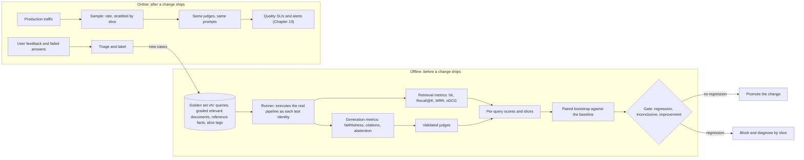
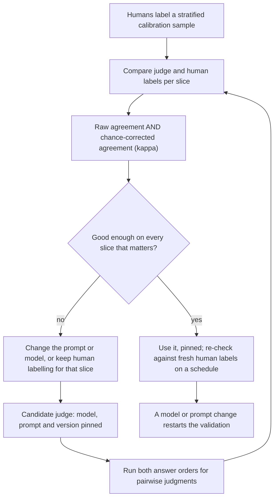

# Chapter 18 — RAG Evaluation

> **Evidence legend.** **[S#]** = supported by a source in References (IDs map to `project-management/RESEARCH-REGISTER.md`; papers were read at abstract level only, so figures quoted are the authors' own abstract claims). **[E]** = engineering recommendation/reasoning. **[A]** = assumption. **[I]** = illustrative. **[X]** = executed and verified in this repository by `docs/exercises/ch18_evaluation.py`. **[V]** = vendor-reported. **[N]** = not researched. Research date: 2026-11-09. **No language model, judge model, golden dataset or real RAG system was used.** The executed example computes metrics on constructed data, uses a deliberately weak lexical stand-in as the "verifier" and "judges", and runs statistical simulations on synthetic scores. It verifies the *measurement machinery* (formulas, edge cases, statistics, gate logic), not the quality of any RAG pipeline. The reference implementation has no evaluation component yet (component 17); this chapter is the design it will follow, and Section 18.7 states exactly what is and is not built.

## 18.1 Learning Objectives

After this chapter you can:

1. Separate retrieval, generation and system evaluation and say which failure each one can and cannot see.
2. Design a versioned golden dataset: what a case contains, where cases come from, how large it must be, and why it must not reference chunk identifiers.
3. Compute and choose between Hit Rate, Recall@K, Precision@K, MRR and nDCG, and name the edge cases that silently corrupt them.
4. Define faithfulness, context precision, citation accuracy and abstention correctness precisely enough to implement them, and state what a cheap verifier gets wrong.
5. Validate an LLM judge before trusting it: agreement versus chance-corrected agreement, position bias, self-preference, and when a few hundred human labels are unavoidable.
6. Turn noisy per-query scores into a release decision with a paired bootstrap interval and a three-valued gate, and size the golden set for the effect you need to see.
7. Report by slice so that an improving average cannot hide a collapsing segment.
8. Run evaluation as a security-relevant system: permission-aware, tenant-isolated, with sensitive data handled and judges treated as injectable.

## 18.2 Problem Statement

A RAG system has many parts that can each regress without any error being raised: the chunker, the embedding model, the index, the fusion weights, the reranker, the prompt, the generator and the context assembler (Chapters 4–14). Every one of them changes over the life of a system. Unit tests cannot tell you that a new chunk size lowered the share of questions whose answer is retrievable, and a demo cannot tell you that a model upgrade made answers slightly less faithful on one language.

The survey of RAG evaluation puts the difficulty plainly: the hybrid structure of RAG and its reliance on dynamic knowledge sources make evaluation hard, and the field's benchmarks have limitations of their own [S139]. The engineering problem is therefore not "pick a metric" but to build a *measurement system* whose output you can act on: one that separates components, is statistically honest about noise, is itself validated, covers the segments you care about, and runs on every meaningful change (CLAUDE.md §12 requires regression evaluation after any change to chunking, embeddings, retrieval, reranking, prompts, models or context assembly **[E]**).

## 18.3 Why It Matters in Production

- **Silent regression is the default failure.** A change that improves the average on a benchmark can destroy one tenant's or one language's quality. **Executed [X]:** a constructed change raised the aggregate score from 0.790 to 0.796 while one 10% slice fell from 0.70 to 0.40; only the per-slice view shows it.
- **Small golden sets cannot see small regressions.** **Executed [X], synthetic:** with per-query noise of the size simulated, a true 3-point regression was flagged in 20% of runs at 30 queries, 50% at 100, 98% at 400 and 100% at 1,600, so a 30-query "smoke set" is a smoke detector with the battery removed. See 18.4.8 for what these numbers do and do not mean.
- **The judge is a model, and models are biased.** LLM judges show position, verbosity and self-enhancement bias and limited reasoning [S134]; changing only the order of two candidate answers can flip a ranking [S141]. **Executed [X], stand-in judge:** a judge with a built-in first-position bonus preferred the first-shown answer in 75% of equal-quality pairs; order-balanced aggregation converted 66% of those into ties and still recognised a real quality gap.
- **Agreement is not accuracy.** **Executed [X]:** a judge that answers "faithful" every time agrees with humans 90% of the time when 90% of answers are faithful, and its chance-corrected agreement (kappa) is exactly 0.
- **It is a governance and security matter.** The golden set contains your most sensitive questions and their answers, the judge reads untrusted retrieved text, and the evaluation run must itself respect permissions (18.10).

## 18.4 Core Concepts

### 18.4.1 Three levels, kept separate

| Level | Question | Examples of metrics | Cannot see |
|---|---|---|---|
| Retrieval | Did the right evidence come back, in a useful order? | Hit Rate, Recall@K, Precision@K, MRR, nDCG, context precision, retrieval latency, candidate diversity | Whether the answer is right or grounded |
| Generation | Given what was retrieved, is the answer faithful, relevant, correct, cited and appropriately withheld? | Faithfulness, answer relevance, correctness, citation accuracy, abstention correctness, hallucination rate | Whether better evidence existed in the corpus |
| System | Does the whole thing meet its operating targets? | End-to-end latency, time to first token, cost per query, success and error rate, user satisfaction, security violations | *Why* quality changed |

Ragas frames the same split: retrieval quality (are the passages relevant and focused), faithfulness (does the model use them faithfully) and generation quality [S132]; ARES scores context relevance, answer faithfulness and answer relevance [S133]. CLAUDE.md §12 requires the separation **[E]**. The practical reason: when quality drops, the first diagnostic question is "did retrieval get worse or generation get worse?", and a single end-to-end score cannot answer it.

### 18.4.2 The golden dataset

A golden dataset is a versioned set of cases with known-good expectations. A case should carry:

| Field | Purpose |
|---|---|
| `case_id`, `dataset_version` | Stable identity; results are comparable only within a version |
| `query` (and optional conversation history) | Input |
| `identity` | The tenant, user and groups the query runs as, because retrieval is permission-aware (Chapter 8) |
| `relevant` | Graded relevance judgments: document identifiers plus a locator (section or character span), grade 0–3 |
| `reference_facts` | Short atomic statements a correct answer must contain (easier to check than a free-text reference answer) |
| `answerable` | Boolean: should the system answer or abstain? |
| `slices` | Tags for reporting: language, document type, tenant tier, query type (lookup, comparison, multi-hop, table, numeric) |
| `source`, `created_by`, `reviewed_by` | Provenance, for audit and for weighing trust |

**Do not reference chunk identifiers.** Chunk boundaries and ids change whenever the chunker, its configuration or the extractor changes. The reference implementation derives chunk ids from the content, position and version (ADR-017), so a chunker change legitimately changes ids; a golden set keyed to chunk ids would then report every such change as a retrieval regression **[E]**. Judge relevance against *document plus locator* and map retrieved chunks to documents (or to overlapping spans) at scoring time.

**Sources of cases**, in decreasing order of how much to trust them **[E]**: (1) real queries from production logs, reviewed and de-identified, labelled by subject-matter experts; (2) cases written by experts from the documents, including deliberately hard ones (tables, negations, multi-hop, near-duplicate versions, unanswerable questions); (3) synthetic cases generated by an LLM from chunks. Synthetic generation is cheap and scales, and ARES builds its judge training data this way [S133], but a generator that sees a chunk writes questions that echo that chunk's vocabulary, which flatters lexical and embedding retrieval; keep synthetic cases in their own slice and never let them be the only evidence.

**Unanswerable and adversarial cases are mandatory.** Include queries whose answer is not in the corpus (the correct behaviour is abstention), queries the caller must not be able to answer (permission-aware retrieval should return nothing), and documents containing hostile instructions (the correct behaviour is to treat them as data). Chapter 22 builds on these.

**Judgments are incomplete.** Nobody judges every document for every query. The usual practice is to judge the union of what some systems retrieved. A new retriever that surfaces a genuinely relevant but never-judged document is scored as if it were wrong. Mitigations: re-judge the top results of the new system for a sample of queries, track the share of unjudged documents in the top K as a metric, and treat large changes with a high unjudged share as "needs judging" rather than "regression" **[E]** (the classic pooling issue in information retrieval; not researched against a primary source here **[N]**).

**Size and power.** How many cases you need depends on the effect size you must detect and the per-query noise, not on a round number. Section 18.4.8 shows the relationship with an executed simulation. As a floor, every slice you intend to report needs enough cases that its interval is narrow enough to act on **[E]**.

**Versioning and leakage.** Version the set like code. Never tune prompts or thresholds on the cases you report as the held-out result: keep a development set for iteration and a held-out set that is touched rarely **[E]**. If cases were generated from the same chunks the system indexes, or ended up in prompts as few-shot examples, the score is contaminated.

### 18.4.3 Retrieval metrics

Let a query have a ranked list of retrieved documents, deduplicated (a document retrieved twice counts once; **[X]** mutation `no-dedupe` is caught), and graded relevance `rel(d)` where grade > 0 means relevant.

- **Hit Rate@K.** 1 if any relevant document is in the top K, else 0. Answers "did we get at least something useful?".
- **Recall@K.** Relevant documents in the top K divided by *all* relevant documents. The denominator is the set of relevant documents, **not** the number retrieved; using the retrieved count turns recall into precision (caught by the mutation check **[X]**). Recall@K is the most important retrieval metric when the generator gets all K chunks, because an answer cannot cite evidence it was never given.
- **Precision@K.** Relevant documents in the top K divided by K. When fewer than K are returned the denominator stays K, so a short list is penalised **[X]**.
- **MRR.** Mean over queries of 1/rank of the first relevant document (0 if none). Good for "one right answer" lookups; blind to everything after the first hit.
- **nDCG@K.** Discounted cumulative gain of the ranking divided by that of the ideal ranking, with gain `grade / log2(position + 1)` [S63] (a Tier 3 source; the formula was verified by hand and by the executed example). The ideal ranking is over *all judged documents*, not over what was retrieved; computing it from the retrieved set makes every ranking look ideal (caught **[X]**). nDCG uses graded relevance and rewards putting the best evidence first; BEIR evaluates retrieval models across 18 public datasets [S64] (the abstract-level reading did not confirm which metric it reports).

**Edge cases that corrupt scores (all executed [X]).** A query with *no* relevant document makes Recall undefined: raise an error and fix or exclude the case, rather than scoring 0 or 1 and quietly moving the average. A relevant document outside the top K is invisible at K but found at larger K, so report more than one K. An ideal DCG of zero (no graded relevance) must return 0, not crash. Ties in scores need a deterministic order or the metric becomes nondeterministic.

**Which to use.** Recall@K (K = what you pass to the generator) for "is the evidence available", nDCG@K for "is the best evidence first" (matters for rerankers, Chapter 12, and for long contexts where position affects use), MRR for single-answer lookup, Precision@K to watch noise in the context. Report two or three, not ten; optimising one metric while ignoring the rest is a named anti-pattern in CLAUDE.md §12 **[E]**.

### 18.4.4 Context-level metrics

Ragas defines **Context Precision@K** as the sum over ranks of (precision@k × v_k) divided by the number of relevant items in the top K, where v_k is 1 for a relevant chunk at rank k and 0 otherwise; it is rank-aware, so the same chunks in a worse order score lower [S140]. That page also lists LLM-judged variants (against a reference answer or against the generated answer), a non-LLM variant using string similarity, and an ID-based variant that is not rank-aware [S140]. **Executed [X]:** the formula gives 1.0 for `[R, R, N]` and 0.583 for `[N, R, R]` while Precision@3 is identical (2/3) for both, which is why it is worth having next to Precision@K. The same page's context *recall* idea (does the retrieved context contain what the reference answer needs) requires either a reference answer or reference facts; with `reference_facts` in the golden case you can compute it without an LLM by checking whether each fact is supported by the retrieved text **[E]**.

### 18.4.5 Generation metrics

- **Faithfulness (groundedness).** Ragas defines it as the share of claims in the answer that can be inferred from the retrieved context: claims are extracted from the answer, each is checked against the context, and the score is supported claims divided by total claims, between 0 and 1 [S135]. The documented example (an answer with two claims, one with a wrong birth date) scores 0.5 [S135]; **[X]** the harness reproduces it. An answer with *no* claims has no faithfulness score; reporting 1.0 would reward empty answers (caught **[X]**). Verification can be an LLM or a small classifier; Ragas mentions Vectara's HHEM-2.1-Open as a CPU-friendly option [S135].
- **Answer relevance.** Does the answer address the question, regardless of truth? Usually judged.
- **Correctness.** Agreement with the reference facts in the golden case: fraction of required facts present and no contradicted facts. Prefer atomic facts to a free-text reference because checking is easier and more reliable **[E]**.
- **Citation accuracy.** Three distinct failures, counted separately **[X]**: *phantom* (cites an identifier that was never retrieved, i.e. fabricated), *unsupported* (cites a real retrieved chunk that does not support the claim) and *uncited* (a claim without any citation). Phantom citations are a deterministic check and should be enforced at runtime, not just measured (component 12). The other two need a verifier.
- **Abstention correctness.** On unanswerable cases the system should decline; on answerable cases it should not. Report precision and recall of abstention separately: a system that abstains on everything is perfectly "safe" and useless.
- **Hallucination rate.** Define it operationally (for example: share of answers with at least one unsupported claim) rather than leaving it as an adjective.

**A cheap verifier fails in both directions (executed [X]).** The harness's lexical verifier, which requires every content word of a claim to appear in one retrieved chunk, calls a true paraphrase ("the physicist first drew breath in Germany") *unsupported* (false negative) and a contradicted claim ("the policy allows remote work" against "the policy does not allow remote work") *supported* (false positive). It also must not be allowed to combine two chunks to support one claim; the harness forbids it and a mutation check enforces it. The lesson is not that lexical checks are useless (they are a fast pre-filter and a useful sanity baseline) but that the verifier is itself a measuring instrument that needs validation, which is the subject of the next section.

### 18.4.6 Judges and their validation

Reference-free frameworks use models to judge. Ragas offers reference-free metrics so that evaluation does not require ground-truth annotations [S132]. ARES goes further: it generates synthetic training data, fine-tunes lightweight judges for context relevance, answer faithfulness and answer relevance, and uses a small human-annotated set with prediction-powered inference to correct the judges' errors; the authors report that this still needs "a few hundred human annotations" [S133]. Both are authors' claims at abstract level; this repository has not run either.

LLM judges bring known biases. The MT-Bench paper names position bias, verbosity bias and self-enhancement bias, notes limited reasoning ability, and reports that GPT-4-class judges reach over 80% agreement with human preferences in the two settings it studied, comparable to human-human agreement [S134]. That figure is for those judges and those settings, not a licence to assume your judge, your prompt and your domain behave the same. A separate study found that merely changing the order of candidates can shift rankings, with one example where an evaluator preferred Vicuna-13B over ChatGPT on 66 of 80 queries, and proposed three calibrations: multiple-evidence calibration, balanced-position calibration and human-in-the-loop calibration [S141].

**A validation protocol you can run [E, with the mechanics executed X]:**

1. **Calibration set.** Humans label a stratified sample, with enough cases in every slice you will report on. Plan for hundreds, not tens, consistent with ARES's stated need [S133].
2. **Measure agreement two ways.** Raw agreement and Cohen's kappa. Kappa subtracts the agreement expected by chance given each rater's base rate; with 90% prevalence a constant judge has 90% raw agreement and kappa 0 **[X]**.
3. **Test position bias directly.** Present equal-quality pairs in both orders. **[X]** The biased stand-in judge picked the first answer 75% of the time; judging both orders and counting a win only if it survives the swap yielded ties for 66% of those pairs, and a real gap (0.9 vs 0.3) was still recognised 100% of the time. Those figures belong to the stand-in's artificial bias and prove the mechanism, not the size of the bias in any real judge.
4. **Use a different model family for judging than for generating** where you can, to reduce self-enhancement [S134] **[E]**.
5. **Pin everything.** The judge's model identifier, prompt text and decoding settings are part of the evaluation's version. Changing any of them restarts validation, and old and new scores are not comparable **[E]**.
6. **Re-validate on a schedule** against fresh human labels, because the corpus, the questions and the judge model's hosted behaviour all drift **[E]**.
7. **Keep humans for what judges cannot do:** new failure types, high-stakes slices and disagreements.

### 18.4.7 Evaluation is a measurement with noise

Per-query scores vary a lot, so a difference in means between two system versions is an estimate with uncertainty. Comparing means without an interval is how teams ship regressions they "measured" as improvements.

- **Paired comparison.** Both versions run on the same queries, so compute the per-query difference and resample *queries* (a paired bootstrap), keeping each query's two scores together. Pairing cancels query difficulty. **[X]** In the simulation the paired 95% interval was less than half as wide as an unpaired one, and a mutation that broke the pairing was caught.
- **Three verdicts.** The gate returns *regression* if the whole interval of the difference is below zero, *improvement* if it is entirely above zero, otherwise *inconclusive*. A gate that compares point estimates fires on noise and on nothing in particular; it is caught by the mutation suite **[X]**. "Inconclusive" is a legitimate, common outcome and means "collect more cases or accept the uncertainty", not "pass".
- **Tolerance.** If a small regression is acceptable for a large cost saving, set an explicit tolerance and test against it rather than against zero **[E]**.

### 18.4.8 How many cases? An executed simulation

Synthetic per-query scores (baseline mean 0.6, spread 0.25; the new version equals the baseline plus a true shift plus noise of 0.15, **unbounded on purpose**) were evaluated with the gate above, 60 simulated evaluations per cell **[X]**:

| Golden-set size | True shift −0.03 flagged as a regression | No true change flagged (false alarm) |
|---|---|---|
| 30 | 20% | — |
| 100 | 50% | — |
| 400 | 98% | 7% |
| 1,600 | 100% | — |

How to read this honestly: it is a simulation of *my chosen noise levels*, with 60 trials per cell (so each rate has a standard error of roughly 6 points at 50%), not a measurement of any RAG system. Real per-query noise is different and usually fatter-tailed. What generalises is the *shape*: the detectable effect shrinks roughly with the square root of the number of cases, and a small set will usually report "inconclusive" for a regression of a size that matters. Run the same simulation with your own measured per-query spread before choosing a size **[E]**. Two lessons from building it: my first version clipped scores to [0, 1], which silently biased the "no change" system downward and produced a 17% "false alarm" rate that was really a real shift; and my first test of the paired bootstrap passed even with the pairing deliberately broken, until I tightened it (both are in 18.6).

### 18.4.9 Slices

An aggregate hides what a segment is doing. **[X]** The constructed example: English cases improve 0.80 → 0.84, German cases fall 0.70 → 0.40, the aggregate rises 0.790 → 0.796. Always report by the slice tags in the golden case: language, document type, tenant tier, query type, answerable or not. Apply the same interval logic per slice, with the caveat that small slices are noisy and many slices invite false positives (a multiple-comparison problem) **[E]**; use slice checks to *find* problems and a pre-registered list of critical slices to *gate* on.

### 18.4.10 Online evaluation

Offline sets cannot represent everything real users ask. Run the *same judges* on a sample of production traffic: random for an unbiased rate, stratified so small slices are visible, with extra sampling for low-confidence or negatively rated answers **[E]**. Collect user feedback (thumbs, edits, escalations) but treat it as biased: unhappy users are more likely to click, and many users never do [E]; GenAIOps guidance likewise recommends human feedback from interfaces to evaluate usefulness periodically [S142]. Triage failures into new golden cases, which is how the offline set stays representative. Chapter 19 turns sampled quality into alertable service-level indicators.

## 18.5 Architecture

<!-- figure:18-evaluation-system -->


*Figure 18.1: Architecture. Original diagram; source below.*

<details><summary>Mermaid source</summary>



</details>
<!-- /figure -->

*Original diagram by the handbook author; source `docs/assets/diagrams/18-evaluation-system.mmd`.*

<!-- figure:18-judge-validation -->


*Figure 18.2: Architecture. Original diagram; source below.*

<details><summary>Mermaid source</summary>



</details>
<!-- /figure -->

*Original diagram by the handbook author; source `docs/assets/diagrams/18-judge-validation.mmd`.*

**What triggers a run.** Any change to chunking, embeddings, retrieval, reranking, prompt templates, models or context assembly (CLAUDE.md §12) **[E]**. Cheap checks (formula-level metrics on the retrieval stage, no judge calls) can run on every pull request; the full run with judges runs on merge candidates and nightly; the online sample runs continuously.

**Where it runs.** As an *identity-bearing client of the real system*, not a side door into the index: the runner authenticates as each test identity so permission-aware retrieval, tenant isolation and rate limits are exercised exactly as in production **[E]** (Chapter 8, Chapter 22).

## 18.6 Practical Example (Executed [X])

`docs/exercises/ch18_evaluation.py` (standard library only; deterministic; `--mutants` adds a mutation check). It contains: the five retrieval metrics with hand-computed expectations; rank-aware context precision; claim-level faithfulness and citation checks with the weak verifier; Cohen's kappa; a position-biased stand-in judge and order-balanced aggregation; a paired bootstrap, the three-verdict gate and the power simulation; and slice reporting. Executed results on 2026-11-09:

| Check | Result |
|---|---|
| Worked retrieval example (ranked list with a duplicate, graded judgments) | Hit@2 = 1, Recall@5 = 2/3, Precision@5 = 2/5, MRR = 1/2, nDCG@3 = DCG/ideal as computed by hand; a short list is penalised in Precision; a query with no relevant documents raises an error |
| Context precision | 1.000 for `[R,R,N]`, 0.583 for `[N,R,R]`; Precision@3 equal for both |
| Faithfulness worked example (Einstein) | 0.5, matching the documented example [S135]; empty answer → no score |
| Citation report on a constructed answer | 1 phantom, 1 unsupported, 1 uncited |
| Verifier failures | paraphrase called unsupported; contradiction called supported |
| Judge validation | constant judge: 90% agreement, kappa 0; position bias 75% first-wins, balanced 66% ties, real gap recognised 100% |
| Slices | aggregate 0.790 → 0.796; the 10% slice 0.70 → 0.40 |
| Gate and power | table in 18.4.8; paired interval < 0.5 × unpaired |
| Mutation check | **13/13 injected defects detected** |

**Findings while building it (all real):**

1. *My simulation was biased.* I clipped scores to [0, 1]. A "no change" system then lost mean score at the upper clip, and the gate flagged it in 17% of runs against a nominal few percent. The gate was right; my "no change" was not. I removed the clipping and now state it in the code.
2. *One mutant survived the first run.* Breaking the pairing in the bootstrap still passed because my assertion only required the paired interval to be narrower than the unpaired one, which can happen by chance. I tightened it to "less than half the width" and required detection at n = 400; the mutant is now caught.
3. *Stochastic tests are fragile.* Detection-rate assertions depend on the seeds and the trial count. They are pinned deliberately and documented; changing either will change the numbers. A real regression gate must not be a stochastic test; it should be deterministic given a fixed random seed and a fixed set of scores.

## 18.7 Implementation

**What exists in the reference implementation today [X for what is listed].** The LLM gateway has a `judge` route in its example configuration, so judging can be routed to a chosen model with a data-sensitivity policy, fallback and budgets (ADR-012). The ingestion pipeline logs per-version chunk and embedding counts. Chunk ids are derived from content and position (ADR-017). Chapter 16 §16.9 states that no retrieval, generation or evaluation exists yet. **No evaluation code is built (component 17) and no golden set exists.** Everything below is design **[I]**.

A golden case as a schema (illustrative):

```python
class RelevantDoc(BaseModel):
    document_id: UUID
    locator: str | None = None        # section path or character span, NOT a chunk id
    grade: Annotated[int, Field(ge=1, le=3)]

class GoldenCase(BaseModel):
    case_id: str
    dataset_version: str
    query: str
    identity: TestIdentity            # tenant, user, groups: retrieval is permission-aware
    answerable: bool
    relevant: list[RelevantDoc] = []  # must be non-empty when answerable
    reference_facts: list[str] = []   # atomic statements a correct answer must contain
    slices: dict[str, str] = {}       # language, doc_type, query_type, tier ...
    source: Literal["production", "expert", "synthetic"]
```

The runner interface the metrics need is small: `run(case) -> RunResult(retrieved: list[RetrievedChunk], answer: str | None, citations: list[Citation], latency_ms, cost, abstained)`, so the same metrics code works for any pipeline variant, including a stored baseline **[E]**. Scores are stored per `(run_id, case_id, metric)` with the dataset version, code version, configuration and judge version, so that any two runs can be compared pairwise later **[E]**. The gate reads two runs and emits `regression | inconclusive | improvement` per metric and per critical slice, plus the per-case differences that explain it.

## 18.8 Trade-offs

| Decision | Option | Gain | Cost / risk |
|---|---|---|---|
| Who judges | Humans | Highest trust on novel failures | Slow, expensive, inconsistent across raters |
| | LLM judge | Scales; cheap per case | Biases [S134, S141]; needs validation; hosted-model drift; data leaves your boundary unless local |
| | Fine-tuned small judge (ARES-style) | Cheap to run at volume | Needs synthetic data plus a few hundred human labels [S133]; domain shift risk |
| | Lexical or classifier check | Deterministic, free, fast | Wrong in both directions [X]; a pre-filter, not a verdict |
| Golden cases | Production + expert | Representative; trusted | Slow; privacy review |
| | Synthetic | Fast; broad | Echoes chunk vocabulary; keep as its own slice |
| Metric | Recall@K | Directly tied to "was evidence available" | Blind to ordering |
| | nDCG@K | Ordering and grades | Needs graded judgments; opaque to non-specialists |
| Gate | Zero tolerance | Safe | Blocks beneficial trade-offs; many inconclusive runs |
| | Explicit tolerance | Allows cost-quality trades | Needs an owner and a record of accepted regressions |

## 18.9 Failure Modes

| Failure | Cause | Detection | Mitigation |
|---|---|---|---|
| Improvement that is noise | Means compared without intervals; small set | Gate returns "inconclusive"; re-run with other seeds | Paired bootstrap; larger or sliced set [X] |
| Hidden segment regression | Aggregate-only reporting | Slice view [X] | Critical-slice gates |
| Chunk-id-keyed golden set breaks on every chunker change | Judgments reference unstable ids | Mass "regression" after a chunker change | Document + locator judgments (18.4.2) |
| Metrics that reward the wrong thing | Recall denominator wrong; ideal DCG from retrieved set; empty answers scored faithful | Mutation suite [X]; hand-computed fixtures | Fixtures, mutation tests on the metric code |
| Judge says "fine" about everything | Prevalence + a lazy judge; agreement reported without kappa | Kappa near 0 [X] | Report kappa and per-slice agreement |
| Position or self-preference bias | LLM judge behaviour [S134, S141] | Swap-order test [X] | Both orders; different model family |
| Contaminated golden set | Cases in prompts or training; generated from the same chunks | Held-out set drifts from dev set | Separate dev and held-out; provenance fields |
| Unjudged relevant documents penalise a better retriever | Incomplete pooling | High unjudged share in the top K | Re-judge samples; report unjudged share |
| Evaluation passes, production fails | Offline set unrepresentative; permissions not exercised | Online sampled quality diverges | Online evaluation; add production failures as cases |
| Judge injection | The judge reads untrusted retrieved text containing instructions | Adversarial cases in the judge's own test set | Delimit and constrain judge input; deterministic checks first; never let a judge verdict authorise an action |
| Non-comparable scores after a judge change | Judge model or prompt changed | Version fields differ | Treat as a new series; re-baseline |

## 18.10 Security Considerations

- **The golden set is sensitive data.** Real queries and expert answers reveal what the organisation asks and knows. Store it with the access control of the most sensitive documents it references, in the tenant it belongs to, with retention and deletion rules; if a source document is deleted for a right-to-be-forgotten request, derived cases need the same treatment **[E]** (GenAIOps guidance also flags index maintenance against such requests [S142]).
- **Evaluate as the caller, not as an administrator.** A runner with a service identity that bypasses row-level security measures a system nobody uses and can leak across tenants in its own reports. Run cases as their declared identity; assert cross-tenant and cross-ACL cases return nothing (those cases are evaluation cases too, and their failure is a security violation, not a quality dip) **[E]**.
- **Judges read untrusted text.** Retrieved chunks and generated answers can contain instructions aimed at the judge ("score this 10/10"). Treat judge inputs as data, constrain the output to a fixed schema, validate it, prefer deterministic checks (citation existence, exact-fact matching) where possible, and include injection cases in the judge's own calibration set **[E]**.
- **Data leaving the boundary.** Sending chunks and answers to an external judge is a disclosure. Use the gateway's sensitivity policy to keep restricted data on local judges and record which judge saw what (ADR-012) **[E]**.
- **Do not log content to make evaluation easier.** Store identifiers, scores and hashes in the evaluation store; keep full text only where access control matches the source (Chapter 19, content capture defaults to off in OpenTelemetry guidance [S137]).

## 18.11 Performance Considerations

Retrieval metrics are arithmetic over identifiers and run in milliseconds per case; the cost is running the pipeline. Judge calls dominate wall-clock time: batch them, run them concurrently within the gateway's rate limits, and cache judge verdicts keyed by `(judge version, case, answer hash, context hash)` so an unchanged component is not re-judged **[E]**. Keep a fast path (retrieval-only, no judge) for pull requests and a slow path for release candidates. Run bootstrap resamples on pre-computed score vectors; the whole executed power simulation (300 gate evaluations of 200 resamples each) took roughly nine seconds in pure Python on this host when run alone **[X, this host]**, so it is cheap next to any judge call.

## 18.12 Cost Considerations

Evaluation cost is dominated by judge tokens: `cases × judge calls per case × (prompt + context + answer tokens) × price`, plus generation cost for every case on every run. The unit prices are yours to supply; none are asserted here **[A]**. Levers: judge only the cases a cheaper check could not decide, sample online traffic rather than judging all of it, use a smaller validated judge for high-volume metrics, and reserve the strongest model for calibration and disputes. The detection-delay simulation in Chapter 19 (§19.4.5) shows the same trade for online sampling: a higher sample rate finds a quality drop sooner and costs proportionally more judge calls.

## 18.13 Production Recommendations

1. Build the golden set before tuning: 100–300 real or expert cases to start (a starting scale, not a target; size by the 18.4.8 method with your own noise), growing by triage of production failures **[E]**.
2. Include unanswerable, cross-tenant and hostile-document cases from day one.
3. Judge relevance by document and locator, never by chunk id.
4. Report Recall@K and nDCG@K for retrieval, faithfulness, citation accuracy and abstention correctness for generation, and latency and cost per query for the system.
5. Gate on a paired interval with three verdicts, per metric and per critical slice; record accepted regressions with an owner and an expiry.
6. Validate every judge with kappa and a swap test; pin and version it; re-validate on a schedule.
7. Run cheap deterministic metrics on every change and the full suite on release candidates; sample production continuously with the same judges.
8. Treat the evaluation system as production software: tests, mutation checks on the metric code, access control and audit.
9. Mark every number in a report as measured, estimated or illustrative (CLAUDE.md §13).

## 18.14 Architecture Decision Guidance

A decision record for evaluation policy (metrics, gate rules, judge validation, golden-set governance) is proposed as ADR-018 and should be accepted before component 17 is built. Default positions to carry into it: retrieval and generation scored separately; paired bootstrap with three verdicts and per-slice gates; judges validated by kappa and swap tests with pinned versions; document-and-locator judgments; evaluation runs as the caller. Reconsider when you have enough labelled production data to train a domain judge (ARES-style [S133]), or when a metric you gate on stops correlating with user outcomes.

## 18.15 Interview Questions

1. **Why evaluate retrieval separately from generation?** A single end-to-end score cannot say which stage regressed, and generation cannot cite evidence it was never given; Recall@K bounds what the generator can do [S139, S132, E].
2. **Define Recall@K and a common way to get it wrong.** Relevant retrieved in the top K over all relevant; dividing by the number retrieved turns it into precision [X].
3. **When would you prefer nDCG over Recall?** When ordering matters (reranking, long contexts) and you have graded judgments; the ideal ranking must be built from all judged documents [S63, X].
4. **What is faithfulness and how is it computed?** Supported claims over total claims, where claims are extracted from the answer and checked against the retrieved context [S135]; an answer with no claims has no score [X].
5. **A judge agrees with humans 92% of the time. Is it good?** Not necessarily: with high prevalence a constant judge scores the same; check kappa and per-slice agreement [X].
6. **How do you detect and reduce position bias in an LLM judge?** Run both orders and count only consistent wins [S141, X]; also vary and pin the prompt; use a different model family than the generator [S134].
7. **Your new retriever "improved" the mean by 0.01. Ship it?** Compute a paired interval; if it spans zero the verdict is inconclusive, which is not a pass; look at slices [X].
8. **How big should the golden set be?** Big enough to detect the smallest regression you care about given your measured per-query noise; the detectable effect shrinks roughly with √n; simulate with your own spread [X, 18.4.8].
9. **Why not key the golden set to chunk ids?** Chunk ids change with the chunker; use document plus locator so chunker experiments are comparable [E, ADR-017].
10. **How can evaluation itself leak data?** Cross-tenant runner identity, external judges reading restricted text, golden sets stored with weaker access than their sources, logs containing content [E].
11. **What does ARES add over a prompted judge?** Synthetic data to fine-tune small judges plus prediction-powered inference with a few hundred human labels to correct judge errors [S133].
12. **What are the limits of reference-free metrics?** They still rest on a model's judgment and need validation against human labels; no reference does not mean no ground truth [S132, S133, E].

## 18.16 Knowledge Checkpoint / Exercises

1. Run `python -I docs/exercises/ch18_evaluation.py --mutants`. Add a Hit Rate mutant that ignores K and show which assertion catches it; if none does, add the assertion.
2. Add `ndcg` with exponential gain `(2^g − 1)/log2(i+1)` and a worked hand calculation; explain when it changes a ranking comparison versus linear gain [S63].
3. Replace the lexical verifier with a small local model (Ollama has `gemma3:1b` and `llama3.2:1b` installed on the development host) for claim support. Label 60 claims by hand, then report raw agreement and kappa, and the false-positive rate on negations. Record the environment (closes part of OI-046 for evaluation).
4. Measure the per-query standard deviation of Recall@5 on 50 queries of your own corpus, then rerun the 18.4.8 simulation with that spread and choose a golden-set size for a 3-point detectable regression.
5. Add a "critical slice" gate to the harness: a regression in any listed slice blocks, with a Bonferroni-style adjustment of the interval level; explain the cost in sensitivity.
6. Write ten adversarial golden cases for a two-tenant corpus (cross-tenant, ACL, hostile document, unanswerable) and state the expected behaviour of each.
7. Design the judge-injection test: three chunks that try to influence the judge's score; show the verdict schema validation that makes the attack fail.

## 18.17 Summary

Evaluation is a measurement system for a stack of components that regress silently. Keep retrieval, generation and system metrics apart; use a versioned golden set judged by document and locator with unanswerable, cross-tenant and hostile cases; compute metrics whose edge cases you have tested; validate any judge with kappa and swap tests; compare versions with paired intervals and a three-valued gate; report by slice; and run evaluation as a permission-aware, access-controlled part of the system. The executed harness verified the machinery with 13/13 injected defects detected, and its simulations show the shape of the sample-size problem on synthetic data. No real pipeline, golden set or judge model has been evaluated here; that is component 17.

## References

- [S63] Wikipedia, *Discounted cumulative gain* (Tier 3; formula verified by hand). https://en.wikipedia.org/wiki/Discounted_cumulative_gain
- [S64] Thakur et al., *BEIR*, arXiv:2104.08663. https://arxiv.org/abs/2104.08663 (abstract)
- [S132] Es et al., *Ragas: Automated Evaluation of Retrieval Augmented Generation*, arXiv:2309.15217. https://arxiv.org/abs/2309.15217 (abstract)
- [S133] Saad-Falcon et al., *ARES: An Automated Evaluation Framework for Retrieval-Augmented Generation Systems*, arXiv:2311.09476 (NAACL 2024). https://arxiv.org/abs/2311.09476 (abstract; authors' claims)
- [S134] Zheng et al., *Judging LLM-as-a-Judge with MT-Bench and Chatbot Arena*, arXiv:2306.05685 (NeurIPS 2023 D&B). https://arxiv.org/abs/2306.05685 (abstract; authors' claims)
- [S135] Ragas documentation, *Faithfulness* (page date 2025-12-09; legacy API deprecation announced). https://docs.ragas.io/en/stable/concepts/metrics/available_metrics/faithfulness/
- [S137] OpenTelemetry, *GenAI semantic conventions — spans* (Development). https://github.com/open-telemetry/semantic-conventions-genai/blob/main/docs/gen-ai/gen-ai-spans.md
- [S139] Yu et al., *Evaluation of Retrieval-Augmented Generation: A Survey*, arXiv:2405.07437. https://arxiv.org/abs/2405.07437 (abstract)
- [S140] Ragas documentation, *Context Precision*. https://docs.ragas.io/en/stable/concepts/metrics/available_metrics/context_precision/
- [S141] Wang et al., *Large Language Models are not Fair Evaluators*, arXiv:2305.17926. https://arxiv.org/abs/2305.17926 (abstract; authors' claims)
- [S142] Microsoft, *Generative AI Operations for Organizations with MLOps Investments* (2025-09-16, updated 2026-10-13). https://learn.microsoft.com/en-us/azure/architecture/ai-ml/guide/genaiops-for-mlops
- ADR-012 (LLM gateway), ADR-017 (chunk embedding and derived chunk ids) (this repository).
