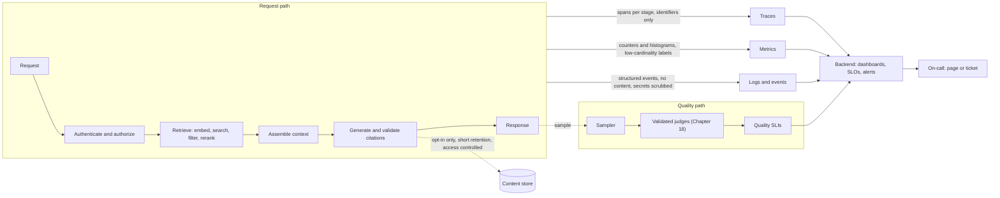
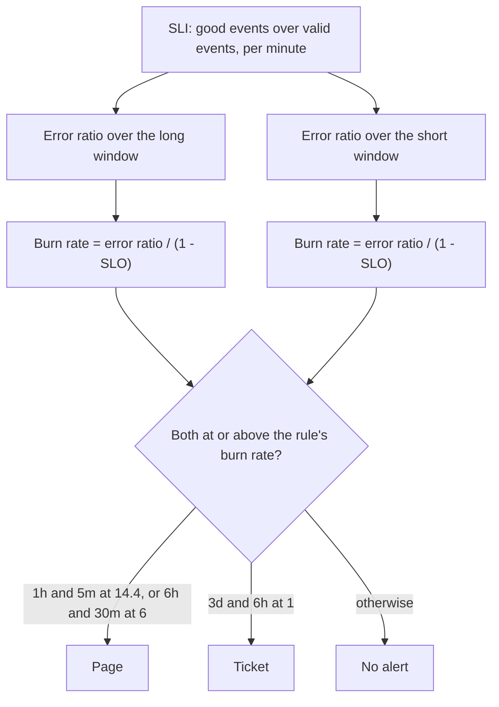

# Chapter 19 — Monitoring and LLMOps

> **Evidence legend.** **[S#]** = supported by a source in References (IDs map to `project-management/RESEARCH-REGISTER.md`; papers were read at abstract level only). **[E]** = engineering recommendation/reasoning. **[A]** = assumption. **[I]** = illustrative. **[X]** = executed and verified in this repository by `docs/exercises/ch19_monitoring.py` (or, for statements about the reference implementation, by inspecting its code on 2026-11-09). **[V]** = vendor-reported. **[N]** = not researched. Research date: 2026-11-09. **No real service, traffic, telemetry backend or language model was used.** The executed example evaluates alert rules on constructed per-minute traffic, runs a simulation of sampled quality monitoring on synthetic verdicts, and tests telemetry-hygiene functions. It verifies the *monitoring logic*, not the behaviour of any deployed system. The reference implementation has structured logging and a few events but **no metrics, traces, dashboards, SLOs or alerts** (component 16, OI-055); Section 19.7 says exactly what exists.

## 19.1 Learning Objectives

After this chapter you can:

1. Explain what LLMOps adds to MLOps for prompting and RAG systems, and what must be versioned together as one "release".
2. Design the three telemetry signals for a RAG request path, using OpenTelemetry GenAI conventions where they exist and saying where they do not (they are still in Development).
3. Choose SLIs for availability, latency, retrieval health, groundedness, freshness and cost, and set SLOs with error budgets.
4. Configure multiwindow, multi-burn-rate alerts, compute the budget each rule protects, and explain why threshold alerts page on blips and miss slow burns.
5. Monitor quality, which is not an HTTP status: sampled judging, interval-based alerting, and the detection-delay versus cost trade-off.
6. Keep telemetry from becoming a data leak: content capture off by default, attribute allow-lists, error class only, bounded label cardinality.
7. Watch the pipeline and the corpus, not only the request path: ingestion health, index freshness, embedding-space drift, canary queries.
8. Run releases and incidents for a system whose behaviour can change without a code change.

## 19.2 Problem Statement

A conventional service fails loudly: error rates rise, latency climbs, a health check goes red. A RAG system adds failure modes that raise no error. A new document version changes what is retrieved. A provider updates a hosted model and answers drift. A quota change makes the fallback model answer in a different style. An ingestion job silently dead-letters a class of PDFs so that part of the corpus stops being searchable. Every request returns HTTP 200 and the answers are worse.

The operational problem is therefore twofold. First, apply proven reliability practice (service-level objectives, error budgets, burn-rate alerting) to the parts that *are* binary. Second, build a quality-monitoring path for the parts that are not, without turning telemetry into a store of the organisation's most sensitive prompts and documents. Microsoft's GenAIOps guidance frames the same extension: existing MLOps practice carries over for fine-tuning, but prompting and RAG add orchestrators, data pipelines for chunking, index maintenance and a gateway, all of which must be versioned, tested, deployed and monitored [S142].

## 19.3 Why It Matters in Production

- **Threshold alerts page on noise and miss slow leaks.** **Executed [X], constructed traffic:** a 10-minute blip at 0.5% errors fired a naive "5-minute error ratio above the SLO rate" alert while costing about 0.12% of a 30-day budget; the multiwindow rules stayed silent. A sustained 2× burn paged nobody and raised a ticket after about 36 hours, exactly when 10% of the budget was spent.
- **Some incidents are worth no alert, by design.** **Executed [X]:** a 10× burn for 3 hours consumes about 4.2% of the budget, below every rule's threshold (2%, 5%, 10%), so none fires. That is a property of the published table [S138], not a bug; if 4% is too much for your product, change the rules, do not discover it in a postmortem.
- **Quality is invisible to status codes.** **Executed [X], synthetic:** with 12% of answers ungrounded against a 5% threshold, a 20% judging sample raised the quality alert after a median of 236 requests, a 5% sample after 1,035 and a 1% sample after 5,611; in a stable 3% state there were no false alert days in 20 simulated days of 20,000 requests at 5% sampling.
- **Telemetry is a liability.** The OpenTelemetry GenAI conventions state that instructions, messages and outputs are sensitive and often large, so instrumentations should not capture them by default [S137]. A tracing backend that stores every prompt is a second copy of your confidential data with weaker access control.
- **Cost is part of correctness.** Token usage, throttling errors (HTTP 429) and quota consumption are first-class operational metrics for model-backed workloads [S142].

## 19.4 Core Concepts

### 19.4.1 What LLMOps adds

GenAIOps extends MLOps along the same inner and outer loops (data, experimentation, evaluation; deployment, monitoring, feedback) but changes what the artefacts are [S142]:

| Area | What is new for RAG and prompting | Source |
|---|---|---|
| Data | Chunking pipelines are not part of traditional DataOps; indexes must be kept fresh and sometimes rebuilt; deletion requests ("right to be forgotten") apply to indexes | [S142] |
| Experimentation | Chunking, enrichment, embedding model, index configuration and search type are all experiment dimensions, together with prompts | [S142] |
| Evaluation | RAG-specific metrics such as groundedness and relevance | [S142], Chapter 18 |
| Deployment | The orchestrator and the data stores are deployed artefacts; a gateway in front of models supports progressive rollout and rollback | [S142] |
| Monitoring | Latency, token usage, 429s; groundedness, completeness, relevancy; drift in grounding data; content safety; user feedback | [S142] |

**A release is a bundle, not a commit [E].** Behaviour is determined by code, prompt templates, model identifiers and decoding settings, chunker version, embedding space and recipe, index parameters, reranker, judge version and golden-set version. If you cannot say which bundle produced an answer you cannot reproduce, compare or roll back. The reference implementation already records part of the bundle per object: each version stores its extractor, each chunk its chunker, and each vector its embedding space, model, recipe and dimension (ADR-016, ADR-017) **[X, by inspection]**. What is missing is the same stamp on *answers* (component 11 onward) and a single release identifier tying the bundle together.

### 19.4.2 Signals: traces, metrics, logs

- **Traces** answer "where did this request spend time and what happened". A RAG request is naturally a tree: authenticate and authorise, embed the query, search (vector, lexical), filter, fuse, rerank, assemble context, generate, validate citations. OpenTelemetry's GenAI conventions define operation-specific spans for inference, embeddings, retrieval and tool execution; the spans page I read documents the status **Development** for the document and for most attributes, with `error.type`, `server.address` and `server.port` marked Stable [S137]. A retrieval span is also defined [S61].
- **Metrics** answer "how often and how bad". The GenAI metrics page defines histograms (unit seconds) for `gen_ai.client.operation.duration`, `gen_ai.server.request.duration`, `gen_ai.server.time_per_output_token` and `gen_ai.server.time_to_first_token`, and agent-level histograms for invocation duration, inference-call count and tool-call count; the same page is marked Development [S136]. I read only the first 100,000 of its 172,000 characters, so I did not confirm the token-usage metric's name and do not state it here.
- **Logs and events** answer "what exactly happened for this request" with structured records carrying a correlation id.

**Stability caveat.** Because these conventions are in Development, attribute and metric names may change. Isolate them behind a small internal mapping layer (one module that translates your event vocabulary to the convention of the day) and pin the convention version in the build **[E]**. Custom RAG attributes (`rag.route`, `rag.k`, `rag.chunks_returned`, `rag.embedding_space`) are *yours*; do not present them as standard.

### 19.4.3 What to measure in a RAG system

| Category | Signals | Notes |
|---|---|---|
| Availability and errors | Request success ratio; error class (`error.type`) by stage | Count refusals and abstentions separately: they are not errors but they are not answers |
| Latency | End-to-end; time to first token; per stage (embed, search, rerank, generate) | Use histograms and percentiles; averages hide tails [E] |
| Retrieval health | Zero-result rate; number of candidates surviving the ACL filter; filter selectivity; top-1 score distribution | A sudden rise in zero results after a deploy is a retrieval incident even with 200s [E] |
| Generation | Finish reasons; abstention rate; citation validation failures (phantom citations are a deterministic check); response length | |
| Quality | Sampled faithfulness, answer relevance, citation accuracy (Chapter 18) | Needs a validated judge and an interval; see 19.4.6 |
| Cost | Input and output tokens per route; cost per query; cache hit ratio; fallback rate | Prices are operator-supplied; the gateway can enforce an external budget (ADR-012) |
| Safety and security | ACL denials, injection detections, policy violations, rate-limit hits | Alert on spikes; they are leading indicators |
| Pipeline and freshness | Ingestion queue depth, dead jobs by reason code, versions stuck in `staged`, index lag (time from document change to searchable) | The ingestion pipeline already records safe failure reason codes (`encrypted_pdf`, `no_text`, `embedding_rejected`, ...) **[X, by inspection]** |
| Providers | 429 and timeout rate per provider, breaker state, fallback rate | A rising fallback rate is a quality and cost signal (the fallback model answers differently) |

### 19.4.4 SLIs, SLOs and the error budget

An **SLI** is a ratio of good events to valid events. An **SLO** is a target for it over a window. The **error budget** is `1 − SLO`; for 99.9% over 30 days the budget is 0.1% of requests, or 43,200 minutes × 0.001 = 43.2 minutes of total outage **[X]**. The **burn rate** is how many times faster than "exactly on budget" the budget is being consumed: `error ratio / (1 − SLO)`.

Candidate RAG SLIs **[E]**: *availability* (non-5xx, non-timeout responses over valid requests), *latency* (share of requests faster than a threshold, with separate thresholds for time to first token and for completion), *quality* (share of sampled answers judged grounded; 19.4.6), *freshness* (share of documents searchable within N minutes of change). Choose a small number; every SLO needs an owner, a rationale and a statement of what happens when the budget is exhausted (for example: freeze risky releases) **[E]**.

### 19.4.5 Multiwindow, multi-burn-rate alerting

The Google SRE Workbook compares alerting approaches and recommends pairing a long window (is a meaningful share of budget being consumed?) with a short window (is it still happening?) per rule. For a 99.9% SLO it tabulates **[S138]**:

| Severity | Long window | Short window | Burn rate | Budget consumed |
|---|---|---|---|---|
| Page | 1 hour | 5 minutes | 14.4 | 2% |
| Page | 6 hours | 30 minutes | 6 | 5% |
| Ticket | 3 days | 6 hours | 1 | 10% |

The short window is about a twelfth of the long one and exists to make the alert *stop* soon after the problem ends [S138]. The workbook's reasons for rejecting simpler alerts: an instantaneous threshold detects fast but with poor precision (a 0.1% error rate over 10 minutes consumes only about 0.02% of a monthly budget and still alerts); a long window improves precision but resets very slowly after an outage; a `for:` clause does not scale with severity; a single burn rate misses a 35× burn that would exhaust the budget in about 20.5 hours; multiple burn rates without short windows keep firing long after the problem ends [S138].

**Executed [X], constructed per-minute traffic at 1,000 requests per minute with 4,400 healthy minutes of history:**

| Scenario | Result |
|---|---|
| Budget arithmetic | 14.4× for 1 h = 2%, 6× for 6 h = 5%, 1× for 3 d = 10%; 35× exhausts the budget in 20.6 h, all reproducing [S138] |
| Total outage for 60 minutes | Page in the first bad minute; the fast rule clears within 5 minutes after the outage ends and the page overall clears 29 minutes after, because the medium rule's 30-minute short window is the last to reset |
| 2× burn for 4 days | No page; ticket at minute 2,160 (36 h), when about 10% of the budget is spent |
| 10-minute blip at 0.5% errors | Naive threshold alert fires; multiwindow rules silent; the blip costs about 0.12% of the budget |
| 10× burn for 3 hours | About 4.2% of the budget consumed; **no rule fires** (below every threshold) |

The last row is the design lesson: burn-rate alerts are *budget-consumption* alerts. If an incident of that size matters to your users, tighten the rules or add a rule; the table is a starting point for a 99.9% SLO, not a law.

### 19.4.6 Monitoring quality

Quality needs a judge, and judging every request is usually too expensive and too slow. Sample instead **[E]**, using the validated judges of Chapter 18, and alert on a *confidence bound*, not a point estimate, because a sampled rate is noisy.

The Wilson score interval is a standard interval for a proportion that behaves well at small counts and near 0 and 1. It is classical statistics; I did not review a source for it in this research batch **[N]**, but the implementation is verified against known values: 0 of 10 gives an upper bound of 0.2775, and 50 of 100 gives [0.4038, 0.5962] **[X]**. The monitor alerts when the *lower* bound of the ungrounded rate is above the threshold, so it fires only when it is confident the rate is too high, and it refuses to alert below a minimum sample count.

**Executed [X], synthetic verdicts** (rolling window of the last 400 judged answers, threshold 5%, true ungrounded rate jumps to 12%, 15 runs per cell, median shown):

| Judging sample rate | Median requests until the alert |
|---|---|
| 1% | 5,611 |
| 5% | 1,035 |
| 20% | 236 |

Reading it: detection delay falls roughly in proportion to the sample rate, and judge cost rises in proportion, so the sample rate is a price you pay for faster detection. At low rates the minimum-sample guard (50 judged answers) dominates the delay. In the stable 3% state, 20 simulated days of 20,000 requests at 5% sampling produced no false alerts. These are properties of the simulation's assumptions (independent verdicts, a perfect judge, a fixed true rate), not predictions for a real system; a real judge has its own error rate, which Chapter 18 shows how to estimate, and verdicts drift and cluster by slice. Monitor quality per slice for the same reason as in Chapter 18 **[E]**.

### 19.4.7 Telemetry hygiene

Observability systems are collection systems. Treat them as such **[E]** with the following rules, each **executed [X]** in the exercise's functions:

1. **No content by default.** The OpenTelemetry guidance: instrumentations should not capture instructions, messages or outputs by default and should offer an opt-in; the content-capture setting `OTEL_INSTRUMENTATION_GENAI_CAPTURE_CONTENT` takes `NO_CONTENT` (the default), `SPAN_ONLY`, `EVENT_ONLY` or `SPAN_AND_EVENT`, and invalid values fall back to `NO_CONTENT`; output messages are flagged as likely to contain PII [S137]. The exercise follows this: an invalid setting yields no content, and event-only capture does not put content on spans.
2. **Allow-list, never block-list.** Only reviewed attribute names are exported; an unreviewed attribute (a user id, an authorization header) is dropped by default.
3. **Record the exception class, not the message.** Messages can hold URLs, keys and prompt fragments. The reference implementation's gateway already follows this rule (its errors carry no provider response text), and its log scrubber masks credentials in free text **[X, by inspection]**.
4. **Bound label cardinality.** Metric labels must be low-cardinality; identifiers (tenant id, user id, request id, chunk id) are never labels. The OpenTelemetry spans page itself keeps the response id out of span names because it is high-cardinality [S137]. The exercise's guard drops non-allow-listed labels and collapses a label that exceeds 20 distinct values to `other`. Per-tenant *reporting* belongs in logs or an analytical store with access control, not in metric series.
5. **If content must be captured** (debugging a quality incident), send it to a separate store with its own access control, a short retention, tenant-scoped access and an audit trail, and prefer references on spans over inline content (the OpenTelemetry guidance lists storing content externally and recording references as one of the options [S137]).

### 19.4.8 Cost monitoring

The gateway emits an event per call with route, operation, provider, model, outcome, input and output tokens, attempts, whether a fallback was used and an estimated cost when operator-supplied prices exist (ADR-012) **[X, by inspection]**. Monitor tokens and cost per route and per tenant tier, alert on cost per query drifting from its baseline (a prompt change that doubles context length is a cost incident), and watch the fallback rate (the fallback is usually a pricier external model). Quota consumption and throttling are operational signals in their own right for hosted models [S142].

### 19.4.9 Drift, freshness and canaries

- **Corpus and query drift.** The documents and the questions change; a tuned system decays (Chapter 2). Watch zero-result rate, score distributions and the share of queries in each slice.
- **Embedding drift.** Vectors from different models are incomparable. The gateway refuses an embed route whose targets do not share one declared embedding space and the ingestion pipeline rejects a space that changes within a version (ADR-012, ADR-017) **[X]**; a model change is therefore an explicit re-embedding event that monitoring should show as a migration in progress.
- **Freshness.** Index lag (document change to searchable) is an SLI. Dead jobs, versions stuck in `staged`, and a growing queue are its leading indicators. GenAIOps guidance includes keeping indexes fresh and valid, including rebuilds when updates cannot be applied incrementally [S142].
- **Canary queries.** Run a small, fixed subset of golden cases through the *real* pipeline on a schedule, as a test identity, and apply the Chapter 18 gate to detect a retrieval regression that traffic would reveal only slowly **[E]**. Canaries also catch silent hosted-model changes.

### 19.4.10 Release management for non-deterministic systems

Ship changes the way the GenAIOps guidance recommends for orchestrators: unit, integration, A/B and end-to-end tests with canary or blue-green rollout, and a gateway that supports progressive rollout and rollback of models [S142]. Concretely **[E]**: run the Chapter 18 gate before promotion; roll out to a small share of traffic with online sampled quality and the SLO burn rates watched; define automatic rollback triggers (a page-severity burn rate, a quality alert, a canary regression); record the release bundle (19.4.1) against every deployment; and watch for model retirement notices, since an unplanned model swap is a release you did not make.

### 19.4.11 Incidents

A quality incident has a different first step from an outage: decide **retrieval versus generation** (Chapter 18). Check the release bundle for recent changes (including corpus changes), the canary results, the per-slice quality view and the fallback rate; roll back the most recent bundle change when the cause is unclear; capture a small number of affected requests under the content-capture policy (19.4.7) for diagnosis; add them to the golden set. Postmortems must not paste user content into tickets, so write them in terms of identifiers and reason codes **[E]**.

## 19.5 Architecture

<!-- figure:19-observability-signals -->

*Figure 19.1: Architecture. Original diagram; source below.*

Mermaid source

<!-- /figure -->

*Original diagram by the handbook author; source `docs/assets/diagrams/19-observability-signals.mmd`.*

<!-- figure:19-burn-rate-alerting -->

*Figure 19.2: Architecture. Original diagram; source below.*

Mermaid source

<!-- /figure -->

*Original diagram by the handbook author, after the rule structure in the SRE Workbook [S138]; source `docs/assets/diagrams/19-burn-rate-alerting.mmd`.*

**Span plan for one request [I].** One trace per request with a root span and a child per stage. Standard GenAI spans for the embedding and generation calls (operation name, provider, request and response model, error type), the retrieval span convention for search [S61, S137], and custom `rag.*` attributes for what the standard does not cover: route, `k`, chunks returned after the ACL filter, embedding space. Span attributes carry identifiers and counts, never text.

## 19.6 Practical Example (Executed [X])

`docs/exercises/ch19_monitoring.py` (standard library only; deterministic; `--mutants` adds a mutation check) contains the budget arithmetic, the three burn-rate rules and a naive alert evaluated over constructed per-minute traffic, the Wilson-interval quality monitor with the sample-rate simulation, and the telemetry-hygiene functions (span allow-list with the content-capture modes, error-class-only attributes, label cardinality guard). Results are in 19.3 and 19.4. Mutation check: **11/11 injected defects detected** (budget period off by one, single-window rule, short-window-only rule, wrong Wilson z, no minimum sample count, point-estimate alerting, content captured by default, allow-list bypass, error-message leak, label allow-list bypass, no cardinality cap).

**Findings while building it.**

1. *Every assertion passed on the first run.* That is unusual and not reassuring by itself, so the mutation check matters: it is what shows the assertions can fail. All eleven mutants were caught.
2. *I had predicted most results by hand before running* (reset time of about 30 minutes, ticket at 36 hours, 4.2% for the quiet incident), and the run agreed. The 4.2% case was the one I did not expect to teach anything and did: it is a legitimate "no alert" under the published thresholds.
3. *The detection-delay table depends on the minimum-sample guard.* Without it, low-rate sampling alerts after only a few judged answers and the false-alert rate rises; the mutant that removes the guard is caught by the stable-state check.
4. *A code-inspection finding, not an exercise result:* while checking what the reference implementation already records I found the gateway's embed path reports `latency_ms` as a constant 0.0 (OI-055). A dashboard built on that field would show embedding as free.

## 19.7 Implementation

**What exists in the reference implementation (inspected 2026-11-09) [X].**

| Capability | State |
|---|---|
| Structured JSON logs with a request correlation id and a credential scrubber for free text and sensitive keys | Built (component 1) |
| Event sink (`app.started`, `health.readiness_changed`, `llm.call`) | Built; events are only logged (`LoggingEventSink`), no metrics sink |
| `llm.call` event: route, operation, provider, model, outcome, tokens, attempts, fallback flag, estimated cost | Built; **embed latency is reported as 0.0** (OI-055a) |
| Liveness and readiness endpoints | Built (`/live` and a readiness check) |
| Ingestion log record per version: counts, extractor, embedding space, tokens, calls, fallback, duration | Built |
| Job states, attempts and safe failure reason codes in PostgreSQL | Built |
| OpenTelemetry SDK, traces, metrics endpoint, dashboards, SLOs, alert rules | **Not built** (component 16) |
| Content-capture policy and opt-in content store | **Not built**; nothing captures content, which is the safe default |
| Release identifier tying code, prompt, models and index parameters together | **Not built** |

**What component 16 should do [I].** Add the OpenTelemetry SDK behind an internal mapping module; emit one trace per request with the span plan above; export the metrics in 19.4.3 with allow-listed low-cardinality labels; define availability and latency SLOs for the API and a freshness SLO for ingestion; implement the burn-rate rules as alert definitions; fix the embed latency; add a release id to logs and spans; add the canary runner on top of component 17. An ADR for the observability design is to be written at that point.

## 19.8 Trade-offs

| Decision | Option | Gain | Cost / risk |
|---|---|---|---|
| Content capture | Off (default) | No second copy of sensitive text | Harder debugging; need reproduction through golden cases |
| | Opt-in with a separate store | Diagnosis of quality incidents | A sensitive store to secure, retain and audit |
| Alerting | Threshold | Simple, fast | Noisy; misses slow burns; pages on blips [S138] |
| | Multiwindow burn rate | Precise, scales with severity | More rules to understand; incidents below the budget thresholds are silent [X] |
| Quality monitoring | High sample rate | Faster detection | Judge cost; load on the judge route |
| | Low sample rate | Cheap | Slow detection; the minimum-sample guard dominates [X] |
| Telemetry standard | OpenTelemetry GenAI | Portable, vendor-neutral | Development status; names may change [S136, S137] |
| | Vendor SDK | Features now | Lock-in; separate migration later |
| Labels | Per-tenant metric labels | Easy per-tenant dashboards | Cardinality explosion and cost; leaks tenant identifiers into the metrics backend |

## 19.9 Failure Modes

| Failure | Cause | Detection | Mitigation |
|---|---|---|---|
| Quality drops, no alert | Only HTTP-level SLIs | Sampled quality SLI diverges from the canary | Quality path and canaries (19.4.6, 19.4.9) |
| Alert fatigue | Threshold alerts on short blips | Pages per week without action | Multiwindow burn rates [S138, X] |
| Silent budget bleed | Many incidents each below the thresholds | Budget consumption report | Review budget consumption regularly; adjust rules |
| Judge drift | Hosted judge model updated | Calibration set agreement falls | Pinned judge versions; scheduled re-validation (Chapter 18) |
| Prompt or content leaked via telemetry | Content captured by default or inside error messages | Telemetry audit; secret scanning of backend data | Allow-list, no content by default, class-only errors [X, S137] |
| Cardinality explosion | Identifiers as metric labels | Backend cost and series count | Label allow-list and cap [X] |
| False confidence from a wrong metric | A dashboard fed by a constant (embed latency 0.0) | Cross-checking with traces and logs | Test the instrumentation; alert on impossible values (OI-055) |
| Unnoticed ingestion failure | Dead jobs not surfaced | Dead-job count and reason codes by age | Freshness SLI, dead-letter alerts |
| Model swap without notice | Provider retires or updates a model | Canary regression; model-id changes in events | Watch retirement notices; pin model ids; canaries |
| Alert storm during provider outage | Every route alerts separately | Correlated pages | Group alerts by dependency; alert on user-facing SLOs, not every cause |

## 19.10 Security Considerations

Everything in 19.4.7 is a security control. In addition **[E]**: restrict telemetry backends with the same care as production data stores (they may contain identifiers, document ids and, if enabled, content); separate duties so the people who can read content are not the people who administer the telemetry platform; make telemetry export tenant-aware where tenants have contractual data-residency or deletion rights; treat the sampler and judge as part of the trust boundary (the judge reads untrusted retrieved text, Chapter 18); log authentication and authorisation decisions as audit events with identifiers, not content; and alert on security signals (cross-tenant attempts blocked by row-level security, repeated ACL denials, injection detections). OWASP-style controls for prompt injection and data exfiltration are covered in Chapter 22.

## 19.11 Performance Considerations

Telemetry costs CPU, memory and network on the request path. I have **not measured** that overhead for this system **[N]**; do so before choosing a sampling policy. Practical measures **[E]**: export asynchronously in batches, sample traces (head-based for cost, tail-based to keep errors and slow requests), keep metric label sets small, and never block a request on exporting telemetry. The judge path must be off the request path entirely: sample after the response is sent.

## 19.12 Cost Considerations

Telemetry cost is dominated by volume (traces, log lines, metric series) and by retention. Label cardinality multiplies series count, which is why the guard in 19.4.7 is a cost control as well as a hygiene control. Judge cost scales with sample rate (19.4.6); the executed table makes the trade explicit but contains no prices, because none were researched and the gateway ships none **[A]**. A cost model to fill in with your own numbers: `monthly judge cost = requests × sample rate × judge calls per sample × tokens per call × price per token`.

## 19.13 Production Recommendations

1. Define a small set of SLOs with owners: availability, latency (including time to first token), freshness, and a sampled quality SLO.
2. Alert with multiwindow, multi-burn-rate rules; know the budget each rule protects and the incidents that fall below it.
3. Version the whole release bundle and stamp it on logs, spans and answers.
4. Instrument with OpenTelemetry behind an internal mapping layer; pin the convention version; label custom attributes as custom.
5. Capture no content by default; allow-list attributes; record error classes only; cap label cardinality; keep content, if ever captured, in a separate audited store with short retention.
6. Sample production answers for judging, per slice, and alert on a confidence bound with a minimum sample count.
7. Run canary queries through the real pipeline on a schedule and apply the Chapter 18 gate.
8. Monitor the pipeline: queue depth, dead jobs by reason code, versions stuck, index lag.
9. Watch cost per query, fallback rate and provider throttling.
10. Test your instrumentation (impossible values, missing labels) and mutation-test the alert logic you write yourself.
11. Write runbooks for the three incident types: outage, quality regression, data/security event; none of them pastes user content into a ticket.

## 19.14 Architecture Decision Guidance

An observability ADR (telemetry stack, SLO set, content-capture policy, release identifier, canary design) should be written at component 16 and should reference ADR-012 (gateway events) and the evaluation policy from Chapter 18. Defaults: OpenTelemetry for portability, content capture off, SLO-based alerting with burn rates, sampled judging through the gateway's `judge` route with local judges for restricted data. Reconsider the telemetry standard when the GenAI conventions reach a stable status, and the sampling policy when measured overhead or judge cost changes.

## 19.15 Interview Questions

1. **What does LLMOps add to MLOps for a RAG system?** Orchestrator and prompt versioning, chunking pipelines and index maintenance, a gateway, RAG-specific evaluation and monitoring, content safety and feedback loops [S142].
2. **Why not alert when the error rate exceeds the SLO for five minutes?** It pages on blips (precision) and ignores how much budget is at stake; multiwindow burn-rate alerts scale with severity and reset quickly [S138, X].
3. **Walk me through the 14.4 burn-rate rule.** Burning at 14.4× for one hour consumes 2% of a 30-day budget; it needs both a one-hour and a five-minute window above the rate, the short window so the alert stops soon after the problem ends [S138, X].
4. **Is it a bug that a 3-hour 10× burn raises no alert?** No: it consumes about 4.2% of the budget, below the rules' thresholds; if that matters, add or tighten a rule [X].
5. **How do you monitor answer quality in production?** Judge a sample with a validated judge, alert when the confidence interval's lower bound exceeds the threshold, per slice, with a minimum sample count; detection delay trades against judge cost [X, E].
6. **What belongs in a span and what does not?** Identifiers, counts, model and provider, error class; not prompts, chunk text, or exception messages; content only by explicit opt-in [S137, X].
7. **Why shouldn't tenant id be a metric label?** Cardinality and cost, and it leaks tenant identifiers into the metrics backend; report per tenant from access-controlled logs or an analytical store [E, X].
8. **What are the OpenTelemetry GenAI conventions' main caveat?** They are in Development; names may change, so isolate them behind a mapping layer [S136, S137].
9. **How would you detect that a hosted model changed under you?** Canary queries through the real pipeline with the evaluation gate, model identifiers in events, fallback-rate and quality SLIs [E].
10. **A dashboard shows embedding latency of 0 ms. What do you do?** Distrust the instrument first: check the code path and traces; in this repository it was a hard-coded constant (OI-055) [X, by inspection].
11. **What is in a release bundle for RAG?** Code, prompts, model ids and settings, chunker and extractor versions, embedding space and recipe, index parameters, reranker, judge and golden-set versions [E].

## 19.16 Knowledge Checkpoint / Exercises

1. Run `python -I docs/exercises/ch19_monitoring.py --mutants`. Add a fourth rule (for example 2 h / 10 min at burn 3) and compute the budget it protects; then show whether the 3-hour 10× incident now alerts.
2. Change the SLO to 99.5% and recompute the budget-consumed column and the scenario results; explain which scenarios change verdict.
3. Fix the embed latency in the gateway (measure around the provider call including retries) and write a test that fails if the event reports 0.0 for a call that sleeps; mutation-check it (closes OI-055a).
4. Extend the quality monitor to two slices and apply a Bonferroni-style adjustment to the interval; report how detection delay changes.
5. Design the span tree for one RAG request, listing for each span its attributes and which are standard GenAI attributes and which are custom; state what you would drop from every span.
6. Write the SLO document for an internal knowledge assistant: four SLIs, targets, owners, burn-rate rules and the action taken when a budget is exhausted.
7. Draft a content-capture policy: who can enable it, for how long, where the content goes, who can read it, and how it is deleted.

## 19.17 Summary

LLMOps extends operational practice to prompts, orchestrators, chunking pipelines, indexes and gateways, and monitoring must cover quality as well as availability. Use SLOs with error budgets and multiwindow, multi-burn-rate alerting, understanding both what it catches and the incidents it deliberately ignores; monitor quality by judging a sample and alerting on an interval; instrument with OpenTelemetry behind a mapping layer while its GenAI conventions are in Development; and treat telemetry as a data-collection system with content off by default, allow-listed attributes, class-only errors and bounded labels. The executed exercise verified the alert logic and the hygiene rules with 11/11 injected defects detected; the reference implementation has structured logs and events but not yet metrics, traces, SLOs or alerts, and its embed latency is reported as zero (OI-055).

## References

- [S61] OpenTelemetry, *GenAI semantic conventions — retrieval span* (Development). https://github.com/open-telemetry/semantic-conventions-genai/blob/main/docs/gen-ai/retrieval.md
- [S136] OpenTelemetry, *GenAI semantic conventions — metrics* (Development; first 100,000 of 172,000 characters read). https://github.com/open-telemetry/semantic-conventions-genai/blob/main/docs/gen-ai/gen-ai-metrics.md
- [S137] OpenTelemetry, *GenAI semantic conventions — spans* (Development). https://github.com/open-telemetry/semantic-conventions-genai/blob/main/docs/gen-ai/gen-ai-spans.md
- [S138] Google, *The Site Reliability Workbook: Alerting on SLOs*. https://sre.google/workbook/alerting-on-slos/
- [S142] Microsoft, *Generative AI Operations for Organizations with MLOps Investments* (2025-09-16, updated 2026-10-13). https://learn.microsoft.com/en-us/azure/architecture/ai-ml/guide/genaiops-for-mlops
- ADR-012 (LLM gateway), ADR-016 (extraction and failure reason codes), ADR-017 (chunk embedding), OI-055 (this repository).
