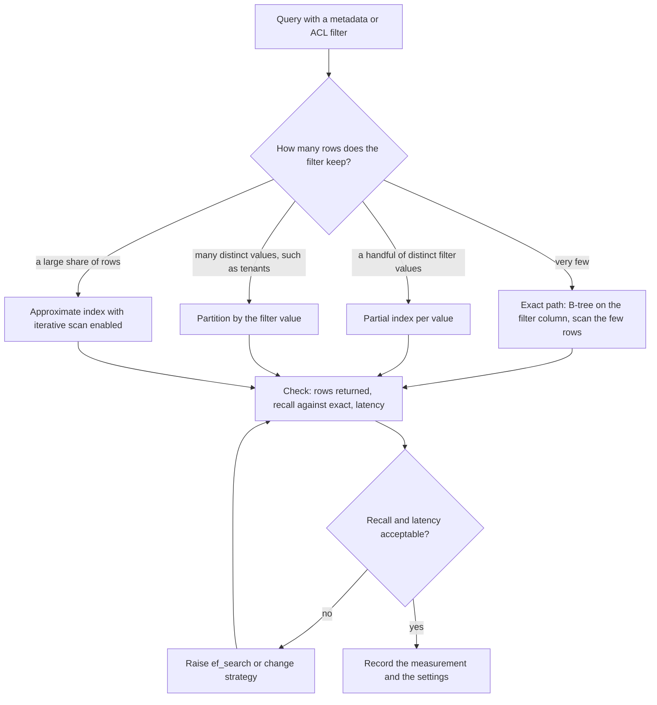
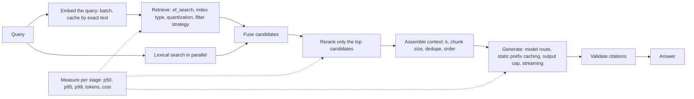

# Chapter 20 — Performance and Cost Optimization

> **Evidence legend.** **[S#]** = supported by a source in References (IDs map to `project-management/RESEARCH-REGISTER.md`; papers were read at abstract level only). **[E]** = engineering recommendation/reasoning. **[A]** = assumption. **[I]** = illustrative. **[X]** = executed in this repository. **[M]** = **measured** on this development machine by `reference-implementation/evaluation/bench_pgvector.py` (results file `evaluation/results/bench-pgvector-2026-11-09.json`). **[V]** = vendor-reported. **[N]** = not researched or not measured. Research date: 2026-11-09. Following CLAUDE.md §13, every number in this chapter is one of: *measured* [M], *computed from stated assumptions* [X], *vendor-reported* [V], or *illustrative* [I]. **The measured numbers come from 30,000 synthetic clustered vectors of 128 dimensions on one laptop-class host with PostgreSQL 16.12 and pgvector 0.8.7 in a Docker container. They are not a benchmark of real embeddings, real corpora or any product, and absolute values will not transfer.** Prices in the cost model are abstract units, not any vendor's price list.

## 20.1 Learning Objectives

After this chapter you can:

1. Decompose a RAG request into stages and assign each a latency and cost budget, knowing why percentile budgets do not add.
2. Tune an approximate nearest-neighbour index by measuring recall against exact results, not by trusting defaults.
3. Explain and measure what happens to filtered vector search, and choose between iterative scans, partial indexes, partitioning and exact scans.
4. Compute vector storage and decide between full-precision, half-precision and binary representations with re-ranking, and say what must be re-evaluated afterwards.
5. Build a per-query cost model from tokens, see which levers matter (retrieved context, output length, cacheable prefix), and compute when prompt caching pays off.
6. Reason about tail latency in fan-out designs and when hedged requests help.
7. Size pools and workers with Little's law, and design benchmarks that report measured versus estimated numbers honestly.
8. State which optimisations the reference implementation has and which it lacks.

## 20.2 Problem Statement

RAG systems spend time and money in places that differ from a conventional service: a model call whose price and latency scale with tokens, a vector index whose speed trades against accuracy, and a pipeline of stages whose slowest member sets the user's experience. Optimisation is dangerous here because the cheap lever is often a quality lever in disguise: lowering `ef_search`, quantising vectors, shrinking `k`, switching to a smaller model or caching an answer all change *what the user gets*. An optimisation without a before-and-after quality measurement (Chapter 18) is a regression you chose not to see.

The engineering problem is to find and apply the levers that remove waste, and to make every change that trades quality for cost explicit, measured and reversible, with a budget for each stage and a model of where the cost actually comes from.

## 20.3 Why It Matters in Production

- **Defaults are not tuned for you.** **Measured [M]:** on the benchmark data, HNSW at the default `ef_search = 40` returned 96.95% of the exact top-10; at `ef_search = 10` it returned 81.35%, at 200 it returned 99.2%, with the median query taking 1.1 ms, 1.2 ms and 1.6 ms. Whether 97% is acceptable depends on your corpus and on how much a missed neighbour costs the answer; you cannot know without measuring.
- **Filters can silently destroy recall.** **Measured [M]:** with a filter keeping 10% of rows, the approximate index returned on average 3.97 rows instead of 10 (recall 0.39); with a 1% filter, 0.42 rows (recall 0.04). Turning on iterative scans restored 10 rows and recall 0.975 and 0.946, at a median latency of 1.7 ms and 4.5 ms. This matches the README's warning that filters apply after the index scan and that a condition matching 10% of rows leaves about 4 rows at `ef_search = 40` [S143]. Permission-aware retrieval is *always* a filter (Chapter 8), so this is the default case for enterprise RAG, not an edge case.
- **Retrieved context dominates the input bill, and caching rarely helps it.** **Computed [X]:** in a worked prompt (800-token system prompt, 8 chunks of 400 tokens plus 20 tokens of wrapper, 300 output tokens) each extra chunk adds exactly its tokens to the input; prefix caching at a 90% hit rate saves 11.0% of cost with an 800-token prefix and 43.2% with a 6,000-token prefix, because only the static prefix is cacheable and retrieved chunks differ per query.
- **Fan-out turns rare slowness into common slowness.** **Simulated [X]:** if each call has about a 1% chance of exceeding its own p99, a request that waits for 10 parallel calls is slow 8.5% of the time and for 50 parallel calls 36.9% of the time. This is why tail latency, not the median, governs retrieval designs with many sub-queries (Chapters 10–11, 15).
- **Cost and quality move together.** Long contexts are not free quality: models often use information at the beginning and end of a long input better than in the middle, even models built for long contexts [S149]. Adding chunks raises cost and can lower accuracy.

## 20.4 Core Concepts

### 20.4.1 Where time and money go

| Stage | What costs | Main levers | Quality risk |
|---|---|---|---|
| Embed the query | One short model call | Exact-text cache; local model; batching only for bulk work | Cache keying (20.10) |
| Vector search | Index traversal, memory | `ef_search`, index type, quantization, dimension | Recall loss |
| Lexical search | Inverted-index lookup | Usually cheap; run in parallel with vector search | None if parallel |
| Filtering | Depends on strategy (20.4.4) | Iterative scan, partial index, partition | Too few results |
| Fusion and rerank | Per-candidate scoring | Rerank only the top N; cap N | Missed re-ordering |
| Context assembly | Tokens | `k`, chunk size, dedupe, parent expansion | Missing evidence vs noise |
| Generation | Input and output tokens; decode time | Model route, prefix caching, output cap, streaming | Answer quality |
| Validation | Deterministic checks, optional verifier | Do cheap checks first | None |

I expect generation to dominate both latency and cost in most designs because it is the only stage priced and timed per token, but I have **not measured** an end-to-end RAG request on this system **[N]**; the observability of Chapter 19 exists to settle that question with traces rather than assumption.

### 20.4.2 Latency: budgets, percentiles and the tail

**Percentiles do not add.** If three sequential stages each have a p95 of X, the p95 of their sum is *less* than 3X, because all three are rarely slow together. **Simulated [X]:** with a lognormal body and a 1% stall, the sum of three stage p95s was 506 ms while the p95 of the actual sum was 445 ms. A budget built by adding stage p95s over-allocates; allocate from the percentile of the end-to-end distribution you can measure **[E]**.

**Fan-out amplification.** With n independent parallel calls each exceeding its own p99 with probability p, the chance that at least one does is `1 − (1 − p)^n`. **Simulated [X]** (each call's measured exceedance rate was about 1% on fresh draws): 1.1% at n = 1, 8.5% at n = 10, 36.9% at n = 50, within sampling error of the formula. The Tail at Scale makes the general point: brief high-latency episodes that are harmless in small systems dominate at scale, and "latency tail-tolerant" techniques aim to build a predictably responsive whole from less predictable parts [S146]. (The page I read is the abstract; it does not name specific techniques, so the next paragraph is my own illustration of a standard idea, not a claim about the paper.)

**Hedged requests [E, simulated X].** Send a second copy of a call if the first has not finished by a delay (here the single-call p95) and take whichever finishes first. **Simulated [X]:** extra load 5.2%, p99 from 1,064 ms to 243 ms. The cost is duplicate work, which is only acceptable for idempotent, read-only calls, and the benefit depends entirely on the tail being caused by *independent* slowness (a stalled replica or connection) rather than by overload, where hedging adds load to a system that is already struggling (Chapter 21). Sending the hedge immediately doubles the load and is caught by the mutation check.

**Streaming** does not reduce total time, but it reduces *perceived* latency by delivering the first token early; the OpenTelemetry GenAI conventions define a time-to-first-token histogram for exactly this reason [S136]. Budget time to first token separately from completion.

**Parallelise independent work** (vector and lexical search, multiple sub-queries) and bound each branch with its own timeout and a deadline from the caller (Chapter 21). **Capacity** follows Little's law: average requests in flight equal arrival rate times time in system; 50 requests per second at 2 seconds each means 100 in flight **[X]**, which is the number your connection pools, worker threads and provider concurrency limits must accommodate with headroom.

### 20.4.3 Tuning the vector index by measurement

HNSW exposes build parameters `m` (default 16) and `ef_construction` (default 64) and a query parameter `hnsw.ef_search` (default 40) settable per session or per transaction with `SET LOCAL` [S143]. Recall is checked by comparing approximate with exact results, which the README suggests doing by disabling index scans in a transaction [S143]; the benchmark computes ground truth before any vector index exists, which is exact by construction.

**Measured [M]** (30,000 × 128, L2, 200 queries, `m = 16`, `ef_construction = 64`, single connection, loopback through Docker):

| `ef_search` | Recall@10 | Median ms | p95 ms |
|---|---|---|---|
| 10 | 0.8135 | 1.09 | 1.45 |
| 20 | 0.9185 | 1.19 | 1.56 |
| 40 (default) | 0.9695 | 1.24 | 1.60 |
| 100 | 0.9820 | 1.41 | 1.81 |
| 200 | 0.9920 | 1.62 | 2.24 |
| 400 | 0.9925 | 1.95 | 2.47 |
| *exact scan* | 1.0000 | 7.86 | 11.08 |

How to read it: recall climbs steeply and then flattens (0.99 at 200, 0.9925 at 400) while latency keeps rising, so there is a knee; the right setting is the smallest `ef_search` whose recall your *downstream quality metric* tolerates (Chapter 18). The exact scan is only about 5× to 7× slower here (7.86 ms against 1.1 to 1.6 ms) because 30,000 small vectors fit in memory; the gap widens with corpus size, which I did **not** measure **[N]**. Synthetic clustered data is easier for graph indexes than many real embedding sets, so expect lower recall at the same settings on real data; measure on yours. A single run on a quiet machine gives indicative, not statistically robust, latency (no repeated trials or confidence intervals were computed) **[M]**.

**Build.** **Measured [M]:** the HNSW build took 9.74 s and the index occupied 24,993,792 bytes (25.0 MB) beside a 17,989,632-byte table (18.0 MB), with `maintenance_work_mem = 128MB` and parallel maintenance workers disabled. The README advises that builds are faster when the graph fits in `maintenance_work_mem`, that `max_parallel_maintenance_workers` defaults to 2, that data should be loaded before indexing, and that production indexes can be created concurrently [S143]. **Finding [M]:** my first run used the default parallel build and failed with "could not resize shared memory segment … No space left on device": the database container has Docker's default 64 MB `/dev/shm`, and a parallel build needs shared memory on the order of `maintenance_work_mem`. Either raise the container's `shm_size` or disable parallel workers; the reference implementation's compose file does neither yet (OI-057).

### 20.4.4 Filtered search

An approximate index returns its `ef_search` nearest candidates and *then* the filter is applied, so a selective filter leaves few rows. The README lists the remedies: exact indexes such as a B-tree on the filter column when the condition matches a small share of rows, partial indexes for filters on a few distinct values, partitioning for many distinct values, and iterative index scans (`hnsw.iterative_scan` with `strict_order` or `relaxed_order`, bounded by `hnsw.max_scan_tuples`, default 20,000) that keep scanning until enough rows pass the filter [S143].

**Measured [M]** (same data; `category` filter keeping about 1% of rows, `bucket` filter keeping 10%; `ef_search = 40`; ground truth is the exact filtered top-10):

| Filter keeps | Setting | Rows returned (mean of 10) | Recall@10 | Median ms | p95 ms |
|---|---|---|---|---|---|
| 10% | iterative scan off | 3.97 | 0.387 | 1.24 | 2.01 |
| 10% | `relaxed_order` | 10.00 | 0.975 | 1.71 | 2.71 |
| 1% | iterative scan off | 0.42 | 0.042 | 1.29 | 1.91 |
| 1% | `relaxed_order` | 10.00 | 0.9465 | 4.47 | 7.49 |

The planner's default plan returned the same results as the forced-index plan in this setup (no B-tree on the filter columns), so I did not observe a planner escape to an exact scan; adding a B-tree index on the filter column could change that and was not tested **[M]**. The first row reproduces the README's "about 4 rows" example almost exactly (3.97) [S143]. Two lessons: (1) **always check the number of rows returned, not only latency**, because the fast, wrong path looks great on a latency chart; (2) iterative scans fix the count at a latency price that grows as the filter gets more selective (3.5× median at 1% here), so at some selectivity an exact path is better, which is what the decision diagram encodes.

<!-- figure:20-filtered-search-decision -->

*Figure 20.1: Filtered search. Original diagram; source below.*

Mermaid source

<!-- /figure -->

*Original diagram by the handbook author; source `docs/assets/diagrams/20-filtered-search-decision.mmd`.*

For a multi-tenant system the filter is the tenant, which is a high-cardinality, always-present predicate; per-tenant partitions or per-tenant indexes (Chapter 8) change the economics and are the main alternative to iterative scans **[E]**. Whatever you choose, the *security* predicate (tenant, ACL) must stay a hard filter (Chapter 13); an optimisation may change how it is evaluated, never whether.

### 20.4.5 Storage and quantization

**Raw bytes (documented formulas [S143], computed [X]).** `vector` stores 4 bytes per dimension plus 8; `halfvec` 2 bytes per dimension plus 8; `bit` dimension/8 (rounded up) plus 8. For 1,000,000 chunks of 1,536 dimensions: 6,152,000,000 bytes (`vector`), 3,080,000,000 (`halfvec`), 200,000,000 (`bit`), a ratio of 1.997 and 30.8. These exclude the HNSW graph, tuple headers, the chunk text, the full-text index and replication, which are often larger than the vectors themselves; the measured table above shows the effect.

**Measured [M]:** the `halfvec` expression index was 17,096,704 bytes against 24,993,792 for the `vector` index, 68% of the size and not 50%, because graph links do not shrink with the element type. Recall at `ef_search = 40` was 0.9745 against 0.9695 for full precision and at 100 it was 0.981 against 0.982; those differences are within what I would expect from run-to-run noise on one run and show no loss on this data; they do not generalise **[M]**.

**Binary quantization** with re-ranking: index `binary_quantize(embedding)::bit(n)`, retrieve a larger candidate set by Hamming distance, then re-rank that set with the original vectors [S143]. Azure AI Search offers built-in scalar quantization (int8, fourfold reduction) and binary quantization (up to 28× smaller index; "up to 96%" in its benchmarks), recommends testing binary on dimensions under 1,024, and pairs both with oversampling and rescoring using the original vectors (default oversampling 4; rescoring only with HNSW) [S151]. Those figures are **vendor-reported [V]** for that service.

**Dimension reduction.** Matryoshka representation learning trains one embedding to be usable at several truncated sizes; the paper reports up to 14× smaller embeddings at the same accuracy and up to 14× retrieval speed-up on image tasks [S148] (authors' abstract claims, not text RAG), and Azure exposes a `truncationDimension` for models trained this way [S151]. Use it only for models that document support.

**Rule [E]:** any change of precision, dimension or index type is a *retrieval change*; run the Chapter 18 gate on Recall@K and nDCG@K, per slice, before adopting it. Storage savings that cost a slice's recall are not savings.

### 20.4.6 Context size and the token bill

**Executed [X], abstract prices:** input tokens are `system + question + k × (chunk tokens + wrapper)`; cost scales linearly with `k` and chunk size; if output tokens are priced higher per token than input (assumed 5:1 here; real ratios vary by model and vendor) they can be a quarter of the bill in this shape of prompt (26% in the worked example) even though they are far fewer tokens. Levers, in the order I would try them **[E]**:

1. **Retrieve less and rerank harder.** A reranker (Chapter 12) that lets you pass 4 excellent chunks instead of 12 mediocre ones cuts input cost and, given the position effects in long contexts [S149], may raise accuracy. Verify on the golden set.
2. **Dedupe and trim.** Remove near-duplicate chunks and boilerplate before assembly.
3. **Cap output.** Set a sensible `max_output_tokens` per route and ask for concise answers where appropriate.
4. **Route by task.** Cheap models for query rewriting and classification, stronger ones for the final answer; the gateway's routes exist for this (ADR-012).
5. **Do not pad the prompt** with long static instructions that a shorter prompt would carry equally well.

### 20.4.7 Prompt caching and other caches

**Prompt caching.** One vendor's documentation: the cacheable prefix is tools, then system, then messages up to a `cache_control` breakpoint, matched exactly; default lifetime 5 minutes, refreshed on each use, with a 1-hour option; cache writes cost 1.25× (5 minutes) or 2× (1 hour) the base input price and reads 0.1× (with model-specific exceptions of 0.05× and 0.025×); minimum cacheable length 512 tokens for current models and more for older ones; changing tool definitions or the system prompt invalidates the cache [S152]. (I read the first 100,000 of 164,327 characters of that page; multipliers and minimums are **model-specific and version-sensitive**, so recompute with the numbers for your model.)

**Executed [X]** with the 5-minute multipliers (write 1.25, read 0.1): caching the static prefix beats not caching it once the hit probability exceeds `(1.25 − 1) / (1.25 − 0.1) = 0.217`. With Poisson arrivals and a refreshed 5-minute TTL, the hit probability is `1 − e^(−rate × 5)`, so a route handling 0.1 requests per minute hits 39% of the time, barely above break-even, while 0.5 per minute hits 92% (checked against simulation). **What is cacheable in RAG:** the system prompt and tool definitions, which are identical across requests; **not** the retrieved chunks, which differ per query. The saving therefore scales with how much of your prompt is static: 11.0% with an 800-token prefix versus 43.2% with 6,000 tokens in the worked example. A long static policy prompt or a fixed few-shot block makes caching worthwhile; a short prompt does not.

**Embedding and answer caches [E].** Caching query embeddings by exact normalised text is safe and cheap. Caching *answers* (including "semantic" caches keyed by embedding similarity) is a correctness and security hazard: an answer generated for a caller with one set of permissions must never be served to a caller with another, so the cache key must include the full authorisation scope (tenant, user, groups, and the corpus version), invalidation must follow document changes and deletions, and a near-miss similarity match can return a wrong answer to a different question. I have not researched or measured semantic caching **[N]**; treat it as high-risk until you have a tested key and invalidation design.

### 20.4.8 Ingestion cost and throughput

Embedding dominates ingestion cost; extraction and chunking are CPU only. Levers **[E]**: skip unchanged content by hash (the reference implementation already treats identical content as an idempotent no-op per document version, ADR-014), batch embedding calls (the ingestion pipeline embeds in batches of 32 by default and the gateway enforces a per-route batch limit, ADR-017), bound concurrency to the provider's limits, and avoid re-embedding when only metadata changes. **I have not measured ingestion throughput or cost per document in this repository (OI-053c, OI-054h)**, so the chapter provides no figures; Chapter 21 treats the rebuild time as a recovery-time input.

### 20.4.9 Capacity, scaling and load testing

Scale on the signal that predicts user pain: queue depth for workers, in-flight requests and latency percentiles for the API, provider throttling for model calls (GenAIOps guidance names latency, token usage and 429s as the operational metrics for model-backed workloads [S142]). Size pools with Little's law and keep headroom [X]. Load test by ramping *until things break* and observe how each component fails and whether it recovers without intervention, as the SRE book recommends [S145]; a load test that stops at the target load only shows that the happy path works.

### 20.4.10 Benchmark method

Report the environment (hardware, versions, settings), the data (and that it is synthetic), the method (warm-up, number of queries, single connection or concurrent), percentiles rather than means, **recall alongside every latency number**, and the distinction between measured, estimated and illustrative figures (CLAUDE.md §13). Store the script and the raw results next to the claim so anyone can rerun them. The benchmark in this repository follows that method and also states what it does not do: no repeated trials, no concurrency, no real embeddings, no corpus-scale test.

## 20.5 Architecture

<!-- figure:20-latency-cost-levers -->

*Figure 20.2: Architecture. Original diagram; source below.*

Mermaid source

<!-- /figure -->

*Original diagram by the handbook author; source `docs/assets/diagrams/20-latency-cost-levers.mmd`.*

## 20.6 Practical Example (Measured [M] and Executed [X])

**Measured benchmark.** `reference-implementation/evaluation/bench_pgvector.py` creates a scratch database, loads 30,000 synthetic 128-dimension vectors (50-cluster Gaussian mixture, fixed seed), computes exact ground truth with no vector index, builds HNSW and a `halfvec` expression index, and measures recall, rows returned and per-query latency for the settings in 20.4.3 to 20.4.5. Run it with `python ../evaluation/bench_pgvector.py` from `reference-implementation/backend` after exporting the `RAG_TEST_*` variables; it took about 34 seconds here.

**Executed model.** `docs/exercises/ch20_cost_latency_model.py` (standard library; `--mutants` for the mutation check) computes the cost, caching, storage, fan-out, hedging, percentile-addition and Little's-law results quoted above. Mutation check: **7/7 injected defects detected** (cache read priced at the write rate, a wrong break-even formula, `halfvec` sized as float32, a wrong `bit` size, a linear fan-out formula, immediate hedging, a wrong Little's law).

**Findings while building them (all real).**

1. *Parallel index builds failed in the container* with a shared-memory error (20.4.3). The reference implementation had never built a vector index in the compose database, so this would have surfaced at component 6; I recorded it as OI-057.
2. *My hand estimate was wrong.* I guessed the prefix-caching saving at 3–10%; the code, and the arithmetic when I did it properly, gave 11.0% (800 × (1 − 0.215) / 5,700). I replaced the guessed range with the analytic value so the test now asserts the formula, not my intuition.
3. *My first fan-out test used a tolerance that was too tight* and failed by 2.3 points at n = 50 because the p99 threshold is itself estimated from a sample. The fix was to compare against the formula evaluated at the measured exceedance rate, with a tolerance of about three standard errors, not to loosen the formula.
4. *A formula can be exactly right and the test still weak:* the linear-fan-out mutant is caught only at n = 50, not at n = 10, so the check relies on including a large n.
5. *Measured filtered-search behaviour agreed closely with the README's own example* (3.97 rows against "about 4"), which is mildly reassuring about both the documentation and the benchmark.

## 20.7 Implementation

**What the reference implementation has today [X, by inspection].**

| Capability | State |
|---|---|
| Per-route model chains, fallback, per-provider breakers, external daily spend budget with operator-supplied prices | Built (ADR-012) |
| Embedding batch size setting and per-route batch limit | Built (ADR-017) |
| Content-hash idempotency (identical content is a no-op per document) | Built (ADR-014) |
| Token and cost recorded on `llm.call` events | Built; embed latency reported as 0.0 (OI-055) |
| Vector index, filtered-search strategy, `ef_search` setting | **Not built** (component 6); this chapter's benchmark is the evidence it will use |
| Prefix caching, answer cache, embedding cache | **Not built** |
| Reranking, context assembly, token budgeting | **Not built** |
| Container shared memory for index builds | **Not set** (OI-057) |
| Ingestion throughput and cost measurements | **None** (OI-053c) |

**Settings component 6 should make explicit [I]:** `ef_search` per route (default chosen from a recall target on the golden set, not from the library default), the filter strategy per tenant size, `maintenance_work_mem` and parallelism for builds with a matching container `shm_size`, and an index-per-embedding-space design so that a model change builds a new index beside the old one (ADR-017).

## 20.8 Trade-offs

| Decision | Option | Gain | Cost / risk |
|---|---|---|---|
| `ef_search` | Low | Latency, CPU | Recall loss, silently [M] |
| | High | Recall | Latency and CPU with diminishing returns [M] |
| Filter | Iterative scan | Correct row count with one index | Latency grows with selectivity [M] |
| | Partitions or partial indexes | Predictable per-filter performance | Operational complexity; planning |
| Precision | `halfvec` | Smaller storage and index [M] | Must be re-evaluated per corpus |
| | Binary + re-rank | Largest savings [V] | Needs oversampling; test on small dimensions [S151] |
| Context | Larger `k` | More chance the evidence is present | Cost, noise, position effects [S149] |
| Caching | Prompt prefix | Large saving if the prefix is large [X] | Little for short prompts; invalidation by edits [S152] |
| | Answer cache | Fast, cheap | Authorisation and staleness hazards |
| Hedging | On idempotent reads | Smaller tail [X] | Duplicate load; harmful under overload |

## 20.9 Failure Modes

| Failure | Cause | Detection | Mitigation |
|---|---|---|---|
| Fast but wrong search | Few rows returned under a filter [M] | Rows-returned and recall checks | Iterative scan, partitioning; test with real filters |
| Recall regression after "free" optimisation | Lower `ef_search`, quantization, fewer dimensions | Chapter 18 gate per slice | Measure before and after |
| Index build fails or crawls | Memory too small for the graph; container shared memory [M] | Build progress view `pg_stat_progress_create_index` [S143]; errors | Size `maintenance_work_mem`; set `shm_size` |
| Cost spike | Larger `k`, longer prompts, fallback to a pricier model, retries | Cost per query, fallback rate (Chapter 19) | Budgets, caps, alerts |
| Cache serves wrong or unauthorised data | Cache key omits authorisation scope or corpus version | Cross-tenant tests; staleness checks | Key by scope and version; invalidate on change |
| Tail latency in fan-out | Many parallel sub-queries [X] | p99 by stage | Fewer sub-queries, per-branch timeouts, hedging where safe |
| Benchmarks that mislead | Synthetic data, no recall, means only | Review against 20.4.10 | State method and limits; measure on your data |
| Stale prompt cache assumptions | Multipliers or minimums changed [S152] | Cost reports vs expectation | Recompute from current documentation |

## 20.10 Security Considerations

Optimisations must not weaken isolation. The tenant and ACL predicates stay hard filters whichever filter strategy is used. Caches are a cross-tenant leak path unless keyed by authorisation scope (20.4.7). Performance tests and benchmarks must use synthetic or de-identified data; the repository's benchmark uses synthetic vectors only. Quantised or truncated vectors are still derived from sensitive text and need the same access control as full vectors. Do not enable verbose query logging or content capture to "debug performance" (Chapter 19). Load tests must not run against production tenants' data and must respect provider terms and quotas.

## 20.11 Performance Considerations

The chapter body is the performance guidance; the short version **[E]**: set budgets per stage from end-to-end percentiles, run independent work in parallel, bound fan-out, stream, measure recall beside latency, size pools with Little's law, and treat every quality-trading change as a release (Chapter 19) gated by evaluation (Chapter 18).

## 20.12 Cost Considerations

Cost model **[X]** (fill in your own prices): per query = `(system tokens × prefix multiplier + variable input tokens) × input price + output tokens × output price` plus embedding, search and rerank costs, where `variable input tokens = question + k × (chunk tokens + wrapper)`. Monthly cost = per-query cost × queries, plus ingestion embedding cost = total chunk tokens × embedding price, plus storage (vectors, graph, text, full-text index, replicas, backups) and judge cost for evaluation and monitoring (Chapters 18–19). Because no vendor prices were researched, the chapter gives none **[A]**. Reduce cost in this order: remove waste (duplicates, oversized prompts, retries), then route cheaper models where measured quality allows, then cache what is genuinely static, then change precision or dimension with an evaluation gate.

## 20.13 Production Recommendations

1. Measure before tuning; record environment, data, method and limits with every number.
2. Choose `ef_search` from a recall target on your corpus and re-measure when the corpus, model or index changes.
3. Always check rows returned and recall under your real filters; enable iterative scans or choose a different strategy deliberately.
4. Size memory for the index build and the serving graph; set container shared memory.
5. Gate any precision, dimension or index-type change with Recall@K and nDCG@K per slice.
6. Build a per-query cost model from tokens; watch input, output, cached and uncached tokens separately.
7. Cache the static prompt prefix when it is large enough; never cache answers without a scope-and-version key.
8. Budget latency from end-to-end percentiles; bound fan-out; hedge only idempotent reads and not under overload.
9. Size pools and workers with Little's law and load test until failure, including recovery.
10. Put per-stage latency and cost into traces and dashboards (Chapter 19) so budgets are enforced by measurement.

## 20.14 Architecture Decision Guidance

An ADR for the index strategy (index type and parameters per embedding space, filter strategy by tenant size, precision, `ef_search` policy, build settings) is required at component 6 and should cite this chapter's benchmark as its first evidence. A second ADR at component 10–11 should fix the token budget policy (`k`, chunk caps, output caps, prefix caching). Reconsider both when measured recall on real embeddings differs materially from the synthetic data, when corpus size changes the exact-versus-approximate crossover, or when provider pricing or caching rules change.

## 20.15 Interview Questions

1. **How do you pick `ef_search`?** Measure recall@K against exact results on your data across a sweep, find the knee, pick the smallest value your downstream quality tolerates; the default is not tuned for you [S143, M].
2. **What happens to filtered ANN search and how do you fix it?** The filter applies after the index scan, so selective filters return too few rows; use iterative scans, partial indexes, partitioning, or an exact path depending on selectivity; check rows returned and recall [S143, M].
3. **Why is permission-aware retrieval a performance problem?** The ACL predicate is a filter on every query, so the filtered-ANN problem is the default; tenant partitioning changes the economics [E, M].
4. **Half-precision vectors halve storage?** Raw vector bytes roughly halve [S143, X]; the HNSW index was 68% of the size in my measurement [M]; recall must be re-checked [E].
5. **What can be prompt-cached in a RAG prompt?** The static prefix (tools, system); retrieved chunks vary per query and generally are not; saving scales with the static share [S152, X].
6. **When does prompt caching break even?** When the hit probability exceeds (write − 1)/(write − read), 0.217 for 1.25× writes and 0.1× reads; with Poisson arrivals the hit probability is 1 − e^(−rate × TTL) [S152, X].
7. **Why does fan-out hurt tail latency?** The probability that at least one of n calls is slow is 1 − (1 − p)^n; 37% at n = 50 for a 1% tail [X, S146].
8. **Do percentiles add up across stages?** No: the p95 of a sum is below the sum of p95s; budget from the end-to-end distribution [X].
9. **When is hedging a bad idea?** For non-idempotent calls, and when the slowness comes from overload, where it adds load [E, X].
10. **How would you cut cost without hurting quality?** Remove waste first, rerank to pass fewer chunks, cap output, route cheaper models by task, cache the static prefix, then gate any precision change with evaluation [E].
11. **Why is a semantic answer cache risky?** Authorisation scope, staleness and near-miss false matches; key by scope and corpus version and invalidate on change [E, N].
12. **How do you size a worker pool?** Little's law: in-flight = rate × latency, plus headroom; then load test to failure [X, S145].

## 20.16 Knowledge Checkpoint / Exercises

1. Run `bench_pgvector.py` with `--n 100000` and report how the exact-versus-HNSW latency gap and the recall at `ef_search = 40` change; state the new environment limits (memory, build time).
2. Add a B-tree index on `bucket` and `category` and repeat the filtered runs; report whether the planner changes its plan and what happens to rows returned and latency.
3. Re-run the benchmark with three repeats per setting and report medians with a spread; explain what the single-run numbers could not show.
4. Add `ef_construction` and `m` sweeps (for example 8/16/32 and 64/128/200) and plot recall at `ef_search = 40` against build time and index size.
5. Using your own price numbers, compute the monthly cost of 1M queries at the worked prompt shape, with and without prefix caching at hit rates of 20%, 50% and 90%; find the break-even.
6. Extend `ch20_cost_latency_model.py` with a second, longer-tailed latency distribution and show whether hedging after the p95 still helps.
7. Make the compose database container set `shm_size` and re-run with parallel maintenance workers enabled; report the build time change (closes OI-057).

## 20.17 Summary

Performance and cost work in RAG is measurement work. Tune the ANN index by recall against exact results; always check rows returned under your real filters, where approximate indexes silently under-deliver unless iterative scans or another strategy are used; treat precision, dimension and index changes as retrieval changes that need evaluation; model the token bill and see that retrieved context and output dominate while only the static prefix is cacheable; and reason about tail latency, fan-out and capacity with the arithmetic that governs them. The measured results here come from synthetic data on one host and show mechanisms and orders of magnitude, not benchmarks; the executed model verified its formulas with 7/7 injected defects detected. The reference implementation has no vector index, caches or reranking yet, and its first index build exposed a container shared-memory limit (OI-057).

## References

- [S136] OpenTelemetry, *GenAI semantic conventions — metrics* (Development). https://github.com/open-telemetry/semantic-conventions-genai/blob/main/docs/gen-ai/gen-ai-metrics.md
- [S142] Microsoft, *Generative AI Operations for Organizations with MLOps Investments*. https://learn.microsoft.com/en-us/azure/architecture/ai-ml/guide/genaiops-for-mlops
- [S143] pgvector README (HNSW options, iterative scans, filtering, quantization, build tips). https://github.com/pgvector/pgvector/blob/master/README.md
- [S145] Google, *Site Reliability Engineering*, "Addressing Cascading Failures". https://sre.google/sre-book/addressing-cascading-failures/
- [S146] Dean and Barroso, *The Tail at Scale*, CACM 56 (2013) (abstract). https://research.google/pubs/the-tail-at-scale/
- [S148] Kusupati et al., *Matryoshka Representation Learning*, arXiv:2205.13147 (abstract). https://arxiv.org/abs/2205.13147
- [S149] Liu et al., *Lost in the Middle: How Language Models Use Long Contexts*, arXiv:2307.03172 (TACL 2023; abstract). https://arxiv.org/abs/2307.03172
- [S151] Microsoft, *Compress vectors using quantization* (Azure AI Search, 2026-04-27). https://learn.microsoft.com/en-us/azure/search/vector-search-how-to-quantization
- [S152] Anthropic, *Prompt caching* (first 100,000 of 164,327 characters read). https://platform.claude.com/docs/en/build-with-claude/prompt-caching
- ADR-012, ADR-014, ADR-017, OI-053, OI-054, OI-055, OI-057; `reference-implementation/evaluation/bench_pgvector.py` and `evaluation/results/bench-pgvector-2026-11-09.json` (this repository).
