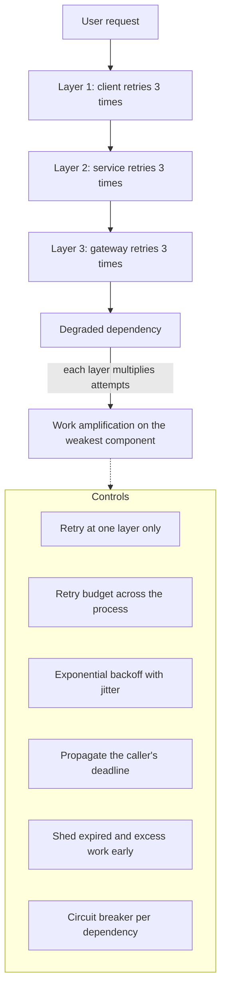
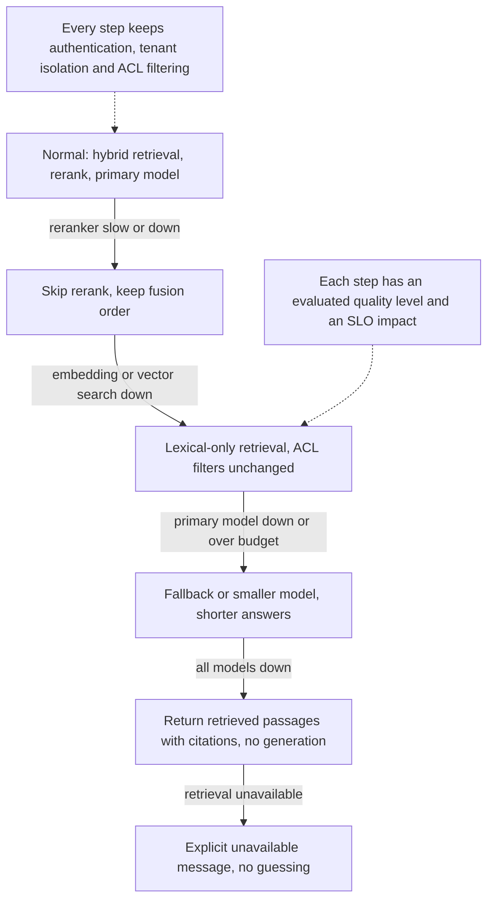

# Chapter 21 — Reliability and Production Failure Modes

> **Evidence legend.** **[S#]** = supported by a source in References (IDs map to `project-management/RESEARCH-REGISTER.md`; papers were read at abstract level only). **[E]** = engineering recommendation/reasoning. **[A]** = assumption. **[I]** = illustrative. **[X]** = executed in this repository by `docs/exercises/ch21_resilience.py`, or, where stated, established by inspecting the reference implementation's code on 2026-11-09. **[V]** = vendor-reported. **[N]** = not researched or not measured. Research date: 2026-11-09. **The executed example is a simple time-stepped simulation whose parameters (arrival rate, capacity, timeout, brown-out length) are my own choices.** It demonstrates mechanisms (work amplification, wasted work, herd effects) and the relative order of policies, not the size of any effect in a real system. No chaos experiment, failover, restore drill or load test was run against the reference implementation, and nothing here claims it is highly available.

## 21.1 Learning Objectives

After this chapter you can:

1. Classify the failure modes of a RAG system (request path, data pipeline, provider, quality, security, operations) and say how each is detected and contained.
2. Set timeouts from latency percentiles, propagate the caller's deadline, and explain why per-call timeouts alone allow worst cases above the user's deadline.
3. Design retries that do not amplify an outage: one retry layer, backoff with jitter, a retry budget, idempotent operations, and a rule for permanent versus transient errors.
4. Explain wasted work in FIFO queues with timed-out clients and how bounded queues and deadline-aware shedding prevent a metastable overload.
5. Place circuit breakers correctly (per dependency), tune them, and state their cost: they reject fresh requests to protect the dependency.
6. Define a graceful-degradation ladder for RAG that never skips authentication, tenant isolation or ACL filtering.
7. Design data-path resilience: idempotent ingestion, dead-letter handling, replay from raw objects, index and embedding-space migrations.
8. Reason about RPO and RTO, PostgreSQL point-in-time recovery and its limits, and why derived data being rebuildable changes what you back up and what you must rehearse.
9. Audit a system against these practices, including the reference implementation's strengths and gaps.

## 21.2 Problem Statement

A RAG system depends on more things than most services: an identity provider, a relational database that holds both metadata and vectors, an object store, a queue and workers, one or more model providers, and sometimes a reranker or a search service. Each can be slow, wrong, throttled or gone, and the system's own recovery mechanisms (retries, queues, fallbacks) can turn a brown-out into an outage. The Google SRE book names the pattern: server overload triggers failures, resource exhaustion spreads them, and retry amplification destabilises the system, because a single user action can multiply into many backend attempts when every layer retries [S145].

The reliability problem has a second half unique to this domain: many failures raise no error. A stale index, a silently dead-lettered document class, a model swapped by the provider, or a fallback that answers in a different style all return HTTP 200. Chapters 18 and 19 give the measurement; this chapter gives the design that limits the damage and the recovery plan for when the damage is real.

## 21.3 Why It Matters in Production

- **Retries multiply.** AWS's guidance: in a five-deep call stack with three retries per layer, database load can rise 243×; retries are "selfish" because they consume capacity from a server that is already overloaded [S144]. **Simulated [X]:** in a brown-out model, three immediate retries raised work per request to 3.13× and the system did not recover within the 250 ticks observed after the brown-out; with a 10% retry budget it stayed at 1.02×.
- **Backoff and jitter alone were not enough in the simulation.** **Simulated [X]:** exponential backoff and full jitter each also failed to recover (3.09× and 3.10× work) because the unbounded FIFO queue kept serving requests whose clients had already given up (27,440 wasted requests). What fixed it was deadline-aware shedding with a bounded queue. Jitter did what it is meant to do in a different test: when 1,000 clients fail at the same instant, the largest single-tick retry spike was 1,000 without jitter and 495 with full jitter.
- **A breaker is a trade, not a free fix.** **Simulated [X]:** adding a circuit breaker cut attempts reaching the dependency from 28,203 to 26,902 but lowered success for fresh requests during the brown-out from 47.3% to 31.0%, because it rejects traffic to protect the dependency.
- **Deadlines bound the worst case.** **Computed [X]:** three stages with 4-second timeouts and a 6-second caller deadline have a 12-second worst case without deadline propagation and 6 seconds with it.
- **Recovery needs rehearsal.** PostgreSQL's continuous archiving gives point-in-time recovery, but it restores a whole cluster, not a tenant or a table, and archive failures make the write-ahead log grow until the disk fills and the server shuts down [S150].

## 21.4 Core Concepts

### 21.4.1 A failure taxonomy for RAG

| Class | Examples | Visible as | Typical containment |
|---|---|---|---|
| Request path | API instance crash, DB pool exhausted, slow vector search, reranker timeout | Errors, latency | Timeouts, shedding, degradation ladder (21.4.6) |
| Provider | Model outage, 429 throttling, hosted model updated or retired, budget exhausted | Errors, fallback rate, quality drift | Fallback chain, breakers, budgets, pinned models, canaries (Chapter 19) |
| Data pipeline | Poison document, extractor crash, embedding refusal, queue backlog, dead jobs | Dead jobs by reason code, index lag | Idempotent jobs, retries with classification, dead letters, replay |
| Index and data | Stale index, partial ingest, embedding-space mix, deletion not propagated, corrupted index | Freshness SLI, zero-result rate | Version states, atomic writes, rebuild, per-space indexes |
| Quality (silent) | Retrieval regression, prompt change, fallback model style, judge drift | Sampled quality SLIs, canaries | Evaluation gate, rollback of the release bundle |
| Security and safety | Cross-tenant attempt, prompt injection, exfiltration attempt | Audit events, denial spikes | Defence in depth (Chapter 22); incident runbook |
| Operations | Bad deploy, migration lock, secret expiry, certificate expiry, disk full | Deploy markers, resource alerts | Canary, expand-contract migrations, rotation, capacity alerts |

**Single points of failure to look for [E]:** the one database that stores metadata and vectors; the single provider on a route; the single region; the one engineer who knows the restore procedure; and the single object store holding the only copy of raw files.

### 21.4.2 Timeouts and deadlines

Every remote call needs a timeout, including connection and request phases. AWS's advice is to choose an acceptable false-timeout rate (for example 0.1%) and set the timeout to the matching percentile of the downstream's latency (p99.9), adjusting for high-latency networks, for tight distributions where p99.9 is close to p50, and for implementations whose timeouts do not cover DNS or TLS handshakes [S144].

A per-call timeout is not a deadline. If each of three stages may take 4 seconds and the caller will wait 6, the pipeline can run for 12 seconds, doing work no one will receive. The SRE book's rule: rather than inventing a deadline when calling backends, **propagate the caller's deadline**, and propagate cancellation so that abandoned work stops deeper in the call tree [S145]. **Executed [X]:** with propagation each stage's timeout is the smaller of its own cap and the time remaining, so the worst case equals the caller's deadline; removing propagation is caught by the mutation check.

**Reference implementation [X, by inspection].** The gateway applies a per-attempt timeout per route (`asyncio.timeout(route.timeout_s)`) and each route has a maximum number of attempts per target, so the worst case is attempts × timeout × targets, *not* the caller's remaining time. The database layer sets `statement_timeout`, `idle_in_transaction_session_timeout` and a pool acquire timeout. There is no request-level deadline object passed through the pipeline yet (OI-058).

### 21.4.3 Retries

Rules, with their sources **[S144, S145]**: retry at one layer of the stack, not every layer (nested retries multiply); use randomized exponential backoff so retries do not synchronise into waves; cap the retry count per request and use a server-wide **retry budget** so retries cannot exceed a fixed fraction of traffic (AWS describes a token bucket where calls retry while tokens remain and then at a fixed rate, which it prefers to circuit breakers because breakers add modal behaviour and slow recovery [S144]); do not retry permanent errors or malformed requests; return clear overload signals so clients back off; and **retry only idempotent operations**, because a timeout does not mean the side effect did not happen [S144].

**Idempotency [X].** The exercise's `apply_once` runs a side effect once per idempotency key, so three retries of the same logical request produce one effect, and a mutation that bypasses the key is caught. In this system the equivalents are content-hash idempotency of uploads and versions (ADR-014), derived chunk ids and replace-in-one-transaction ingestion (ADR-016, ADR-017), and job leases with at-most-one holder (ADR-015) **[X, by inspection and tests]**.

**Permanent versus transient.** The ingestion worker marks unprocessable files as permanent failures with a safe reason code and ends the job at once instead of retrying (ADR-016); the gateway classifies errors into retryable, fallback-able and neither, and does not retry a request that is wrong for every provider (ADR-012) **[X, by inspection]**.

**What the simulation showed [X].**

| Policy | Work per request | Peak queue | Fresh-request success during the brown-out | Wasted requests | Ticks to recover after the brown-out |
|---|---|---|---|---|---|
| No retries | 1.00 | 1,500 | 7.6% | 4,160 | 33 |
| Immediate retries ×3 | 3.13 | 52,980 | 7.6% | 27,440 | not within 250 |
| Exponential backoff ×3 | 3.09 | 51,860 | 7.6% | 27,440 | not within 250 |
| Full jitter ×3 | 3.10 | 52,183 | 7.6% | 27,440 | not within 250 |
| Jitter + 10% retry budget | 1.02 | 1,685 | 7.6% | 5,911 | 50 |
| + deadline-aware shedding, bounded queue | 1.01 | 430 | 47.3% | 0 | 0 |
| + circuit breaker | 0.96 | 400 | 31.0% | 0 | 0 |

Model: 70 new requests per tick against a capacity of 100, falling to 20 for 30 ticks, a 5-tick client timeout, three retries maximum. (The "33 ticks" for no retries matches my analytic estimate: a 1,500-request backlog drains at 30 per tick until the queue wait falls under the timeout.) Reading it: the retry budget removes the amplification but not the stale-work problem (recovery 50 ticks, worse than no retries at all, because the retries it still allows add stale work); shedding expired work with a bounded queue removes the stale work; the breaker lowers load further at the price of rejecting more fresh traffic. The surprising row is the middle three: **backoff and jitter did not rescue a system that was already in a wasted-work spiral**. They matter for the *herd* effect (21.3), not for this one. All of this is my model's behaviour with my parameters; a real system has different queueing, client behaviour and failure shapes.

<!-- figure:21-retry-amplification -->

*Figure 21.1: Retries. Original diagram; source below.*

Mermaid source

<!-- /figure -->

*Original diagram by the handbook author; source `docs/assets/diagrams/21-retry-amplification.mmd`.*

### 21.4.4 Queues, overload and load shedding

A FIFO queue in front of an overloaded dependency makes every waiting request older, and a client that has timed out may still have its request served: the dependency spends capacity on work nobody will use (**27,440 wasted requests in the unbounded cases [X]**). The SRE book's remedies: shed load early by rejecting when a server nears its limits (for example HTTP 503), use LIFO or CoDel-style queueing to drop requests clients have likely abandoned, keep queues short relative to the thread pool (it suggests 50% or less), and degrade quality when overloaded, for example searching a smaller dataset or using a cheaper ranking algorithm [S145]. It also warns that degraded modes are rarely exercised, so they must be tested regularly and be simple enough to disable quickly [S145].

**Executed [X]:** a queue bounded at what the dependency can serve within the timeout (capacity × timeout = 500) plus skipping requests whose deadline has passed kept the peak queue at 430, wasted work at zero and fresh-request success during the brown-out at 47.3%.

**Admission control and fairness [E].** Beyond protecting a dependency, protect tenants from each other: per-tenant concurrency and rate limits, so one tenant's batch job cannot consume every connection, worker or provider slot (a noisy neighbour). The reference implementation has no rate limiting or quotas yet (OI-052c).

### 21.4.5 Circuit breakers

The Azure Architecture Center describes the pattern as a state machine: **closed** (calls pass; failures are counted over a time window), **open** (calls fail immediately; a timer runs), **half-open** (a limited number of trial calls pass; success closes it, any failure reopens it). It complements retry rather than replacing it, and the retry logic should stop when the breaker says the fault is not transient [S147]. Its listed considerations map to design decisions **[S147]**: distinguish exception types (time-outs versus unavailability may need different thresholds); expose state changes for monitoring; tune the open duration to the likely recovery (too long raises errors after recovery, too fast flaps); allow manual override; keep it cheap under concurrency; use **separate breakers per independent resource** (one shard or provider failing must not block the others); trip faster on explicit overload signals such as 429 or 503 with a retry-after; and beware of long timeouts that hold resources before the breaker can react. It also notes breakers may not suit message-driven systems that already dead-letter failed messages [S147], which is relevant to the ingestion worker.

AWS argues for token-bucket retry limiting over breakers because breakers add modal behaviour and slow recovery [S144]; the two views are compatible if you use a retry budget everywhere and a breaker where a dependency can be wholly unavailable for minutes (a provider outage), which is the gateway's case. **Simulated [X]:** the breaker reduced load on the dependency and cost fresh-request success (31.0% against 47.3%) in my model; the mutation that disables it is caught because the attempts reaching the dependency no longer fall.

**Reference implementation [X, by inspection].** The gateway keeps one breaker per provider, opens after a number of *consecutive* failures, allows exactly one trial call after a reset interval, and treats errors that say nothing about provider health (a bad request) as neutral; a successful call closes it. Its backoff between retries is capped exponential with a factor between 0.5 and 1.0 (partial jitter) and honours `retry-after`. Gaps: no process-wide retry budget; thresholds are consecutive counts, not rates over a window; breaker state is readable through a diagnostics method (`status()`), but state changes are not emitted as events and nothing exports them as metrics (OI-058).

### 21.4.6 Graceful degradation

When a dependency fails, serve something useful and honest rather than nothing, in a defined order, with each step's quality evaluated in advance **[E]**:

<!-- figure:21-degradation-ladder -->

*Figure 21.2: Graceful degradation. Original diagram; source below.*

Mermaid source

<!-- /figure -->

*Original diagram by the handbook author; source `docs/assets/diagrams/21-degradation-ladder.mmd`.*

Rules: **degraded modes must preserve every security control**, because a degraded path is the classic place for an authorisation check to be skipped; each step must be *tested*, because untested fallbacks fail when needed [S145]; users and clients should be told when they are in a degraded mode (a response flag); and the ladder's steps need quality numbers from the golden set (Chapter 18) so you know what you are trading. The reference implementation already supports the lexical rung in principle: the chunks table has a generated full-text column independent of embeddings **[X, by inspection]**; the ladder itself, the response flag and the degraded-mode tests are not built.

**Fallback providers change behaviour.** A fallback model answers differently and may cost more, and a fallback in a different data-handling regime may violate policy. The gateway's data-sensitivity policy keeps restricted requests on local providers and refuses rather than falling back to an external one (ADR-012), which is the right reliability-versus-confidentiality trade for restricted data **[X, by inspection]**.

### 21.4.7 Data-path resilience

The ingestion path is a queue-based pipeline, which suits failure: **at-least-once delivery with idempotent handlers** is the model. The reference implementation uses a PostgreSQL job queue with `SKIP LOCKED`, time-limited leases (a crashed worker's job becomes claimable again), retries with backoff, a dead state for jobs that exhausted attempts, and permanent failures that end a job at once; chunks and vectors for a version are replaced in one transaction so a retry never leaves a half-written version (ADR-015, ADR-016, ADR-017) **[X, by inspection and tests]**. Operational practices on top **[E]**:

- **Poison documents** are expected. Surface dead jobs by reason code and age, and make the response a runbook (fix the extractor, quarantine the file, notify the owner), not a retry loop.
- **Backlog** is a first-class signal: queue depth and oldest-job age drive scaling and the freshness SLO (Chapter 19).
- **Replay.** Because the raw object store retains every uploaded file and ingestion is idempotent, derived data (chunks, vectors) can be rebuilt by replaying ingestion jobs. This is the strongest reliability property of the design and also its main recovery-time risk: **rebuild time equals corpus size divided by ingestion throughput, which I have not measured (OI-053c)**.
- **Embedding or chunker changes** are migrations: build the new representation beside the old (vectors are keyed by embedding space, ADR-017), switch reads when complete, delete the old after a retention window. Do not mix spaces.
- **Deletion consistency.** A deleted document's raw object, chunks and vectors must all go; the system uses a deletion outbox so object removal cannot be lost (ADR-014), and vectors follow chunks by cascade (ADR-017). Backups complicate deletion: a restored backup resurrects deleted data unless deletions are re-applied after restore **[E]**.

**Worker retry backoff has no jitter [X, by inspection].** The job runner backs off deterministically (`min(cap, base × 2^(attempts − 1))`); a provider outage that fails many jobs at once will schedule their retries in lockstep, the herd effect measured above (OI-058).

### 21.4.8 Backup, restore and disaster recovery

**Definitions [E].** *RPO* is how much data you can afford to lose (time since the last recoverable point); *RTO* is how long you can be down. Set them per data class, because they differ: identity and tenant configuration (low RPO), raw documents (low RPO, large), derived chunks and vectors (rebuildable, so RPO is not the issue but RTO is), logs and telemetry (usually relaxed), golden sets and evaluation history (valuable, small).

**PostgreSQL.** Continuous archiving combines a base backup with archived write-ahead log segments; recovery restores the base backup and replays WAL to a chosen point, so you can recover to any moment since the backup (PITR). Archiving must be configured and tested *before* the first base backup because recovery needs an unbroken WAL sequence. Documented limits that matter here **[S150]**: recovery restores the **entire cluster**, not a subset (so you cannot restore one tenant or one table with PITR; per-tenant recovery needs a logical export or per-tenant database, a design choice to make early [E]); `pg_dump` output cannot be used for WAL replay; configuration files are not in WAL and must be backed up separately; if the archive fails, `pg_wal` keeps growing and a full filesystem causes a PANIC shutdown (without losing committed transactions); some archiver failures are not reported in `pg_stat_archiver`, so monitor the archive process itself. The page does not itself recommend periodic restore drills; I recommend them anyway **[E]**: a backup you have never restored is a hope.

**Object store.** Raw files are the source of truth for derived data. Replicate them (cross-zone or cross-region as your RPO requires) and protect them from accidental deletion with versioning or soft delete **[E]**. Back up the database and the object store consistently enough that every `raw_object_uri` in a restored database resolves, or run a reconciliation job after restore.

**What to restore first [E]:** identity and secrets, the database, the object store; then bring the API up in a read-only or degraded mode; then rebuild derived data if the restored database lacks it or fails consistency checks. **Rehearse** the sequence on a schedule and record the measured RTO.

**The reference implementation [X, by inspection].** Data lives in Docker volumes for the database and the raw objects; there is **no backup configuration, no WAL archiving, no restore procedure, no replication and no disaster-recovery plan**, and the development compose stack is single-instance (OI-058). Chapter 17 and the infrastructure component (19) are where this must be designed; Azure's managed PostgreSQL and object storage provide these capabilities, which I have not researched here **[N]**.

### 21.4.9 Deploys, migrations and configuration

Changes are a leading cause of incidents **[E]**. The reference implementation applies forward-only SQL migrations under an advisory lock, one transaction per migration, with checksums, and a one-shot migration service runs before the API starts; roles are created at database initialisation (ADR-013) **[X, by inspection]**. Practices to add: expand-then-contract migrations so the old and new code both work during rollout; canary releases watched by SLO burn rates and quality canaries (Chapter 19); rollback of the whole release bundle (code, prompts, models, index parameters); and feature flags for risky behaviours. Prerequisites that are not code (the pgvector extension must be installed by an administrator, ADR-017; the container needs adequate shared memory for index builds, OI-057) belong in a deployment checklist and a readiness check **[E]**.

### 21.4.10 Dependencies and blast radius

Isolate resources so one failure cannot consume all of them (bulkheads) **[E]**: separate connection pools per role (the worker has its own pool as a restricted database role, ADR-015), separate concurrency limits per provider and per route, per-tenant limits, and separate worker pools for ingestion and re-embedding. Per-dependency breakers prevent a failing provider from starving healthy ones [S147]. Keep health checks honest: readiness should reflect whether the instance can do its job (database reachable, schema current), not merely that the process is up; the reference implementation's readiness check verifies the database and the schema **[X, by inspection]**.

### 21.4.11 Testing reliability

Load test until it breaks and observe how each component fails, whether it recovers without human intervention after overload, how clients back off, and how non-critical backends behave when they stop responding entirely; test gradual ramps and sudden spikes, since caching changes the result [S145]. For RAG add **[E]**: provider failure and 429 injection at the gateway; slow-vector-store and slow-reranker injection; poison documents and an extractor crash in the worker; a killed worker mid-job (lease expiry and retry); an embedding model change; a restore drill; a degraded-mode drill that confirms ACL filters still apply. The executed simulation in this chapter is a *model*, useful for understanding mechanisms; it does not replace fault injection against the real system.

## 21.5 Architecture

The two diagrams in 21.4 (retry amplification and controls; the degradation ladder) are the architecture of this chapter. The operational view **[E]**: requests enter through admission control (authentication, per-tenant limits, deadline creation); each downstream call carries the remaining deadline, passes through a per-dependency breaker and a retry budget, and has a defined degraded alternative; queues are bounded and shed expired work; the data pipeline is at-least-once with idempotent handlers and dead letters; and every layer emits the signals of Chapter 19.

## 21.6 Practical Example (Executed [X])

`docs/exercises/ch21_resilience.py` (standard library; deterministic; `--mutants` adds a mutation check) simulates the brown-out of 21.4.3 for seven policies, measures the thundering-herd peak with and without jitter, checks deadline propagation arithmetic and idempotency keys. **Mutation check: 7/7 injected defects detected** (no backoff, no jitter, ignored budget, disabled shedding, a breaker that never opens, no deadline propagation, bypassed idempotency).

**Findings while building it (all real).**

1. *The first mutation run found two survivors.* Removing jitter and disabling the breaker both passed my assertions: the simulation spread arrivals evenly, so jitter had nothing to desynchronise, and I had asserted breaker-era recovery but never that the breaker *reduced load*. I added a thundering-herd measurement (1,000 clients failing together) and an assertion that the breaker reduces attempts, and both mutants are now caught.
2. *The result I did not expect:* backoff and jitter did not rescue the wasted-work spiral. I had expected them to. They are about *when* retries arrive; the spiral is about *what the dependency serves*. This is a cleaner statement than "use backoff and jitter" and changed how 21.4.3 is written.
3. *The breaker has a visible cost in the model* (fresh-request success 31.0% against 47.3%), which the pattern descriptions state in words and the simulation quantifies for one configuration only.
4. *My analytic estimate agreed with the simulation* for the no-retry recovery time (33 ticks), which is a useful check that the queue mechanics are modelled as intended.
5. *A code-inspection finding:* the job runner's backoff has no jitter, so the very herd effect the exercise measures applies to this repository's own worker (OI-058).

## 21.7 Implementation: A Resilience Audit of the Reference Implementation (inspected 2026-11-09)

| Practice | State | Where |
|---|---|---|
| Per-call timeouts on model calls | Present (per attempt) | Gateway route `timeout_s` |
| Database statement, idle-in-transaction and pool acquire timeouts | Present | `db/database.py` |
| Deadline propagation across the request | **Absent** | OI-058 |
| Retry with backoff and partial jitter on model calls; honours `retry-after` | Present | Gateway |
| Retry budget across requests | **Absent** | OI-058 |
| Retries classified as retryable, fallback-able or neither | Present | Gateway errors |
| Worker job retries with backoff | Present, **no jitter** | `jobs/worker.py` |
| Permanent failures end jobs at once with a safe reason | Present | ADR-016 |
| Per-provider circuit breaker with single half-open probe | Present; consecutive-count threshold only | Gateway |
| Fallback chain and data-sensitivity policy | Present | ADR-012 |
| External spend budget | Present, in memory, resets on restart | Gateway |
| Idempotent uploads, versions and ingestion; leases; dead letters; deletion outbox | Present | ADR-014 to ADR-017 |
| Graceful shutdown of the worker on SIGTERM | Present | `jobs/worker.py` |
| Readiness checks (database, schema) and liveness | Present | `features/health` |
| Container hardening (read-only root, dropped capabilities, resource limits) | Present for api and worker | `docker-compose.yml` |
| Load shedding, admission control, per-tenant rate limits and quotas | **Absent** | OI-052c |
| Degradation ladder, degraded-mode response flag, degraded-mode tests | **Absent** | OI-058 |
| Backups, WAL archiving, restore procedure, replication, DR plan, restore drills | **Absent** | OI-058 |
| Chaos or fault-injection tests, load tests | **Absent** | OI-052i |
| High availability (single instance of each component) | **Absent** (development stack) | component 19 |

## 21.8 Trade-offs

| Decision | Option | Gain | Cost / risk |
|---|---|---|---|
| Retry layer | One layer | No multiplication [S144] | Needs agreement on which layer |
| Retry limit | Budget (token bucket) | Bounded extra load [S144, X] | Some failures not retried; tuning |
| Breaker | Per dependency | Protects dependency and resources [S147] | Rejects fresh traffic [X]; flapping if mistuned |
| Queue | Bounded with shedding | No wasted work, predictable latency [X] | Some requests rejected early |
| Degradation | Lexical-only fallback | Availability | Lower quality; must keep ACLs [E] |
| Fallback model | Cheaper or external | Availability | Different behaviour, cost, data regime [E] |
| Backup | PITR | Fine-grained recovery [S150] | Whole-cluster only; operational burden |
| Rebuild instead of back up derived data | Smaller backups | Simpler | RTO depends on unmeasured ingestion throughput |

## 21.9 Failure Modes

The failure taxonomy in 21.4.1 and the audit in 21.7 are the catalogue; the table below adds the failure mechanisms most specific to RAG and queue-based pipelines.

| Failure | Mechanism | Detection | Mitigation |
|---|---|---|---|
| Retry storm | Layered retries multiply load [S144, X] | Work per request, attempts per origin | One layer, budget, jitter |
| Metastable overload | Stale queued work consumes capacity after the trigger ends [X] | Queue age, wasted work, recovery that does not happen | Bounded queue, shed expired work, deadlines |
| Thundering herd after an outage | Synchronised retries or timers [X] | Spikes at regular intervals | Jitter, including on job retries |
| Provider brown-out | Slow responses, not errors | p99 by provider, breaker state | Timeouts, breakers, fallback |
| Wrong fallback behaviour | Fallback model answers differently or violates policy | Quality canaries, route audit | Evaluate fallbacks; sensitivity policy |
| Poison document loop | Retrying an unprocessable file | Dead jobs by reason | Permanent failure classification [X] |
| Backlog growth | Workers slower than arrivals | Queue depth and oldest-job age | Scale workers, shed new ingestion |
| WAL archive failure | Archive command fails; `pg_wal` grows [S150] | Archive monitoring beyond `pg_stat_archiver` | Alert on disk and archive lag |
| Restore resurrects deleted data | Backup older than a deletion | Post-restore reconciliation | Replay deletions after restore |
| Degraded mode skips security | A fallback path without ACL filters | Degraded-mode tests with cross-tenant cases | Ladder preserves all controls |
| Cost runaway during incidents | Retries and fallbacks to pricier models | Cost per query, fallback rate | Budgets, caps, retry budget |
| Unrehearsed recovery | Procedures never run | Drills | Scheduled restore and failover drills |

## 21.10 Security Considerations

Reliability mechanisms are common attack and leak paths **[E]**. Retries and fallbacks must not resend restricted content to a provider the policy forbids (the gateway refuses rather than falls back for restricted data, ADR-012). Degraded paths must keep authentication, tenant isolation and ACL filtering. Backups contain everything: encrypt them, restrict access, and apply retention and deletion rules; a restored copy must not resurrect data subject to a deletion request. Rate limits and admission control are also abuse controls (Chapter 22). Dead-letter stores and incident captures can hold document content; give them the access control of the source. Break-glass access for recovery needs audit and expiry.

## 21.11 Performance Considerations

Resilience costs capacity: bounded queues reject work, hedges and retries add load, breakers add latency to the first call after reopening, and fallbacks may be slower. Keep headroom (Little's law, Chapter 20) so that losing one instance or one provider does not push the rest into overload, which is how cascades start [S145]. Measure recovery time after overload, not only throughput at load.

## 21.12 Cost Considerations

Redundancy, replication, backup storage, longer WAL retention, standby capacity and drills cost money, as do fallbacks to higher-priced models during an outage. Budgets and retry limits cap the incident cost; alerts on cost per query and fallback rate catch it early (Chapter 19). Rebuild-from-raw reduces backup volume but needs spare ingestion and embedding capacity at recovery time and a measured rebuild time. I did not research managed-service backup or high-availability pricing **[N]**.

## 21.13 Production Recommendations

1. Set a timeout on every remote call from the downstream's latency percentile; create a deadline at the edge and propagate it, with cancellation.
2. Retry at one layer, only idempotent or key-protected operations, never permanent errors, with randomized exponential backoff and a process-wide retry budget; add jitter to job retries too.
3. Bound every queue; shed expired and excess work; expose overload clearly (429/503 with retry-after).
4. Use one circuit breaker per independent dependency; tune from observed recovery; emit state changes; accept the rejection cost knowingly.
5. Define the degradation ladder, evaluate each rung, flag degraded responses, and test every rung including that ACL filters still apply.
6. Make every pipeline stage at-least-once and idempotent; surface dead jobs by reason; keep raw objects so derived data can be rebuilt; measure the rebuild time.
7. Set RPO and RTO per data class; configure and test PostgreSQL archiving before the first base backup; monitor the archive; document the restore order; rehearse restores and record the measured RTO.
8. Decide early how a single tenant is restored (separate database, logical export) because PITR restores the whole cluster [S150].
9. Isolate resources: pools, concurrency limits, per-tenant limits, separate worker pools.
10. Load test to failure and observe recovery without intervention; run fault-injection drills for providers, workers, the queue and the database.
11. Treat deploys as risky: expand-contract migrations, canaries watched by SLO burn rates and quality canaries, one-step rollback of the release bundle.
12. Keep a deployment checklist for prerequisites that are not code (extensions, shared memory, secrets, certificates).

## 21.14 Architecture Decision Guidance

An ADR for the reliability policy (timeouts and deadlines, retry layer and budget, breaker design, degradation ladder, bounded queues, per-tenant limits) should be written before the API and generation components (11–13) go in, because those are the components that should adopt it. A separate ADR for backup, restore and disaster recovery (RPO and RTO per data class, PITR, per-tenant restore, object-store replication, drill schedule) belongs with the infrastructure component (19). Reconsider when real traffic data shows different failure shapes, when the provider mix changes, or when tenant contracts impose recovery objectives.

## 21.15 Interview Questions

1. **Why can retries make an outage worse?** They add load to a degraded dependency and multiply across layers (243× for five layers of three retries) [S144, X].
2. **How do you make retries safe?** One retry layer, randomized exponential backoff, a retry budget, no retries of permanent errors, and idempotent operations or idempotency keys [S144, S145, X].
3. **If backoff and jitter are in place, why can a system still fail to recover?** A queue serving requests whose clients already gave up wastes capacity (metastable overload); bound the queue and shed expired work [X, S145].
4. **What is the purpose of jitter then?** Desynchronising a herd that fails at once: the peak per-tick retry load fell from 1,000 to 495 in the test [X].
5. **Circuit breaker versus retry budget?** A budget bounds extra load everywhere; a breaker stops calling a dependency that is wholly unavailable; the breaker rejects fresh requests too [S144, S147, X].
6. **What is deadline propagation and why is it needed?** Each downstream call gets the caller's remaining time, so the worst case equals the caller's deadline rather than the sum of per-call timeouts (12 s versus 6 s in the example) [S145, X].
7. **Design a degradation ladder for RAG.** Skip rerank, lexical-only retrieval, fallback or smaller model, retrieved passages without generation, explicit unavailable; every step keeps ACL filtering and has an evaluated quality level [E].
8. **What does PostgreSQL PITR not give you?** Recovery of a single tenant or table: it restores a whole cluster; plus configuration files are not in WAL and archive failures can fill the disk [S150].
9. **How do derived chunks and vectors change your backup strategy?** They can be rebuilt by replaying ingestion from raw objects, so back up raw objects and metadata carefully and measure rebuild time, which becomes the recovery-time driver [E, X].
10. **How do you prevent a restore from resurrecting deleted data?** Reapply deletions after restore using a deletion log or reconciliation, and design retention accordingly [E].
11. **How would you test the reliability of a RAG system?** Load test to failure and observe unattended recovery; inject provider errors and slowness, kill workers mid-job, add poison documents, change the embedding model, rehearse restores, and drill degraded modes including security checks [S145, E].
12. **Why is a fallback provider a security concern?** It may send restricted data to an external provider; the sensitivity policy should refuse rather than fall back [E, ADR-012].

## 21.16 Knowledge Checkpoint / Exercises

1. Run `python -I docs/exercises/ch21_resilience.py --mutants`. Change the brown-out to 60 ticks and report which policies recover and how long they take.
2. Add a "LIFO with expiry" server policy to the simulation and compare it with bounded FIFO plus shedding.
3. Add a retry-budget mutant that refills tokens too fast and show which assertion catches it; if none does, add one.
4. Add jitter to the job runner's backoff in `jobs/worker.py` with a test that fails if two jobs failing at the same time get identical delays (closes part of OI-058).
5. Implement a request deadline object that the gateway honours: each attempt's timeout is `min(route.timeout_s, remaining)`; write tests including exhaustion before the first attempt (closes part of OI-058).
6. Write the runbook for a restore drill of the compose database: base backup, WAL archive to a volume, simulate loss, recover to a timestamp, reconcile objects; record the time taken.
7. Design the degraded-mode tests: for each rung of the ladder, one case proving a cross-tenant query returns nothing.

## 21.17 Summary

RAG reliability is classical reliability engineering applied to an unusual dependency stack, plus protection against failures that raise no error. Set timeouts from percentiles and propagate deadlines; retry at one layer with idempotent operations, jittered backoff and a budget; bound queues and shed expired work because wasted work, not just retry volume, turns a brown-out into a metastable outage; place breakers per dependency and accept their rejection cost; degrade along an evaluated ladder that never drops a security control; make the data path at-least-once and idempotent with raw objects as the source of truth; and set recovery objectives per data class, with PostgreSQL PITR understood as whole-cluster and everything rehearsed. The executed simulation verified these mechanisms on my own parameters with 7/7 injected defects detected. The reference implementation has a solid retry-classification, breaker, lease and idempotency foundation and clear gaps: no request deadline, retry budget, load shedding, job-retry jitter, backups, high availability or fault-injection testing (OI-058).

## References

- [S144] Marc, *Timeouts, retries, and backoff with jitter*, AWS (2019-12-05). https://builder.aws.com/content/3EumjoZascWd1oZiEgL8ORlv3qE/timeouts-retries-and-backoff-with-jitter
- [S145] Google, *Site Reliability Engineering*, "Addressing Cascading Failures". https://sre.google/sre-book/addressing-cascading-failures/
- [S147] Microsoft, *Circuit Breaker pattern*, Azure Architecture Center (2025-02-05, updated 2026-09-26). https://learn.microsoft.com/en-us/azure/architecture/patterns/circuit-breaker
- [S150] PostgreSQL 16 documentation, *Continuous Archiving and Point-in-Time Recovery*. https://www.postgresql.org/docs/16/continuous-archiving.html
- ADR-012 (LLM gateway), ADR-013 (schema and migrations), ADR-014 (object storage), ADR-015 (job queue), ADR-016 (extraction), ADR-017 (embedding); OI-052, OI-053, OI-057, OI-058 (this repository).
