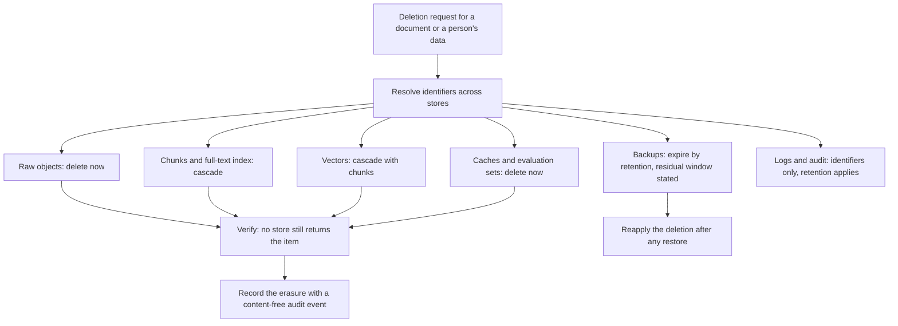
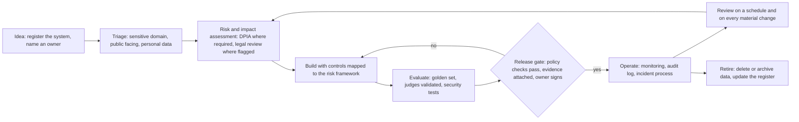

# Chapter 23 — Enterprise AI Governance

> **Evidence legend.** **[S#]** = supported by a source in References (IDs map to `project-management/RESEARCH-REGISTER.md`; papers were read at abstract level only). **[E]** = engineering recommendation/reasoning. **[A]** = assumption. **[I]** = illustrative. **[X]** = executed in this repository by `docs/exercises/ch23_governance.py`, or, where stated, established by inspecting the reference implementation on 2026-11-09. **[V]** = vendor-reported. **[N]** = not researched or not read. Research date: 2026-11-09. **This chapter is engineering guidance, not legal advice.** The regulatory statements are limited to what the cited pages say; where I read only part of a source, or only a reproduction of legislation, that is stated, and **the EU AI Act timeline in particular changed during 2026 and must be rechecked against the Official Journal before anyone relies on it**. The executed example is a *governance-as-code* illustration: its policy thresholds, register fields and control mapping are my choices for the reference system, not requirements of any law or framework. The reference implementation has **no governance artefacts yet** (no register, no impact assessments, no policy gates, no audit log); Section 23.7 says exactly what exists.

## 23.1 Learning Objectives

After this chapter you can:

1. Distinguish governance, risk management and compliance, and define an operating model with named roles and decision rights for AI systems.
2. Maintain an AI system register and enforce policy on it automatically (owner, pinned models, data classes, provider locality, impact assessment, oversight, evidence, review dates).
3. Map a RAG system to the NIST Generative AI Profile's twelve risks so that no risk is silently unaddressed, and record accepted risks with an owner and an expiry.
4. Describe, with their limits, what the GDPR's erasure and impact-assessment provisions mean for derived copies of data in RAG (chunks, vectors, caches, evaluation sets, logs, backups).
5. Explain how the EU AI Act's amendments in 2026 changed the application dates, and why a governance programme must treat regulatory dates as data that change.
6. Design erasure propagation across stores with a stated residual window, and verify it.
7. Build a tamper-evident, content-free audit log and state the limit of a hash chain.
8. Define governance metrics and a release gate that produce evidence, not paperwork.

## 23.2 Problem Statement

Security controls (Chapter 22) answer *can this be attacked*. Governance answers *who decided this system should exist, on what evidence, who is accountable for it, what must it never do, how do we know it still behaves, and how do we prove all of that to a customer, an auditor or a regulator*. RAG raises particular governance questions: the system copies source data into several derived forms that outlive the source (chunks, vectors, caches, evaluation sets, logs, backups); it depends on third-party models whose behaviour changes without a code change (Chapter 19); its answers can be wrong in ways that look authoritative (Chapter 18); and the regulatory ground it stands on is moving.

The failure mode is governance that exists only as documents: a policy no one can check, a register that is out of date the week it is written, a risk acceptance nobody owns, an erasure procedure that covers the database and forgets the vectors. The engineering response is to make as much governance as possible *executable and evidenced*: policies as checks, evidence as files and test results with identifiers, exceptions with owners and expiry dates, and an audit trail that is tamper-evident and contains no content.

## 23.3 Why It Matters in Production

- **Regulatory dates move.** The EU's Digital Omnibus on AI, Regulation (EU) 2026/1744, entered into force on 27 July 2026 according to the AI Act explorer page I read, and amended the AI Act's application dates: Annex III high-risk obligations now apply from 2 December 2027 and Annex I from 2 August 2028; providers of generative AI systems placed on the market before 2 August 2026 must comply with Article 50(2) by 2 December 2026; and new prohibitions on non-consensual intimate imagery and child sexual abuse material apply from 2 December 2026 [S168]. That page is a reproduction of the legislation (Tier 2) and I read only its first 100,000 of 187,134 characters. A programme that hard-coded the earlier dates would have been wrong; treat dates as maintained data with an owner.
- **Derived data multiplies erasure obligations.** GDPR Article 17 requires erasure without undue delay on listed grounds, with a duty to inform other controllers when data was made public, subject to listed exceptions [S166]. In RAG, one document becomes raw objects, chunks, a full-text index, vectors, cache entries, evaluation cases and backups. **Executed [X]:** an erasure simulation removed a document from six stores immediately or by cascade and left it in backups for the retention period (35 days in the example), which the plan reports as a residual window rather than hiding.
- **Impact assessments are triggered by new technology and scale.** GDPR Article 35 requires a data protection impact assessment where processing, particularly with new technologies, is likely to result in a high risk, lists three cases where it is always required, and sets minimum content: a description of processing and purposes, an assessment of necessity and proportionality, an assessment of risks, and measures to address them [S167].
- **Risks have names.** NIST's Generative AI Profile names twelve risks unique to or exacerbated by generative AI [S165]. **Executed [X]:** the exercise maps the reference system to all twelve and fails if any is unmapped, if a claimed control has no evidence file, or if a risk acceptance lacks an owner or has expired; of the twelve, one is marked implemented, five partial, two planned and four explicitly accepted.
- **Audit trails are evidence only if they resist tampering.** **Executed [X]:** a hash-chained log detected edits, deletions, insertions, reordering and re-hashed edits, and I found, by a surviving mutant, that without an externally anchored head hash an attacker who can rewrite the whole log can rebuild a valid chain.

## 23.4 Core Concepts

### 23.4.1 Governance, risk management and compliance

*Governance* is the system of decision rights and accountability: who may approve what. *Risk management* identifies, assesses, treats and monitors risks. *Compliance* demonstrates conformance to specific obligations. The NIST AI Risk Management Framework is a voluntary framework (AI RMF 1.0, released 26 January 2023, with the page stating it is being revised as part of the White House AI Action Plan) whose four functions, as named on NIST's overview page, are Govern, Map, Measure and Manage [S164]. Use frameworks as vocabularies for structuring evidence, not as checklists to be "completed" **[E]**.

**An operating model [E].** At minimum: a **system owner** accountable for each AI system's purpose, risks and evidence; a **risk owner** (often the same, or a delegate) for each accepted risk; **privacy** and **legal** advisers who approve impact assessments and flagged classifications; **security** who owns the threat model and controls (Chapter 22); a **platform owner** for shared components (gateway, index, pipeline); and an **approval body** with authority to block a release. Write decision rights as a table (who proposes, who approves, who is informed, who can veto) and keep it with the register.

### 23.4.2 The AI system register

Every AI system has a register entry, created before build and reviewed on a schedule **[E]**. NIST's Generative AI Profile includes a suggested action to enumerate organisational generative-AI systems for incorporation into an AI system inventory and to define inventory exemptions in policy (action identifiers GV-1.6-001 and GV-1.6-002 in the profile text I extracted) [S165]. The exercise's entry carries: name, owner (a named contact), purpose, data classes processed, models (provider, identifier, **pinned version**, locality), risk tier, impact-assessment status, human-oversight arrangement, evaluation evidence reference, retention period, whether content capture is on and its approval reference, and next review date.

**Policy rules executed as checks [X].** The validator reports a finding when: the owner is not a named contact; the purpose is empty; data classes are not from the approved list; a model is unpinned (`latest` or empty); **restricted data could reach an external provider**; personal data has neither a completed assessment nor a recorded rationale; a high-risk or legal-review tier has no oversight arrangement; a tier above minimal has no evaluation evidence; retention is outside 1 to 365 days (an illustrative ceiling); content capture is on without an approval reference; or the review date has passed. The test constructs a violating entry for each rule and checks the matching finding appears, and the mutation check confirmed that removing any rule makes a test fail.

**Triage is a workflow gate, not a legal classification [X, I].** A small function routes a proposal by three questions (touches a sensitive domain? public-facing? personal data?) to *needs legal review*, *limited* or *minimal*. It exists to make sure the right people look before launch; it does not decide what any law requires. In particular the page I read for the AI Act describes Annex III and Article 50 only through their application dates, so I did not read the lists of high-risk use cases or the transparency duties themselves **[N]**; counsel must make those determinations.

### 23.4.3 Frameworks and what they give you

**NIST AI RMF and the Generative AI Profile.** The profile (NIST AI 600-1, July 2024) names twelve risks: CBRN information or capabilities; confabulation; dangerous, violent or hateful content; data privacy; environmental impacts; harmful bias or homogenization; human-AI configuration; information integrity; information security; intellectual property; obscene, degrading and/or abusive content; and value chain and component integration [S165]. Under information security it explicitly describes direct and indirect prompt injection and data poisoning as attacks on generative AI systems [S165]. It organises suggested actions by function with identifiers such as GV-1.3-007 ("devise a plan to halt development or deployment of a GAI system that poses unacceptable negative risk") and GV-1.5-001 (define responsibilities for periodic review of content provenance and incident monitoring) in the text I read [S165]. I read only the first 20 of its 64 pages.

**Mapping the reference system, executed [X].**

| NIST GAI risk | Status | Basis (illustrative; my judgement) |
|---|---|---|
| Value chain and component integration | Implemented | Provider and model configuration, pinned versions, dependency inventory |
| Confabulation | Partial | Faithfulness evaluation machinery (Chapter 18); citation validation planned (component 12) |
| Data privacy | Partial | Tenant isolation and sensitivity policy built; erasure partly built; PII redaction is an exercise only |
| Information security | Partial | Sandboxed parsing and narrow roles built; egress control, framing and re-check are exercises only (Chapter 22) |
| Harmful bias or homogenization | Partial | Slice-based evaluation designed (Chapter 18); no data yet |
| Information integrity | Partial | Provenance per chunk and versioned sources; citation checks planned |
| Dangerous, violent or hateful content | Planned | Provider filters and an output policy (component 11) |
| Human-AI configuration | Planned | Citations, disclosure and feedback in the UI (component 15) |
| CBRN, environmental, intellectual property, obscene content | Accepted | Rationale, owner and review date recorded for each (for example: internal corpus; revisit if public-facing) |

**The rule that matters:** an *implemented* or *partial* claim must name evidence that exists, a *planned* claim must name the component, and an *accepted* risk must have a rationale, an owner and a future review date; an expired acceptance is a finding **[X]**. When I first wrote the mapping I marked data privacy and information security as implemented, then noticed that several controls I listed existed only as exercises; I downgraded both to partial. The checker would not have caught that (the evidence files exist), which is the point: the check enforces *traceability*, and honesty about *status* still needs a reviewer.

**ISO/IEC 42001.** An international standard for AI management systems exists (ISO/IEC 42001:2023); I understand from secondary summaries that organisations can seek certification against it, but I did not verify even that. **I could not verify its content**: the ISO page returned an access error, an alternative catalogue page held no standard text, and I did not rely on the vendor summaries that search returned **[N]**. If your customers ask for it, obtain the standard and map your register and controls to its clauses and Annex A.

### 23.4.4 The EU AI Act, as far as I verified it

What the page I read states **[S168]**: Regulation (EU) 2026/1744 (dated 8 July 2026, in force 27 July 2026) amends the AI Act (Regulation (EU) 2024/1689). Application dates in the amended Article 113: Annex III high-risk systems from 2 December 2027; Annex I high-risk systems from 2 August 2028; certain prohibitions on generating non-consensual intimate imagery and child sexual abuse material from 2 December 2026; high-risk systems used by public authorities must comply by 2 August 2030. Providers of generative AI systems placed on the market before 2 August 2026 must comply with Article 50(2) by 2 December 2026. The amended AI-literacy provision requires providers and deployers to take measures supporting staff AI literacy. The AI Office gains expanded competence over systems built on general-purpose models when the same provider develops both. Small and mid-sized enterprises get simplified documentation duties.

**What I did not read [N]:** the full substance of Article 50 (Chapter 25 later read paragraphs 1, 2 and 5 of it through a reproduction: the duty to inform people they are interacting with an AI system, machine-readable marking of synthetic content, and timing and accessibility of the information [S175]; provider-versus-deployer status and the exceptions' application remain unresolved), the Annex III list of high-risk use cases, the definitions and duties of providers versus deployers, the general-purpose-model obligations, and the penalty provisions. Law-firm summaries appeared in search results and I did not rely on them. For an enterprise knowledge assistant, the engineering consequences to *plan for* are: classify the use case (the triage gate), keep technical documentation and evaluation evidence per system (the register), make AI interaction and generated content identifiable where a transparency duty applies, train staff, and track the dates as data **[E]**. Whether a particular system is high-risk is a legal question.

### 23.4.5 Personal data: erasure and impact assessment

**Erasure (Article 17) [S166].** Grounds include that the data is no longer necessary for its purposes, consent is withdrawn without another legal basis, the data subject objects, processing was unlawful, or a legal obligation requires erasure; exceptions include a legal obligation to retain, public interest tasks, archiving and research, and legal claims. The controller must act without undue delay. **What this means for design [E]**: *build an inventory of every store that can hold a copy and give each a deletion path*:

<!-- figure:23-erasure-propagation -->

*Figure 23.1: Personal data: erasure and impact assessment. Original diagram; source below.*

Mermaid source

<!-- /figure -->

*Original diagram by the handbook author; source `docs/assets/diagrams/23-erasure-propagation.mmd`.*

**Executed [X].** The simulation holds a document in raw objects, chunks, vectors, the full-text index, an answer cache, a golden set and backups. After the erasure it is gone from every store except backups, where the plan reports a 35-day residual window; a store with no deletion path (an analytics export in the test) is reported as a failure; mutants that skip the cascade or ignore the backup window are caught. **In the reference implementation:** deleting a document marks it deleted and enqueues removal of raw objects through an outbox, and chunks, the full-text column and vectors go with their chunk rows by foreign-key cascade (ADR-014, ADR-017) **[X, by inspection and tests]**; caches, evaluation sets and backups do not exist yet, so their deletion paths are undesigned.

**Backups.** Backups complicate erasure: restoring one resurrects deleted data unless deletions are reapplied (Chapter 21). State the residual window to the data subject and the auditor, document that backups expire by retention, and keep a deletion log (identifiers only) that is replayed after any restore **[E]**. Whether this satisfies the "without undue delay" standard in a given case is a legal question **[N]**.

**Vectors and logs.** Embeddings can leak information about their source (Chapter 22, OWASP LLM08 [S153]), so I recommend treating vectors derived from personal data as personal data for erasure and access purposes; that is an engineering position, not a legal conclusion **[E]**. Keep logs content-free so that erasure does not require searching them.

**Impact assessment (Article 35) [S167].** Required where processing is likely to result in high risk, always in three listed cases (systematic and extensive automated evaluation with significant effects, large-scale special-category data, large-scale public monitoring); minimum content as above; the data protection officer's advice where one exists; review when risks change. A RAG assistant over HR documents, customer records or health information is a likely candidate; decide with the privacy adviser, record the outcome in the register (`done` or `not-required-with-rationale`) and rerun on material change **[E]**. Other data-protection questions (lawful basis, purpose limitation, international transfers, processor agreements with model providers) are real and **not covered** by my research **[N]**.

### 23.4.6 Data governance for RAG

Data governance for a corpus is where AI governance becomes concrete **[E]**: every source has a **named owner** who answers for its accuracy, classification and retention; documents carry a **classification** that drives which providers may see them (the gateway's sensitivity policy keeps restricted data on local providers, ADR-012 **[X, by inspection]**); **ACLs** are synchronised from the source of truth and re-synchronised on change; **lineage** is recorded (in the reference implementation each version stores the raw object's hash and URI, the extractor and chunker that produced its chunks, and each vector its embedding space, model and recipe, ADR-016, ADR-017 **[X, by inspection]**); **freshness** and **retention** are defined per source; and **quality** is monitored (stale, duplicated or contradictory documents degrade answers and are a governance responsibility, not only a search one). GenAIOps guidance likewise treats index maintenance, including rebuilds and "right to be forgotten" requests, as an operational responsibility for RAG [S142].

### 23.4.7 Policy as code and release gates

A release gate is a set of automated checks plus named approvals **[E]**: the register entry validates; the evaluation gate (Chapter 18) passes with evidence attached; the security checks (Chapter 22) pass, including the trifecta lint; the impact assessment status is current; accepted risks are unexpired; the release bundle is recorded (Chapter 19). Exceptions are allowed but are **records**: a rationale, an owner, an expiry, and an approver, and an expired exception blocks the next release. The exercise's checks (register rules, framework coverage, acceptance expiry) are the template; wire them into CI so that governance evidence is produced by the pipeline rather than assembled before an audit.

### 23.4.8 Audit and accountability

An audit log records *who did what, when, to which object, with what outcome*, using identifiers only; the OWASP guidance recommends detailed immutable retrieval logs [S153], and sensitive-information guidance warns against logging content [S154]. **A hash chain makes tampering evident [X]:** each entry's hash covers its content and the previous entry's hash; verification recomputes the chain. In the exercise, editing an entry, deleting one, inserting one, reordering two, re-hashing an edited entry, and patching the next entry's link were all detected. **The limit, found by a surviving mutant [X]:** if the writer can rewrite *every* later entry and recompute every hash, the result is a valid chain; the defence is to **anchor** the head hash somewhere the writer cannot modify (a separate system with write-once retention, or a periodic signed publication), and verify against the anchor. The log must also refuse content: the exercise rejects events containing prompt, question, answer or text fields, so a developer cannot accidentally turn the audit log into a copy of the data **[E]**. Control who can read the log and who can administer it; separate those duties.

### 23.4.9 Human oversight and transparency

NIST's profile names *human-AI configuration* as a risk: inappropriate anthropomorphising, algorithmic aversion, automation bias, over-reliance and emotional entanglement [S165]. Design responses **[E]**: show sources and citations with every answer; make abstention visible and normal; state clearly that the user is interacting with an AI system and what it can and cannot do (and check the transparency duties that apply to you, which I did not read **[N]**); provide a feedback and escalation path to a human; for consequential decisions, require a human to decide and record that they did (Chapter 22 covers human approval for risky tool actions). Measure over-reliance indirectly through feedback and escalation rates.

### 23.4.10 Third parties, changes and incidents

**Providers.** Maintain a register of model and data providers with the data classes each may receive, data-handling terms (I did not research any provider's terms **[N]**), locality, pinned model identifiers, deprecation notices and an exit plan. The value-chain risk in NIST's profile is non-transparent or untraceable integration of upstream components and improper supplier vetting [S165].

**Material changes** re-open the assessment: a new model or provider, a new data class, a new tenant type, a new tool or egress path, a changed purpose, an embedding or chunker change that alters behaviour (Chapter 19's release bundle). Define the trigger list in the register policy.

**Incidents** include quality incidents (Chapter 19), security incidents (Chapter 22) and privacy incidents. Maintain a runbook for each, with owners, containment steps, evidence preservation, and notification obligations determined by counsel **[N]**. The profile includes a suggested action to plan for halting a system that poses unacceptable risk [S165]; define the kill switch and who may pull it.

### 23.4.11 Metrics for governance

Key risk indicators that come from systems rather than surveys **[E]**: share of AI systems with a named owner and a current register entry; overdue reviews; expired risk acceptances; open exceptions and their age; systems without current evaluation evidence; impact-assessment coverage for systems processing personal data; time to complete erasure and the stated backup residual; access re-check violations (Chapter 22); and unpinned models in production. Report them to the approval body monthly; treat any non-zero count of "unpinned model" or "restricted data to external provider" as a release blocker.

## 23.5 Architecture

<!-- figure:23-governance-lifecycle -->

*Figure 23.2: Architecture. Original diagram; source below.*

Mermaid source

<!-- /figure -->

*Original diagram by the handbook author; source `docs/assets/diagrams/23-governance-lifecycle.mmd`.*

**Governance control plane [E].** The register, the policy checks, the evidence store (evaluation reports, security test results, impact assessments, approvals), the exception register and the audit log form a small control plane that the CI/CD pipeline queries and writes to. Keep it simple (a repository of structured files plus the pipeline) before buying a platform.

## 23.6 Practical Example (Executed [X])

`docs/exercises/ch23_governance.py` (standard library; deterministic; `--mutants` adds a mutation check) contains the register validator and triage gate, the coverage check against the twelve NIST generative-AI risks (with evidence files verified to exist), the erasure-propagation simulation, and the hash-chained content-free audit log with an anchor. **Mutation check: 16/16 injected defects detected.**

**Findings while building it (all real).**

1. *I overclaimed in the first mapping.* Two risks were marked implemented although some listed controls existed only as exercises. The coverage check cannot see that (it verifies that evidence files exist); I caught it on re-reading and downgraded both to partial. Traceability checks make dishonesty harder, not impossible.
2. *A surviving mutant taught me the limit of a hash chain.* Removing the previous hash from the hash input was not caught by my first tests because the explicit link check still failed on simple edits. Writing the attack that distinguishes them (rewrite an entry and patch the next link) showed why each hash must cover the previous one, and pushing the attack further showed that an attacker who rewrites every later entry produces a valid chain unless the head is anchored externally. Both are now tests.
3. *The accepted-risk dates and owners are placeholders* (reserved example addresses and dates I chose); a real register needs real people and a real review calendar.
4. *Nothing here is a statement about what a regulation requires.* The triage function is deliberately a gate for human review.

## 23.7 Implementation: What the Reference Implementation Has (inspected 2026-11-09)

| Governance capability | State |
|---|---|
| Architecture decision records (ADR-001 to ADR-018) with status, trade-offs and reversal conditions | **Built** (a decision trail) |
| Pinned and documented dependencies (purpose, version, licence, limits) | **Built** (`DEPENDENCIES.md`) |
| Lineage fields (raw object hash, extractor, chunker, embedding space, model, recipe) | **Built** |
| Document deletion with cascade to chunks, full-text column and vectors; outbox for raw object removal | **Built and tested** |
| Gateway data-sensitivity policy; model and provider configuration by route | **Built and tested** |
| Evaluation evidence for releases; golden set | **Not built** (component 17; ADR-018 Proposed) |
| AI system register, impact assessments, risk acceptances, exception register | **Not built** (the exercise is a template; this repository's own register does not exist) |
| Policy-as-code release gate in CI | **Not built** (component 20) |
| Audit log (content-free, tamper-evident, anchored) | **Not built** |
| Erasure orchestration across caches, evaluation sets and backups; backup and restore procedure | **Not built** (OI-058g) |
| Role definitions, approval body, incident runbooks, training | **Not defined** |
| Authentication and access governance | **Not built** (OI-052a) |

These gaps are tracked in OI-061.

## 23.8 Trade-offs

| Decision | Option | Gain | Cost / risk |
|---|---|---|---|
| Register | Structured files in the repository | Versioned, checkable, close to code | Needs discipline outside engineering |
| | Governance platform | Workflow, reporting | Cost; data duplication; lag |
| Policy checks | Automated gate | Consistent; produces evidence | False positives; maintenance |
| | Manual review | Judgement | Inconsistent; slow; paperwork |
| Risk acceptance | Time-boxed, owned | Visible, revisited | Process overhead |
| | Implicit | None | Silent risk |
| Erasure | Cascade plus stated backup window | Clear and verifiable | Residual window; legal sign-off needed |
| | Immediate backup purge | Shorter exposure | Cost and restore-point loss |
| Audit | Hash chain with anchor | Tamper evidence | Anchor infrastructure |
| | Plain log | Simple | Editable without trace |

## 23.9 Failure Modes

| Failure | Cause | Detection | Mitigation |
|---|---|---|---|
| Shadow AI systems | No register discipline | Procurement, cloud and gateway usage reviews | Register as a precondition for credentials and budgets |
| Stale register | No review dates; no owner | Overdue-review metric [X] | Review schedule; owner accountability |
| Unpinned model changes behaviour | `latest` identifiers [X] | Register rule; canary regression (Chapter 19) | Pin; re-assess on change |
| Erasure incomplete | A store without a deletion path [X] | Erasure verification; inventory review | Store inventory; plan with residual windows |
| Restore resurrects deleted data | Backup older than deletion | Post-restore reconciliation | Deletion log replay |
| Risk acceptance forgotten | No expiry [X] | Expiry check | Owner, rationale, review date |
| Overclaimed controls | Status labels not tied to evidence | Review; evidence checks [X] | Evidence per claim; reviewer sign-off |
| Audit log tampered or rebuilt | Writer controls the whole log [X] | Verification against an external anchor | Anchored head hash; separation of duties |
| Regulatory dates outdated | Dates hard-coded in documents [S168] | Date register with owner | Treat dates as data; recheck primary sources |
| Governance without evidence | Paperwork only | Audit finds missing artefacts | Evidence produced by the pipeline |

## 23.10 Security Considerations

The governance control plane holds sensitive information (risk assessments, vulnerabilities, accepted risks, golden sets, audit logs); give it access control proportionate to the most sensitive item, separate administrators from readers, and protect the evidence store from silent edits (the anchoring technique applies to the register too). The audit log must be content-free, access-controlled and monitored. Approvals and exceptions must be attributable to individuals. Third-party assessments and provider terms may be confidential; store references, not copies, where required **[E]**.

## 23.11 Performance Considerations

Governance checks run in CI and are cheap (the exercise runs in a fraction of a second). The costs are latency in human approvals and the effort of keeping evidence current; automate everything that can be automated and reserve human review for judgement calls **[E]**. Audit logging must not add noticeable latency to requests; write asynchronously where the loss model allows, and synchronously for events whose loss would defeat the purpose (for example access to restricted data) **[E]**.

## 23.12 Cost Considerations

Governance costs people (owners, privacy, legal, security reviews), tooling (evidence storage, anchoring, CI) and delay. It saves cost by avoiding rework, by shortening customer security reviews (evidence is ready), and by reducing the likelihood and impact of incidents. I did not research assessment, certification or audit costs, including for ISO/IEC 42001 **[N]**.

## 23.13 Production Recommendations

1. Create the register before the build; no register entry, no credentials or budget; automate the policy checks in CI.
2. Name an accountable owner for every system, source and risk; record decision rights.
3. Map each system to the NIST generative-AI risks; require evidence for implemented and partial claims, a component for planned, and owner, rationale and expiry for accepted.
4. Triage every proposal; send sensitive-domain and personal-data cases to legal and privacy before launch; record the outcome.
5. Pin models; forbid restricted data to external providers in policy and in code.
6. Inventory every store that can hold a copy of source data; give each a deletion path or a stated residual window; verify erasure; replay deletions after restores.
7. Keep a content-free, hash-chained audit log with an externally anchored head hash.
8. Define material-change triggers that re-open assessments.
9. Track regulatory dates as maintained data with an owner; recheck primary sources, not summaries.
10. Report governance metrics from systems; treat unpinned models and restricted-data routing violations as release blockers.
11. Train staff and document oversight arrangements; measure over-reliance indirectly.
12. Use legal and privacy counsel for every legal determination; do not use this chapter for one.

## 23.14 Architecture Decision Guidance

An ADR for the governance control plane (register format and location, policy-check set, evidence store, exception process, audit log and anchor, roles) should be written before the CI/CD component (20) and should be reviewed by privacy and legal. A separate note should record the regulatory-date register and its owner. Reconsider when a certification (for example an AI management-system standard) is required by customers, when the system becomes public-facing, when it enters a sensitive domain, or when regulations change again.

## 23.15 Interview Questions

1. **How do governance and security differ for an AI system?** Security asks whether it can be attacked; governance asks who decided it should exist, on what evidence, who is accountable, how it is monitored and how this is proven [E].
2. **What goes in an AI system register and how do you keep it honest?** Owner, purpose, data classes, pinned models and providers, risk tier, impact-assessment status, oversight, evidence, retention, review date; validate by policy checks in CI and tie claims to evidence [X].
3. **What are the NIST generative-AI risks and how would you use them?** Twelve named risks; map the system to each with implemented, partial, planned or time-boxed accepted status and evidence [S165, X].
4. **What happens when a regulation's dates change?** Treat dates as maintained data with an owner and recheck primary sources; the AI Act's application dates were amended in 2026 [S168].
5. **How does the right to erasure affect RAG architecture?** Every derived store needs a deletion path or a stated residual window; vectors, caches, evaluation sets and backups are included; replay deletions after restore [S166, X, E].
6. **When is a DPIA needed?** Where processing, especially with new technologies, is likely to result in high risk, always in the listed cases; with required minimum content [S167].
7. **What does a hash-chained audit log guarantee and what not?** It makes edits, deletions, insertions and reordering detectable; it cannot stop someone who rewrites the whole log unless the head hash is anchored elsewhere [X].
8. **Why must audit events be content-free?** Otherwise the log becomes a second, weaker copy of the data and a breach and erasure problem [S154, E].
9. **How do you handle a risk you decide not to mitigate?** Record rationale, owner and an expiry; an expired acceptance blocks release [X].
10. **What triggers re-assessment?** A new model or provider, data class, tenant type, tool or egress path, purpose, or behaviour-changing pipeline change [E].
11. **What would you not claim in a governance report?** Compliance with a regulation or standard you have not verified, or implemented controls without evidence [E, X].
12. **How do you prevent shadow AI?** Make the register a precondition for credentials, budgets and gateway routes; audit usage against it [E].

## 23.16 Knowledge Checkpoint / Exercises

1. Run `python -I docs/exercises/ch23_governance.py --mutants`. Add three register rules that matter to your organisation (for example, mandatory fallback-provider locality, an upper bound on external-provider spend, evidence not older than 90 days) with tests and mutants.
2. Replace the example risk acceptances with real owners and dates for your system and add a check that rejects `example.com` contacts.
3. Extend the erasure simulation with a restore event and show how a deletion-log replay removes resurrected items; add a mutant that skips the replay.
4. Implement anchoring for the audit log: publish the head hash to a separate store at intervals and verify against the latest anchor; write the attack that the anchor stops and the one it cannot.
5. Write the register entry, impact-assessment outline (the four Article 35 content items) and risk mapping for a system you know.
6. Build a regulatory-date register (dates, source, last checked, owner) and a check that fails when a date has not been rechecked for 90 days.
7. Draft the governance ADR for the control plane and list which checks run in CI versus at a human gate.

## 23.17 Summary

Governance for RAG is accountability and evidence for a system whose data is copied into many forms, whose models change under it and whose regulatory environment moves. Define an operating model; keep a register and validate it by policy as code; map the system to the twelve NIST generative-AI risks with evidence-backed statuses and time-boxed, owned acceptances; plan erasure across every derived store with stated residual windows; treat regulatory dates as data and legal determinations as counsel's; and keep a content-free, tamper-evident, anchored audit log. The executed example verified these checks with 16/16 injected defects detected, and its mutation survivor showed the limit of a hash chain. The reference implementation has a good decision trail, lineage fields and deletion cascades, and none of the governance control plane itself (register, assessments, gates, audit log, erasure orchestration), which is tracked in OI-061. Nothing in this chapter is legal advice, and the EU AI Act, ISO/IEC 42001 and data-protection questions above that I did not read are explicitly marked as such.

## References

- [S142] Microsoft, *Generative AI Operations for Organizations with MLOps Investments*. https://learn.microsoft.com/en-us/azure/architecture/ai-ml/guide/genaiops-for-mlops
- [S153] OWASP GenAI, *LLM08:2025 Vector and Embedding Weaknesses*. https://genai.owasp.org/llmrisk/llm082025-vector-and-embedding-weaknesses/
- [S154] OWASP GenAI, *LLM02:2025 Sensitive Information Disclosure*. https://genai.owasp.org/llmrisk/llm022025-sensitive-information-disclosure/
- [S164] NIST, *AI Risk Management Framework* (AI RMF 1.0, 2023-01-26; overview page). https://www.nist.gov/itl/ai-risk-management-framework
- [S165] NIST, *AI 600-1: Artificial Intelligence Risk Management Framework: Generative Artificial Intelligence Profile* (July 2024; first 20 of 64 pages read). https://nvlpubs.nist.gov/nistpubs/ai/NIST.AI.600-1.pdf
- [S166] *GDPR Article 17, Right to erasure* (reproduction of the regulation text; not EUR-Lex). https://gdpr-info.eu/art-17-gdpr/
- [S167] *GDPR Article 35, Data protection impact assessment* (reproduction of the regulation text; not EUR-Lex). https://gdpr-info.eu/art-35-gdpr/
- [S168] *Regulation (EU) 2026/1744, Digital Omnibus on AI* (AI Act explorer reproduction; first 100,000 of 187,134 characters read; recheck against the Official Journal). https://artificialintelligenceact.eu/ai-act-explorer/digital-omnibus/
- ISO/IEC 42001:2023: not verified, not cited as support (SRC-169, S169).
- ADR-012, ADR-014, ADR-016, ADR-017, ADR-018; OI-052, OI-058, OI-061 (this repository).
