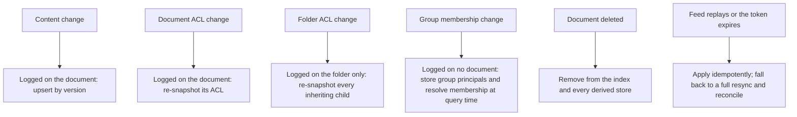
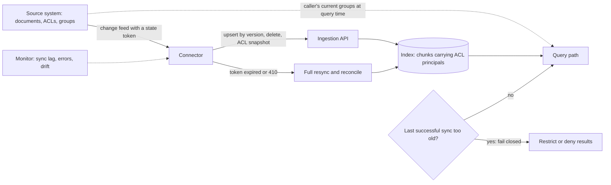

# Chapter 24 — Enterprise Knowledge Management

> **Evidence legend.** **[S#]** = supported by a source in References (IDs map to `project-management/RESEARCH-REGISTER.md`). **[E]** = engineering recommendation/reasoning. **[A]** = assumption. **[I]** = illustrative. **[X]** = executed in this repository by `docs/exercises/ch24_connector_sync.py`, or, where stated, established by inspecting the reference implementation on 2026-11-09. **[V]** = vendor-reported. **[N]** = not researched or not read. Research date: 2026-11-09. **No connector, source system, directory or customer corpus was used.** The executed example is a simulation of an index being kept in step with a source system, with my chosen parameters (6 users, 24 documents, 4 folders, 3 nested groups, 300 time steps, a change feed that retains 40 entries, a sync every 10 steps, and per-step event probabilities I set). It demonstrates mechanisms documented by the Microsoft Graph, Azure AI Search and Google Drive pages I read, not the behaviour of any product. The reference implementation has **no connectors**: documents arrive through an upload API with an ACL fixed at upload, and it has no endpoint to change an ACL afterwards (OI-053g).

## 24.1 Learning Objectives

After this chapter you can:

1. Scope an enterprise knowledge assistant and choose between synced and federated connector models.
2. Map source-system permission models (users, groups, domains, inheritance, labels) onto the ACLs your index enforces, and decide what to do with permissions you cannot represent.
3. Design change tracking that tolerates replays, expiring tokens, deletions and delayed feeds, with a full-resync fallback.
4. Explain why permission changes are a distinct synchronisation problem: ACL-only edits, inherited folder changes and group-membership changes each leave the content unchanged.
5. Choose between storing group principals (resolved at query time) and expanding users at index time, and quantify the exposure window of each.
6. Bound permission staleness and decide when to fail closed.
7. Manage knowledge quality: ownership, freshness, versions, duplicates, conflicts, and the feedback loop from unanswered questions.
8. Define the metrics that show whether the knowledge assistant is trustworthy, not merely popular.

## 24.2 Problem Statement

An enterprise's knowledge lives in many systems that each have their own permission model: file shares, SharePoint, wikis, ticketing systems, drives, repositories, chat. A knowledge assistant must answer from all of them while honouring each one's access rules, and it must do so continuously, because documents change, people change teams, folders are re-permissioned and files are deleted. Retrieval is the easy part. **The hard part is keeping a copy of the content *and of the permissions* in step with the source**, because a stale copy of a permission is a data leak, and a stale copy of content is a wrong answer with a citation.

Two further problems are organisational rather than technical. Knowledge decays: policies are superseded, owners leave, duplicates diverge. And trust is asymmetric: users forgive "I could not find that" but not a confident answer from an outdated or unauthorised document. A knowledge-management programme is therefore a connector and permission-sync system, a content-quality process and a set of measures, not a search box.

## 24.3 Why It Matters in Production

- **Permission changes are reflected in search only after synchronisation.** Azure AI Search's own documentation says query-time enforcement compares the caller's claims with permission metadata *already stored in the index*, so changes in the source (group membership, ACLs, labels) appear only after the source-specific synchronisation; for SharePoint, ACL changes on items with unique permissions are picked up incrementally on each successful indexer run (from a 2026 preview API version) while changes inherited from parent scopes need an explicit refresh [S170]. The document-level features I read are mostly in **preview**, which Microsoft says carries no service-level agreement and is not recommended for production [S170].
- **Source permission models resist naive mapping.** In Google Drive, child items inherit permissions and inherited access cannot be reduced on a child; removing a user from a parent revokes only inherited access, so a direct grant on a child remains; and the field that says whether a permission is direct or inherited is not returned unless requested [S174].
- **Change feeds are not exact.** Microsoft Graph delta query can replay changes, can answer `410 Gone` and require a full resynchronisation, expires tokens after a limited period (seven days for directory objects), shows eventual-consistency delays, and does not track some properties at all [S172]. Google's push notifications carry no detail; they only signal that something changed [S173].
- **Executed [X], simulated (parameters in the header):** the design choices below changed the exposure of revoked access by an order of magnitude. Over 43,200 user-document-time-step combinations, a design that stores group principals and processes every kind of permission change allowed revoked access in 330 of them (0.8%) and never for more than 9 consecutive steps (the sync interval); expanding groups into users at index time produced 2,961 over-exposed combinations with a longest run of 122 steps; ignoring permission changes entirely produced 2,746 and 129; ignoring only inherited folder changes produced 969 and 112.
- **A staleness bound trades exposure for availability.** **Executed [X]:** during a simulated connector outage (steps 60 to 200), failing closed after 20 stale steps cut over-exposed combinations from 2,027 to 314 and raised hidden-but-allowed combinations from 946 to 8,447.

## 24.4 Core Concepts

### 24.4.1 Scope and success

Typical enterprise corpora: policies and procedures, runbooks, engineering and product documentation, project and meeting records, tickets and incident histories, contracts, HR and finance guidance. Success is **trusted answers** (correct, current, cited, permitted), **findability** of the owning document, and **coverage** of the sources people actually use. Popularity (usage) is a poor proxy: a confidently wrong assistant is widely used until the first incident. Start with a bounded corpus whose owners can be named, a golden set drawn from real questions (Chapter 18), and the controls of Chapters 22 and 23 in place before widening **[E]**.

### 24.4.2 Connector models

Microsoft describes two models for connecting external content to its assistant. *Synced* connectors ingest content into Microsoft Graph (an `externalItem` schema) and index it semantically; *federated* connectors fetch content at query time through the Model Context Protocol with no data movement, which the page positions for dynamic data or regulated content that must remain in the source [S171]. The same page notes that deployed connectors are tenant-wide unless external-item security is restricted [S171], which is a reminder that **a connector's default visibility is a security decision**.

| | Synced (copy and index) | Federated (query-time fetch) |
|---|---|---|
| Latency and retrieval quality | Local index, semantic and hybrid search, full control of chunking and ranking | Depends on the source API; limited ranking control |
| Permission enforcement | Copied ACLs, enforced by you; staleness risk (24.4.5) | The source enforces at query time (when the call carries the user's identity) |
| Data movement and residency | Content and derived vectors copied | None |
| Freshness | Sync interval | Immediate |
| Resilience | Works if the source is down (stale) | Fails if the source is down |
| Cost | Ingestion, storage, embedding | Per-query API calls and quotas |

**Choose per source [E]:** synced for sources you need to rank across and search quickly; federated where data must not leave the source, changes too fast to index, or the source's own permissions must be authoritative at query time; and be explicit that federated retrieval trades control for freshness (you cannot rerank across sources you cannot see).

### 24.4.3 Source permission models

Permissions in the source are richer than a list of group names **[S170, S174, E]**:

- **Principal types.** Drive permissions have a type of user, group, domain or anyone, and roles such as owner, writer, commenter and reader [S174]. Decide how each maps to your ACL. "Anyone with the link" and domain-wide sharing have no natural group; the safe default is to *not index such content as broadly readable* unless an owner approves, or to map it to an explicit group such as "all employees" with a recorded decision.
- **Inheritance.** Children inherit from folders; effective access is the union of direct and inherited grants; moving an item re-evaluates it against the new parent [S174]. Store the *effective* ACL on each chunk (the reference implementation's chunks inherit the document's ACL at write time, ADR-016) and recompute it when the parent changes.
- **Source-specific constructs.** SharePoint site groups, ADLS Gen2 ACLs and RBAC scopes, and Purview sensitivity labels are the constructs Azure AI Search ingests or enforces; label enforcement in the preview I read is limited to single-tenant scenarios and requires role-based authentication [S170].
- **Nested groups, guests, deleted accounts.** Group membership can be nested; guest and external identities may not map to your directory; departed users' direct grants should disappear with the account. Each needs an explicit rule.
- **Representability.** If a source permission cannot be represented in your ACL model, the document must be **excluded or restricted by default**, never widened. Record unrepresentable cases in a report for owners to fix **[E]**.

Matching semantics in the reference implementation: a chunk is visible if its `acl_groups` array overlaps the caller's groups and the tenant matches, enforced by row-level security, with an empty ACL meaning no access (ADR-013) **[X, by inspection and tests]**. The caller's groups come from the identity provider, which is not built yet (OI-052a).

### 24.4.4 Change tracking

**Microsoft Graph delta query [S172].** The client requests a delta, follows `nextLink` pages until it receives a `deltaLink`, stores the link, and later calls it to get changes; deletions appear as `@removed` with a reason; the same change can appear again (replay), so apply changes idempotently; a `410 Gone` means restart with a full sync; tokens expire; delays exist; some properties are not tracked; and delta can be combined with change notifications so the app does not poll constantly. **Google Drive [S173].** Store the token from `changes.getStartPageToken`, page through `changes.list` (chronological, oldest first), save `newStartPageToken` when a page lacks `nextPageToken`, and treat push notifications as a signal to poll, not as data.

**A connector's contract [E, executed in part X].**

1. *Idempotent apply.* An upsert keyed by document id and version; applying the same change twice leaves the index identical. **Executed:** with a feed that replays its last three changes, the final index was byte-for-byte the same as without replays; the mutant that bumps the version on every apply is caught.
2. *Deletions are first-class.* Removing a document from the index and every derived store (chunks, vectors, caches; Chapter 23). The mutant that ignores removals is caught.
3. *Token expiry and gaps trigger a full resync* that lists the source, upserts everything and **deletes what is no longer there**. **Executed:** after an outage longer than the feed's retention, the old token expired and one full resync restored consistency; the mutant that never recovers is caught.
4. *A periodic reconciliation* (a full listing compared with the index) catches what a best-effort feed misses; schedule it even when the feed is reliable **[E]**.
5. *Backpressure and throttling.* Sources throttle (the Graph page links to throttling guidance [S172]); the connector respects retry-after, runs initial backfills slowly and keeps a per-source rate budget **[E]**.

### 24.4.5 The permission-sync problem

Content sync and permission sync are different problems because **a permission can change with no change to the document**. The simulation distinguishes four kinds of event, shown in the diagram, and measures what handling each costs.

<!-- figure:24-permission-change-paths -->

*Figure 24.1: The permission-sync problem. Original diagram; source below.*

Mermaid source

<!-- /figure -->

*Original diagram by the handbook author; source `docs/assets/diagrams/24-permission-change-paths.mmd`.*

**Executed [X]** (43,200 user-document-step combinations; sync every 10 steps):

| Design | Over-exposed combinations | Longest run of one pair (steps) | Under-exposed combinations |
|---|---|---|---|
| Group principals, all change kinds handled | 330 | 9 | 223 |
| Users expanded at index time | 2,961 | 122 | 3,536 |
| Content-only sync (ignore ACL changes) | 2,746 | 129 | 2,488 |
| Ignore inherited folder ACL changes | 969 | 112 | 1,070 |

*Over-exposed*: the index allows what the source no longer permits (a leak). *Under-exposed*: the index hides what the source permits (a lost answer). Reading it:

1. **Store group principals and resolve membership at query time.** Group membership changes touch no document, so an index that expanded groups into users when it indexed them never learns of them until each affected document happens to change (longest exposure 122 steps in the simulation). Resolving the caller's *current* groups against the directory at query time makes membership changes effective immediately. The cost is a directory lookup per query (or a short cache) and a limit on how many groups a caller can carry (for example in a token); I did not research directory token limits **[N]**.
2. **Handle ACL-only changes.** They are logged on the document, but a connector that only reacts to content changes never re-snapshots the ACL.
3. **Handle inherited changes by re-snapshotting the inheriting children.** A folder permission change is logged on the folder, not on its files; Azure's documentation makes the same point for SharePoint (inherited changes need an explicit refresh) [S170].
4. **The sync interval is the floor on the exposure window** for changes the connector can see (longest run 9 against an interval of 10 in the best design). Shorten it for sensitive sources, or add change notifications to trigger a sync when a permission changes (supported on some Microsoft Graph resources [S172]).

### 24.4.6 Failing closed

If the connector has not synced successfully for longer than a bound, the index's permission data may be arbitrarily stale. A **staleness bound** makes the query path refuse (or restrict to the least sensitive tier) when `now − last_successful_sync` exceeds a limit. **Executed [X]:** over a long outage the bound cut over-exposure by 85% and multiplied hidden-but-allowed combinations by about nine. That is the trade: you choose which error to make during an outage. Pick per source class: restrict sensitive sources strictly, and allow lower-sensitivity sources to continue with a visible "may be out of date" banner **[E]**. Alert on sync lag (Chapter 19) so the bound is a last resort, not the normal control.

### 24.4.7 Knowledge quality and lifecycle

Retrieval quality depends on content quality **[E]**:

- **Ownership.** Every source and every high-value document has a named owner and a review date; documents without owners are reported, then archived. This is a governance requirement as much as a quality one (Chapter 23).
- **Versions and supersession.** Mark documents as superseded and exclude or down-rank them; when several versions exist, prefer the authoritative one by metadata (status, effective date) rather than by text similarity. The reference implementation keeps document versions with states (staged, active, superseded, failed); retrieving only active versions is the intended behaviour of component 6, which is not built (ADR-013, ADR-016).
- **Duplicates and conflicts.** Near-duplicate documents dilute retrieval and produce inconsistent answers. Detect with content hashes (identical content is already an idempotent no-op per document in the reference implementation, ADR-014) and with similarity for near-duplicates; surface conflicts to owners.
- **Freshness.** Show "last updated" and the owner with each citation, and give answers an "as of" statement where the source is time-sensitive.
- **The feedback loop.** Questions the assistant could not answer, answers users marked unhelpful, and corrections are the knowledge backlog: route them to owners as tasks and add them to the golden set (Chapter 18).
- **Do not index everything.** Low-quality, ephemeral or sensitive-by-default content (drafts, personal folders, HR case files) reduces answer quality and raises risk; define inclusion rules per source and keep the exclusion list reviewable **[E]**.

### 24.4.8 Answer experience

Link every citation to the *source system*, so that opening it re-applies the source's own permission check as a last line of defence **[E]**. Do not reveal the existence or title of documents the caller cannot access (the reference implementation has known existence side channels in its upload API, OI-052h). Explain abstentions in terms the user can act on ("I could not find a current policy on that; the owner of the HR policies space is …"). Treat "I do not know" as a feature to measure, not a failure to hide.

### 24.4.9 Metrics

**Freshness** (document change to searchable; index lag per source), **permission staleness** (time since the last successful permission sync per source; maximum over-exposure window), **coverage** (share of intended documents indexed per source; share excluded because unrepresentable), **reconciliation drift** (documents whose index state differs from the source in a periodic audit; this is the real measure of connector correctness), **answer quality** (faithfulness, citation accuracy, abstention correctness, sliced by source and team; Chapter 18), **no-answer rate and unanswered-question themes**, **feedback**, **source health** (errors, throttling, backfill progress) and **security events** (access re-check violations, Chapter 22). A rising reconciliation drift with healthy sync metrics means the change feed is losing events.

### 24.4.10 Multi-source and multi-tenant operation

Per-source credentials with least privilege and read-only scope; one connector failure must not stall others; rate budgets per source API; tenant isolation of the index and of connector state (Chapter 8); idempotent backfills that can be paused and resumed; and a documented procedure for rotating connector credentials. In a multi-tenant product, a connector is a per-tenant resource: its tokens, its sync state and its failures are tenant data **[E]**.

## 24.5 Architecture

<!-- figure:24-connector-sync-loop -->

*Figure 24.2: Architecture. Original diagram; source below.*

Mermaid source

<!-- /figure -->

*Original diagram by the handbook author; source `docs/assets/diagrams/24-connector-sync-loop.mmd`.*

The connector should talk to the **same ingestion API** that uploads use, so that versioning, idempotency, ACL inheritance by chunks and deletion cascades are implemented once (ADR-014, ADR-016) **[E]**.

## 24.6 Practical Example (Executed [X])

`docs/exercises/ch24_connector_sync.py` (standard library; deterministic; `--mutants` adds a mutation check) simulates a source with folders, documents, nested groups and a change feed that replays and expires, a connector with configurable designs, and a query path that checks each user-document pair against both the index and the source. Results are in 24.3 and 24.4. **Mutation check: 5/5 injected defects detected** (ignoring removals, non-idempotent apply, no token-expiry recovery, ignoring the staleness bound, allowing documents missing from the index); the four design variants (expanded users, content-only, no folder ACL, no fail-closed) are asserted as measured contrasts rather than mutants.

**Findings while building it.**

1. *The result that surprised me most* was the cost of expanding groups at index time: it looks like a harmless optimisation (precompute who can read what) and it is the worst design in the table, because membership changes are invisible to document change feeds.
2. *My first mutation run covered only three code-level defects;* the query-time branches (staleness bound, unindexed documents) were untested until I added two more mutants, both now caught.
3. *The best design still over-exposes briefly* (330 combinations, up to the sync interval). No polling design removes that window; only shortening it, or pushing a trigger on permission change, shrinks it.
4. *The model does not include* directory-lookup latency, token group limits, rate limiting by source APIs, partial failures of individual documents, or permission semantics beyond union-of-grants (for example deny rules). Each of those matters in a real connector.

## 24.7 Implementation (reference implementation, inspected 2026-11-09)

| Capability | State |
|---|---|
| Upload API with source id, idempotent versioning and ACL rules; list, get and delete | **Built and tested** (ADR-014) |
| Chunks inherit the document ACL at write; deletion cascades to chunks and vectors; raw object removal by outbox | **Built and tested** (ADR-016, ADR-017) |
| Row-level security enforcing tenant and ACL overlap, empty ACL means none | **Built and tested** (ADR-013) |
| Connectors, change-feed state, reconciliation job | **Not built** |
| ACL-update endpoint that rewrites chunk ACLs in the same transaction | **Not built** (OI-053g) |
| Identity provider integration (callers' groups) | **Not built** (OI-052a) |
| Permission-staleness bound and sync-lag metric | **Not built** |
| Source-owner, review-date and supersession metadata beyond versions | **Not built** |
| Knowledge-quality loop (unanswered questions to owners) | **Not built** |

Gaps are tracked in OI-063. The design to carry into a connector ADR **[I]**: connectors write through the ingestion API; the index stores group principals, not expanded users; a permission-only change is a first-class event that rewrites chunk ACLs in one transaction; the query path resolves the caller's current groups; sync lag has a hard bound per source class; and a nightly reconciliation job reports drift.

## 24.8 Trade-offs

| Decision | Option | Gain | Cost / risk |
|---|---|---|---|
| Connector model | Synced | Control, ranking, speed | Copy of content and ACLs; staleness |
| | Federated | Source is authoritative; fresh | Latency, quota, limited ranking |
| Group handling | Principals, resolved at query time | Membership changes effective at once [X] | Directory dependency; group-claim limits [N] |
| | Expanded users at index time | No directory call per query | Long exposure after membership changes [X] |
| Staleness | Fail closed | Bounded exposure [X] | Lost answers during outages [X] |
| | Fail open | Availability | Unbounded exposure |
| Sync | Short interval or notifications | Small exposure window | Load; source throttling |
| | Long interval | Cheap | Window equals the interval [X] |
| Scope | Index everything | Coverage | Noise, risk |
| | Curated sources | Quality, safety | Missing answers; maintenance |

## 24.9 Failure Modes

| Failure | Cause | Detection | Mitigation |
|---|---|---|---|
| Revoked access still visible | ACL-only or inherited change not processed [X] | Reconciliation drift; exposure audits | Handle all change kinds; shorten the window |
| Membership changes ignored | Groups expanded at index time [X] | Drift after directory changes | Store principals; resolve at query time |
| Deleted documents still answer | Removal ignored or feed gap [X] | Deleted-but-indexed count | Process removals; reconcile; erasure plan (Chapter 23) |
| Duplicate or inflated state after replays | Non-idempotent apply [X, S172] | Version anomalies | Idempotent upserts by version |
| Connector stuck after token expiry | No 410 or expiry handling [X, S172] | Sync lag grows | Full resync fallback |
| Over-broad visibility by default | Connector default is tenant-wide [S171]; "anyone" links mapped broadly | Access review of connector scope | Restrict by default; map explicitly |
| Unrepresentable permissions widened | Mapping falls back to public | Report of unmapped permissions | Exclude or restrict by default |
| Stale answers with citations | Source updated, index not [S172] | Freshness SLI | Sync and reconcile; show "last updated" |
| Outage causes leak or blackout | No staleness policy [X] | Sync-lag alert | Fail-closed bound per source class |
| Existence leakage | Titles or counts of inaccessible documents | Security tests | Do not reveal; uniform responses |

## 24.10 Security Considerations

Connector credentials are high-value: scope them read-only and least-privilege, store them in a secrets manager, rotate them, and audit their use. A connector with tenant-wide read access is a single point of compromise; prefer per-source, per-tenant credentials **[E]**. Treat all connector-delivered content as untrusted (Chapter 22): hidden text, injection payloads and poisoned documents arrive through connectors exactly as through uploads, and "an internal source" is not a trust level. Permission snapshots are security data: protect them like content, log changes (identifiers only) and alert on bulk ACL widening. Do not log document text in connector errors. For federated retrieval, pass the *user's* identity to the source rather than a service identity, or the source's permission check is bypassed **[E]**.

## 24.11 Performance Considerations

Initial backfill dominates load: throttle to the source's limits, parallelise across sources not within one, and make the job resumable. Incremental sync is cheap per change but the permission re-snapshot of a large folder can touch thousands of chunks, so batch ACL rewrites and bound them per transaction. Query-time group resolution adds a directory call; cache group closures briefly, but note that the cache lifetime *is* an exposure window **[E]**. I did not measure connector throughput or directory lookup latency **[N]**.

## 24.12 Cost Considerations

Costs: source API quotas and throttling, embedding of every changed chunk (permission-only changes should *not* trigger re-embedding, since content is unchanged; rewrite ACL metadata only), storage of duplicate content, and the people cost of content ownership. Federated retrieval avoids copying and embedding but pays per query and cannot be cached across users **[E]**. No prices were researched **[A]**.

## 24.13 Production Recommendations

1. Start with a bounded, owned corpus; define success as trusted answers, coverage and freshness, not usage.
2. Choose synced or federated per source; make default visibility restrictive.
3. Store group principals; resolve the caller's current groups at query time; never expand groups into users at index time.
4. Treat permission-only, inherited-folder and membership changes as first-class events; rewrite chunk ACLs without re-embedding.
5. Apply changes idempotently by version; handle replays, token expiry and `410`; always provide a full-resync fallback.
6. Run a scheduled reconciliation and track drift as the connector's correctness metric.
7. Bound permission staleness per source class; fail closed for sensitive sources; alert on sync lag.
8. Map unrepresentable permissions to *exclude or restrict*, never to *public*; report them to owners.
9. Link citations to the source system; never disclose inaccessible documents.
10. Give every source and key document an owner, a review date and a supersession status; feed unanswered questions back to owners.
11. Scope connector credentials narrowly; rotate; audit.
12. Test with cross-tenant, cross-ACL, revoked-access and deleted-document cases on every connector change (Chapters 18, 22).

## 24.14 Architecture Decision Guidance

An ADR for connectors and permission synchronisation (connector model per source, ACL principal model, change kinds handled, staleness bound, reconciliation, identity provider integration, failure policy) is required before the access-filtering component (8) and before any connector is built. It should reference ADR-013 (isolation), ADR-014 (ingestion) and ADR-016 (chunk ACL inheritance), Chapter 22 and Chapter 23. Reconsider when a source offers native permission-aware retrieval at the quality you need (a managed service may replace a custom connector, with its preview status and limits understood [S170]), when sync windows become unacceptable, or when directory scale makes query-time group resolution too slow.

## 24.15 Interview Questions

1. **Why is permission sync harder than content sync?** Permissions change without document changes: ACL-only edits, inherited folder changes and group membership changes leave content untouched [X, S170, S174].
2. **Store users or groups in the index?** Groups, resolved at query time; expanded users miss membership changes (122-step exposure versus 9 in the simulation) [X].
3. **How do you handle a change feed that replays and expires?** Idempotent apply by version, full resync on expiry or `410`, periodic reconciliation [S172, X].
4. **What does failing closed cost?** Lost answers during outages (946 to 8,447 hidden-but-allowed combinations in the simulation) for much lower exposure (2,027 to 314) [X].
5. **Synced or federated connectors?** Synced for control and speed; federated for freshness and data that must stay in the source; federated needs the user's identity at query time [S171, E].
6. **How do you treat "anyone with the link" sharing?** No natural group: exclude or restrict by default unless an owner approves a mapping [S174, E].
7. **What happens when a folder's permissions change?** Children inherit but log nothing; re-snapshot inheriting children (or refresh explicitly) [S170, S174, X].
8. **Why shouldn't permission-only changes trigger re-embedding?** Content is unchanged; only ACL metadata needs rewriting [E].
9. **How do you know a connector is correct?** Reconciliation drift against the source, not sync success counts [E].
10. **How does knowledge quality affect RAG?** Duplicates, superseded documents and orphaned content produce inconsistent or stale answers; owners, review dates, supersession and a feedback loop are controls [E].
11. **What default scope should a connector have?** Narrow and read-only; Microsoft's connectors are tenant-wide unless restricted [S171].
12. **How would you shorten the exposure window?** Shorter intervals or change notifications that trigger a sync; bound with a staleness policy [S172, X].

## 24.16 Knowledge Checkpoint / Exercises

1. Run `python -I docs/exercises/ch24_connector_sync.py --mutants`. Change the sync interval to 2 and 30 and report the over-exposure and longest run for the best design; explain why the longest run tracks the interval.
2. Add a **change-notification trigger**: when a permission change occurs, run a sync within 1 step; measure the effect on the longest run and on source calls.
3. Add a query-time group cache with a TTL and show how the TTL becomes the exposure window for membership changes.
4. Add *deny* permissions to the source model and decide how the index should represent them; write the test that shows what breaks if they are ignored.
5. Add a reconciliation job that runs every 100 steps, reports drift, and repairs it; show it catching a feed that silently drops 5% of changes.
6. Write the ADR outline for connectors and permission sync for your environment, including the staleness bound per source class.
7. Design the knowledge-quality workflow: unanswered questions to owners, review dates, supersession, and the metrics that show it works.

## 24.17 Summary

An enterprise knowledge assistant is a connector and permission-synchronisation system plus a content-quality process. Choose synced or federated per source; map source permissions conservatively and exclude what cannot be represented; apply changes idempotently with a full-resync and reconciliation fallback; treat ACL-only, inherited and group-membership changes as first-class events, store group principals and resolve membership at query time; bound permission staleness and decide per source class whether to fail closed; and run the knowledge itself with owners, versions and a feedback loop. The executed simulation showed an order-of-magnitude difference in exposure between designs and verified its logic with 5/5 injected defects detected, on my own parameters. The reference implementation has the ingestion, isolation and deletion foundations and no connectors, ACL-update path or identity integration yet (OI-063).

## References

- [S170] Microsoft Learn, *Document-Level Access Control* (Azure AI Search; 2026-08-08; features largely in preview). https://learn.microsoft.com/en-us/azure/search/search-document-level-access-overview
- [S171] Microsoft Learn, *Microsoft 365 Copilot connectors overview* (2026-09-30). https://learn.microsoft.com/en-us/microsoft-365/copilot/extensibility/overview-copilot-connector
- [S172] Microsoft Graph, *Use delta query to track changes*. https://learn.microsoft.com/en-us/graph/delta-query-overview
- [S173] Google, *Drive API: Manage changes*. https://developers.google.com/workspace/drive/api/guides/manage-changes
- [S174] Google, *Drive API: Manage sharing and permissions*. https://developers.google.com/workspace/drive/api/guides/manage-sharing
- ADR-013, ADR-014, ADR-016, ADR-017; OI-052, OI-053, OI-063 (this repository). Chapters 8, 13, 18, 22, 23.
