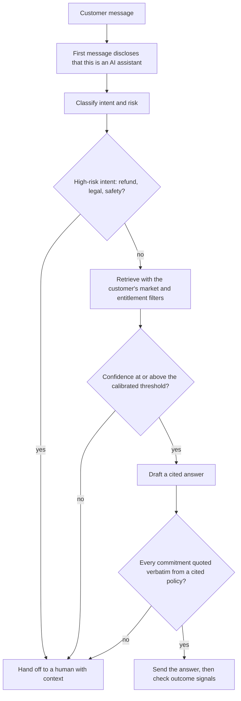
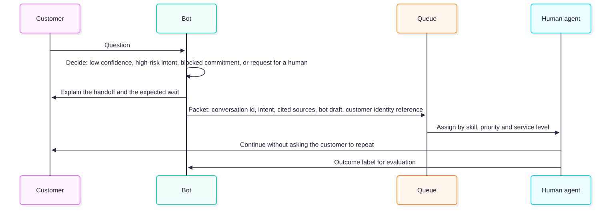
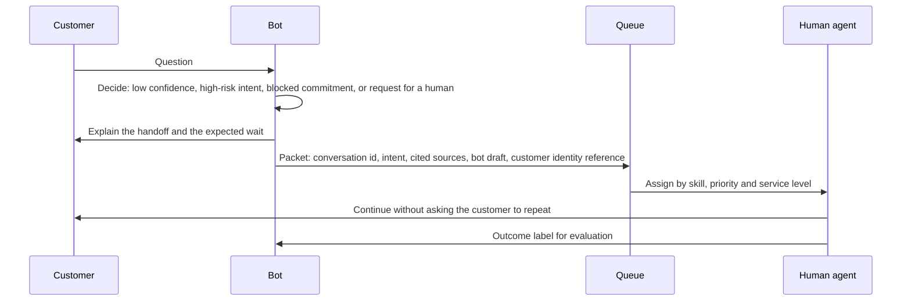

# Chapter 25 — Customer Support and AI Chatbots

> **Evidence legend.** **[S#]** = supported by a source in References (IDs map to `project-management/RESEARCH-REGISTER.md`). **[E]** = engineering recommendation/reasoning. **[A]** = assumption. **[I]** = illustrative. **[X]** = executed in this repository by `docs/exercises/ch25_support_policy.py`. **[V]** = vendor-defined. **[N]** = not researched or not read. Research date: 2026-11-09. **This chapter is engineering guidance, not legal advice.** **No real bot, customer, ticket history or cost was used.** The executed example simulates 6,000 synthetic conversations per setting with traffic shares, answerability rates, user behaviour after a wrong answer, costs and a *calibrated-confidence assumption* that are all my own choices; costs are abstract units. Real retrieval confidence is usually worse calibrated than assumed here, so the threshold conclusions are optimistic. The reference implementation has **no support bot** (no generation, no frontend, no handoff); this chapter is design guidance and executed policy logic only.

## 25.1 Learning Objectives

After this chapter you can:

1. Choose a safe progression for customer-facing AI, from agent assist to limited autonomous answering, and say what each stage requires.
2. Design the answer-or-escalate policy: confidence thresholds, high-risk intents that always go to a human, and the cost trade-off that gives an interior optimum.
3. Prevent a bot from making commitments the company does not make, using a deterministic quotation rule rather than a prompt.
4. Distinguish containment from resolution, define your own resolution metric with a verification window, and recognise that vendor definitions differ and change.
5. Design handoff so the customer never repeats themselves and the human gets the bot's context.
6. Apply the security controls a public-facing system needs (anonymous versus authenticated modes, quotas, egress control, no cross-customer data).
7. Explain the liability and transparency questions the Air Canada case and the EU AI Act's Article 50 raise, with the limits of what I verified.
8. Evaluate and roll out a support bot with shadow mode, canaries and a kill switch.

## 25.2 Problem Statement

A support bot talks to people who are often frustrated, may be adversarial, and will treat what it says as the company's word. The business case is deflection and speed; the risk is wrong, unauthorised or unfair answers delivered at scale to the public. Two features make support different from internal knowledge assistants (Chapter 24): the users are **untrusted and numerous** (every Chapter 22 threat applies with fewer assumptions), and **answers can create obligations** (a refund, a deadline, an entitlement).

The engineering problem is to capture the benefit of automation while making the failure cases small, visible and cheap: abstain or hand off when the bot is unsure; never let it say what the policy does not say; measure real resolution, not the absence of a human; and keep a human path that always works.

## 25.3 Why It Matters in Production

- **The company is answerable for what its bot says.** In *Moffatt v. Air Canada* (2024 BCCRT 149), as described by a law-firm commentary, a website chatbot told a customer he could apply retroactively for a bereavement fare while another page on the airline's own site said otherwise; the tribunal held that the airline owed a duty of care, rejected the argument that the chatbot was a separate entity responsible for its own statements, found negligent misrepresentation and reasonable reliance, and awarded the fare difference [S176]. The commentator calls it an incremental development, notes that the decision says little about how the chatbot was built or tested, and questions the negligence reasoning [S176]; I read the commentary, not the decision (the tribunal's text was not retrievable), and a tribunal decision is not a general rule of law. The engineering lesson does not depend on the legal detail: **an unsupported commitment is a business liability, so prevent it deterministically.**
- **"Contained" is not "resolved."** **Executed [X], synthetic:** at a permissive threshold the bot kept 75.2% of conversations away from humans, but only 53.8% had a correct answer; 68.6% were still "contained" after discounting those who came back, because many customers who got a wrong answer simply left. The gap between what you can count (no human) and what you want (solved) was 21.4 points.
- **Vendor metrics move.** Zendesk's help centre defines unassisted conversations, assisted escalations, *contained* resolutions and *verified* resolutions, and states that from 18 May 2026 its automated-resolution rate counts contained as well as verified resolutions, which the article says may raise the figure, while billing remains for verified resolutions only [S177]. A reported "resolution rate" is only meaningful with its definition.
- **Caution has a price and so does confidence.** **Executed [X]:** total cost was U-shaped in the answer threshold, with an interior optimum (a threshold of 0.6 in my model), 11% below answering everything permitted and 23% below almost always escalating.
- **Transparency is becoming a legal duty.** The page I read for Article 50 of the EU AI Act states that providers must design AI systems intended to interact directly with people so that those people are informed they are interacting with an AI system, unless that is obvious to a reasonably well-informed person, and that the information must be clear and distinguishable, given at the latest at the first interaction, and meet accessibility requirements [S175]. Whether *your* company is the "provider" of a bot built on a vendor's model is a legal question I did not resolve.

## 25.4 Core Concepts

### 25.4.1 A safe progression

Move one stage at a time and require evidence to advance **[E]**:

1. **Agent assist.** The bot drafts answers with citations for a human agent, who edits and sends. Risk is low, and you collect labelled outcomes (accepted, edited, rejected) for free.
2. **Shadow mode.** The bot answers in the background on live conversations; nothing is sent. Compare its answers to what humans did.
3. **Self-service for low-risk intents** (FAQ, order status, public policy lookups) with a confidence threshold, a visible handoff and a kill switch.
4. **Account-aware assistance** (authenticated; read-only tools).
5. **Actions** (cancellations, refunds) only with human approval or tightly bounded, reversible operations (Chapters 15, 22).

### 25.4.2 Knowledge sources and their hazards

Help-centre articles, policies and terms, product documentation, macros and canned answers, status pages, and (carefully) historical tickets **[E]**. Hazards: **policy conflicts** between pages (the Air Canada pattern: designate one authoritative source per topic and retire the rest); **effective dates and markets** (policies differ by region and change over time: carry them as metadata and filter, Chapter 13); **ticket history contains other customers' personal data**: retrieve from it only de-identified and never across customers; and **staleness** (Chapter 24: connectors, freshness, owners). A bot that cites a policy must cite the version in force on the date that matters **[E]**.

### 25.4.3 Conversation design and disclosure

- **Disclose first.** The first message states that the user is talking to an AI assistant. **Executed [X]:** the check passes a first message that says so and fails one that does not, and fails a disclosure buried beyond the first 200 characters; the mutant that skips the check is caught. This is a product behaviour consistent with the transparency duty in [S175] (clear, at or before the first interaction, accessible); whether and how the duty applies to you is for counsel **[N]**.
- **State scope and limits,** and offer a human at any time. Make "talk to a person" work on the first request.
- **Cite sources** (help-article links) so customers can check; link to the policy page, not a paraphrase.
- **Ground or abstain.** If retrieval does not support an answer, say so and hand off (Chapter 18's abstention correctness).
- **Accessibility and language.** Information must be accessible [S175 for the disclosure]; evaluate each language as its own slice (Chapter 18); do not assume quality transfers **[E]**.
- **Tone is a policy decision.** Empathy and apology templates are fine; commitments and legal characterisations are not the model's to improvise.

### 25.4.4 The decision policy: answer, escalate, refuse

The decision flow combines three deterministic gates around a model-produced confidence:

<!-- figure:25-support-decision-flow -->

*Figure 25.1: The decision policy: answer, escalate, refuse. Original diagram; source below.*

Mermaid source

<!-- /figure -->

*Original diagram by the handbook author; source `docs/assets/diagrams/25-support-decision-flow.mmd`.*

**High-risk intents always go to a human [X].** Refunds, legal, safety, account closure, complaints about discrimination, anything with financial or physical consequences. In the simulation, with the rule on, the bot answered none of them; the mutant that lets them through is caught. The intent classifier is itself imperfect, so bias it toward over-flagging and review misses **[E]**.

**The threshold is a cost decision [X].** Synthetic results (6,000 conversations per row; 20% of traffic is high-risk and always escalated, which is why the hand-off share never falls below 24%):

| Threshold | Containment | Verified (correct) | Complaint rate | Upfront handoff share | Total cost per conversation |
|---|---|---|---|---|---|
| 0.0 | 76.4% | 54.0% | 4.30% | 23.6% | 3.756 |
| 0.2 | 76.4% | 54.2% | 4.27% | 23.6% | 3.740 |
| 0.4 | 73.0% | 54.1% | 3.92% | 27.1% | 3.680 |
| 0.5 | 69.2% | 53.4% | 3.23% | 30.8% | 3.465 |
| **0.6** | 62.0% | 49.9% | 2.38% | 38.0% | **3.334** |
| 0.7 | 48.8% | 41.8% | 1.48% | 51.2% | 3.450 |
| 0.8 | 31.0% | 28.1% | 0.73% | 69.0% | 3.886 |
| 0.9 | 14.9% | 14.4% | 0.12% | 85.1% | 4.336 |

Cost units: a human handoff or reopened conversation 5, a complaint 50, a bot answer 0.1 (abstract). Assumed customer behaviour after a *wrong* answer: 50% leave silently, 30% come back to a human, 20% complain. Reading it: raising the threshold lowers complaints and verified resolutions fall only slowly until about 0.5 to 0.6, then fall quickly as more answerable questions are escalated; total cost is minimised in the middle. **Your optimum depends on your own costs, user behaviour and calibration.** The method is the transferable part: measure per-intent calibration on a golden set (Chapter 18), set per-intent thresholds, and choose by expected cost including the cost of complaints and reputational harm **[E]**. A single global threshold hides that FAQ intents tolerate a lower threshold than policy intents.

### 25.4.5 No unsupported commitments

A prompt that says "never promise refunds" is not a control. The deterministic rule **[X]**: any sentence containing a commitment (refund, guarantee, entitlement, deadline) may be sent only if it appears **verbatim** (after whitespace and case normalisation) in the cited policy passage; otherwise the answer is blocked and the conversation goes to a human. Executed results: an Air Canada-style sentence ("You can apply retroactively within 90 days of travel.") against a policy saying the opposite was blocked; a verbatim quotation of the policy was allowed; ordinary chat passed; and an *inverted* commitment whose every word occurs in the policy ("Refunds are available within 30 days." against "Refunds are not available after travel.") was blocked, whereas a word-overlap check would have passed it (the mutant is caught by that case). In the simulation the rule blocked 138 of 6,000 drafts at a 0.5 threshold and lowered the complaint rate from 3.93% to 3.23%. The rule has a cost: answers about commitments become extractive (quotes), which is the intent. For commitments that depend on the customer's account, compute them in code from authoritative data rather than letting the model state them **[E]**.

### 25.4.6 Handoff

<!-- figure:25-handoff-flow -->

*Figure 25.2: Handoff. Original diagram; source below.*

Mermaid source

<!-- /figure -->

*Original diagram by the handbook author; source `docs/assets/diagrams/25-handoff-flow.mmd`.*

**Triggers [E]:** low confidence; high-risk intent; a blocked commitment; the customer asks for a human (honour it immediately); repeated rephrasing or repeated failures; strongly negative sentiment; the bot cannot authenticate the customer for an account question. **Packet:** conversation id, intent, the sources the bot retrieved, its draft answer (so the human can use or reject it), and a reference to the customer's identity, not a dump of personal data. **Out of hours:** create a ticket and say when to expect a reply; never leave the customer with no path. **Outcome labels** from the human (was the bot's draft right?) are the best evaluation data you will get.

### 25.4.7 Metrics and their definitions

Define each metric in writing **[E]**:

- **Containment:** no human involved by the end of the conversation. Easy to count and easy to inflate (abandonment counts as contained).
- **No-reopen resolution:** contained and the customer did not return on the same issue within a window (for example 3 days).
- **Verified resolution:** the answer was correct, established by sampled human review, a validated judge (Chapter 18) or strong outcome signals; Zendesk describes its verified category as a resolution with additional signals that the outcome was complete and satisfactory, without describing the signals [S177].
- **Customer satisfaction, repeat contact, escalation rate, time to resolution, cost per resolution, complaint and wrong-answer rate.**

**Executed [X]:** containment ≥ no-reopen ≥ verified in every configuration, with the gap widest at permissive thresholds (21.4 points at 0.3; narrower at 0.8). Zendesk's own materials separate *contained* from *verified* and changed its headline formula in May 2026 [S177]; use the *verified* idea and publish your definition and window. Pair every deflection figure with satisfaction, repeat contact and sampled quality review; a deflection rate alone rewards a bot for being hard to escape **[E]**.

### 25.4.8 Liability, transparency and governance

**What I verified.** The Air Canada commentary [S176] and Article 50's paragraphs on informing people they are interacting with an AI system and on timing and accessibility [S175]. **What I did not.** The tribunal's own text; whether a tribunal decision in British Columbia has any bearing on your jurisdiction; Article 50's applicability to your deployment (provider versus deployer), its interaction with the Digital Omnibus's grace period for marking generated content (which concerns Article 50(2)) [S168], or consumer-protection and sector rules (for example in financial services or healthcare) **[N]**. Treat the following as engineering policy for counsel to confirm **[E]**:

- Treat bot statements as company statements: apply the same review standard as to published help content.
- Designate one authoritative source per topic and retire conflicting pages; the bot should quote it.
- Do not rely on disclaimers to excuse wrong content; the commentary notes that the airline did not rely on website disclaimers and that this appeared significant [S176], so a disclaimer is not a substitute for correctness.
- Disclose AI use at the start and keep an accessible human path.
- Run Chapter 23's triage: a public-facing system goes through the review gate (in the exercise, public-facing without a sensitive domain is *limited*, and any sensitive domain is *needs legal review*) **[X]**; record the impact-assessment decision if personal data is processed at scale (GDPR Article 35 [S167]).
- Retain transcripts according to a documented policy with erasure support (Chapter 23); keep telemetry content-free by default (Chapter 19).
- Handle complaints and corrections: a path for customers to report a wrong answer, and a process to correct the source and retract the answer.

### 25.4.9 Security for a public-facing bot

Everything in Chapter 22 applies with a hostile audience **[E]**:

- **Two modes.** *Anonymous*: public knowledge only, no account tools, strict quotas. *Authenticated*: account tools with least privilege, the customer's identity injected by the harness and never accepted from the model, read-only by default, human approval for side effects (Chapter 15).
- **No cross-customer data:** tenant-style isolation per customer account for any retrieved personal data; never retrieve other customers' tickets (24.4.2 above).
- **Quotas and rate limits** per session, per address and per account; input size caps; denial-of-wallet protection (Chapter 22 [X]).
- **Egress control** on every answer (no images, no HTML, allow-listed links); markdown from a model reaches a public browser (Chapter 22).
- **Prompt-injection by customers** is expected: they will try to make the bot reveal instructions, give discounts or insult others. The decision gates above, not the prompt, are the defence.
- **Abuse and scraping:** bots talking to bots; detect and throttle.
- **Logging:** content-free by default; redact PII (Chapter 22 [X]); restrict transcript access.

### 25.4.10 Evaluation and rollout

Build a golden set from **de-identified historical conversations**, sliced by intent, risk class, language and channel, with unanswerable and adversarial cases and the expected action (answer, abstain, escalate) per case (Chapter 18). Measure retrieval, faithfulness, citation accuracy, abstention correctness, **handoff correctness** (did it escalate when it should have?) and, for the commitment rule, a corpus of commitment-bearing cases. Roll out **shadow → agent assist → low-risk self-service canary → ramp**, watching complaint rate, verified-resolution samples, satisfaction and SLO burn (Chapter 19) at each step, with a kill switch that returns every conversation to humans **[E]**. Online, sample conversations for human or validated-judge review per intent and language, and feed failures back as golden cases.

### 25.4.11 Channels, languages and other modes

Chat, email and voice differ in latency, ability to show citations, authentication and the cost of mistakes; voice adds recognition errors. Multilingual support needs per-language evaluation and a check that the *policy source* exists in each language (translated policies can diverge). I did not research channel-specific practices or multilingual retrieval for support **[N]**.

## 25.5 Architecture

The two diagrams in 25.4 (decision flow and handoff) are the architecture. Surrounding them **[E]**: an authenticated or anonymous entry with quotas; an intent and risk classifier; retrieval with market and entitlement filters from an authoritative, versioned policy corpus (Chapters 13, 24); a generation step through the gateway (ADR-012); the deterministic gates (high-risk, threshold, commitment quotation); an output policy (Chapter 22); handoff into the existing help-desk system; and telemetry and evaluation (Chapters 18, 19). The bot should integrate with the help desk's queues, skills and service levels rather than build parallel ones.

## 25.6 Practical Example (Executed [X])

`docs/exercises/ch25_support_policy.py` (standard library; deterministic; `--mutants` adds a mutation check) contains the commitment guard, the disclosure check and a synthetic support simulation with five intents (two high-risk), calibrated confidence, user behaviour after wrong answers and the cost model above. Results are in 25.3 and 25.4. **Mutation check: 5/5 injected defects detected** (guard off, word-overlap guard, no disclosure, high-risk intents answered, containment counting handoffs as containment).

**Findings while building it.**

1. *My word-overlap mutant would have survived my first test set.* The first guard test used sentences that a word-overlap check also blocked for other reasons; I only noticed by reasoning about what the mutant would do, then added the inverted-commitment case ("Refunds are available within 30 days" against a policy that says "not available") where the two checks differ. I did not run the earlier version to confirm.
2. *Containment is a trap you fall into by construction:* it is the one number that rises when you make the bot easier to abandon. The gap to verified resolution (21.4 points at a permissive threshold) is the simulation's most important output.
3. *The optimum threshold (0.6) is a property of my assumptions* (costs 5/50/0.1, 50/30/20 behaviour after a wrong answer, calibrated confidence). Change any and it moves.
4. *High-risk intents set a floor on handoffs* (20% of traffic here), so even a "fully permissive" bot hands off a quarter of conversations; this is correct behaviour, and containment targets must be set net of it.

## 25.7 Implementation (reference implementation, inspected 2026-11-09)

| Capability | State |
|---|---|
| Gateway with routes, fallback and a data-sensitivity policy | **Built and tested** (ADR-012) |
| Generation, grounded answers, citation validation | **Not built** (components 11, 12) |
| Frontend, chat UI, AI disclosure, feedback | **Not built** (component 15) |
| Intent and risk classifier, threshold policy, commitment guard, handoff | **Not built**; the exercise is the executable specification |
| Authentication, anonymous versus authenticated modes, quotas | **Not built** (OI-052a, OI-052c) |
| Output egress policy; PII redaction | **Exercise only** (Chapter 22) |
| Help-desk integration, queues, handoff packet | **Not built** |
| Evaluation of handoff correctness and commitment cases | **Not built** (component 17) |

Gaps are tracked in OI-064. The reference system is designed as an internal knowledge assistant (Chapter 24); a customer-facing deployment would need the additional decisions of this chapter before any public exposure **[E]**.

## 25.8 Trade-offs

| Decision | Option | Gain | Cost / risk |
|---|---|---|---|
| Autonomy | Agent assist | Low risk; labelled data | Smaller deflection |
| | Self-service | Scale | Wrong answers reach customers |
| Threshold | Low | More automation | More wrong answers and complaints [X] |
| | High | Safety | Cost and wait from handoffs [X] |
| Commitments | Verbatim quotation only | No invented promises [X] | Stilted, extractive answers |
| | Free generation | Natural | Liability exposure [S176] |
| Metric | Containment | Simple | Counts abandonment as success [X] |
| | Verified resolution | Truth | Needs sampling, judges or signals |
| Identity | Anonymous | Low friction | Knowledge-only; abuse |
| | Authenticated | Account help | Higher security burden |
| Disclosure | Prominent | Transparency [S175] | Slightly lower engagement |

## 25.9 Failure Modes

| Failure | Cause | Detection | Mitigation |
|---|---|---|---|
| Bot invents or misstates a policy | Free-form commitments; conflicting pages [S176] | Commitment-case evaluation; complaints | Verbatim rule [X]; one authoritative source |
| Inflated "resolution" | Containment counts abandonment [X] | Verified sampling; reopen rate | Define and publish the metric with a window |
| Customer trapped in the bot | No easy human path | Escalation-request handling; CSAT | Immediate handoff on request |
| High-risk answered by the bot | Classifier miss or rule absent [X] | Intent audits | Over-flag; always-human intents |
| Wrong answer with confident tone | Miscalibrated confidence | Calibration curves per intent | Per-intent thresholds from a golden set |
| Cross-customer data exposure | Retrieval over tickets; weak isolation | Cross-account tests (Chapter 22) | Per-customer isolation; no ticket retrieval across customers |
| Abuse and cost spikes | Bots, scraping, long inputs | Cost per session; rate | Quotas; throttling (Chapter 22 [X]) |
| Prompt injection by customers | Hostile input | Adversarial cases | Deterministic gates, egress policy |
| Stale policy cited | Index lag; superseded pages | Freshness SLI (Chapter 24) | Effective dates; owners; sync |
| Handoff loses context | Poor packet | Customers repeating themselves | Context packet; outcome labels |
| Unclear AI disclosure | Disclosure missing or buried [X] | UI checks; audits | Disclose in the first message [S175] |

## 25.10 Security Considerations

See 25.4.9 and Chapter 22. In addition **[E]**: treat customers' free text as hostile; never let the model choose the customer identity or the account scope; keep refund and account tools behind human approval; protect transcripts (they contain personal data and sometimes credentials customers paste); rate-limit and monitor for credential stuffing through the chat; ensure handoff packets do not carry more personal data than the agent needs; and test the bot with adversarial customers (red team) before launch.

## 25.11 Performance Considerations

Customers expect fast first responses: stream the answer (time to first token, Chapter 19), keep the disclosure and handoff messages static and instant, and make the high-risk path (which never calls the model) the fastest. The gateway's timeouts, fallbacks and budgets (Chapter 21) apply; a degraded mode for a support bot should be "take the customer's details and promise a human", never a guess **[E]**. I did not measure latency for any support path **[N]**.

## 25.12 Cost Considerations

Cost per conversation is human handoffs plus model tokens plus the expected cost of errors (complaints, refunds granted in error, reputational harm); the executed model shows how a threshold moves these three against each other [X]. Savings claimed by deflection are net of reopened conversations and complaints; measure cost per *verified* resolution **[E]**. Vendor pricing for resolutions varies (Zendesk bills only verified resolutions [S177]); no prices were researched here **[A]**.

## 25.13 Production Recommendations

1. Begin with agent assist, then shadow mode; advance only on measured evidence.
2. Disclose that the user is talking to an AI in the first message; keep an accessible human path that works on the first request.
3. Make high-risk intents always-human; over-flag.
4. Set confidence thresholds per intent from calibration on a golden set; choose by expected cost including complaints.
5. Enforce "no unsupported commitments" with verbatim quotation of the cited policy, and compute account-specific commitments in code.
6. Maintain one authoritative, versioned, dated policy per topic and market; retire conflicting pages.
7. Define and publish resolution metrics (containment, no-reopen, verified) with their windows; judge on verified resolution and satisfaction.
8. Design handoff with a context packet, queue integration and outcome labels.
9. Separate anonymous and authenticated modes; least privilege; human approval for side effects.
10. Apply Chapter 22's controls (quotas, egress policy, PII redaction, no cross-customer data) before any public exposure.
11. Evaluate on de-identified historical conversations and adversarial cases; canary with a kill switch.
12. Involve legal and privacy counsel for transparency duties, liability, retention and sector rules.

## 25.14 Architecture Decision Guidance

An ADR for the support-bot policy (autonomy stage, intent and risk taxonomy, thresholds and their calibration method, commitment rule, disclosure, handoff contract, metric definitions, identity modes, kill switch) is required before any customer-facing component is built, with legal and privacy review (Chapter 23 triage: public-facing). Reconsider when real calibration data differs from the assumptions, when a sector regulator adds duties, when the help-desk platform changes, or when verified resolution diverges from reported containment.

## 25.15 Interview Questions

1. **What is the difference between containment and resolution?** Containment is no human involvement; resolution is that the problem was solved; abandonment inflates containment (75.2% versus 53.8% in the simulation) [X, S177].
2. **How do you stop a bot promising things the company does not?** Allow commitments only as verbatim quotes of the cited policy and hand off otherwise; a prompt is not a control [X, S176].
3. **Why is word overlap a poor check for commitments?** An inverted sentence can use only words found in the policy ("available" within "not available") [X].
4. **How do you choose the answer-or-escalate threshold?** Calibrate per intent on a golden set and minimise expected cost including complaints; total cost was U-shaped with an interior optimum in the simulation [X].
5. **Which intents should never be automated?** Refunds, legal, safety and other high-risk intents, with the classifier biased to over-flag [X, E].
6. **What does the Air Canada decision teach engineers?** The company answered for its chatbot's statement and the "separate entity" defence failed; prevent unsupported commitments deterministically (as reported by a commentary, not the decision text) [S176].
7. **What should the first message of a support bot say?** That the user is talking to an AI assistant, clearly, before anything else; the EU AI Act's Article 50 contains a duty of this kind, subject to who is the provider and the exceptions [S175, N].
8. **How do you design handoff?** Triggers, a packet with conversation id, intent, sources and draft, queue integration, no repetition for the customer, outcome labels back to evaluation [E].
9. **Why do vendor "resolution rate" figures differ?** Definitions differ and change; Zendesk changed its formula in May 2026 to count contained as well as verified resolutions [S177].
10. **How do anonymous and authenticated modes differ in risk?** Anonymous is knowledge-only with strict quotas; authenticated adds account tools, which need least privilege, injected identity and human approval for side effects [E, Chapter 22].
11. **How would you roll out a support bot?** Agent assist, shadow mode, low-risk canary, ramp, each gated by measured quality and a kill switch [E].
12. **What would you not claim about a deployed bot?** That it is correct or compliant; claim measured quality, enforced controls and an owned, reviewed policy [E].

## 25.16 Knowledge Checkpoint / Exercises

1. Run `python -I docs/exercises/ch25_support_policy.py --mutants`. Change the post-wrong-answer behaviour to 20% abandon, 30% reopen, 50% complain and find the new optimal threshold; explain the shift.
2. Make confidence **miscalibrated** (for example `P(correct) = confidence²`), re-run the sweep and report how the optimum and the complaint rate change.
3. Add per-intent thresholds and show the cost saving over a single global threshold.
4. Extend the commitment guard to numbers and dates (a deadline of "30 days" must match the cited policy's number) and write the test where the model changes the number.
5. Write 20 adversarial customer messages (injection, requests for discounts, requests to reveal instructions, cross-account requests) and the expected safe behaviour for each.
6. Design the handoff packet schema and say which fields contain personal data and why each is needed.
7. Draft the support-bot ADR: autonomy stage, thresholds, commitment rule, disclosure text, metrics with windows, kill switch.

## 25.17 Summary

A support bot is a decision policy with a model inside it. Disclose AI use first; send high-risk intents to humans always; set confidence thresholds per intent by expected cost; allow commitments only as verbatim quotations of the cited, authoritative policy; hand off with context and a path that always works; measure verified resolution, not containment; apply Chapter 22's controls with a hostile public audience; and roll out through agent assist and shadow mode with a kill switch. The executed simulation showed containment overstating resolution by 21 points, an interior optimum threshold under my assumptions, and deterministic guards behaving as specified, with 5/5 injected defects detected, on synthetic data and assumed calibration. The Air Canada discussion rests on commentary rather than the decision, and the Article 50 statements on a reproduction of the regulation; both need counsel. The reference implementation has no support bot yet (OI-064).

## References

- [S167] *GDPR Article 35, Data protection impact assessment* (reproduction; not EUR-Lex). https://gdpr-info.eu/art-35-gdpr/
- [S168] *Regulation (EU) 2026/1744, Digital Omnibus on AI* (AI Act explorer reproduction; partial read; recheck against the Official Journal). https://artificialintelligenceact.eu/ai-act-explorer/digital-omnibus/
- [S175] *EU AI Act, Article 50, Transparency obligations* (AI Act explorer reproduction; recheck against the Official Journal). https://artificialintelligenceact.eu/article/50/
- [S176] Sookman (McCarthy Tétrault), *Moffatt v. Air Canada: a misrepresentation by an AI chatbot*, on 2024 BCCRT 149 (2024-02-19; commentary; the decision itself was not read). https://www.mccarthy.ca/en/insights/blogs/techlex/moffatt-v-air-canada-misrepresentation-ai-chatbot
- [S177] Zendesk Help Center, *Automated resolutions and AR%* (announced 2026-05-14; vendor-defined metric). https://support.zendesk.com/hc/en-us/articles/10677925692698
- ADR-012; OI-052, OI-064 (this repository). Chapters 13, 15, 18, 19, 22, 23, 24.
