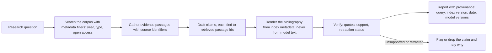
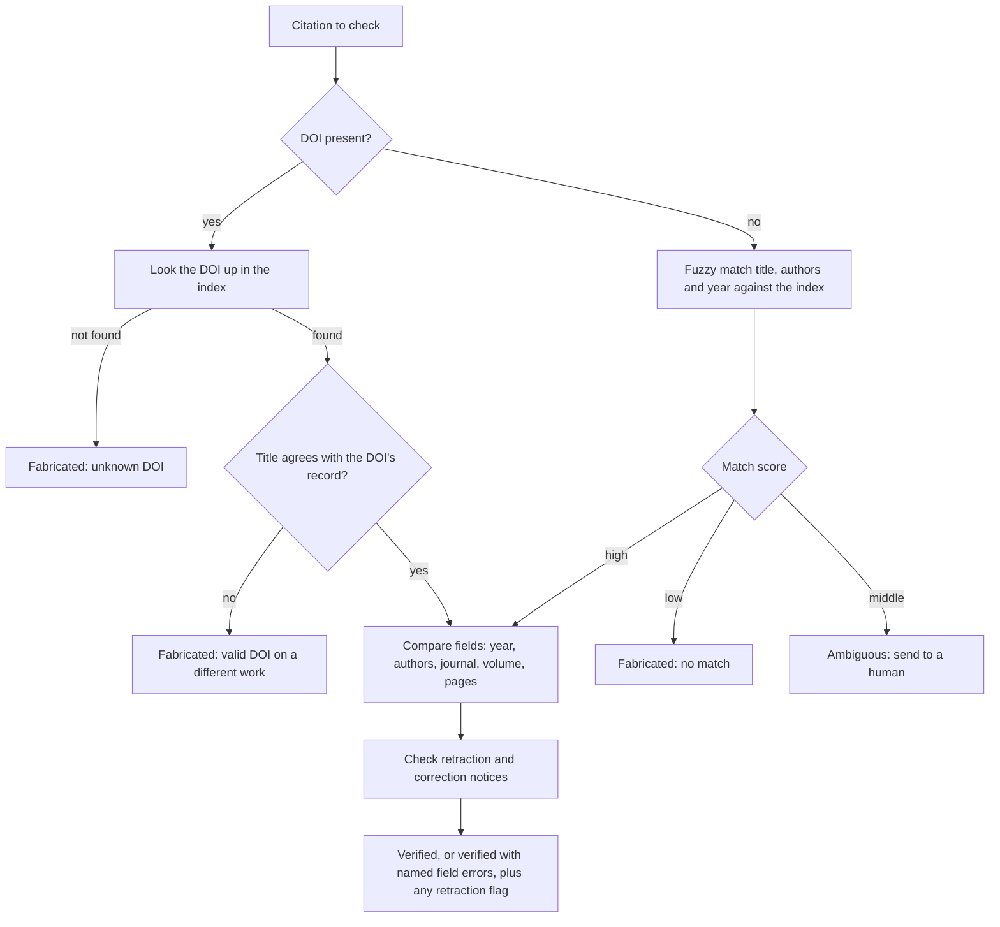

# Chapter 26 — Research and Academic Assistance

> **Evidence legend.** **[S#]** = supported by a source in References (IDs map to `project-management/RESEARCH-REGISTER.md`; papers were read at abstract level only, so figures quoted are the authors' own abstract claims). **[E]** = engineering recommendation/reasoning. **[A]** = assumption. **[I]** = illustrative. **[X]** = executed in this repository by `docs/exercises/ch26_citation_verify.py`. **[V]** = vendor-reported. **[N]** = not researched or not read. Research date: 2026-11-09. **Everything executed here is synthetic.** The exercise builds an 80-work stand-in for a scholarly metadata index, generates 195 citations with known defects, and measures a verifier on them; no real index (Crossref, OpenAlex), no real model output and no real publications were used, and the error mix is mine, not a measurement of any model. The reference implementation has **no research-assistant features**: no scholarly metadata schema, no citation verification, no scholarly PDF structure extraction (its PDF extractor yields flat paragraphs per page, OI-053d).

## 26.1 Learning Objectives

After this chapter you can:

1. Explain why language models fabricate and corrupt bibliographic references, using measured evidence, and why that makes verification a hard requirement for research assistants.
2. Design a research-assistant pipeline in which the model cites *retrieved source identifiers* and the bibliography is rendered from index metadata, not from model text.
3. Verify a given citation: DOI lookup with metadata comparison, fuzzy matching without a DOI, an ambiguity band for humans, field-level error reporting, and retraction checks.
4. Choose and use scholarly metadata sources (Crossref, OpenAlex) with their rate limits, licences and data-quality caveats.
5. Process scholarly PDFs into structure (header, references, sections, citation contexts) and know the limits of the tools.
6. Verify quotations and claim support, and present evidence honestly (what sources say versus inference, contradictions, study status).
7. Evaluate a research assistant on citation correctness and claim support, with expert-labelled data.
8. Handle integrity, confidentiality, licensing and reproducibility.

## 26.2 Problem Statement

Research users (scientists, analysts, clinicians, lawyers doing scholarly review, students) ask questions whose answers must be traceable to published evidence. A research assistant therefore has the usual RAG requirements plus a stricter one: **a reference that does not exist, or that exists but does not say what is claimed, is worse than no reference**, because the reader will trust it and build on it. At the same time the corpus is open-ended (millions of papers, mixed licences, preprints and published versions, retractions that arrive after indexing) and the documents are hard to parse (two-column PDFs, equations, tables, figures).

The engineering problem is to build a pipeline in which citations are **constructed from retrieved identifiers**, every reference shown to the user is **checked against an authoritative index**, quotations and claims are **verified against the source text**, retractions and corrections are **surfaced**, and the whole answer carries **provenance** that lets a reader reproduce it.

## 26.3 Why It Matters in Production

- **Models fabricate references.** Walters and Wilder asked ChatGPT (GPT-3.5 and GPT-4, text generated in the first week of April 2023) to write short literature reviews on 42 topics and checked 636 cited works against many databases and by browsing journal volumes: **55% of GPT-3.5 works and 18% of GPT-4 works were fabricated** (for articles, 73% and 18%), and among the real works **43% and 24% contained substantive errors** (wrong authors, titles, dates, journals, volumes or pages) [S178]. The study has limits the authors' design implies: broad first-year-composition topics, one week, only bibliographies checked, and subjective calls on near matches [S178]. **Those models are old**; the rates will not transfer to current systems, and I have not measured any current model **[N]**. The durable lesson is structural: free-text bibliographic entries produced by a generator cannot be trusted, and errors cluster in exactly the fields a reader would not re-check.
- **A naive verifier fails the other way.** **Executed [X], synthetic:** an exact-match check on title and first author flagged **90% of harmless variants** (name order, case, diacritics, abbreviated journals, truncated subtitles, "et al.") as fabricated. A verifier that cries wolf is switched off.
- **A valid identifier is not proof.** **Executed [X]:** 20 citations carried a DOI that exists in the index but belongs to a different work than the cited title; a DOI-existence check would pass all of them. Metadata comparison caught all 20.
- **Retractions arrive after indexing.** OpenAlex exposes an `is_retracted` flag "per the Retraction Watch database" [S179], and Crossref makes Retraction Watch data available through its API and a CSV, updated every working day, noting that many retractions have not been reported by publishers [S182]. **Executed [X]:** the verifier flagged 5 of 5 retracted works while still verifying that they exist.
- **Agentic literature agents exist.** PaperQA is described as a RAG agent over full-text scientific articles that assesses the relevance of sources and passages; its authors report that it exceeds existing models and agents on science question-answering benchmarks and matches expert researchers on their new LitQA benchmark, and offer RAG as a way to reduce hallucination and provide provenance [S184] (authors' abstract claims; the page gives no scores or citation metrics).

## 26.4 Core Concepts

### 26.4.1 Use cases and stakes

Literature search and synthesis; related-work drafting; evidence tables for reviews; prior-art and grant searches; reading assistants over a lab's own papers; question answering over a curated corpus. The stakes are **research integrity** (fabricated or misattributed evidence propagates), **reproducibility** (a reader must be able to rerun the search) and **confidentiality** (unpublished manuscripts and peer-review material must not leak). Treat any assistant output that will be cited or published as *draft material requiring human verification* **[E]**.

### 26.4.2 Corpora and metadata sources

| Source | What it gives | Limits and caveats |
|---|---|---|
| **Crossref** | Metadata deposited by publishers (JSON via REST); DOI lookup at `/works/{doi}`; update notices including retractions; Retraction Watch data | The documentation page I read was last updated in April 2020 and says records may be incorrect, confusing or partial; almost none of the metadata is subject to copyright, though some abstracts may be [S181] |
| **OpenAlex** | An index of works with `referenced_works`, `cited_by_count`, `type`, `publication_year`, open-access status and locations, DOI and other ids, and `is_retracted` [S179] | It ships abstracts as an inverted index to be reconstructed, "for legal reasons" [S179]; basic queries need no key, with limits of 10 requests per second without a key and 30 with a free key, daily budgets, HTTP 429 when exceeded and a recommendation of exponential backoff [S180] (version-sensitive) |
| **Full text** | Open-access PDFs and repository copies | Only where licences allow; text-and-data-mining rights and publisher terms were **not** researched **[N]** |

**Design [E]:** store each work's metadata with its source, retrieval date and a content hash; treat the metadata index as a *versioned dataset* you can cite; refresh it on a schedule (retractions, corrections, new versions); respect rate limits with backoff (Chapter 21); never redistribute PDFs without a licence; keep a record of which licence allowed full-text indexing for each document. Deduplicate preprint and published versions by DOI relations and title/author matching, and prefer the version of record while keeping the link **[E]**.

### 26.4.3 Parsing scholarly documents

GROBID converts scholarly PDFs to structured TEI XML with header (title, authors, abstract), reference and full-text models; it extracts citation contexts that link an in-text callout to its reference, figures and tables with captions, and PDF coordinates, can consolidate references through Crossref, and is Apache-2.0 licensed [S183]. The project reports F1 around 0.87 (PubMed Central set) and 0.90 (bioRxiv set) for reference extraction and 0.76 to 0.91 for citation-context resolution, but those are results on specific evaluation sets [S183]. It notes that its deep-learning models scale poorly without a GPU and states Linux and macOS support (Windows only formerly) [S183]; I did not run it **[N]**, and the reference implementation's development host is Windows.

**Why structure matters [E]:** citation contexts are excellent retrieval units ("which papers say X about Y"); section labels let you down-weight references and acknowledgements; page numbers allow pinpoint citations (the reference implementation's chunks already carry page start and end for PDFs [X, by inspection]). **What still fails [E]:** equations, tables and figure content are often lost or garbled; two-column layouts mis-order text; scanned papers need OCR (the reference implementation rejects PDFs without a text layer as `no_text`, ADR-016). Evaluate extraction on your own papers before trusting retrieval built on it.

### 26.4.4 Chunking, retrieval and the agentic loop

Section-aware chunks (abstract, methods, results, discussion) with metadata (year, venue, type, open-access status, retraction flag, DOI) enable filters and ranking features (Chapters 4, 13). Hybrid retrieval and reranking apply (Chapters 9, 12). Query formulation is a research skill: decompose a question into concepts, synonyms and constraints (population, intervention, outcome in clinical questions), run several queries, and merge (Chapters 10, 11) **[E]**. Specialised scientific embedding models exist; I did not research them or compare them **[N]**.

An *agentic* loop searches, judges the relevance of sources and passages, gathers evidence and then answers, which is the structure the PaperQA abstract describes [S184]; the controls of Chapter 15 apply (step and cost budgets, no unrestricted tools). Keep the loop's evidence list as an artefact: every claim in the final answer should map to specific passages **[E]**.

### 26.4.5 Citation generation: identifiers, not strings

<!-- figure:26-research-pipeline -->

*Figure 26.1: Citation generation: identifiers, not strings. Original diagram; source below.*

Mermaid source

<!-- /figure -->

*Original diagram by the handbook author; source `docs/assets/diagrams/26-research-pipeline.mmd`.*

**The strongest control is architectural [E]:** the model never writes a bibliographic entry. It emits source identifiers that came from retrieval; your code renders the reference list from the index's metadata. A citation can then only be *wrong about support* (the passage does not say that), never *non-existent* or *garbled*. Reject any identifier not in the retrieved set (the phantom-citation check of Chapter 18). If users paste or import their own reference lists, or a model is allowed to produce references anyway, the verifier below is the line of defence.

### 26.4.6 Verifying citations (executed)

<!-- figure:26-citation-verification -->

*Figure 26.2: Verifying citations (executed). Original diagram; source below.*

Mermaid source

<!-- /figure -->

*Original diagram by the handbook author; source `docs/assets/diagrams/26-citation-verification.mmd`.*

**Normalisation.** Fold case and diacritics, strip punctuation, expand common journal abbreviations, compare author *surnames* regardless of order and treat "et al." as a first-author match, and compare titles as token sets, allowing a truncated subtitle (the cited title's tokens are contained in the real title) **[X]**. Without normalisation the exact-match verifier fails 90% of the harmless variants.

**Matching.** With a DOI: look it up; if absent, the citation is fabricated; if present, **compare the cited title with the record**, because an identifier that exists but belongs to another work is a classic fabrication pattern **[X]** (my construction; I did not verify that real models do this, and the study I read does not say [S178]). Without a DOI: score candidates as `0.6 × title similarity + 0.3 × author similarity + 0.1 × (year within one)`; at or above 0.85 accept, below 0.60 call it fabricated, in between mark **ambiguous** for a human **[X]** (thresholds chosen before the run; Chapter 18's calibration discipline applies when you tune them on real data).

**Field-level errors.** For matched citations report *which* field disagrees (year, authors, journal, volume, pages) so a human can fix it, since real errors concentrate in such fields [S178].

**Retractions.** Check the matched work's retraction status (`is_retracted` [S179]; Crossref update notices and Retraction Watch data [S182]). Surface retractions, corrections and expressions of concern to the user with the notice; do not silently drop the work (the user may need to know it was retracted) and re-check periodically, because retractions happen after indexing **[E]**. Retraction Watch coverage of corrections and expressions of concern is less complete than for retractions, and notices can be paywalled [S182].

**Executed results [X]** (80 works, 5 retracted; 195 citations; fixed seed; results as obtained):

| Case type | Count | Outcome |
|---|---|---|
| Correct work, harmless formatting variant | 50 | all 50 verified |
| Wrong year | 20 | 18 verified with the year error named, 2 ambiguous |
| Wrong first author | 20 | 10 verified with the authors error named, 10 ambiguous |
| Wrong pages | 20 | all 20 verified with the pages error named |
| Wrong journal | 10 | all 10 verified with the journal error named |
| Invented work (plausible title, real-looking surnames and journals) | 50 | all 50 fabricated |
| Valid DOI on a different work | 20 | all 20 fabricated |
| Correct citation of a retracted work | 5 | all 5 verified **and flagged retracted** |

Summary: fabricated citations detected 100%; harmless variants called fabricated 0%; non-fabricated citations sent to a human 9.6%; error field named correctly 82.9% (the rest were routed to a human, never silently verified or called fabricated); retracted works flagged 100%; the naive exact-match verifier flagged 90% of harmless variants as fabricated. The ambiguous cases are no-DOI citations whose wrong author or year lowered the score into the middle band; a wrong-author citation and a fabricated one with the same title are genuinely hard to tell apart without a person, so the band is the design working, not failing.

**Quote verification [X].** A quoted passage must occur in the source text after whitespace, case, quote-mark and diacritic normalisation; an ellipsis splits the quote into fragments that must each appear, **in order**. In the tests a quotation with a changed number failed, reordered fragments failed, and an ellipsis quote with both fragments in order passed; mutants that ignore fragments or order are caught.

**Claim support.** That a reference exists and a quote is present does not show that the cited passage supports the *claim*. Use the claim-level faithfulness checks of Chapter 18 with a validated judge, and keep in mind their limits (a lexical verifier misses paraphrase and negation; a judge must be calibrated, and for scholarly claims by domain experts) **[S135, E]**.

### 26.4.7 Presenting evidence honestly

Separate *what the sources say* from *the assistant's inference*; show conflicting evidence rather than averaging it away; attach metadata that bears on weight (study type, sample size where extractable, preprint versus published, retraction and correction notices, date); give pinpoint locations (section, page); state when evidence is thin and abstain; and say "as of" the index date for time-sensitive questions **[E]**. Do not generalise beyond the population or conditions a study covers, and flag when the answer rests on a single source. Provide *provenance*: the queries run, filters, index version and date, model and prompt versions, so another person can reproduce the answer (Chapter 19's release bundle).

### 26.4.8 Evaluation

Build a golden set of research questions with expert-labelled relevant papers and key facts (Chapter 18), with slices by field, language and question type. Metrics: retrieval Recall@K and nDCG for relevant papers; **citation correctness** (every displayed reference exists and its metadata matches), **quote correctness**, **claim support** (expert-validated judge), abstention correctness, and **retraction handling**. Track the **hallucinated-reference rate** of anything that is *not* rendered from the index (user imports, generated references) by running the verifier on it. Benchmarks such as LitQA are introduced by PaperQA's authors [S184], and I have not run them **[N]**. Domain experts must label the calibration set for any judge; a general-purpose judge may be unreliable for specialist claims **[E]**.

### 26.4.9 Integrity, confidentiality and licensing

- **Academic integrity.** The assistant helps find and organise evidence; people are accountable for what they cite. Disclosure expectations for AI assistance differ by venue and institution, and I did not research them **[N]**.
- **Confidentiality.** Unpublished manuscripts, embargoed results, peer-review material and grant proposals must not be sent to external providers without permission; route such data to local models through the gateway's restricted-sensitivity policy (ADR-012) and keep it out of shared indexes **[E]**.
- **Licensing.** Index and reproduce only what licences permit; keep per-document licence metadata; the metadata sources have their own terms [S179, S181] **[E]**.
- **Bias.** Retrieval and ranking by citation counts favour well-cited, English-language and Western venues; surface this as a limitation and offer filters **[E]**.

## 26.5 Architecture

The pipeline diagram (26.4.5) and the verification flow (26.4.6) are the architecture. In terms of the reference system **[E, I]**: ingestion extracts scholarly structure (GROBID or equivalent) into chunks with scholarly metadata; the index stores per-chunk work identifiers (DOI, OpenAlex id), section, page range and the retraction flag; retrieval filters by metadata; generation (through the gateway) emits passage ids; the citation renderer builds references from the metadata table; the verifier runs on any externally supplied references and on quotes; and the evaluation harness measures citation and claim correctness.

## 26.6 Practical Example (Executed [X], synthetic)

`docs/exercises/ch26_citation_verify.py` (standard library; deterministic; `--mutants` adds a mutation check) builds the 80-work index and 195 citations described above, implements the normaliser, the verifier, the quote checker and the naive baseline, and checks them. **Mutation check: 7/7 injected defects detected** (no normalisation, ignoring the year, trusting DOI existence only, title-only matching, no retraction flag, ignoring quote fragments, ignoring fragment order).

**Findings while building it (all real).**

1. *I changed a pre-set criterion after seeing the result, and I am disclosing it.* Before running, I required that the verifier name the injected error field in at least 90% of error cases. The run gave 82.9%. All of the shortfall was no-DOI citations with a wrong first author or a year two to three off, which lowered the match score into the ambiguous band. That is the intended behaviour, and my criterion had conflated "named the field" with "did not silently pass". I replaced it with two criteria: every error case must be routed to *errors or a human* (100% achieved) and the field must be named at least 80% of the time (82.9% achieved), and I report the original number.
2. *A unit test failed on my own test data* (I wrote "J. Applied Optics" for a journal called "Journal of Applied Optics", dropping a word); the verifier was right.
3. *The generator's difficulty is mine.* Invented titles are built from the same word pool as real ones and still differ enough to fall under the matching threshold; real fabrications (for example partial titles of real papers with a swapped venue) can be harder. A 100% detection rate on this generator is not a claim about real data.
4. *The 90% false-flag rate of the naive verifier* depends on the proportion of harmless variants I generated; the qualitative lesson (exact match breaks on formatting) is what generalises.

## 26.7 Implementation (reference implementation, inspected 2026-11-09)

| Capability | State |
|---|---|
| PDF text extraction with page numbers carried into chunks; encrypted and text-less PDFs rejected | **Built and tested** (ADR-016) |
| Scholarly structure extraction (header, references, citation contexts) | **Not built**; PDFs yield flat paragraphs per page (OI-053d) |
| Scholarly metadata schema (DOI, venue, type, licence, retraction flag) and metadata-source clients | **Not built** |
| Citation rendering from metadata; citation verifier; quote checker | **Exercise only**; generation and citation validation are components 11 and 12 |
| Retraction refresh job | **Not built** |
| Gateway sensitivity policy for confidential manuscripts | **Built and tested** (ADR-012) |
| Evaluation of citation and claim correctness | **Not built** (component 17) |

Gaps are tracked in OI-066.

## 26.8 Trade-offs

| Decision | Option | Gain | Cost / risk |
|---|---|---|---|
| Citations | Render from index metadata | No fabricated or garbled references [E] | Cannot cite what is not in the index |
| | Let the model write references | Flexible | Fabrication and errors [S178]; verifier required |
| Verification | Strict matching | Few false accepts | Many false flags [X] |
| | Matching with an ambiguity band | Humans see hard cases [X] | Reviewer workload |
| Parsing | Structure extraction (GROBID-style) | Citation contexts, sections [S183] | Setup, GPU for scale, platform limits, errors on equations and tables |
| | Flat text | Simple | Loses structure and references |
| Corpus | Open metadata plus open-access full text | Reproducible and licensable | Coverage gaps |
| | Licensed full text | Coverage | Contract and TDM constraints [N] |
| Agentic loop | Iterative evidence gathering | Better coverage [S184] | Cost and latency (Chapters 15, 20) |

## 26.9 Failure Modes

| Failure | Cause | Detection | Mitigation |
|---|---|---|---|
| Fabricated or corrupted references | Model-written bibliographic text [S178] | Verifier; phantom-id check | Render from metadata; verify imports |
| Valid DOI, wrong work | Fabrication that borrows an identifier [X] | Title versus record comparison | Compare metadata, not existence |
| Real citation that does not support the claim | Retrieval or synthesis error | Claim-support evaluation (Chapter 18) | Passage-level citations; validated judge |
| Retracted work cited as sound | Index not refreshed; flag ignored [S179, S182] | Retraction status checks; refresh job | Surface notices; periodic recheck |
| Parsing errors propagate | Equations, tables, columns mis-extracted [S183] | Extraction audits | Evaluate on your papers; keep source page images or links |
| Preprint and published versions confused | No deduplication | Duplicate DOIs or titles | Relate versions; prefer version of record |
| Confidential manuscript leaks | External provider used for restricted data | Route audit | Local models for restricted data (ADR-012) |
| Licence violations | Redistributing or indexing without rights | Licence metadata audits | Per-document licence records |
| Over-generalised synthesis | Ignoring study scope | Expert review | Present scope; abstain on thin evidence |
| Irreproducible answers | No provenance | Rerun comparisons | Record queries, index version, dates, model versions |

## 26.10 Security Considerations

Scholarly PDFs are untrusted files (Chapters 16 and 22): parse in the sandbox, treat their text as hostile data (instructions hidden in a paper's text are indirect prompt injection), and apply the egress controls of Chapter 22 to answers. Fetching external metadata means outbound network calls to third-party APIs: restrict egress, validate responses, cap sizes and handle rate limits (HTTP 429 with backoff [S180]), and never send confidential text as a query to a public metadata service **[E]**. API keys for metadata services are secrets. Citation links should resolve to canonical identifiers (DOI resolvers, repository pages) that you control or trust, not arbitrary URLs from model output (the egress allow-list of Chapter 22 applies).

## 26.11 Performance Considerations

Verification is cheap relative to generation: the exercise's linear scan over 80 works is trivial, but a real verifier must use an index (DOI lookup is a key lookup; fuzzy matching needs a bibliographic search endpoint or a local index). Cache metadata by DOI with a refresh policy; batch lookups; respect source rate limits (OpenAlex: 10 requests per second without a key, 30 with a free key at the time of reading [S180]). Parse papers offline at ingestion, not per query **[E]**. I did not measure parsing or lookup throughput **[N]**.

## 26.12 Cost Considerations

Costs: parsing compute (GPU for GROBID-scale throughput [S183]), metadata API usage (OpenAlex budgets and pricing, not researched in detail [S180]), embedding and storage of full text, evaluation labelling by domain experts (the dominant cost for trustworthy evaluation), and human review of ambiguous citations. Rendering references from metadata removes most citation-verification cost by construction **[E]**. No prices were researched **[A]**.

## 26.13 Production Recommendations

1. Never let the model write bibliographic entries; emit retrieved identifiers and render references from index metadata.
2. Verify any externally supplied reference with DOI lookup *and* metadata comparison, fuzzy matching, an ambiguity band, field-level errors and retraction checks.
3. Verify quotations (in order, with fragments) and evaluate claim support with a domain-validated judge.
4. Maintain the metadata index as a versioned, refreshed dataset with source, date and licence per record; refresh retraction data on a schedule.
5. Extract scholarly structure and page locations; evaluate extraction on your own papers.
6. Present evidence with scope, status (preprint, retracted, corrected) and conflicts; abstain on thin evidence.
7. Record provenance (queries, filters, index version, dates, model versions) for reproducibility.
8. Keep confidential manuscripts off external providers; keep per-document licence metadata.
9. Measure citation correctness, quote correctness, claim support and retraction handling on an expert-labelled golden set.
10. Treat all assistant output intended for publication as draft requiring human verification.

## 26.14 Architecture Decision Guidance

An ADR for the research-assistant data model and verification policy (metadata schema, sources and refresh, citation rendering from metadata, verifier thresholds and ambiguity handling, retraction policy, licensing records, provenance) should be written when a research use case is scheduled, building on ADR-016 (extraction) and the Chapter 18 evaluation policy (ADR-018). Reconsider when metadata sources change terms or limits [S180, S181], when a scholarly parser fits your platform and corpus, or when measured error rates on real model output differ from assumptions.

## 26.15 Interview Questions

1. **Why can't a research assistant trust model-written references?** Measured studies found fabricated and corrupted citations (55% and 18% fabricated for GPT-3.5 and GPT-4 in April 2023 samples); render references from index metadata [S178].
2. **How do you verify a citation?** DOI lookup with title/metadata comparison, fuzzy matching without a DOI, an ambiguity band, field-level errors, retraction check [X].
3. **Why compare metadata when the DOI resolves?** A valid DOI can belong to a different work; existence is not agreement [X].
4. **What does exact-match verification get wrong?** It flags harmless variants as fabricated (90% in the exercise) [X].
5. **How do you handle retractions?** Check `is_retracted` and Crossref/Retraction Watch notices, surface them, refresh periodically [S179, S182].
6. **Why use citation contexts as retrieval units?** They state what a paper says about another, which is the natural evidence for "who claims X" questions [S183, E].
7. **What are the limits of GROBID-style parsing?** Reported F1 is on specific sets, equations and tables are hard, deep-learning models need GPUs to scale, platform support is limited [S183].
8. **How do you verify a quotation?** Normalised substring match, with ellipsis fragments in order [X].
9. **Does a verified reference support the claim?** Not necessarily; claim-level support needs a validated judge and expert labels (Chapter 18) [E].
10. **What are the confidentiality risks?** Unpublished manuscripts or peer-review material sent to external providers; use restricted routing to local models [E, ADR-012].
11. **What goes into the provenance of an answer?** Queries, filters, index version and date, model and prompt versions [E].
12. **What would you not claim about a literature assistant?** That its references are correct without verification, or that error rates measured on 2023 models apply to current ones [S178, E].

## 26.16 Knowledge Checkpoint / Exercises

1. Run `python -I docs/exercises/ch26_citation_verify.py --mutants`. Change the match thresholds to 0.80 and 0.50, report the effect on ambiguous rate and on fabricated detection, and explain the trade-off.
2. Add a "partial real title with a swapped venue" fabrication type and measure whether the verifier still catches it; adjust only with a stated rationale.
3. Replace the stand-in index with a small real sample of 50 Crossref or OpenAlex records fetched respecting the documented limits [S180, S181]; re-run and record every disagreement.
4. Add retraction-notice types (correction, expression of concern) and decide what the verifier should do for each [S182].
5. Implement the identifier-based pipeline: a generator stub that outputs passage ids, a renderer that builds the bibliography from metadata, and a phantom-id check; test that a fabricated id is rejected.
6. Evaluate GROBID (or your parser) on 20 papers from your field: report reference-extraction precision and recall against hand labels.
7. Draft the verification policy: thresholds, who reviews ambiguous cases, retraction handling, refresh schedule.

## 26.17 Summary

A research assistant must make fabricated references structurally impossible or detectable: cite retrieved identifiers and render bibliographies from index metadata; verify anything else by DOI lookup with metadata comparison, fuzzy matching with an ambiguity band, field-level error reporting and retraction checks; verify quotations and claim support; extract scholarly structure; present evidence with scope and provenance; and protect confidential and licensed material. The measured evidence on model-written citations is from 2023 models and shows high fabrication and error rates; the executed harness is synthetic and verified the verifier's logic (100% of fabricated citations detected, 0% harmless variants flagged, 9.6% routed to a human, 7/7 injected defects detected) while showing that an exact-match baseline fails on formatting alone. I changed one pre-set criterion after seeing the result and disclosed it. The reference implementation has PDF text with page numbers and the confidentiality routing, and none of the scholarly metadata, verification or retraction machinery yet (OI-066).

## References

- [S135] Ragas documentation, *Faithfulness*. https://docs.ragas.io/en/stable/concepts/metrics/available_metrics/faithfulness/
- [S178] Walters and Wilder, *Fabrication and errors in the bibliographic citations generated by ChatGPT*, Scientific Reports 13 (2023-09-07). https://pmc.ncbi.nlm.nih.gov/articles/PMC10484980/
- [S179] OpenAlex help, *Works attribute dictionary*. https://help.openalex.org/data/works/attributes/
- [S180] OpenAlex help, *Authentication and rate limits* (version-sensitive). https://help.openalex.org/api/authentication/
- [S181] Crossref, *REST API documentation* (page last updated 2020-04-08). https://www.crossref.org/documentation/retrieve-metadata/rest-api/
- [S182] Crossref, *Retraction Watch data*. https://www.crossref.org/documentation/retrieve-metadata/retraction-watch/
- [S183] GROBID documentation, *Introduction*. https://grobid.readthedocs.io/en/latest/Introduction/
- [S184] Lála et al., *PaperQA*, arXiv:2312.07559 (abstract). https://arxiv.org/abs/2312.07559
- ADR-012, ADR-016, ADR-018; OI-053, OI-066 (this repository). Chapters 4, 9, 10, 11, 12, 13, 15, 18, 22.
