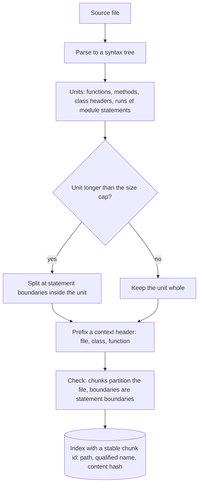
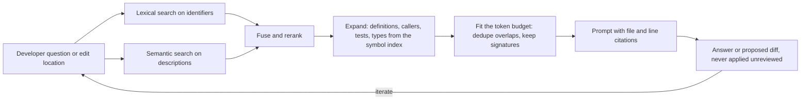

# Chapter 27 — Code and Developer Assistance

> **Evidence legend.** **[S#]** = supported by a source in References (IDs map to `project-management/RESEARCH-REGISTER.md`; papers were read at abstract level only, so figures quoted are the authors' own abstract claims). **[E]** = engineering recommendation/reasoning. **[A]** = assumption. **[I]** = illustrative. **[X]** = executed in this repository by `docs/exercises/ch27_code_retrieval.py`. **[M]** = **measured on real data** by that script: this repository's own Python source. **[V]** = vendor-reported. **[N]** = not researched or not measured. Research date: 2026-11-09. **The measured numbers come from one small Python code base** (snapshot `3dd9af6d14ed`: 59 files, 4,896 lines, 340 symbols), **34 or 41 queries derived from docstrings, lexical (BM25) retrieval only, one run.** They are not a benchmark, they say nothing about embeddings or other languages, and they will change as the repository changes. The reference implementation has **no code-assistance feature**; the exercise indexes its source only to measure chunking.

## 27.1 Learning Objectives

After this chapter you can:

1. Explain how code differs from prose for retrieval (syntax, identifiers, structure, versions, scale) and what developers actually ask.
2. Chunk source code along syntactic units, verify structural invariants (partition, statement boundaries, size caps), and choose between a standard-library parser and a general parsing library.
3. Measure a code chunker honestly: avoid query leakage, use a defined hit rule, report intervals, and recognise when a difference is inconclusive.
4. Combine lexical, semantic and structural retrieval (symbols, callers, tests) and assemble context under a token budget with file and line citations.
5. Keep a code index fresh: per-file hashing, deletions, renames, branches and stable chunk identities.
6. Handle the security and licensing risks specific to code: hostile repositories, secrets, licences, and hallucinated packages.
7. Evaluate a developer assistant on retrieval and on task outcomes, and say what published benchmarks do and do not show.

## 27.2 Problem Statement

Developers ask questions that prose retrieval handles badly: *where is X handled, what calls this, why does this test fail, how do I add a field to this model, what changed in this module recently.* Code is structured text with exact identifiers, dependencies across files, tests that document behaviour, and a history. The same function name can exist in many places; a natural-language description ("validate the upload size") rarely shares words with the code that does it; and a naive chunker that cuts every 40 lines splits functions in the middle, which is precisely the failure Chapter 4 warned about for documents.

The engineering problem is to retrieve *code units* with enough context to be understood, expand to related definitions and tests, fit a token budget, cite file and line, never leak secrets or licensed code carelessly, and never trust generated code or dependencies without checks.

## 27.3 Why It Matters in Production

- **Naive chunking cuts through code.** **Measured [M]:** with 40-line windows, **73.7% of chunks had a boundary strictly inside a function or method body**; with the AST-based chunker, 3.0% did (those are the 20 symbols longer than the 60-line cap, split at statement boundaries).
- **But a retrieval benefit was not demonstrated on this data.** **Measured [M]:** on 34 queries (docstrings of at least 6 words), the AST chunker had Recall@5 0.676 against 0.647 and MRR@10 0.535 against 0.512; per query, AST was better on 8, worse on 5 and tied on 21, and the 95% paired-bootstrap interval for the MRR difference was **[−0.072, +0.115]**. With a lower cutoff (41 queries, docstrings of at least 4 words) AST led by 11 to 5 with an interval of **[−0.041, +0.124]**. Both intervals include zero. With this few queries, one query is worth about 3 points. The structural result is clear; the retrieval result is **inconclusive**.
- **Published claims point the same way but are the authors' own.** The cAST paper argues that line-based chunking "often break[s] semantic structures" and reports Recall@5 +4.3 points on RepoEval retrieval and Pass@1 +2.67 points on SWE-bench generation for AST-based chunking [S189] (authors' abstract claims). My measurement is consistent in sign and far from conclusive in size.
- **Repository-scale tasks are hard.** SWE-bench collects 2,294 real GitHub issues from 12 Python repositories and, at the time of the paper, the best model resolved 1.96% [S187] (a dated figure: models have changed since). RepoCoder reports that iterative retrieval-and-generation improves in-file completion by over 10% in all settings of its RepoEval benchmark (authors' claim) [S188].
- **Generated dependencies are a supply-chain risk.** A study of 16 code-generation models over 576,000 samples reported average hallucinated-package rates of at least 5.2% for commercial and 21.7% for open-source models and 205,474 unique hallucinated names, framing it as a package-confusion attack on software supply chains [S190]; OWASP also lists hallucinated packages seeded with malware under improper output handling [S155].

## 27.4 Core Concepts

### 27.4.1 What developers ask and what to retrieve

| Question type | Example | Best retrieval |
|---|---|---|
| Locate | "where is upload size validated" | Lexical on identifiers and paths, plus semantic on descriptions |
| Explain | "what does `replace_chunks` do" | The definition, its docstring, callers and tests |
| Trace | "who calls this" | Symbol index and call graph, not text search |
| Change | "add a field to the document model" | Definition, schema, migrations, serializers, tests |
| Debug | "why does this test fail" | Test, code under test, recent changes, logs |
| History | "what changed in ingestion this month" | Commit and pull-request history |

Retrievable material: code units (functions, classes, modules), documentation (README, ADRs, docstrings), tests (usage examples), configuration and manifests, issues and pull requests, API specifications. Different question types need different retrievers; one embedding index is not enough **[E]**. CodeSearchNet formalised semantic code search with about 6 million functions in six languages (about 2 million with query-like documentation text) and 99 queries with about 4,000 expert relevance annotations [S186] (the abstract names no metric and gives no scores).

### 27.4.2 Parsing and chunking code

**Parsers.** Tree-sitter is a parser generator and incremental parsing library that builds concrete syntax trees, aims to be general, fast, robust to syntax errors and dependency-free (a C11 runtime), and has parsers and bindings for many languages [S185]; it is the usual choice for multi-language production indexing because it tolerates broken code and updates incrementally **[E]**. Python's standard `ast` module parses Python only and (from general knowledge, not stated in the page summary I read) raises `SyntaxError` on invalid code; it gives 1-based line numbers with optional end positions (column offsets are UTF-8 byte offsets) and warns that a sufficiently large or complex string can crash the interpreter in `ast.parse` through stack-depth limits [S191]. The exercise uses `ast` because it is in the standard library and the target code is Python; **a production indexer parsing untrusted repositories must run the parser in the sandbox of Chapter 16 with a time and memory limit** **[E]** (the `ast` warning is the reason).

<!-- figure:27-code-chunking -->

*Figure 27.1: Parsing and chunking code. Original diagram; source below.*

Mermaid source

<!-- /figure -->

*Original diagram by the handbook author; source `docs/assets/diagrams/27-code-chunking.mmd`.*

**The chunker in the exercise [X].** Units are top-level functions and classes, methods inside classes, the class statement itself (its header), and contiguous runs of module-level statements. A unit over 60 lines (a function) is split at statement boundaries inside it. Lines between units (blank lines, comments) are attached to the *following* unit so the chunks **partition** the file: no line lost, none duplicated. Every chunk is prefixed with a header naming the file and the enclosing class and function, because a method body alone often lacks the context that makes it findable (`file: ... | Class.method`).

**Invariants checked on every file in the snapshot [X]:** (1) the chunks cover every non-blank line exactly once; (2) every chunk ends at a statement boundary (the end of some statement, or the line just before a statement starts, which is where a class header ends); (3) a *function* is split across chunks only if it is longer than the cap; (4) the context header is present on symbol chunks; (5) docstrings are really absent from the indexed text (below). Mutants that drop gap lines, split mid-statement, omit the header or fail to strip docstrings are each caught.

### 27.4.3 Measuring a code chunker without fooling yourself

**Queries.** Developers' real questions were not available. The exercise uses the **first sentence of each function, method or class docstring** as a natural-language description of the target. **Leakage control:** the docstring text itself would trivially match the corpus, so *all* docstrings are blanked from the indexed text (line numbers preserved). **Measured [M]:** with docstrings left in, MRR@10 is 1.000, which shows how much leakage would have inflated the result; the reported figures use stripped text. Other leakage remains (identifiers often share words with the description; comments remain in the text), so treat the numbers as a proxy.

**Retriever.** BM25 over tokens split at underscores and case changes (`parseHTTPResponse` becomes `parse http response`), the same for both chunkers. **Hit rule.** A chunk hits a target if it is in the same file and overlaps it by at least half of the *shorter* of the two; the rule makes both "a small function inside a big window" and "a window inside a big function" count, and a mutation test shows that a laxer rule would be caught. **Statistics.** Per-query reciprocal ranks, a paired bootstrap over queries (Chapter 18), wins, losses and ties, and a snapshot hash so every number is tied to the exact files.

**Measured results [M]** (snapshot `3dd9af6d14ed`):

| Chunker | Chunks | Mean lines | Recall@1 | Recall@5 | MRR@10 | Chunks cut through a function |
|---|---|---|---|---|---|---|
| 40-line windows, 10 overlap (34 queries) | 175 | 35.4 | 0.412 | 0.647 | 0.512 | 73.7% |
| AST units with header (34 queries) | 439 | 11.2 | 0.441 | 0.676 | 0.535 | 3.0% |
| 40-line windows (41 queries) | 175 | 35.4 | 0.341 | 0.610 | 0.448 | 73.7% |
| AST units with header (41 queries) | 439 | 11.2 | 0.390 | 0.659 | 0.491 | 3.0% |

Per query: 8 better, 5 worse, 21 tied (34 queries); 11 better, 5 worse, 25 tied (41 queries). MRR difference intervals [−0.072, +0.115] and [−0.041, +0.124]. **Reading it:** AST chunks are smaller and cleaner and nominally lead on every retrieval figure; the data cannot distinguish that lead from chance. I did not choose the second cutoff in advance to find a significant result (neither is), but I did add it *because* the first sample was small; both are reported. A larger corpus, real developer questions and embedding retrieval could change the picture in either direction **[N]**. A claim to adopt AST chunking on retrieval grounds from this experiment would not be justified; a claim on *structural* grounds (functions arrive whole in the prompt) is.

### 27.4.4 Retrieval beyond text similarity

- **Identifier-aware lexical search** is strong for code because names are exact signals; split identifiers and index file paths and qualified names **[E]**.
- **Semantic search** helps when the query describes behaviour in words absent from the code; embedding models trained on code exist and I did not evaluate any **[N]**.
- **Symbol index and graph.** Index definitions, references, imports, inheritance and call edges; answer "who calls X" and "where is Y defined" from the index, and use it to **expand** retrieved chunks to their dependencies, tests and types **[E]**. A language-server or tree-sitter-based extractor builds it; for an agent, "go to definition" and "find references" are natural tools (Chapter 15) with the usual allow-list and budget.
- **Iterative retrieval.** RepoCoder alternates retrieval and generation, using the model's draft as the next query, and reports gains over in-file completion and over single-shot retrieval [S188]; it fits completion and edit tasks more than Q&A **[E]**.
- **History.** Commit messages and pull-request discussions explain *why*; index them as separate document types with dates and authors **[E]**.

### 27.4.5 Assembling context

<!-- figure:27-code-context-assembly -->

*Figure 27.2: Assembling context. Original diagram; source below.*

Mermaid source

<!-- /figure -->

*Original diagram by the handbook author; source `docs/assets/diagrams/27-code-context-assembly.mmd`.*

Fit the budget by priority **[E]**: the target unit, then its signature dependencies (types, called function signatures), then the nearest tests, then documentation; collapse unchanged parts of large files to signatures; deduplicate overlapping chunks; put the most important material at the start or end of the context because long inputs are used unevenly [S149]; cite `path:line` so a developer can open the source. A larger context window does not remove the need to select.

### 27.4.6 Freshness and identity

A code index is stale as soon as someone commits. Use per-file content hashes and re-index only changed files; handle deletions (remove chunks) and renames (a rename with unchanged content should keep embeddings); index the default branch and, if needed, per-branch overlays; and rebuild when the chunker or parser version changes (Chapter 4's chunker versions). **Stable chunk identities** matter for citations and caching: derive the id from path, qualified name and content hash (the reference implementation derives chunk ids from content and position, ADR-017), and decide whether an unchanged function that moved files keeps its id **[E]**. The snapshot hash in the exercise is the same idea applied to an evaluation: tie results to exact content.

### 27.4.7 Security, secrets and licensing

- **Hostile repositories.** Code, comments, READMEs, issue text and commit messages are untrusted input to the model: an instruction in a comment is indirect prompt injection (Chapter 22). Parse untrusted code only in a sandbox with limits (the `ast` stack-depth warning [S191]), never execute it for indexing, and apply the egress and capability controls of Chapter 22 to the assistant (an agent that can run code or call the network is the lethal trifecta in a terminal) **[E]**.
- **Secrets.** Repositories contain keys, tokens and credentials. Scan before indexing, exclude secret-bearing files (`.env`, key files, credential stores), redact detected secrets from chunks, and never send them to external providers; I did not research secret-scanning tools **[N]**, and the reference implementation's log scrubber (Chapter 19) is not a repository scanner.
- **Permissions.** Repository access control must carry into retrieval: per-repository and per-path ACLs as chunk ACLs, re-checked after retrieval (Chapters 8, 22, 24). A developer must not see code from a repository they cannot read.
- **Licences.** Record each file's licence; do not surface or suggest snippets whose licence is incompatible with the destination; licence compliance for generated code is a legal question I did not research **[N]**.
- **Hallucinated dependencies.** Verify that any package the assistant proposes exists in the intended registry, is the intended project (typosquats and slopsquats), and passes your supply-chain checks before anything installs it; the study above quantifies why [S190, S155] **[E]**.
- **Generated code is untrusted.** Review it, run tests in a sandbox, scan it, and never auto-apply diffs to protected branches **[E]** (OWASP's guidance on improper output handling applies to code as output [S155]).

### 27.4.8 Evaluation

Layer the evaluation **[E]**:

1. **Retrieval** on a golden set of real developer questions with labelled target symbols or files: Recall@K, MRR, nDCG, per language and per question type, with paired intervals (Chapter 18).
2. **Context quality:** does the assembled context contain the definition, the callers and the relevant tests?
3. **Task outcomes:** for edit-and-fix tasks, the fraction resolved by hidden tests, as SWE-bench defines it (2,294 issues, 12 Python repositories) [S187]; for completion, exact match and execution on benchmarks such as RepoEval [S188].
4. **Human metrics:** acceptance and edit rates of suggestions, time to complete tasks, and incident rates.
5. **Safety:** secret leakage, licence incompatibility, hallucinated dependencies, and unauthorised-repository access on adversarial cases.

Beware **benchmark contamination** (models may have seen public repositories and issues) and **leakage inside your own evaluation** (the docstring example above); use private held-out tasks from your own repositories where you can **[E, N]**.

## 27.5 Architecture

The chunking and context-assembly diagrams above are the architecture. The system **[E, I]**: a repository connector (webhooks or polling, Chapter 24's synchronisation principles apply: idempotent per-file updates, deletions, reconciliation) feeds a sandboxed code extractor (tree-sitter or `ast`) that emits AST units with headers, a symbol index and per-file metadata (path, language, licence, ACL, content hash); an embedding and lexical index serves hybrid retrieval; a retrieval service expands and budgets context; the generation step goes through the gateway with the sensitivity policy (proprietary code to local or approved providers only); outputs pass the egress and review controls; and telemetry stays content-free.

## 27.6 Practical Example (Measured [M] and Executed [X])

`docs/exercises/ch27_code_retrieval.py` (standard library; `--mutants` adds a mutation check) reads this repository's Python source, builds both chunkers, checks the invariants, evaluates both on docstring-derived queries with BM25, computes paired intervals at two query cutoffs, measures the leakage upper bound, and prints a snapshot hash. **Mutation check: 6/6 injected defects detected** (docstrings not stripped, gap lines dropped, no context header, wrong window overlap, a lax hit rule, splitting mid-statement).

**Findings while building it (all real).**

1. *My first invariant was wrong in a revealing way:* I asserted that every AST chunk ends at the end of a statement, and the class-header chunk (the `class X:` line before its first method) failed it, because it necessarily ends *inside* the class statement. The right property is "at a statement end or just before a statement starts", and the harmful cut is the one *through a function*, so I measure that. The last chunk of a file ends at end-of-file, not at a statement, and is exempt.
2. *One mutant survived the first run* (a lax hit rule) because my unit test used an overlap too small to separate a 10% rule from a 50% rule; I added a case with 30% overlap.
3. *The sample was small, so I added a paired bootstrap and a second cutoff.* Both intervals span zero; I therefore do **not** claim a retrieval gain.
4. *The leakage upper bound of 1.000* is a reminder that an evaluation can look perfect for the wrong reason; the docstring stripping and its test are the controls.
5. *Only 34 of 340 symbols have a docstring first sentence of six or more words,* which is a fact about this code base (many short docstrings) and limits any conclusion.

## 27.7 Implementation (reference implementation, inspected 2026-11-09)

| Capability | State |
|---|---|
| Text, Markdown, HTML, DOCX and PDF extraction with structure-aware chunking for documents | **Built and tested** (ADR-016) |
| Code-aware extraction (syntax-tree units, symbol index, per-file licence and secrets scanning) | **Not built**; a code file would arrive as plain text and be chunked as prose |
| Repository connector, incremental per-file indexing | **Not built** (see Chapter 24) |
| Hybrid retrieval, reranking, context assembly | **Not built** (components 6 to 10) |
| Sandboxed parsing with resource limits | **Built** for documents (ADR-016); would be reused for code parsing |
| Gateway sensitivity policy (keep proprietary code on approved providers) | **Built and tested** (ADR-012) |
| Evaluation of code retrieval or tasks | **Exercise only** (this chapter); component 17 |

Gaps are tracked in OI-067.

## 27.8 Trade-offs

| Decision | Option | Gain | Cost / risk |
|---|---|---|---|
| Chunking | Syntax-tree units | Whole functions, clean boundaries [M] | Parser dependency per language; error handling |
| | Fixed line windows | Language-agnostic, trivial | 73.7% cut through functions [M] |
| Parser | tree-sitter | Many languages, error-tolerant, incremental [S185] | Native dependency; grammar maintenance |
| | Language stdlib parser | No dependency | One language; fails on broken code; stack limits [S191] |
| Chunk size | Small units | Precise hits | More chunks (439 versus 175 [M]); context loss |
| | Large windows | Context | Noise; cuts |
| Retrieval | Lexical | Exact identifier signals | Misses behavioural descriptions |
| | Semantic | Concept queries | Needs code embeddings; evaluate [N] |
| Expansion | Symbol graph | Dependencies and tests | Index maintenance |
| Autonomy | Suggest only | Safe | Slower |
| | Auto-apply | Fast | Supply-chain and quality risk [S190] |

## 27.9 Failure Modes

| Failure | Cause | Detection | Mitigation |
|---|---|---|---|
| Function split across chunks | Line-window chunking [M] | Cut-rate metric; structural invariants [X] | AST units; cap with statement-boundary splits |
| Evaluation inflated by leakage | Query text present in the corpus [M] | Upper-bound check (1.000) | Strip docstrings; hold out; real queries |
| Conclusion from a tiny sample | 34 queries; paired interval spans zero [M] | Bootstrap; wins and losses | More queries; state inconclusive |
| Stale index | Commits not indexed | Per-file hash lag; reconciliation | Incremental indexing; deletions; rebuild on parser change |
| Wrong repository access | Chunk ACLs missing or stale | Cross-repo tests (Chapters 22, 24) | Per-repo ACLs; re-check |
| Secrets leaked to the model | Unscanned repository [N] | Secret scanning in CI | Scan, exclude, redact before indexing |
| Hallucinated dependency installed | Unverified suggestion [S190] | Registry and provenance checks | Verify existence and identity; allow-lists |
| Injection through code comments | Hostile repository text | Adversarial cases | Treat as data; egress and capability controls |
| Parser crash or hang | Hostile or huge file [S191] | Sandbox limits | Time and memory limits; skip and report |
| Licence violation | Incompatible snippet suggested | Licence metadata audits | Record licences; filter |

## 27.10 Security Considerations

Everything in 27.4.7 applies; in addition **[E]**: treat the code index as sensitive intellectual property (access control, encryption, retention); route proprietary code only to approved or local providers; keep telemetry content-free (Chapter 19); sandbox any code execution the assistant performs (no network, no credentials, resource limits, ephemeral filesystem); require human review before merging generated changes; sign and scan build artefacts; and log which retrieved files influenced a suggestion (identifiers only) for incident review.

## 27.11 Performance Considerations

Parsing and chunking are linear in code size and fast on this snapshot (the whole experiment, including two chunkers, bootstrap and mutation-free run, took about a second on this host **[M]**); parsing at scale needs the sandbox's process overhead budgeted. Retrieval latency is dominated by the index and rerankers (Chapter 20). Incremental indexing keeps load proportional to change. Smaller AST chunks mean more vectors per repository (2.5 times as many chunks as windows here [M]), which raises index size and embedding cost; measure before committing **[E]**.

## 27.12 Cost Considerations

Embedding cost scales with chunk tokens, so cleaner chunks do not change the token total much but increase the count of calls and rows; repeated re-embedding on every commit is avoided by per-file hashing. Context-assembly choices dominate generation cost (Chapter 20: retrieved context is the largest input cost). Evaluation tasks with execution (SWE-bench style) are expensive in compute and time **[E]**. No prices were researched **[A]**.

## 27.13 Production Recommendations

1. Chunk code by syntactic units with a size cap, statement-boundary splits and a context header; check the partition and boundary invariants in CI.
2. Use tree-sitter (or the language's own parser) in a sandbox with limits; never execute indexed code.
3. Combine identifier-aware lexical search, semantic search and a symbol index; expand to definitions, callers and tests.
4. Assemble context by priority under a token budget; cite `path:line`; avoid burying key material in the middle.
5. Index incrementally with per-file hashes; handle deletions, renames and parser-version rebuilds; reconcile periodically.
6. Enforce repository and path ACLs on chunks and re-check after retrieval.
7. Scan for secrets and licences before indexing; exclude and redact; route proprietary code to approved providers.
8. Verify every dependency the assistant suggests against the registry and your allow-list.
9. Evaluate retrieval on real developer questions with paired intervals, and task outcomes in a sandbox; state inconclusive results as such; beware leakage and contamination.
10. Keep humans in the loop for merges; never auto-apply to protected branches.

## 27.14 Architecture Decision Guidance

An ADR for code assistance (parser choice and sandboxing, unit and size policy, symbol index, retrieval mix, context-assembly priorities, freshness model, ACL and licence handling, secret scanning, dependency verification, evaluation plan) should be written when a code-assistance use case is scheduled. It should cite this chapter's measurements as *structural* evidence and call for a real-question retrieval evaluation before any claim about retrieval quality. Reconsider the chunker when languages other than Python are added, when embedding retrieval is introduced, or when evaluation on real questions shows a significant difference.

## 27.15 Interview Questions

1. **Why not chunk code every N lines?** It cuts functions in the middle (73.7% of windows here) and loses structure; use syntactic units [M, S189].
2. **How do you chunk an oversized function?** Split at statement boundaries inside it, keep a context header, keep the partition invariant [X].
3. **What invariants do you test on a code chunker?** Partition (no line lost or duplicated), boundaries at statements, size cap respected, header present [X].
4. **How can a code-retrieval evaluation mislead you?** Query leakage (docstrings in the corpus gave MRR 1.000), tiny samples, contaminated benchmarks [M, E].
5. **Your AST chunker scores 3 points higher on 34 queries. Do you adopt it on retrieval grounds?** No: the paired interval spans zero; adopt on structural grounds and collect more real queries [M, Chapter 18].
6. **tree-sitter or the stdlib parser?** tree-sitter for multi-language, error-tolerant, incremental parsing; stdlib parsers for one language with sandboxing because large inputs can crash them [S185, S191].
7. **How do you answer "who calls this function"?** From a symbol and call-graph index, not text similarity [E].
8. **What is iterative retrieval for code?** Alternate retrieval and generation, using the draft to form the next query; RepoCoder reports gains for repository-level completion [S188].
9. **What are the security risks specific to code assistants?** Hostile repositories (injection in comments), secrets, licences, hallucinated packages (at least 5.2% commercial and 21.7% open-source average rates in one study), generated code [S190, S155].
10. **What does SWE-bench measure?** Resolution of real issues in 12 Python repositories (2,294 tasks), via hidden tests; the 1.96% figure is from 2023 [S187].
11. **How do you keep a code index fresh?** Per-file hashes, deletions, renames, reconciliation, rebuilds on parser or chunker changes [E].
12. **What would you not claim from this chapter's experiment?** That AST chunking improves retrieval, that results transfer to other languages or embeddings, or that the numbers are stable as the repository changes [M].

## 27.16 Knowledge Checkpoint / Exercises

1. Run `python -I docs/exercises/ch27_code_retrieval.py --mutants`. Change the window to 80 lines and the AST cap to 120; report cut rates, chunk counts and retrieval changes with intervals.
2. Replace the queries with 40 questions *you* write about this repository (not derived from docstrings) and label the target symbols; re-run both chunkers and report the paired interval.
3. Add a symbol index (definitions and call edges via `ast`) and an expansion step that adds the callees of the top hit; measure whether the target's *tests* or dependencies are retrieved more often.
4. Add a simple embedding retriever (a local model through the gateway when available) and compare hybrid against BM25 alone with paired intervals.
5. Extend the extractor to TypeScript with tree-sitter [S185]; run the same invariants (partition, statement boundaries) and report which break.
6. Write a pre-index scanner that excludes `.env` and key files and redacts token-like strings; test it with planted secrets and report false negatives.
7. Draft the dependency-verification policy for assistant-suggested packages: registry check, age, maintainers, allow-list.

## 27.17 Summary

Code retrieval needs units that respect syntax, context headers, a symbol index for structural questions, budgeted context assembly with file and line citations, incremental indexing, repository-level access control, secret and licence handling, and distrust of generated code and dependencies. On this repository's own Python, line windows cut through functions in 73.7% of chunks against 3.0% for AST units, while the retrieval advantage of AST chunking was not distinguishable from chance on 34 to 41 docstring-derived queries (paired intervals span zero), so the structural case is established and the retrieval case is open. The executed harness verified its invariants and measurement logic with 6/6 injected defects detected, and a leakage check showed how a careless evaluation can look perfect. The reference implementation has document-oriented extraction, sandboxed parsing and provider routing, and no code-aware features yet (OI-067).

## References

- [S149] Liu et al., *Lost in the Middle*, arXiv:2307.03172 (abstract). https://arxiv.org/abs/2307.03172
- [S155] OWASP GenAI, *LLM05:2025 Improper Output Handling*. https://genai.owasp.org/llmrisk/llm052025-improper-output-handling/
- [S185] *Tree-sitter documentation*. https://tree-sitter.github.io/tree-sitter/
- [S186] Husain et al., *CodeSearchNet Challenge*, arXiv:1909.09436 (abstract). https://arxiv.org/abs/1909.09436
- [S187] Jimenez et al., *SWE-bench*, arXiv:2310.06770 (ICLR 2024; abstract; dated figure). https://arxiv.org/abs/2310.06770
- [S188] Zhang et al., *RepoCoder*, arXiv:2303.12570 (EMNLP 2023; abstract). https://arxiv.org/abs/2303.12570
- [S189] Zhang et al., *cAST: Enhancing Code Retrieval-Augmented Generation with Structural Chunking via Abstract Syntax Tree*, arXiv:2506.15655 (abstract). https://arxiv.org/abs/2506.15655
- [S190] Spracklen et al., *We Have a Package for You!*, arXiv:2406.10279 (USENIX Security 2025; abstract). https://arxiv.org/abs/2406.10279
- [S191] Python documentation, *ast* (3.15 branch). https://docs.python.org/3/library/ast.html
- ADR-012, ADR-016, ADR-017; OI-053, OI-067 (this repository). Chapters 4, 15, 16, 18, 19, 20, 22, 24.
