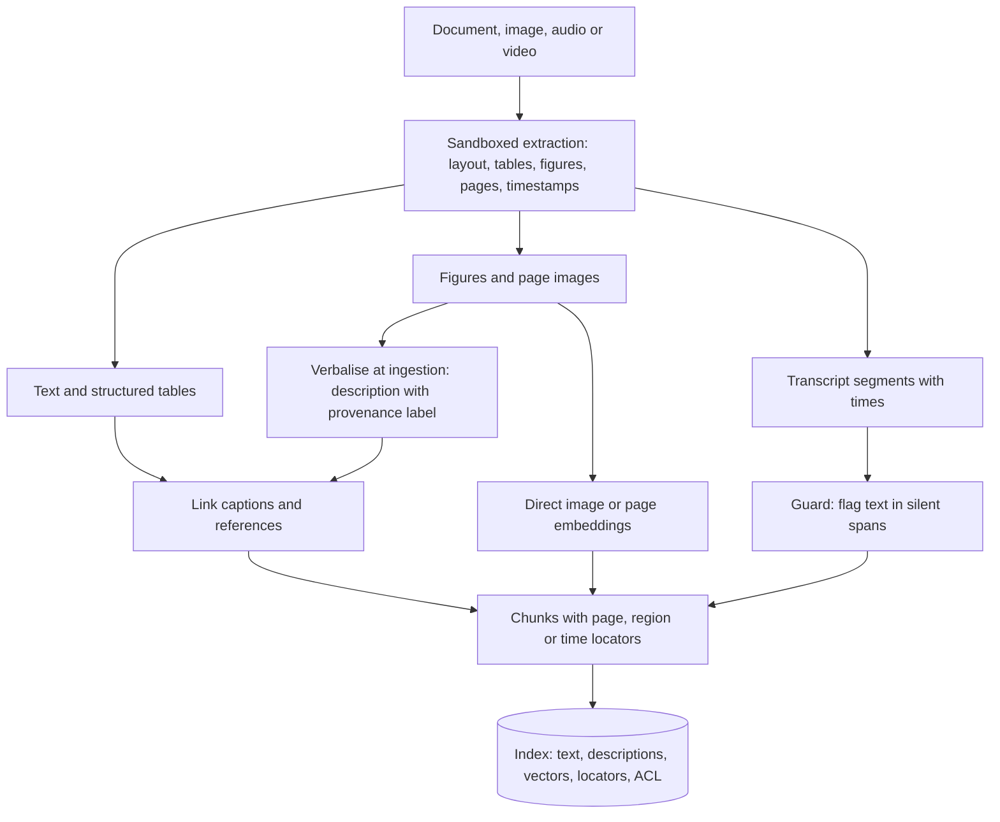
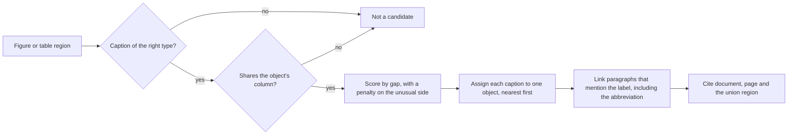

# Chapter 28 — Multimodal RAG

> **Evidence legend.** **[S#]** = supported by a source in References (IDs map to `project-management/RESEARCH-REGISTER.md`; papers were read at abstract level only, so figures quoted are the authors' own abstract claims). **[E]** = engineering recommendation/reasoning. **[A]** = assumption. **[I]** = illustrative. **[X]** = executed in this repository by `docs/exercises/ch28_multimodal.py`. **[V]** = vendor-reported. **[N]** = not researched or not run. Research date: 2026-11-09. **Everything executed here is synthetic or abstract.** The exercise reproduces one vendor's published image-token examples (S198), links captions on 300 generated two-column pages, and guards generated transcripts; prices are abstract units, and no real PDF extractor, vision model, speech model or corpus was run. The reference implementation is **text-only**: its gateway's message content is a plain string (inspected), its PDF extractor yields flat paragraphs per page (OI-053d), it ignores images inside documents, and it has no OCR, audio or video handling.

## 28.1 Learning Objectives

After this chapter you can:

1. Choose among three architectures for non-text content (extract to text, verbalise at ingestion, embed images or pages directly) and say what each costs and what each loses.
2. Extract and keep layout, tables and figures with their captions, and cite a page region or a time range rather than a document.
3. Estimate the token cost of sending images to a vision model, and decide when page images beat extracted text.
4. Treat speech-to-text and image-to-text outputs as fallible and untrusted: detect hallucinated speech, label derived text, and defend against instructions embedded in media.
5. Retrieve across modalities (hybrid text and vector search, image queries, late-interaction page retrieval) and know which approach supports which query type.
6. Evaluate multimodal retrieval and generation with modality-specific golden cases.
7. Secure the pipeline: hostile media files, PII in images, access control and deletion of derived artefacts.

## 28.2 Problem Statement

Enterprise knowledge is not only prose. Processes live in diagrams, numbers in tables and charts, decisions in meeting recordings, procedures in screenshots, and the authoritative description of an approval flow may exist *only* as an image inside a PDF, which is the example Microsoft's own multimodal-search documentation uses [S193]. A text-only RAG system cannot answer those questions at all, or answers from whatever fragments the extractor happened to flatten.

Three things make the multimodal case harder than the text case: **extraction is lossy** (a table flattened into a paragraph loses its meaning; a figure's information is not in its caption), **models that read media are fallible in new ways** (transcription can invent speech; vision models misread small or rotated text), and **media is a new attack surface** (instructions in an image, malicious files, personal data in photographs). The engineering problem is to keep the information, keep its location so it can be cited, and keep the derived text honest about where it came from.

## 28.3 Why It Matters in Production

- **Page images are expensive context.** One vendor documents that an image costs `⌈width/28⌉ × ⌈height/28⌉` visual tokens, with a standard-tier cap of 1,568 tokens and a long edge of 1,568 px, and a high-resolution tier capped at 4,784 tokens [S198] (model-specific and version-sensitive). **Executed [X]:** the exercise reproduces the vendor's published examples exactly for the sizes that need no resizing (for example 1,000×1,000 px costs 1,296 tokens), and a 1,241×1,754 px page image (about 150 dpi A4) comes to **1,551 visual tokens**. For four retrieved pages with 700 tokens of extracted text each, the answer step sees **2,860 input tokens as text, 6,264 as page images (2.2 times as much), and 3,220 as text plus one 120-token description for each of three figures**. Verbalising 30 figures at ingestion costs about 29,880 tokens once (image, prompt and generated description) under my assumptions.
- **Text extraction can miss what matters.** The ColPali authors argue that pipelines which index extracted text use "lengthy and brittle processes" and struggle with layout, tables and figures, and propose embedding page images directly with a vision-language model and late interaction; they report it largely outperforms modern document-retrieval pipelines while being drastically simpler and faster (authors' abstract claims, no figures on the page I read) [S192].
- **Speech-to-text can invent speech.** An audit of Whisper found that roughly 1% of audio transcriptions contained entire hallucinated phrases or sentences, about 38% of those hallucinations included explicit harms, and they disproportionately affected speakers with longer non-vocal stretches (an aphasia group compared with controls) [S196]. **Executed [X], synthetic:** text emitted in near-silent spans was flagged 100% of the time with 0.00% of real segments wrongly flagged; the generator is mine and real hallucinations need not be silent.
- **Media carries instructions.** Researchers showed that an adversarial perturbation corresponding to a prompt, blended into an image or an audio recording, can make an unmodified multimodal model output attacker-chosen text or follow attacker instructions later in the dialogue (proofs of concept on LLaVa and PandaGPT; the abstract discusses no defences) [S197].
- **Layout linking is a measurable engineering task.** **Executed [X], synthetic:** a type-, column- and direction-aware linker attached figures and tables to their captions on 99.0% of 300 generated two-column pages; a nearest-block baseline managed 57.7%.

## 28.4 Core Concepts

### 28.4.1 Modalities and questions

| Content | Typical questions | What retrieval needs |
|---|---|---|
| Scanned or digital documents | "What does clause 4 say?" | OCR or extraction, reading order, page numbers |
| Tables | "What was Q3 revenue for region X?" | Structured cells, headers, units, caption, cross-page continuity |
| Charts and diagrams | "What is the approval process?" | A description or direct visual embedding; the underlying data if available |
| Screenshots and photos | "Which screen shows the error?" | Verbalisation or visual embeddings; OCR of embedded text |
| Audio and video | "What did we decide about the migration?" | Transcript with timestamps, speaker labels, sometimes frames |

### 28.4.2 Three architectures

<!-- figure:28-multimodal-ingestion -->

*Figure 28.1: Three architectures. Original diagram; source below.*

Mermaid source

<!-- /figure -->

*Original diagram by the handbook author; source `docs/assets/diagrams/28-multimodal-ingestion.mmd`.*

1. **Extract to text.** Run layout analysis and OCR; keep text, tables and figure regions with their captions. Azure Document Intelligence's layout model returns text, tables, selection marks, paragraphs with roles, figures with bounding regions and related text spans, and can emit Markdown; it processes PDFs and TIFFs up to 2,000 pages and files up to 500 MB on the paid tier (first two pages and 4 MB on the free tier), needs post-processing for tables that span pages, and in the 2024-11-30 version its figure and table regions exclude captions and footnotes [S194]. Docling is an MIT-licensed open-source PDF converter using DocLayNet for layout and TableFormer for table structure, said to run on commodity hardware (no figures on the abstract page) [S199]. This path is cheap at query time and loses what the extractor loses.
2. **Verbalise at ingestion.** Use a vision-language model to write a description of each figure, store and embed it as text. Azure AI Search's guidance: this costs an LLM call per image and some indexing time, supports hybrid text queries and gives the generator ready captions it can cite, but does not support image-to-vector queries [S193].
3. **Embed directly.** Embed images (or whole pages) with a multimodal embedding model; no language model at indexing time, well suited to "find something that looks like this", but a purely numeric representation does not say *why* two images relate and gives the generator no ready context to cite [S193]. ColPali is the page-level variant: a vision-language model produces multi-vector embeddings of page images, matched by late interaction, evaluated on the ViDoRe page-retrieval benchmark [S192].

**Combine them [E, S193]:** verbalise diagrams and flow charts (explanation-rich), embed screenshots and photographs (similarity-driven), extract text and tables always, and keep everything addressable by locator.

| Approach | Index-time cost | Query-time cost | Citation support | Loses |
|---|---|---|---|---|
| Extract to text | Parsing compute | Low (text tokens) | Page and region from extractor | Visual content not in text |
| Verbalise | One model call per image [S193] | Low | Description plus image location | Whatever the description omits or invents |
| Direct embeddings | Embedding call; no LLM [S193] | Vector search; vision model if images are sent to the generator | Locator only; no explanation [S193] | The reason for similarity; text precision |
| Page-image retrieval (late interaction) | Vision model forward pass per page; multi-vector storage | Late-interaction scoring; page images sent to the generator [S192] | Page | Fine text detail depends on resolution |

**Multi-vector storage is large [I].** Late interaction stores many vectors per page (patches × dimension × bytes). For an illustrative 1,000 patches of 128 dimensions in 16-bit floats, that is about 256 KB per page, against about 6 KB for one 1,536-dimension 32-bit vector; I did not read ColPali's actual configuration, so treat the ratio as an order of magnitude to check against the model you use **[I, N]**.

### 28.4.3 Layout, tables and figures

**Tables are data.** Keep a table as structured cells (header row, units, merged cells resolved) plus its caption and page, not as a paragraph; render to Markdown or JSON for the generator and keep the original region for citation. Cross-page tables must be stitched (the Document Intelligence guidance suggests splitting the PDF and post-processing when labelling [S194]; Azure's Content Understanding skill preserves cross-page tables and semantic units across pages [S193]). For numeric questions, extract values and compute in code, not in the model (Chapter 29) **[E]**.

**Figures need their captions.** Because the extractor's figure region may exclude the caption [S194], a linker must attach the caption and the paragraphs that discuss the figure. **Executed [X]:**

<!-- figure:28-caption-linking -->

*Figure 28.2: Layout, tables and figures. Original diagram; source below.*

Mermaid source

<!-- /figure -->

*Original diagram by the handbook author; source `docs/assets/diagrams/28-caption-linking.mmd`.*

Rules: a figure takes a *Figure* caption and a table a *Table* caption (type match); the caption must overlap the object's horizontal extent (same column in a two-column layout); the usual side is preferred (below for figures, above for tables) and the other side is allowed with a penalty; each caption serves one object; a caption overlapping the object vertically is not its caption; and paragraph references are found with a pattern that includes "Fig. 3" as well as "Figure 3". On 300 generated pages the linker reached **99.0%** against **57.7%** for "nearest caption block"; all paragraph references were found. Each rule corresponds to a mutant the exercise catches (ignoring type, column, direction, one-to-one use, or the abbreviation). **Limits:** real layouts (rotated figures, side captions, multi-panel figures, captions split from labels) are harder than my generator, and the numbers say nothing about a real extractor.

**Citations to regions and times.** A multimodal citation names the document, the page and a bounding region (the union of the cited elements' boxes, validated to lie on the page, executed [X]) or a time range for audio. Azure's pipeline stores extracted images and their locations in the index for exactly this purpose (so the client can show the image snippet beside the answer) [S193].

### 28.4.4 Images at answer time

**Cost.** `visual tokens = ⌈w/28⌉ × ⌈h/28⌉` before the vendor's resize to its tier limits [S198]; the downscale rule lives on a page I did not read, so the exercise's resize is my approximation, checked to within 3% of the vendor's table and exact for the rows that need no resize **[X]**. A page image is therefore cheap only when the extracted text for that page is long: at about 700 text tokens per page, a 1,551-token page image costs more than twice as much, while a dense 2,000-token page costs less as an image **[X, A]**. The high-resolution tier allows up to roughly three times as many visual tokens for the same image, so downsample when the fidelity is not needed [S198].

**Quality and limits.** The same documentation says the model can hallucinate or err on low-quality, rotated or very small images (under 200 pixels), gives only approximate counts and coordinates, is not designed to read complex diagnostic medical scans, and that interpretations should be reviewed for high-stakes uses; lossy compression can make text hard to read [S198]. Practical rules **[E]**: send the *region* that answers the question, not the whole page, at adequate resolution; avoid repeated lossy re-compression; verify numbers read from charts against tabular data where it exists; and never use a vision model as the only source for safety-critical values.

**When to send images to the generator [E].** When the answer is *in* the picture (diagram logic, chart trends, UI state) and a description would lose it; when text extraction is known to fail for the document class; and when the page count is small. Otherwise retrieve text and descriptions.

### 28.4.5 Audio and video

**Transcription.** Whisper was trained on 680,000 hours of multilingual and multitask supervision and the authors report it generalises well, often competitive with prior supervised results zero-shot (abstract claims; no limitations listed there) [S195]. Its hallucinations are documented [S196] (above).

**Guard [X].** Keep, per segment, the start and end time and the audio energy (or a voice-activity signal) over that span; flag any segment whose span is almost silent (here: under 20% of seconds above a threshold) and quarantine it from the index until reviewed. On 40 synthetic ten-minute recordings, every injected hallucination in a silent gap was flagged and no real segment was; **real hallucinations can occur during speech** (substitutions, additions), which this guard does not detect. Also record the model, version, language, and any confidence fields the recogniser provides, and sample transcripts for human review **[E]**.

**Chunking and citation [X].** Chunk by segments, never splitting one, with a duration cap (60 seconds here); the chunks partition the transcript in order; cite the time range (`12s-59s`). Speaker diarisation, noisy-audio robustness, multilingual accuracy and word error rates were not researched or measured **[N]**. For **video**, index a transcript plus keyframes (verbalised or embedded) with timestamps; I did not research video pipelines **[N]**.

### 28.4.6 Retrieval across modalities

- **Hybrid text queries** over text, tables, descriptions and transcripts (full-text plus vector plus reranking, Chapters 9 and 12) handle most questions; filters on content type let a query target "only images" or "only text" [S193].
- **Image queries** ("find me one that looks like this") need a multimodal embedding model with a vectorizer for images; verbalisation alone cannot support them [S193].
- **Page-level visual retrieval** (late interaction) is appropriate when layout carries meaning and extraction is brittle [S192]; evaluate it against a strong text pipeline on your own documents before adopting it, because the benchmark and your corpus differ **[E]**.
- **Fusion.** Retrieve from each representation and fuse (RRF, Chapter 9); keep one locator per hit so the final context cites the original page, region or time **[E]**.

### 28.4.7 Security and privacy

- **Instructions in media.** Text recovered by OCR or a vision model, a description produced by a model, and a transcript are all *untrusted data*; hidden or adversarial content in an image or audio file can steer a model that reads it directly [S197]. Controls: do not feed raw media to a model that can act (Chapter 22's lethal-trifecta rule); **label derived text with its origin and trust level and escape it** so it cannot close its own block **[X]** (in the exercise a hostile description containing a fake closing delimiter stays inside its block; mutants without the label or the escaping are caught); apply the egress controls of Chapter 22 to answers.
- **Hostile files.** Image, PDF, audio and video parsers are large attack surfaces: parse in the sandbox with CPU, memory and size limits, cap dimensions and frame counts, and cap images per request (a vendor limit of 8,000×8,000 px and 600 images per request illustrates why [S198]) **[E]**.
- **Personal data in media.** Faces, ID documents, screenshots with credentials, location metadata. Strip metadata, apply PII detection to derived text, restrict who may see original media, and decide whether to index images that contain people at all; vendor vision policies also restrict what models will do with images of people [S198] **[E]**.
- **Access control and deletion.** Derived artefacts (descriptions, crops, transcripts, embeddings) inherit the source's ACL; deleting the source must delete them (Chapters 23, 24) **[E]**.
- **Cost abuse.** Large images and long recordings are denial-of-wallet vectors: enforce size, count and duration limits before processing (Chapter 22) **[E]**.

### 28.4.8 Evaluation

Add modality slices to the golden set (Chapter 18) **[E]**: questions whose answer is only in a table, a chart, a diagram or a recording; page-level retrieval metrics as in ViDoRe [S192]; extraction fidelity (table cell accuracy, reading order) against hand-labelled pages; description faithfulness (does the description say what is in the image, judged by humans or a validated judge); transcript quality (word error rate against reference transcripts, plus a hallucination audit like [S196]); citation correctness (does the cited region or time contain the evidence); and cost per document. Report each modality separately; a good aggregate can hide a failing modality.

## 28.5 Architecture

The ingestion diagram (28.4.2) and the linking flow (28.4.3) are the architecture. In the reference system **[I]**: a sandboxed extractor with a layout engine emits typed blocks (paragraph, table, figure, caption, transcript segment) with page, region and time locators; a linker attaches captions and references; a verbaliser (through the gateway, which would need image-capable messages) and a multimodal embedder produce text and vectors; chunks carry locators and the source's ACL; retrieval fuses text and visual hits; and the answer step receives text plus, when needed, specific image regions.

## 28.6 Practical Example (Executed [X], synthetic)

`docs/exercises/ch28_multimodal.py` (standard library; deterministic; `--mutants` adds a mutation check) contains the image-token model with the vendor's table, the three strategies' token arithmetic, the caption and reference linker with a naive baseline and region citations, the transcript guard and chunker, and the provenance labeller. **Mutation check: 12/12 injected defects detected** (floor instead of ceiling on patches, a wrong patch size, ignoring caption type, column, direction, one-to-one use or the "Fig." abbreviation, an unchecked citation region, a disabled silence guard, splitting segments, no provenance label, no escaping).

**Findings while building it.**

1. *The vendor's token table reproduced on the first run* for the rows that need no resize, which tells me the formula is stated faithfully; the resized rows depend on a rule I did not read, so I assert them only to within 3%.
2. *A mutant survived once:* ignoring direction passed my unit test because the correct caption won the tie on block order. I reordered the blocks so a direction-blind linker would pick the wrong one.
3. *One assertion of mine was wrong* (it compared caption labels with block indexes); the code was right.
4. *The surprising number* was the 2.2× cost of sending four pages as images compared with their text, which reverses for dense pages; the break-even is a function of text density, so measure it on your documents.
5. *All hallucinations in the generator are silent,* which makes the guard look perfect; that is a property of my generator, and [S196]'s audit does not say real hallucinations are silent.

## 28.7 Implementation (reference implementation, inspected 2026-11-09)

| Capability | State |
|---|---|
| Sandboxed extraction of text, Markdown, HTML, DOCX and PDF with page numbers | **Built and tested** (ADR-016) |
| Layout, table structure, figure and caption extraction; OCR for scans | **Not built**; text-less PDFs are rejected as `no_text`; images in documents are ignored |
| Image-capable model messages in the gateway | **Not built**; message content is a plain string |
| Multimodal embeddings; image or page retrieval | **Not built** |
| Audio and video ingestion; transcript guard | **Not built** |
| Locator-bearing citations (region, time) | **Not built**; chunks carry page start and end for PDFs only |
| Provenance labels for derived text; egress controls | **Exercise only** (Chapters 22, 28) |

Gaps are tracked in OI-070.

## 28.8 Trade-offs

| Decision | Option | Gain | Cost / risk |
|---|---|---|---|
| Figures | Verbalise | Text-searchable, citable descriptions [S193] | Model call per image; descriptions can omit or invent |
| | Embed directly | No LLM at indexing; visual similarity [S193] | No explanation; harder to cite |
| Pages | Extracted text | Cheap context | Loses visual structure |
| | Page images to the generator | Preserves layout | 2.2× the tokens in the example [X]; resolution limits [S198] |
| Retrieval | Late-interaction page embeddings | Handles brittle extraction [S192] | Large multi-vector storage [I]; vision model at indexing |
| Audio | Transcribe everything | Coverage | Hallucinated speech [S196] |
| | Guarded and sampled | Safer | Review cost |
| Tier | High-resolution images | Fine detail | Up to about 3× the visual tokens [S198] |

## 28.9 Failure Modes

| Failure | Cause | Detection | Mitigation |
|---|---|---|---|
| Table flattened into nonsense | Layout lost in extraction | Table-cell audits | Structured tables; layout engine [S194] |
| Figure answered from its caption only | Caption and image not linked or described | Figure-slice evaluation | Linker [X]; verbalisation |
| Wrong caption attached | Layout heuristics fail on columns or direction [X] | Linking audits | Type, column, direction, one-to-one rules |
| Hallucinated transcript text | Recogniser invents speech [S196] | Silence guard [X]; sampling | Quarantine; human review |
| Vision misreads small or rotated text | Resolution, compression [S198] | Spot checks | Region crops; adequate resolution; verify |
| Instructions hidden in an image or audio | Adversarial media [S197] | Adversarial cases | Provenance labels [X]; no acting on raw media |
| Citation points to the wrong place | Locators lost | Citation tests | Region and time locators validated [X] |
| PII in media indexed | No detection | PII scans | Metadata stripping; detection; access control |
| Cost spike | Many large images or long audio | Cost per document | Size, count, duration limits |
| Stale derived artefacts after deletion | No cascade | Erasure tests (Chapter 23) | Delete descriptions, crops, transcripts, vectors |

## 28.10 Security Considerations

See 28.4.7 and Chapter 22. In addition **[E]**: media files are untrusted binaries (sandbox, limits, no execution); vision and speech providers receive customer media, so the gateway's data-sensitivity policy must cover media (restricted media to local models); transcripts of meetings are sensitive records with retention and consent implications that I did not research **[N]**; and evaluation sets containing real media need the same access control as the sources.

## 28.11 Performance Considerations

Vision-model calls dominate ingestion latency and cost for image-heavy corpora; batch and rate-limit them (Chapters 20, 21), and cap concurrent calls per provider. Query-time cost depends on whether images go to the generator; prefer retrieving text and descriptions and attach image regions only when needed [X]. Late-interaction scoring and multi-vector indexes have their own latency and memory profiles that I did not measure **[N]**; transcription runs offline.

## 28.12 Cost Considerations

Use the token arithmetic [X, S198]: image tokens at ingestion (verbalisation) and at query time (images sent to the generator), plus embedding and storage. Under my abstract assumptions verbalising 30 figures cost about 29,880 tokens once, and four page images cost 6,264 input tokens per query against 2,860 for text. Transcription cost and licensing, OCR compute and multimodal embedding costs were not researched **[A]**.

## 28.13 Production Recommendations

1. Extract text, tables and figures with layout and keep locators (page, region, time) on every chunk.
2. Treat tables as structured data; compute numbers in code.
3. Link figures and tables to their captions and referencing paragraphs; test the linker on your documents.
4. Choose verbalisation, direct embeddings or page-level retrieval per content class; combine where needed.
5. Send image regions at adequate resolution, not whole pages, and only when the answer is in the picture; budget visual tokens.
6. Guard transcripts (silence checks, sampling, human review) and store the recogniser version and language.
7. Label all derived text as untrusted with its origin; never let a model that can act read raw media.
8. Sandbox and limit media parsing; cap sizes, counts and durations; strip metadata; detect PII.
9. Inherit ACLs and cascade deletion to descriptions, crops, transcripts and vectors.
10. Evaluate each modality separately with expert-labelled golden cases and cost per document.

## 28.14 Architecture Decision Guidance

An ADR for multimodal ingestion (extractor and layout engine, sandboxing, per-class representation strategy, locator schema, gateway image support and sensitivity policy, transcript guard, retention) should be written when a multimodal use case is scheduled, with a measured comparison of extract-only against verbalisation and page-level retrieval on the real documents (Chapter 18 gate). Reconsider when vendor token rules or limits change [S198], when preview features reach general availability [S193, S194], or when evaluation shows a modality failing.

## 28.15 Interview Questions

1. **What are the three ways to make images searchable?** Extract text, verbalise with a vision model at ingestion, or embed images or pages directly; combine them by content type [S193, S192].
2. **When is verbalisation better than direct embeddings?** For diagrams and flow charts where explanation and citable text matter; embeddings suit visual similarity; verbalisation cannot answer image queries [S193].
3. **How does ColPali differ from a text pipeline?** It embeds page images into multi-vector representations matched by late interaction, avoiding extraction; the authors report advantages on ViDoRe [S192].
4. **How do you estimate the cost of sending an image to a vision model?** Visual tokens from the vendor's rule (here ⌈w/28⌉×⌈h/28⌉ with tier caps) times the price; a page image is dearer than average text and cheaper than dense text [S198, X].
5. **Why link captions to figures, and how?** Extractors may exclude captions from figure regions; link by type, column, direction and one-to-one assignment, and attach referencing paragraphs [S194, X].
6. **What are the risks of speech-to-text?** Hallucinated phrases (about 1% of transcriptions in one audit, many harmful), bias against some speakers; guard and sample [S196, X].
7. **How can media attack a RAG system?** Adversarial perturbations or hidden text steer models that read the media; treat derived text as untrusted and label it [S197, X].
8. **How do you cite a diagram or a recording?** Document, page and bounding region, or a timestamp range, validated against the source [X, S193].
9. **What does a vision model get wrong?** Small, rotated or low-quality images, counting, precise localisation, complex medical scans; verify for high-stakes use [S198].
10. **How do you evaluate multimodal RAG?** Modality slices: table, chart, diagram and recording questions; extraction fidelity; description faithfulness; transcript error and hallucination audits; citation correctness [E].
11. **What is lost when a table becomes a paragraph?** Headers, units, cell relationships and numeric precision; keep structure and compute in code [E].
12. **What privacy issues are specific to media?** Faces, ID documents, screenshots with credentials, location metadata, meeting consent [S198, E].

## 28.16 Knowledge Checkpoint / Exercises

1. Run `python -I docs/exercises/ch28_multimodal.py --mutants`. Add a three-column layout generator and report how caption accuracy changes; fix only with a stated rule.
2. Measure the text-token count of ten real pages from your documents and the vendor-rule image tokens at your rendering resolution; find the break-even text density.
3. Add multi-panel figures (one caption, several sub-figure regions) to the generator and extend the linker.
4. Extend the transcript guard with a low-confidence signal and a "repeated phrase" detector; test on synthetic non-silent hallucinations and report which are missed.
5. Evaluate a layout extractor you can run (Docling [S199] or another) on 20 real pages: table cell accuracy and reading order against hand labels.
6. Implement image-capable messages in a gateway adapter behind the sensitivity policy, with a size and count cap, and test that restricted images are never sent to external providers.
7. Draft the multimodal ingestion ADR for one document class, with the evaluation plan.

## 28.17 Summary

Multimodal RAG keeps information that text extraction loses and adds new failure modes. Choose extraction, verbalisation or direct and page-level embeddings by content class; keep tables structured and figures linked to captions and referencing text; cite regions and times; budget visual tokens and send image regions only when needed; guard transcripts against hallucinated speech; treat all derived text as untrusted and labelled; sandbox media parsing; and evaluate every modality separately. The executed exercise reproduced one vendor's image-token examples, showed that four page images cost 2.2 times the extracted text in my example, linked captions at 99.0% against 57.7% for a naive baseline on synthetic pages, and detected 12/12 injected defects; all of it synthetic. The reference implementation is text-only and has none of the multimodal machinery yet (OI-070).

## References

- [S192] Faysse et al., *ColPali: Efficient Document Retrieval with Vision Language Models*, arXiv:2407.01449 (ICLR 2025; abstract). https://arxiv.org/abs/2407.01449
- [S193] Microsoft Learn, *Multimodal search concepts and guidance*, Azure AI Search (2026-04-20; preview features). https://learn.microsoft.com/en-us/azure/search/multimodal-search-overview
- [S194] Microsoft Learn, *Document layout analysis*, Document Intelligence (2026-05-01). https://learn.microsoft.com/en-us/azure/ai-services/document-intelligence/prebuilt/layout
- [S195] Radford et al., *Robust Speech Recognition via Large-Scale Weak Supervision*, arXiv:2212.04356 (abstract). https://arxiv.org/abs/2212.04356
- [S196] Koenecke et al., *Careless Whisper: Speech-to-Text Hallucination Harms*, arXiv:2402.08021 (abstract). https://arxiv.org/abs/2402.08021
- [S197] Bagdasaryan et al., *Abusing Images and Sounds for Indirect Instruction Injection in Multi-Modal LLMs*, arXiv:2307.10490 (abstract). https://arxiv.org/abs/2307.10490
- [S198] Anthropic, *Vision* (Claude API docs; model-specific and version-sensitive). https://platform.claude.com/docs/en/build-with-claude/vision
- [S199] Auer et al., *Docling Technical Report*, arXiv:2408.09869 (abstract). https://arxiv.org/abs/2408.09869
- ADR-012, ADR-016; OI-053, OI-070 (this repository). Chapters 9, 12, 16, 18, 20, 22, 23, 24, 29.
