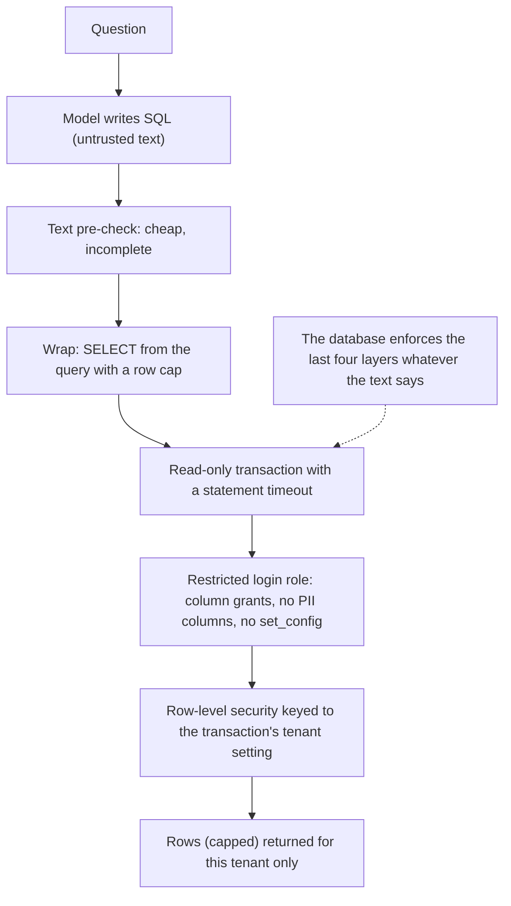

# Chapter 29 — Business Intelligence and Analytics

> **Evidence legend.** **[S#]** = supported by a source in References (IDs map to `project-management/RESEARCH-REGISTER.md`; papers were read at abstract level only, so figures quoted are the authors' own abstract claims). **[E]** = engineering recommendation/reasoning. **[A]** = assumption. **[I]** = illustrative. **[X]** = executed in this repository by `docs/exercises/ch29_sql_guard.py` **against real PostgreSQL 16 (pgvector image) in the compose container**, with tiny constructed data. **[V]** = vendor-reported. **[N]** = not researched or not run. Research date: 2026-11-09. **No language model was used:** the "model-written" SQL is a fixed corpus of attack statements and fixed gold and candidate queries. **The exercise's mutation check was NOT completed:** the host's `C:` drive filled up (0 GB free) while it ran and the database container began returning I/O errors, so none of the seven mutants was verified and I cannot say which controls' tests would fail if the control were removed. The first complete run of the exercise (before the failure) passed; the mutation check must be re-run once disk space is restored (OI-071). The reference implementation has **no BI or text-to-SQL feature**.

## 29.1 Learning Objectives

After this chapter you can:

1. Describe a business-intelligence assistant architecture: question, schema and metric retrieval, SQL generation, guarded execution, and an answer that shows its SQL and data.
2. Prefer governed metric definitions (a semantic layer) over free-form SQL where one exists.
3. Execute model-written SQL under controls that hold even when the SQL text is hostile: a least-privilege role, column grants, row-level security, a read-only transaction, a timeout and a row cap.
4. Explain why a text filter on SQL is not a security boundary, and demonstrate a way a plain SELECT can defeat a row-level-security design.
5. Keep numbers honest: compute in the database, never in the model, and show the query, filters and freshness.
6. Evaluate text-to-SQL by execution on more than one dataset, and explain why string matching and single-database execution accuracy mislead.
7. Apply tenant isolation, PII protection and auditing to analytical queries.
8. State what published text-to-SQL benchmarks do and do not tell you.

## 29.2 Problem Statement

Business users want answers from structured data ("revenue by region last quarter, excluding refunds") without writing SQL. A language model can draft the SQL, but three problems separate a demo from a system. **Correctness:** a query can run, return plausible numbers and be wrong (the wrong join, the wrong aggregate, a missing filter), and wrong numbers drive decisions. **Safety:** the SQL is written by an untrusted component that reads untrusted text (Chapter 22), so it must not be able to modify data, read other tenants' data, read columns the user may not see, or consume the warehouse. **Meaning:** "revenue" has a business definition, and a model guessing it from column names produces numbers that disagree with the finance dashboard.

The engineering problem is to constrain *what SQL can do* with the database's own mechanisms (not with prompts or text filters), to ground questions in governed definitions where possible, to make results verifiable, and to measure correctness the way databases allow: by execution.

## 29.3 Why It Matters in Production

- **Text-to-SQL is far from solved.** Spider (10,181 questions, 5,693 SQL queries, 200 databases, 138 domains) reported a best exact-match accuracy of 12.4% when it appeared in 2018, with different databases in train and test [S200]; BIRD (12,751 pairs over 95 databases totalling 33.4 GB in 37 domains) reported 40.08% execution accuracy for the best model (ChatGPT) against 92.96% for humans in 2023, emphasising dirty values, external knowledge and efficiency [S201]. **Both figures are dated** and models have improved since; I did not run either benchmark **[N]**. The survey of LLM-based text-to-SQL names three core challenges: understanding the question, understanding the schema and generating the SQL [S202].
- **A text filter on SQL does not secure anything.** **Executed [X], real PostgreSQL:** a pre-check that requires `SELECT` or `WITH`, a single statement, no comments and no write keywords blocked 11 of 21 attack statements and **passed 10**, among them `SELECT pg_sleep(5)`, a query that reads another tenant's rows, a query that reads a PII column, a query that tries to terminate other sessions, and a plain `SELECT` that changes the tenant setting (below). All 21 were harmless only because the *database* refused them or bounded them.
- **A plain SELECT can defeat row-level security.** **Executed [X]:** with row-level security keyed to a per-transaction setting (`app.tenant_id`), a restricted role that kept PostgreSQL's default privileges could run `SELECT … FROM (SELECT set_config('app.tenant_id', '<other tenant>', true)) s, LATERAL (SELECT count(*) FROM sales.orders) o` and receive the *other tenant's* row count (5 rows against its own 3). Revoking `EXECUTE` on `set_config` from `PUBLIC` made the same statement fail. **This project's own design has the same property** (29.4.5, OI-069).
- **Execution accuracy on one database accepts wrong SQL.** **Executed [X]:** on seven gold/candidate pairs, judging by string match agreed with the truth only 71% of the time (it rejects correct rewrites), judging by execution on one tenant's data agreed 57% of the time (it accepts a wrong aggregate, a fan-out join and a missing filter because that tenant's data is degenerate), and judging by execution on two tenants' data agreed 100%.

## 29.4 Core Concepts

### 29.4.1 Architecture

<!-- figure:29-text-to-sql-flow -->

*Figure 29.1: Architecture. Original diagram; source below.*

Mermaid source

<!-- /figure -->

*Original diagram by the handbook author; source `docs/assets/diagrams/29-text-to-sql-flow.mmd`.*

### 29.4.2 Governed metrics first

A semantic layer defines each business metric once and lets every consumer query it. The dbt Semantic Layer, powered by MetricFlow, moves metric logic out of individual BI tools into the modelling project, applies joins automatically, exposes metrics through APIs, integrations and an MCP server so that AI tools use governed metrics rather than guessing at raw tables, and includes access permissions, exports and caching; the page states that it requires a paid dbt tier [S205] (a vendor product; other semantic layers exist and I did not research them **[N]**). **Design rule [E]:** where a governed metric exists, the assistant composes a *metric query* (metric, dimensions, filters, time grain) rather than free SQL, which narrows what the model can get wrong and makes numbers agree with dashboards. Free SQL over raw tables is the fallback, with stricter guards and a visible "this is not a governed metric" label.

### 29.4.3 Schema and context retrieval

Large schemas do not fit in a prompt. Treat **schema documentation as a retrieval corpus** (Chapters 4, 6): one chunk per table or view with its description, grain ("one row per order line"), primary and foreign keys, columns with types and meanings, units, common filters, example values and known pitfalls (soft deletes, test accounts), plus the business glossary and metric definitions **[E]**. Retrieve by the question, include join paths explicitly, and add a few verified example queries (a small golden set that doubles as few-shot material). Ambiguity is common ("last quarter", "active customer"): ask a clarifying question or state the assumption in the answer. **Permission-aware schema:** only describe tables and columns the user may query; do not reveal that a restricted table exists (Chapter 24's existence side channels).

### 29.4.4 Generating SQL

Constrain generation to a single read-only `SELECT` or `WITH` in the target dialect; give the model the schema context and the metric definitions; allow a bounded repair loop that feeds back database error messages (not data) a limited number of times; log each attempt with identifiers; and prefer to *abstain or ask* when the question maps to no metric or table **[E]**. The model's SQL is **untrusted text** whatever the prompt says: the next section is what makes it safe.

### 29.4.5 Executing untrusted SQL safely (executed on real PostgreSQL)

<!-- figure:29-sql-guard-layers -->

*Figure 29.2: Executing untrusted SQL safely (executed on real PostgreSQL). Original diagram; source below.*

Mermaid source

<!-- /figure -->

*Original diagram by the handbook author; source `docs/assets/diagrams/29-sql-guard-layers.mmd`.*

**Why not parameterise?** The OWASP SQL-injection guidance's primary defences are parameterised queries for *values* and allow-list mapping for table and column names, with manual escaping strongly discouraged, and least privilege and separate per-application accounts as defence in depth [S204]. A model writes the *structure* of the query, which cannot be parameterised away, so for model-written SQL the database-side controls become the primary defence, not the secondary one **[E, inference from S204]**. (Metric queries are an exception: the structure is fixed by code and only metric names, dimensions and filters are chosen from allow-lists.)

**The layers, each executed [X]** (scratch database with `customers`, `orders` and `order_items` for two tenants, a login role, and 21 attack statements):

1. **A restricted login role.** `NOSUPERUSER NOBYPASSRLS`, `SELECT` on `orders` and `order_items`, and `SELECT` on only three *columns* of `customers` (the `email` column is not granted). Consequences observed: `SELECT email FROM sales.customers` was refused, and `SELECT * FROM sales.customers` was also refused, because `*` includes an ungranted column; users must list columns. Statements reading `pg_shadow` or `pg_read_file('/etc/passwd')`, or calling `pg_terminate_backend` on other sessions, returned no privileged result (the harness checked the returned rows and the database state, and did not record which specific error each produced).
2. **Forced row-level security** keyed to `current_setting('app.tenant_id', true)`, with a policy for the restricted role. The same `SELECT count(*) FROM sales.orders` returned 3 rows for tenant A and 5 for tenant B; for an unknown tenant, 0; with *no* tenant setting, 0 (fail closed). A query that named the other tenant's id in a predicate returned no rows.
3. **A read-only transaction** (`BEGIN READ ONLY`). PostgreSQL's documentation lists what it disallows: `INSERT`, `UPDATE`, `DELETE`, `MERGE`, `COPY FROM`, all `CREATE`, `ALTER` and `DROP`, `GRANT`, `REVOKE`, `TRUNCATE` and the like; it also says "this is a high-level notion of read-only that does not prevent all writes to disk" and that writes to temporary tables are not blocked [S203]. So read-only is a layer, not the boundary: **privileges are the boundary** (the role had no write privileges at all).
4. **A statement timeout** (1 second here) and **a row cap** (the query is wrapped as `SELECT * FROM (<sql>) q LIMIT 1001`). `pg_sleep(5)`, a billion-row `generate_series` and a cartesian-product bomb were all cancelled by the timeout; an unbounded `SELECT g FROM generate_series(1, 5000)` returned exactly the cap and was flagged truncated.
5. **No way to change the tenant setting from inside a query.** Without this layer the attack below worked.

**The attack, measured [X].** The row policy reads `app.tenant_id`, a custom setting that *any* role may set for itself, and the built-in `set_config(name, value, is_local)` is executable by `PUBLIC` by default. The statement `SELECT o.n FROM (SELECT set_config('app.tenant_id','<tenant B>',true)) s, LATERAL (SELECT count(*) AS n FROM sales.orders) o` evaluates the `LATERAL` subquery after the `set_config` call, so the row policy sees tenant B. In the unprotected database it returned 5 (tenant B's count) for a session scoped to tenant A (3 rows). After `REVOKE EXECUTE ON FUNCTION pg_catalog.set_config(text, text, boolean) FROM PUBLIC` the same statement failed with a privilege error. The executor itself sets the tenant with the `SET LOCAL` *command* (not a function), which needs no privilege on `set_config`. A text pre-check could not have caught this attack: it is a syntactically ordinary `SELECT`.

**Finding about this project's design (verified on the real migrated schema [X], one-off check).** The reference implementation's isolation uses the same mechanism: its application role sets `app.tenant_id`, `app.user_id` and `app.groups` per transaction with `set_config`, and row-level security policies read them (ADR-013). I ran the same trick as the application role against the real schema with two tenants (1 and 3 documents): scoped to the first tenant, a single `SELECT` that called `set_config` to the second tenant's id then counted `rag.documents` and saw **3**, the other tenant's rows. **This is not exploitable by current code** (all SQL in the repository is parameterised and no model-written or user-written SQL exists), but it means that **any SQL injection in the application role, or any future feature that executes model-written SQL as that role, defeats tenant isolation entirely**, because the application role must be able to call `set_config`. Consequences **[E]**: (1) never run untrusted SQL as the application role; run it as a separate role with no `EXECUTE` on `set_config`, ideally on a separate database or read replica; (2) keep all application SQL parameterised and review any dynamic SQL; (3) consider hardening the identity mechanism itself (for example identity set only through a `SECURITY DEFINER` function that verifies a signed token, or per-tenant connection roles), recorded as a design question for ADR-013 (OI-069); (4) Chapter 22's statement that isolation is "enforced in the database" should be read as *enforced against filter bugs, not against SQL injection in the application role*.

**The text pre-check [X].** Useful as a cheap early filter and for good error messages: it rejected inserts, updates, deletes, drops, grants and `DO` blocks, stacked statements and comments. It cannot see dangerous *SELECTs*. Treat it as hygiene.

**Other controls [E].** Run analytical queries on a separate database, schema or read replica so heavy queries cannot starve transactional work; set `work_mem` and concurrency limits for the analytics role; use `EXPLAIN` cost estimates to reject obviously enormous plans before running (not executed here **[N]**); pool connections per role, never reuse a connection that carries session-level settings; and apply the quota and rate-limit controls of Chapter 22 to the BI endpoint.

### 29.4.6 Numbers and truth

Language models are unreliable at arithmetic and aggregation; therefore **every number in an answer comes from query results**, formatted by code **[E]**. Show the SQL (or metric query), the filters and time range, the time the data was last refreshed, the row count (and whether the result was truncated by the row cap), units and rounding, and how nulls were treated. Distinguish a governed metric from an ad-hoc computation. Do not let the model state causal conclusions the data cannot support; let it describe what the table shows. Reconcile with existing dashboards when a governed metric exists, and surface disagreements rather than hiding them. For charts, generate the chart specification deterministically from the result table, not from the model's prose.

### 29.4.7 Evaluating text-to-SQL

**Execution accuracy, done properly [X].** Compare the *results* of gold and candidate SQL, not their text. Compare as multisets (a set comparison forgets duplicates, so a fan-out join can look correct; the harness's mutant that uses sets is the kind of defect a unit test should catch), order-sensitively only when the gold query orders, with a tolerance for numeric rounding. Run both on **more than one dataset**: the exercise's first tenant is deliberately degenerate (one customer per region, one order per customer, one item per order, all paid), so a wrong `AVG` instead of `SUM`, a fan-out join and a missing `status = 'paid'` filter all return the same rows as the right SQL there and different rows on the second tenant.

| Case | String match | Execution, tenant A only | Execution, A and B |
|---|---|---|---|
| Equivalent rewrite (CTE for a join) | wrong (rejects) | right | right |
| Harmless filter rewrite (`= 'paid'` vs `IN ('paid')`) | wrong (rejects) | right | right |
| Wrong aggregate | right | **wrong (accepts)** | right |
| Fan-out join | right | **wrong (accepts)** | right |
| Missing filter | right | **wrong (accepts)** | right |
| Hallucinated column | right | right | right |
| Ordering differs under `ORDER BY … LIMIT` | right | right | right |
| **Agreement with the truth** | **71%** | **57%** | **100%** |

("Right" means the metric's verdict agrees with whether the candidate is truly correct.) This is the "multiple test databases" idea in miniature; build such datasets deliberately, with duplicates, nulls, ties, multiple periods and rows that distinguish the common wrong queries **[E]**. Add **semantic review** by people for the questions where several results are defensible (ambiguity), measure **valid-SQL rate**, latency and cost per question, and slice by metric, table and question type. BIRD's emphasis on dirty values, external knowledge and efficiency [S201] is a reminder that real warehouses are harder than clean benchmarks; build your golden set from real questions **[E]**.

### 29.4.8 Tenants, permissions, privacy and audit

Row-level security with a per-tenant (and optionally per-user) predicate, column grants for sensitive fields, and views that expose only approved columns are the enforcement mechanisms; the executed layers show them working for a restricted role **[X]** and the caveat above shows how the identity mechanism must be protected. For PII: grant no access to identifying columns for the assistant's role, or expose masked or aggregated views; apply small-group suppression for aggregates that could identify individuals (not researched **[N]**). **Audit:** log who asked what, the generated SQL's hash and the tables touched, the row count and duration, with the SQL text itself stored in an access-controlled audit store because literals in it can be sensitive (Chapter 23's content-free audit principle). Alert on blocked statements and privilege errors: they indicate either a model failure or an attack **[E]**.

### 29.4.9 Tabular data without a warehouse

Small tables (a spreadsheet or CSV) can be put in the prompt or loaded into a temporary database and queried with the same guarded path; large or numerous spreadsheets need schema inference and metadata like any other source. Avoid embedding rows as text and asking the model to aggregate them **[E]**. Semi-structured data (JSON) is queried with the database's JSON functions under the same controls.

## 29.5 Architecture

The text-to-SQL flow (29.4.1) and the guard layers (29.4.5) are the architecture. Operationally **[E, I]**: a metadata service holds schema documentation and metric definitions as a retrieval corpus; a generator (through the gateway, with the sensitivity policy) produces a metric query or SQL; a validator applies the pre-check and routes metric queries to the semantic layer; an executor runs the statement as a dedicated restricted role on a separate analytics database or replica, in a read-only transaction with timeout and row cap, setting identity with `SET LOCAL`; a formatter turns results into the answer; and the audit and evaluation pipelines consume the logs.

## 29.6 Practical Example (Executed [X], real PostgreSQL)

`docs/exercises/ch29_sql_guard.py` (needs psycopg, the compose database and `RAG_TEST_ADMIN_URL`; creates and drops a scratch database and role; `--mutants` rebuilds the database with each control removed) builds the schema and two tenants, the restricted role and the controls, the 21-statement attack corpus (DML and DDL also run without the wrapper), judges each attack by comparing the **database state** before and after (orders by tenant, table list, customer count) and by inspecting the rows returned (another tenant's markers, email addresses, over-budget runtime), demonstrates the tenant-setting attack with and without the revoke, and runs the seven-case accuracy harness. First complete run: **no harm found in any attack with all controls on; the tenant-setting attack succeeded without the revoke and failed with it; accuracy harness 71% / 57% / 100%.** The whole run took about 9 seconds.

**The mutation check was not completed.** The seven mutants (no read-only transaction, no timeout, no row cap, the `email` column granted, no row-level security, no `set_config` revoke, set-based result comparison) each require rebuilding the database. During that run the host's `C:` drive reached 0 GB free, the PostgreSQL container started failing with "could not open file global/pg_filenode.map: I/O error", and the run aborted before any mutant was reported. I therefore do **not** know whether the attack corpus detects the removal of each individual control; the one control with direct evidence is `set_config` (the demonstration above is exactly its mutant). I did not delete anything to free space; the scratch database and role from the aborted run remain in the container to be dropped (OI-071).

**Findings while building it (all real).**

1. *The single most important result was unplanned:* while designing the attack corpus I tried changing the tenant setting from inside a query, expecting the row policy to hold, and it did not; that led to the check on the reference implementation's own role.
2. *`SELECT *` failing is a feature* of column-level grants and a usability cost; assistants must list columns.
3. *My accuracy fixtures had to be engineered to expose the problem:* the degenerate tenant is my construction; real data may or may not distinguish wrong queries, which is why the lesson is to build distinguishing datasets rather than trust one.
4. *The environment failed under the test,* and the honest consequence is an unfinished mutation check, recorded as such.

## 29.7 Implementation (reference implementation, inspected 2026-11-09)

| Capability | State |
|---|---|
| PostgreSQL with forced row-level security and fail-closed identity; separate login roles | **Built and tested** (ADR-013) |
| An application role that can change its own tenant identity from SQL (`set_config`) | **Present by design** (finding, OI-069); safe only while all SQL is application-written and parameterised |
| Analytics role without `set_config`; analytics database or replica; column-grant views | **Not built** |
| Schema and metric documentation corpus; text-to-SQL generation; metric queries; semantic layer | **Not built** |
| SQL guard (pre-check, wrapper, read-only, timeout, row cap) | **Exercise only** |
| Execution-accuracy harness; golden questions | **Exercise only**; component 17 |
| Audit of generated SQL | **Not built** |

Gaps are tracked in OI-069 to OI-071.

## 29.8 Trade-offs

| Decision | Option | Gain | Cost / risk |
|---|---|---|---|
| Query form | Governed metric queries | Consistent numbers; small attack surface [S205] | Needs a semantic layer; limited flexibility |
| | Free SQL | Flexible | Wrong or unsafe SQL; needs strict guards |
| Safety | Database privileges and RLS | Hold regardless of SQL text [X] | Schema work; `SELECT *` fails |
| | Text filter only | Cheap | Passed 10 of 21 attacks [X] |
| Tenant identity | Transaction setting set by the app role | Simple, per-request | Changeable by SQL run as that role [X] |
| | Separate analytics role without `set_config` | Closes the hole [X] | Another role and pool |
| Evaluation | Single dataset execution | Cheap | Accepts wrong SQL [X] |
| | Multiple distinguishing datasets | Catches wrong SQL [X] | Dataset construction effort |
| Timeout | Short | Protects the warehouse | Cancels legitimate heavy queries |

## 29.9 Failure Modes

| Failure | Cause | Detection | Mitigation |
|---|---|---|---|
| Plausible wrong number | Wrong join, aggregate or filter | Multi-dataset execution tests [X]; reconciliation | Metric queries; review; evaluation |
| Cross-tenant data returned | Identity setting changed from SQL [X]; missing RLS | Cross-tenant tests; audit | Revoke `set_config`; separate role; RLS |
| PII returned | Column granted or `SELECT *` over masked tables | Column-privilege tests [X] | Column grants; masked views |
| Data modified | Write privileges; non-read-only session | Privilege audit; state checks [X] | No write grants; read-only transaction |
| Warehouse overload | Cartesian or unbounded query [X] | Timeout events; cost | Timeout; plan-cost check; separate replica |
| Silent truncation | Row cap not shown | Truncated flag [X] | Show cap and truncation |
| Metric definition drift | Model guesses definitions | Dashboard mismatch | Semantic layer [S205] |
| Hallucinated schema | Model invents a column | Database error; repair loop | Schema retrieval; bounded repair; abstain |
| Benchmark over-trust | Dated or clean benchmarks [S200, S201] | Your own golden set | Evaluate on your data |
| Untested control | Mutation check not run [29.6] | Re-run when the environment allows | Complete the check (OI-071) |

## 29.10 Security Considerations

The chapter's central points: model-written SQL is hostile text; privileges, row-level security, read-only transactions, timeouts and row caps are enforced by the database; the identity mechanism must not be changeable from query text; a text filter is hygiene. Additionally **[E]**: protect the analytics role's credentials; never reuse the application role; log blocked statements and privilege errors; apply Chapter 22's output and egress controls to answers (a result table can still carry injected text from the data itself, for example a product name field containing instructions); treat free-text columns in query results as untrusted data when the model summarises them; and keep generated SQL and results out of general-purpose logs.

## 29.11 Performance Considerations

Analytical queries can be expensive: use a separate database or replica, indexes and partitions suited to common questions, materialised views for popular aggregates, and caching of governed-metric results (the semantic layer page lists exports and caching [S205]). The guard itself is cheap (the whole attack corpus and accuracy harness ran in about 9 seconds on this host, dominated by database creation and the intentional timeouts) **[X]**. Choose the statement timeout from the latency users accept; surface timeouts as "too broad; narrow the time range" rather than as errors **[E]**.

## 29.12 Cost Considerations

Costs: model tokens for schema context and repair loops (schema context can be large; retrieve only relevant tables, Chapter 20), warehouse compute for ad-hoc queries (bounded by timeout and concurrency), semantic-layer licences (the dbt page states a paid tier requirement [S205]), and the human cost of metric governance and golden-set maintenance. Cache governed-metric answers; avoid re-running identical queries; no prices were researched **[A]**.

## 29.13 Production Recommendations

1. Prefer governed metric queries; use free SQL as a labelled fallback.
2. Execute model-written SQL as a dedicated restricted role on a separate analytics database or replica; never as the application role.
3. Revoke `EXECUTE` on `set_config` from the analytics role (from `PUBLIC` where the cluster allows), and set identity with `SET LOCAL`; test that a SELECT cannot change it.
4. Grant `SELECT` on columns, not tables; exclude PII; accept that `SELECT *` fails.
5. Use forced row-level security keyed to a per-transaction setting, failing closed when it is unset.
6. Run inside a read-only transaction with a statement timeout and a row cap; show truncation to the user.
7. Treat the text pre-check as hygiene; judge safety by database state in tests.
8. Compute every number in SQL; show the query, filters, time range, freshness and row count.
9. Evaluate by execution on several datasets built to distinguish common wrong queries; add human semantic review; track valid-SQL rate and latency.
10. Audit generated SQL (hash in logs, text in a protected store) and alert on blocked statements.
11. Fix the reference implementation's identity design question (OI-069) before any feature runs untrusted SQL.
12. Re-run mutation checks on the guard whenever it changes.

## 29.14 Architecture Decision Guidance

An ADR for the BI assistant (governed metrics versus free SQL, analytics database and role design including the `set_config` finding, guard layers, schema corpus, evaluation datasets, audit, semantic-layer choice) should be written when a BI use case is scheduled and should revisit ADR-013 on how tenant identity is carried (OI-069). Reconsider when a semantic layer is adopted, when warehouse scale changes the timeout and cost controls, or when evaluation shows free SQL accuracy is too low for the question mix.

## 29.15 Interview Questions

1. **How do you run SQL written by a model safely?** A least-privilege role with column grants, row-level security, a read-only transaction, a statement timeout and a row cap, all enforced by the database; a text filter is only hygiene [X, S204].
2. **Why can't you parameterise model-written SQL?** The model writes the query structure; parameters protect values, not structure; so privileges and isolation carry the defence [S204, E].
3. **Describe a way a plain SELECT can break row-level security.** If the policy reads a per-transaction setting that the role can set, `SELECT set_config(...)` inside a `LATERAL` subquery changes it; revoke `EXECUTE` on `set_config` from the role [X].
4. **What does READ ONLY not protect against?** It does not stop all writes to disk and does not block temporary-table writes, so privileges are the boundary [S203].
5. **Why does `SELECT *` fail under column grants?** It includes an ungranted column; assistants must list columns [X].
6. **How do you evaluate text-to-SQL?** By execution on multiple datasets built to distinguish wrong queries, multiset comparison, ordered only when the gold orders; string match and single-dataset execution mislead (71% and 57% agreement in the example) [X].
7. **What do Spider and BIRD tell you today?** They are dated measurements (12.4% exact match in 2018; 40.08% execution accuracy for ChatGPT in 2023 versus 92.96% for humans) that show difficulty and emphasise dirty values and efficiency; run your own evaluation [S200, S201].
8. **Why use a semantic layer?** One governed definition per metric, consistent numbers and a narrower surface for the model [S205].
9. **How do you stop the model from doing arithmetic?** Take all numbers from query results and format them in code; show the query [E].
10. **What is the finding about this project's tenant identity mechanism?** The application role can change its own tenant setting from SQL, so any SQL injection or model-run SQL as that role defeats isolation; use a separate role for untrusted SQL and consider hardening identity [X, OI-069].
11. **How do you handle a query that exceeds the timeout?** Cancel it, tell the user to narrow the question, and log it; protect the warehouse [E].
12. **What would you not claim about a BI assistant?** That its numbers are correct without evaluation on distinguishing data, or that a prompt or filter makes it safe [X, E].

## 29.16 Knowledge Checkpoint / Exercises

1. When disk space is available, run `python -I docs/exercises/ch29_sql_guard.py --mutants` and report which controls' removals are *not* detected; add attacks until each is (closes OI-071).
2. Add an attack that tries `SET ROLE`, `RESET ROLE`, `SET app.tenant_id` and `DO` through every path available to the restricted role, and show the database state afterwards.
3. Replace the revoke with a `SECURITY DEFINER` function that sets identity only when given a valid signed token; test the same attack, and discuss the new risks.
4. Add `EXPLAIN (FORMAT JSON)` plan-cost checking before execution; measure how many bomb queries it rejects without running them.
5. Extend the accuracy harness with a third tenant that has nulls and ties; find a wrong query that passes on A and B but fails on the third.
6. Define three governed metrics as views, restrict the assistant to metric queries, and compare attack surface and accuracy against free SQL.
7. Write the audit schema for generated SQL: what is hashed, what is stored, who can read it.

## 29.17 Summary

A BI assistant is safe and correct only if the database enforces what the SQL may do and evaluation executes SQL on enough data to tell right from wrong. Prefer governed metrics; ground generation in retrieved schema and definitions; execute as a restricted role with column grants, forced row-level security, a read-only transaction, a timeout and a row cap; treat text filters as hygiene; protect the identity setting that row-level security reads; compute every number in SQL; and evaluate on several distinguishing datasets rather than by string match. On real PostgreSQL the guard stopped all 21 attacks, a text pre-check passed 10 of them, a plain SELECT changed the tenant setting until `set_config` was revoked, and execution accuracy agreed with the truth 100% of the time only when run on two tenants. The same trick works against this project's own application role (not exploitable today, a design question for ADR-013). The exercise's mutation check could not be completed because the host disk filled, and that is recorded as open work.

## References

- [S200] Yu et al., *Spider*, arXiv:1809.08887 (EMNLP 2018; abstract; dated figure). https://arxiv.org/abs/1809.08887
- [S201] Li et al., *BIRD*, arXiv:2305.03111 (NeurIPS 2023; abstract; dated figure). https://arxiv.org/abs/2305.03111
- [S202] Hong et al., *Next-Generation Database Interfaces: A Survey of LLM-based Text-to-SQL*, arXiv:2406.08426 (abstract). https://arxiv.org/abs/2406.08426
- [S203] PostgreSQL 16 documentation, *SET TRANSACTION*. https://www.postgresql.org/docs/16/sql-set-transaction.html
- [S204] OWASP, *SQL Injection Prevention Cheat Sheet*. https://cheatsheetseries.owasp.org/cheatsheets/SQL_Injection_Prevention_Cheat_Sheet.html
- [S205] dbt Docs, *dbt Semantic Layer* (page updated 2026-09-29; vendor product). https://docs.getdbt.com/docs/use-dbt-semantic-layer/dbt-sl
- ADR-013; OI-052, OI-069, OI-070, OI-071 (this repository). Chapters 4, 6, 13, 18, 20, 22, 23, 24.
