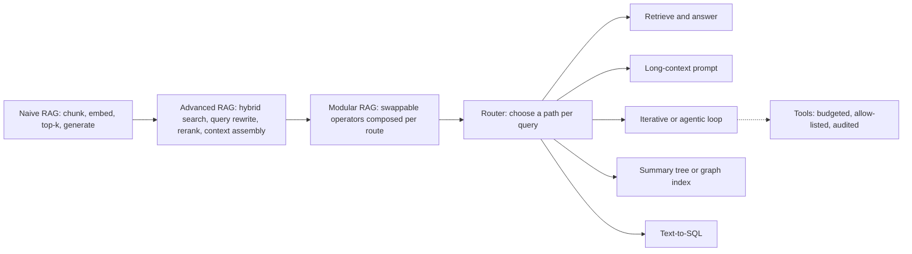
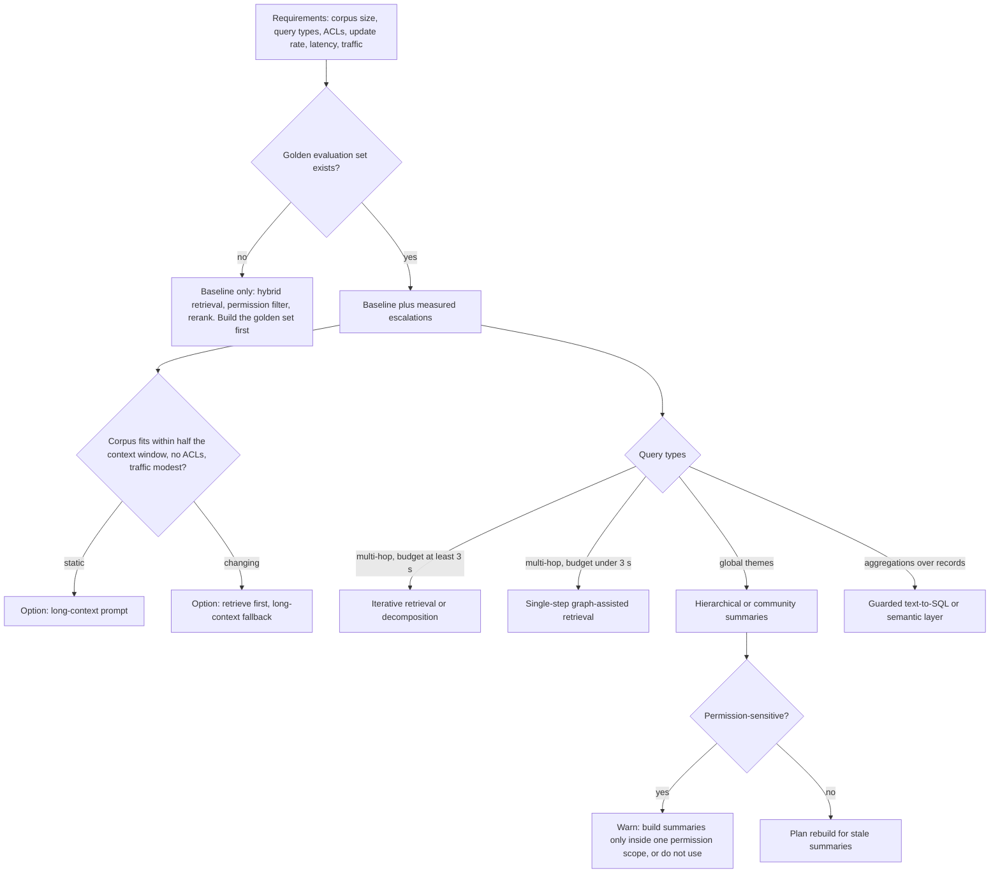

# Chapter 30 — RAG Architecture Patterns

> **Evidence legend.** **[S#]** = supported by a source in References (IDs map to `project-management/RESEARCH-REGISTER.md`; papers were read at abstract level only, so figures quoted are the authors' own abstract claims and were not reproduced). **[E]** = engineering recommendation/reasoning. **[A]** = assumption. **[I]** = illustrative. **[X]** = executed in this repository by `docs/exercises/ch30_pattern_selection.py` (pure Python, no model, no database). **[V]** = vendor-reported. **[N]** = not researched or not run. Research date: 2026-11-10. **What is executed here is a decision procedure and a cost model, not a benchmark of the patterns.** No pattern in this chapter was built or measured in this repository except the baseline pieces described in 30.7. The selection rules are my engineering judgement built from the sources; the thresholds are assumptions; prices are abstract units.

## 30.1 Learning Objectives

After this chapter you can:

1. Place any RAG design on the naive, advanced and modular spectrum and say which operators it adds.
2. State when a corpus should be put in the prompt instead of retrieved, and when a router between the two pays for itself, with the break-even computed rather than asserted.
3. Choose between iterative retrieval, entity-graph retrieval, hierarchical or community summaries and text-to-SQL for a given question type, and say what each costs to build and keep fresh.
4. Explain why cross-document summary indexes conflict with document-level permissions, and what to do about it.
5. Refuse to adopt an advanced pattern without an evaluation set, and say what evidence would justify it.
6. Run a selection procedure that returns reasons and warnings, not just a name, and test it with invariants and mutants.

## 30.2 Problem Statement

By this point the handbook has described many techniques: hybrid search, reranking, query rewriting, multi-hop retrieval, agents, graph and summary indexes, multimodal ingestion, text-to-SQL. Each is justified in its own chapter. The failure that remains is **pattern shopping**: assembling every technique into one pipeline because each looked good in isolation. The result is a system that is slower, costlier, harder to secure and impossible to evaluate, because nobody can tell which component earned its place.

The architecture question is therefore not "which patterns exist" but "given this corpus, these questions, these permissions and this latency budget, what is the **smallest** design that meets the bar, and what evidence would make me add the next piece?" **[E]**

## 30.3 Why It Matters in Production

- Every added stage is a failure mode, a latency contribution, a cost line and an attack surface (Chapters 20 to 22).
- Some patterns have an indexing cost that scales with the corpus (summary trees, entity graphs) and a freshness problem the baseline does not have.
- Some patterns conflict with requirements that are not about quality at all: a summary built across documents with different access rights has no single correct access control list **[E]**.
- A system chosen by fashion cannot be defended in an architecture review. A system chosen by stated requirements and measured gains can.

## 30.4 Core Concepts

### 30.4.1 Naive, advanced and modular RAG

The survey by Gao et al. organises the field into three paradigms: **Naive RAG**, **Advanced RAG** and **Modular RAG**, and describes the state of the art in retrieval, generation and augmentation techniques **[S213]**. I use the names this way **[E]**:

- **Naive**: chunk, embed, take the top-k by vector similarity, put them in a prompt, generate.
- **Advanced**: add operators around retrieval: hybrid lexical plus vector search, query rewriting, reranking, metadata and permission filters, context assembly and citation checks. Chapters 9 to 13 cover these.
- **Modular**: treat each operator as a replaceable component, with routing between alternative paths per query. This is a structural statement: the pipeline is a graph of operators with explicit contracts, not one fixed sequence.

The reference implementation is built as modular from the start in this sense (ports for the store, the gateway, the object store and the embedder; ADR-011, ADR-012), which is why adding an operator later does not mean rewriting the pipeline **[E]**.

**Standard versus agentic.** Microsoft's design guide draws the line at who decides. In a standard pipeline "the orchestrator follows a fixed sequence" and does not decide whether to search, which indexes to query or how many retrieval steps to take; for multistep reasoning, dynamic source selection, runtime query decomposition or combining retrieval with actions, the guide points to agentic RAG, in which an agent treats retrieval as a tool **[S214]**. Chapter 15 covers the agentic loop and its controls; here the point is that it is an escalation chosen for question types the fixed pipeline cannot serve, not a default.

### 30.4.2 Long-context prompt, retrieval, or a router

Long-context models raise an obvious question: why retrieve at all if the corpus fits in the prompt? The study by Li et al. compares retrieval-augmented generation with long-context models and finds that, "when resourced sufficiently", the long-context model outperforms on average, while retrieval remains much cheaper; they propose **Self-Route**, which sends each query to retrieval or to the long prompt based on the model's own self-reflection and report that it significantly reduces computation cost while staying comparable to long context **[S211]**. These are the authors' results for three models on public datasets; I did not reproduce them, and the abstract gives no figures.

What I can compute is the cost side **[X, I]**. Let `lc` be the cost of a long prompt (corpus tokens plus question), `rag` the cost of a retrieval prompt (say 8 chunks of 400 tokens plus question), and `f` the fraction of queries that retrieval answers well enough. Routing as "retrieve first, fall back to the long prompt" costs `rag + (1 - f) * lc`: the fallback queries pay for **both** attempts. Routing is no more expensive than always using the long prompt when

```
f >= rag / lc        (break-even fraction)
```

With the exercise's abstract prices (one input token = 1 unit): a 2,000,050-unit long prompt against a 3,250-unit retrieval prompt gives a break-even fraction of 0.16%, and at `f = 0.8` routing costs 20.2% of always stuffing. Two cautions, both from the exercise's own logic:

1. A 2M-token corpus does not fit a 200k-token window at all; that row shows how the ratio scales, not a feasible configuration. For a 20k-token corpus the same retrieval prompt gives a break-even fraction of 16.2%, and for a 2k-token corpus stuffing is cheaper than retrieval so routing can never win (`rag / lc > 1`).
2. **The quality side is not modelled.** A cheap path that answers 80% of queries is only valuable if you can tell which 80%. Whether Self-Route's signal works for your model and data is an empirical question for your evaluation set (Chapter 18), not something this arithmetic settles.

Prompt caching (Chapter 20) changes the economics of repeated long prompts and is not modelled here **[N]**.

### 30.4.3 Hierarchical and community summaries

Some questions are not about any passage: "what are the main themes in this collection?" Top-k retrieval returns the passages most similar to the question and cannot summarise the whole.

- **GraphRAG** (Edge et al.): an LLM builds an entity knowledge graph from the documents, pregenerates summaries for groups of closely related entities, and at query time each community summary produces a partial answer which are then summarised into a final one. The authors target "global sensemaking" questions over corpora in the 1-million-token range and report substantial improvements over conventional RAG in comprehensiveness and diversity of answers **[S207]**.
- **RAPTOR** (Sarthi et al.): recursively embeds, clusters and summarises chunks into a tree, then retrieves from the tree "at different levels of abstraction"; the authors report a 20% absolute accuracy improvement on the QuALITY benchmark when paired with GPT-4 **[S212]**.

Both pay an **indexing cost** (many model calls over the whole corpus) and a **freshness cost** (a changed document invalidates the summaries that include it) **[E]**. Chapter 24 covers change propagation from connectors for ordinary chunks; for summary structures the reasonable options are scheduled rebuilds with an explicit "built on" date in the answer, or incremental update of the affected clusters only if the library supports it, which I did not verify **[N]**.

**The permission problem [E].** A community summary or tree node mixes content from many documents. Chapter 22's rule is that retrieval must filter by permission inside the query. A summary has no single access control list: a user who may read two of its twelve sources would either see text derived from documents they may not read, or see nothing. The defensible designs are (a) build summaries only within one permission scope (one tenant, one uniform-access collection), (b) build per-scope summaries and keep them separate, or (c) do not use the pattern for permission-sensitive corpora. I did not find the sources above discussing this; it is my reasoning and should be treated as a requirement to test, not a settled result.

### 30.4.4 Graph-assisted single-step retrieval

HippoRAG (Gutiérrez et al.) combines an LLM, a knowledge graph and the Personalized PageRank algorithm, inspired by hippocampal indexing theory. The authors report outperforming state-of-the-art methods on multi-hop question answering by up to 20% and, compared with iterative retrieval such as IRCoT, comparable or better performance with single-step retrieval that is 10 to 30 times cheaper and 6 to 13 times faster **[S210]**. These are the authors' abstract claims; I read no further and reproduced nothing. The architectural point **[E]**: when the latency budget does not allow several retrieve-and-reason round trips, moving the "hop" work into an index built offline is the alternative to iterating at query time. The price is again the offline build and its staleness.

### 30.4.5 Question type drives the pattern

| Question type | Example | Pattern | Chapter |
|---|---|---|---|
| Lookup | "What is the notice period in the standard contract?" | Baseline hybrid retrieval, rerank, cite | 9 to 13 |
| Multi-hop | "Which suppliers named in the audit also appear in the incident log?" | Iterative retrieval or decomposition; or graph-assisted if latency is tight | 11, 15, 30.4.4 |
| Global | "What are the recurring complaints across all tickets this quarter?" | Hierarchical or community summaries | 30.4.3 |
| Structured | "Revenue by region last quarter" | Guarded text-to-SQL or governed metrics | 29 |
| Small stable corpus | "Answer questions about this 60-page handbook" | Long-context prompt or router | 30.4.2 |

### 30.4.6 The selection procedure

The exercise encodes the guidance as `select_patterns(requirements)` **[X]**. Its rules, each with an assumed threshold **[A]**:

1. **The baseline is always recommended** (hybrid retrieval, reranking, permission filter when documents have different ACLs).
2. **No evaluation set: return the baseline and nothing else**, with the warning "build the golden set first". Escalations need evidence, and evidence needs measurement (Chapter 18).
3. **Long-context options** only if the corpus fits in at most half the window (`LC_FILL_LIMIT = 0.5`, leaving room for instructions, history and the answer), the corpus is not permission-sensitive, and daily traffic is at most 5,000 queries (`LC_MAX_QPD`). Static corpus: "long-context prompt". Changing corpus: "retrieve first, long-context fallback".
4. **Multi-hop**: iterative retrieval when the latency budget is at least 3,000 ms (`ITERATIVE_LATENCY_MS`), otherwise single-step graph-assisted retrieval.
5. **Global questions**: hierarchical or community summaries, with a staleness warning on fast-changing corpora and a mandatory permission warning on permission-sensitive ones.
6. **Structured questions**: guarded text-to-SQL.

These thresholds are judgement, not measurements. Their value is that they are explicit, so a reviewer can disagree with a number instead of with a feeling.

## 30.5 Architecture

**The pattern landscape.** Modular RAG is a router in front of alternative paths:

<!-- figure:30-pattern-landscape -->


*Figure 30.1: Architecture. Original diagram; source below.*

<details><summary>Mermaid source</summary>



</details>
<!-- /figure -->

**The selection decision tree** (the exercise's rules as a picture):

<!-- figure:30-pattern-selection -->


*Figure 30.2: Architecture. Original diagram; source below.*

<details><summary>Mermaid source</summary>



</details>
<!-- /figure -->

**Microsoft's reference flow** matches the baseline: an orchestrator receives the query, runs a search on the index, packages the top results with the query into a prompt and returns the model's answer; a separate data pipeline chunks, enriches, embeds and persists the documents **[S214]**. The reference implementation follows the same two-sided shape (ingestion worker and query path), with chunk enrichment (for example metadata, Chapter 13) not built.

## 30.6 Practical Example (Executed [X])

Command: `python -I docs/exercises/ch30_pattern_selection.py --mutants`. Pure Python, no model, no database.

**What ran.**

1. **Twelve constructed requirement sets** with expected outcomes: a large lookup corpus gets only the baseline; a small static corpus gets the long-context option; a small changing corpus gets the router instead; the half-window boundary is exact (100,000 tokens in a 200,000 window fits, 100,001 does not); a permission-sensitive small static corpus never gets a shared long prompt; 5,000 queries a day is allowed and 5,001 is not; the 3,000 ms latency boundary flips iterative to single-step graph; global questions on a fast-changing corpus warn about staleness, and on a permissioned one warn about permissions; structured questions get text-to-SQL; no evaluation set yields the baseline only; and all four query types together yield all three escalations.
2. **Invariants swept over a grid of 11,520 requirement sets**: the baseline is always first; every recommendation has a reason; nothing beyond the baseline without an evaluation set; no shared-prompt option on permissioned corpora; global plus permissioned always warns; nothing that cannot fit in the window is stuffed; and adding a query type never removes a recommendation (one deliberate exception, the latency-dependent swap between "iterative" and "single-step graph", is written into the test).
3. **The cost model**: closed-form break-even `rag / lc`, tested at the break-even point (routing equals the long prompt), above it (cheaper), below it (dearer), at `f = 0` (strictly worse than always stuffing: the fallback is not free) and at `f = 1` (exactly the retrieval cost), and for small corpora.

**Results (as obtained).** All assertions held. Break-even fraction 0.1625% for the 2M-token row and 16.2% for 20k tokens; routing at `f = 0.8` on the 2M row costs 20.2% of always stuffing. **Mutation check:** 7 of 7 injected defects detected (baseline dropped for huge corpora, evaluation gate removed, fit check removed, latency ignored, staleness warning removed, permission warning removed, fallback treated as free). Nothing needed fixing after the first run.

**What this does not show.** It does not show that the rules choose the best pattern in practice; there is no measured quality anywhere in the exercise. The scenarios test that the code implements the rules I wrote, and the grid tests that the rules are internally consistent. The thresholds could be wrong; the exercise makes them visible so you can change them with evidence.

## 30.7 Implementation (reference implementation, inspected 2026-11-10)

- **Done (components 1 to 5)**: tenant-isolated schema, ingestion, extraction and chunking, embeddings in the ingest job, an LLM gateway with fallback and sensitivity policy. This is the data side of the baseline.
- **Not yet built**: hybrid retrieval, filtering, reranking, context assembly, grounded generation (components 6 to 12). The baseline itself therefore does not exist end to end, and **no escalation pattern of this chapter exists in the code**.
- **Consequence [E]**: the chapter's guidance on this repository is "finish and measure the baseline before considering anything else", which is also what the selection procedure returns for a system with no evaluation set.

## 30.8 Trade-offs

| Choice | Gains | Costs |
|---|---|---|
| Baseline only | Simple, cheap, evaluable, secure by construction | Weak on global and multi-hop questions |
| Long-context prompt | No index, no retrieval failures | Cost per query scales with corpus; needs corpus to fit; cannot filter by permission per user **[E]** |
| Router (retrieve first, fall back) | Cheap for most queries | Fallbacks pay twice; needs a validated routing signal; two paths to test |
| Iterative / agentic | Handles multi-hop and dynamic sources | Latency, cost and failure compounding; needs budgets and audit |
| Summary tree / community graph | Answers global questions | Offline model spend; staleness; ACL conflict **[E]** |
| Entity graph with PageRank | Multi-hop in one step (authors' claim) | Extraction quality bound; offline build; staleness |
| Text-to-SQL | Exact aggregates | Needs a governed schema and a guarded execution role (Chapter 29) |

## 30.9 Failure Modes

1. **Pattern stacking**: five techniques, no ablation; quality changes cannot be attributed.
2. **Router drift**: the routing signal degrades after a model update and sends hard queries down the cheap path; detect with online sampling (Chapter 19).
3. **Silent staleness** of summary indexes: answers cite themes from last quarter.
4. **Permission leakage through derived artifacts**: a summary or graph node built across ACL boundaries **[E]**.
5. **Fallback cost blow-up**: if the cheap path answers few queries, routing costs more than always using the long prompt (the `f = 0` case in 30.6).
6. **Agent loop runaway** when an escalation is adopted without budgets (Chapter 15).
7. **Benchmark transfer**: adopting a pattern because a paper reports gains on a different corpus and model; the authors' figures are not your figures.

## 30.10 Security Considerations

- Derived indexes (summaries, graphs, caches of generated text) are **new stores of content** and need the same classification, tenant isolation, retention and erasure handling as chunks (Chapters 22 and 23). Erasing a document must also invalidate or rebuild every summary that included it **[E]**.
- A long prompt containing many documents mixes trust levels in one context; it has no per-document permission filter and gives indirect prompt injection more surface **[E]**.
- Agentic escalation increases tool-use risk (the lethal-trifecta analysis in Chapter 22).
- Residual risk: the selection procedure is advice; it does not enforce anything. Enforcement lives in the database and gateway (Chapters 13, 22).

## 30.11 Performance Considerations

Latency adds up per stage: retrieval, rerank, each model call, each hop. The iterative threshold in the procedure (3 s) is an assumption about typical model latency, not a measurement **[A]**. Offline builds (summaries, graphs) move latency from query time to indexing time and make index builds a capacity-planning item. Tail latency under routing is the maximum of both paths for fallback queries.

## 30.12 Cost Considerations

Cost is the argument that makes the baseline the default: it is the only path whose per-query cost is independent of corpus size. Long-context and routing costs scale with corpus tokens (30.4.2). Summary and graph patterns convert per-query cost into per-corpus indexing cost plus rebuild cost per change. HippoRAG's authors report 10 to 30 times lower cost than iterative retrieval, which is a comparison between two query-time strategies and does not include the offline build **[S210, E]**. Prices change; use your provider's current price list when applying the formula.

## 30.13 Production Recommendations

1. Ship and measure the baseline first; adopt an escalation only when the evaluation set shows a slice the baseline fails and the escalation fixes it (paired comparison, Chapter 18).
2. Record each adopted pattern in an ADR with its evidence, its reversal condition and its owner (Chapter 31).
3. Keep the pipeline modular: ports and contracts per operator, so removing an escalation is a configuration change.
4. For summary or graph indexes: build per permission scope, label answers with the index build date, rebuild on a schedule and on erasure.
5. For routing: log the route taken and the cost; sample queries from the cheap path for quality checks.
6. Re-run the selection procedure when requirements change (corpus growth, new ACL model, new latency target) and diff the output.

## 30.14 Architecture Decision Guidance

ADR-005 (orchestration approach) is still Proposed with an open evidence gap; ADR-004 (retrieval architecture) is Proposed; ADR-007, ADR-008, ADR-009 and ADR-010 cover query transformation, reranking, filtering and agentic policy, all Proposed. A pattern-escalation policy ADR (evidence required, evaluation slice, owner, rollback) should be written when the first escalation is considered; I have not written it because no escalation is scheduled. The status of the existing ADRs is itself a finding of Chapter 31.

## 30.15 Interview Questions

1. **How do you decide between RAG and a long-context prompt?** Check that the corpus fits with headroom, whether it changes, whether documents have different permissions, traffic, and cost per query; then measure quality on your own evaluation set. Authors of one study found long context better on average when resourced sufficiently and retrieval much cheaper **[S211]**.
2. **What does a retrieve-first router cost?** `rag + (1 - f) * lc`; the fallback pays for both attempts; break-even `f = rag / lc` **[X]**.
3. **When would routing never pay?** When the long prompt is cheaper than the retrieval prompt (tiny corpora): break-even above 1 **[X]**.
4. **What question does GraphRAG answer that top-k cannot?** Global sensemaking across a corpus; it pregenerates community summaries and combines partial answers **[S207]**.
5. **What does RAPTOR add?** A tree of recursive summaries so retrieval can pick the level of abstraction **[S212]**.
6. **What is the cost of summary-based indexes?** Offline model spend, staleness after changes, and conflict with per-document access control **[E]**.
7. **Why might you choose a graph index over iterative retrieval?** When the latency budget cannot afford several round trips; HippoRAG's authors report 10 to 30 times cheaper and 6 to 13 times faster single-step retrieval than iterative methods **[S210]**.
8. **How do you stop pattern shopping?** Evaluation first; each escalation needs a slice it fixes, a paired measurement and an ADR **[E]**.
9. **What separates standard from agentic RAG?** Who decides whether to search, where and how many times: fixed sequence versus an agent using retrieval as a tool **[S214]**.
10. **How do you keep derived indexes secure?** Treat them as content stores: per-scope builds, classification, erasure propagation, labelled build dates **[E]**.
11. **Which claims in this chapter are measured?** Only the cost arithmetic and the internal consistency of the rules **[X]**; pattern quality figures are the authors' **[S]**.
12. **What would make you revisit the thresholds?** Different model latency, a larger window with cheaper caching, or evaluation data showing a slice the rules mis-route.

## 30.16 Knowledge Checkpoint / Exercises

1. Change `LC_FILL_LIMIT` to 0.8 and `ITERATIVE_LATENCY_MS` to 1500; which scenarios change, and which of your own systems would be re-classified?
2. Add a requirement "freshness SLA in minutes" and a rule that rejects summary indexes unless incremental rebuild is available; write the scenario and the mutant.
3. Add prompt caching to the cost model (a cached prefix priced at a fraction) and find the cache hit rate at which stuffing beats routing.
4. Write the missing quality half: given a labelled evaluation set and a routing signal, compute the quality of the routed system against both pure paths and the paired-bootstrap verdict (Chapter 18).
5. Take a system you know and fill in the requirement fields honestly; does the procedure disagree with what was built?
6. Design the per-scope build for community summaries on a multi-tenant corpus and state how erasure of one document invalidates them.

## 30.17 Summary

Choose the smallest architecture that meets the requirements and add pieces only with evidence. The naive-to-modular spectrum tells you what operators exist **[S213]**; the question type and the constraints decide which you need: long-context or routing for small corpora (with a break-even you can compute), iterative or graph retrieval for multi-hop, summary structures for global questions, text-to-SQL for aggregates. Derived indexes bring staleness and permission problems that the baseline does not have. The executed exercise shows the rules are consistent and the routing arithmetic is right; it does not show the patterns perform, and this repository has built none of them yet.

## References

- [S207] Edge et al., *From Local to Global: A Graph RAG Approach to Query-Focused Summarization*, arXiv:2404.16130 (v1 2024-04-24, v2 2025-02-19; abstract). https://arxiv.org/abs/2404.16130
- [S210] Gutiérrez et al., *HippoRAG: Neurobiologically Inspired Long-Term Memory for Large Language Models*, arXiv:2405.14831 (NeurIPS 2024; abstract). https://arxiv.org/abs/2405.14831
- [S211] Li et al., *Retrieval Augmented Generation or Long-Context LLMs? A Comprehensive Study and Hybrid Approach*, arXiv:2407.16833 (EMNLP 2024 industry track; abstract). https://arxiv.org/abs/2407.16833
- [S212] Sarthi et al., *RAPTOR: Recursive Abstractive Processing for Tree-Organized Retrieval*, arXiv:2401.18059 (abstract). https://arxiv.org/abs/2401.18059
- [S213] Gao et al., *Retrieval-Augmented Generation for Large Language Models: A Survey*, arXiv:2312.10997 (v5 2024-03-27; abstract). https://arxiv.org/abs/2312.10997
- [S214] Microsoft Learn, *Design and Develop a RAG Solution on Azure* (Azure Architecture Center; ms.date 2025-12-17; page metadata updated 2026-07-02). https://learn.microsoft.com/en-us/azure/architecture/ai-ml/guide/rag/rag-solution-design-and-evaluation-guide
- ADR-004, ADR-005, ADR-007 to ADR-012 (this repository). `docs/exercises/ch30_pattern_selection.py`. Chapters 9 to 15, 18 to 23, 29, 31.
