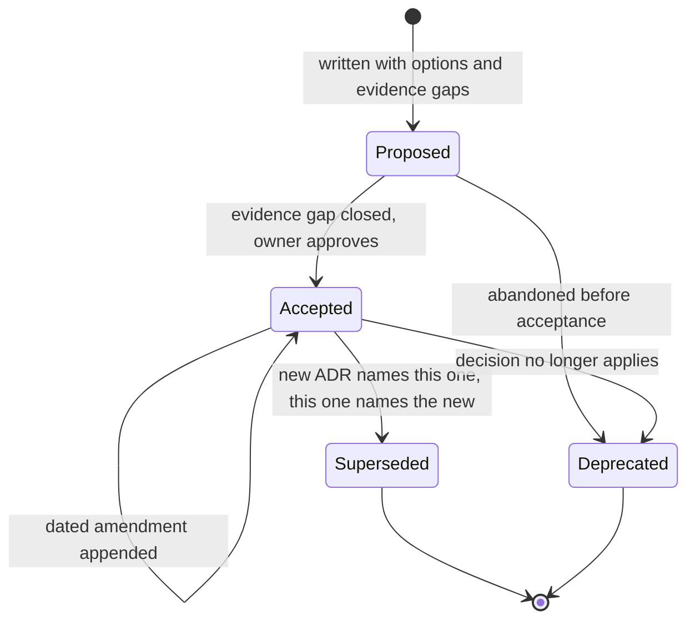
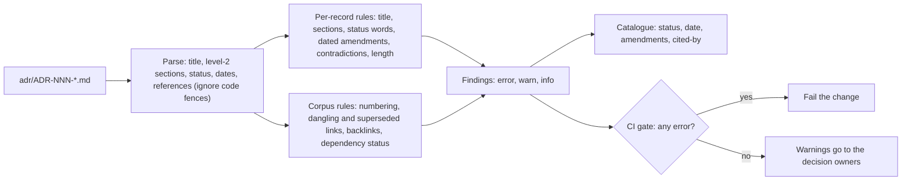

# Chapter 31 — Architecture Decision Records

> **Evidence legend.** **[S#]** = supported by a source in References (IDs map to `project-management/RESEARCH-REGISTER.md`). **[E]** = engineering recommendation/reasoning. **[A]** = assumption. **[I]** = illustrative. **[X]** = executed in this repository by `docs/exercises/ch31_adr_lint.py` against this repository's own `adr/` directory (pure Python, no model, no database). **[N]** = not researched or not run. Research date: 2026-11-10. **The linter checks that records are well formed and consistent with each other. It cannot tell whether a decision is good, whether its rationale is true or whether the code follows it.** One rule (Accepted decisions that cite Proposed ones) was added **after** I had looked at the status data, which is disclosed in 31.6.

## 31.1 Learning Objectives

After this chapter you can:

1. Say what an architecture decision record is, which decisions deserve one, and which do not.
2. Compare the Nygard, MADR and this repository's templates and choose one deliberately.
3. Run a record through its lifecycle (Proposed, Accepted, amended, Superseded, Deprecated) without rewriting history.
4. Turn the properties you care about (complete, numbered, honest about status, linked, dated) into automated checks, and say what such checks cannot establish.
5. Read a lint report on a real decision log and separate defects from decisions that belong to a human owner.
6. Connect decisions to evidence and to code through verification and confirmation steps.

## 31.2 Problem Statement

Architecture is the accumulation of its decisions, and decisions lose their reasons. Nygard's original post puts the failure plainly: a newcomer who does not understand why a decision was made can only blindly accept it, which may preserve a decision that no longer fits, or blindly reverse it, which may break a requirement it was protecting **[S206]**. Large specification documents make this worse because nobody reads or updates them. The ADR is a short text file, kept with the code, that records one decision and its reasoning **[S206, S208]**.

The second problem is less discussed: a decision log **rots**. Records stay Proposed forever, get implemented while still marked Proposed, are amended silently, point to records that were renamed or never written, or contradict their own status. A log that cannot be trusted is worse than none, because it looks authoritative. This chapter treats the log as a data set you can check **[E]**.

## 31.3 Why It Matters in Production

- Reviews, audits and incident response need to know why a system is shaped the way it is; Microsoft's guidance names the ADR as one of a solution architect's most important deliverables and as a source of truth for reference, audits and incident response **[S215]**.
- Decisions that are made and never recorded "will likely be forgotten, leading to repeated debates or later changes that unknowingly contradict the original intent" **[S215]**.
- CLAUDE.md for this project makes ADRs mandatory for significant decisions and fixes a template (section 14); the handbook's claim that its decisions are documented is only as good as the log's consistency.
- For AI systems specifically, many decisions are reversible only at cost (embedding model, chunking, tenancy model), which is exactly the class the guidance says to record **[S215, E]**.

## 31.4 Core Concepts

### 31.4.1 Definitions and the Nygard structure

The ADR community site defines an **architectural decision** as a justified design choice that addresses an architecturally significant functional or non-functional requirement; an **architecturally significant requirement** as one with a measurable effect on the system's architecture and quality; an **ADR** as the record of a single decision with its rationale, trade-offs and consequences; and the collection as the **decision log** **[S208]**. It credits Nygard's 2011 post with popularising the practice **[S208]**.

Nygard's template has five parts **[S206]**:

| Part | Content and rule |
|---|---|
| Title | A short noun phrase ("ADR 9: LDAP for Multitenant Integration") |
| Status | Proposed, Accepted, or later Deprecated or Superseded with a reference to the replacement |
| Context | The forces at play, in value-neutral language: "simply describing facts" |
| Decision | Full sentences, active voice, typically "We will ..." |
| Consequences | All of them, positive, negative and neutral: "not just the 'positive' ones" |

His rules of practice matter as much as the template: one or two pages; written as a conversation with a future developer; **numbered sequentially, numbers never reused**; a reversed decision stays in place and is marked superseded; kept in the repository in a lightweight markup **[S206]**.

### 31.4.2 Append-only history

The Azure Well-Architected guidance states the same discipline as a log rule: the ADR "serves as an append-only log"; do not edit accepted records; if a decision changes, write a new record that supersedes the original and link the two **[S215]**. This preserves the history of the reasoning and shows when and why direction shifted. The repository's practice is a middle path **[E]**: an accepted record may receive a **dated, appended amendment, update or addendum** section (ADR-003, ADR-013 and others have them), while the original decision text is not rewritten. The lint rule that amendment headings carry a date exists to keep that history legible.

### 31.4.3 Which decisions deserve a record

Microsoft's guidance: include only choices that affect the system's structure or key quality attributes, or that are difficult to reverse; include alternatives that were ruled out; split a decision into several records when it has phases (short, mid, long term); record the **confidence level**, because a low-confidence decision is a candidate for reconsideration; keep records "pithy, assertive, on-topic, and factual"; do not turn a record into a design guide, and link supplemental material while keeping the decision understandable without it **[S215]**. For this handbook: the embedding model, the chunking policy, the tenancy model and the job-queue design qualify; the name of a helper function does not **[E]**.

### 31.4.4 Templates compared

| Template | Sections | Strengths | Cost |
|---|---|---|---|
| Nygard | Title, Status, Context, Decision, Consequences **[S206]** | Light; quick to write; low rot | Alternatives and trade-offs are not structurally required |
| MADR 4.0.0 | Title; Context and Problem Statement; Decision Drivers (optional); Considered Options; Decision Outcome (with optional Consequences and **Confirmation**); Pros and Cons of the Options (optional); More Information (optional); YAML front matter with status, date, decision-makers, consulted, informed **[S209]** | Forces options and drivers; names a confirmation step; dual-licensed MIT or CC0 **[S209]** | More structure to maintain |
| Y-statement | A compact single-statement format that the community site credits to Zdun et al. **[S208]**; I read only that attribution, not the format or the original paper **[N]** | Compact | Likely loses nuance and evidence **[E]** |
| This repository (CLAUDE.md section 14) | Status, Context, Requirements, Options Considered, Decision, Rationale, Trade-offs, Consequences, Security Considerations, Performance and Cost, Reversal Conditions, References | Matches the handbook's evidence rules; reversal conditions explicit | Heavy: the 18 records run 51 to 76 lines, above Nygard's two pages in spirit **[X]** |

The heavier template is a deliberate choice for a reference project whose point is to show reasoning; for a small team the lighter ones are defensible **[E]**. MADR's **confirmation** field is the idea this repository does not yet have in a structured form: say how compliance with the decision will be verified (a review, a test) **[S209]**. Some of our records carry a "Verification" section describing executed checks (ADR-001, ADR-006), which is the same idea expressed ad hoc.

### 31.4.5 Lifecycle

<!-- figure:31-adr-lifecycle -->

*Figure 31.1: Lifecycle. Original diagram; source below.*

Mermaid source

<!-- /figure -->

The states are the ones in the sources (Proposed, Accepted, Deprecated, Superseded) **[S206, S215]**; the transitions drawn are my arrangement of them **[E]**. The two-way naming on supersession (the old record names the new one and the new one names the old) is a property the linter checks.

### 31.4.6 Properties of a trustworthy log, as checks

| Rule | Severity | Defect it catches |
|---|---|---|
| title-format, title-number-mismatch | error | Record cannot be found or numbered reliably |
| duplicate-number, numbering-gap | error | Reused or missing numbers (Nygard: never reuse **[S206]**) |
| missing-section | error | Record lacks a section the template requires |
| status-vocabulary | error | Status outside Proposed, Accepted, Superseded, Deprecated |
| status-contradiction | error | Status Accepted but a heading still says "(proposed)" or "blocks acceptance" |
| superseded-without-successor, superseded-by-missing | error | Superseded record that does not say by what, or names a record that does not exist |
| dangling-reference | error | Mention of an ADR number that does not exist |
| empty-section, references-empty, undated-amendment, too-long | warn | Placeholder content, unsourced references, history that cannot be dated, records past the length threshold |
| stale-proposed | warn | Proposed for more than 30 days **[A]** |
| no-backlink | warn | Superseding record does not mention the one it replaces |
| accepted-cites-proposed | warn | Accepted decision that leans on one still Proposed |
| orphan | info | No other record refers to this one |

Thresholds (120 lines, 30 days, 20 characters of content) are assumptions **[A]**. Errors fail a CI gate; warnings go to decision owners **[E]**.

**What no rule can check [E]:** that the context is true; that the options are the real ones; that the decision is wise; that the code still follows it; that a record exists for every significant decision. Those need review and, for the code link, a confirmation test.

## 31.5 Architecture

<!-- figure:31-adr-lint-flow -->

*Figure 31.2: Architecture. Original diagram; source below.*

Mermaid source

<!-- /figure -->

The rules live in `docs/exercises/ch31_adr_lint.py`, where they are tested. `scripts/validate-adrs.py` imports them, exits non-zero on any error, and with `--write-catalogue` regenerates `docs/09-Architecture-Decision-Records.md` so the catalogue cannot drift from the records **[X]**.

## 31.6 Practical Example (Executed [X], real `adr/` directory)

Command: `python -I docs/exercises/ch31_adr_lint.py --mutants`.

**Unit tests on constructed records.** A clean two-record corpus yields no errors or warnings, and the only finding is the orphan note for the record nobody cites. Each rule is then triggered by a record broken in exactly that way (for example one required section deleted at a time; a heading suffix like "Decision (proposed)" still satisfies the "decision" requirement; a `## ` line inside a code fence is not a section; "Accepted (conditional)" is a valid status; 30 days Proposed is not stale and 31 days is; a record may not name itself as its successor; the placeholder `ADR-XXX` is not a reference).

**The real run.** 18 ADRs, `adr/ADR-001` to `ADR-018`: **0 errors, 11 warnings, 2 info**.

- No errors: numbering is complete, titles agree with filenames, every record has the 12 required sections, statuses use the vocabulary, every amendment heading is dated, no dangling references, no record exceeds 120 lines (they run 51 to 76).
- Status counts: 9 Accepted, 9 Proposed. Proposed records are 1 to 3 days old on 2026-11-10, so none is stale yet.
- **11 `accepted-cites-proposed` warnings**: ADR-001 cites 002 and 004; ADR-012 cites 002, 007, 008 and 010; ADR-013 cites 002, 006 and 009; ADR-014 cites 006; ADR-017 cites 002. The substantive ones: ADR-002 (embedding strategy) is cited by four Accepted records and the implementation of components 1 to 5 embeds chunks (ADR-017), yet ADR-002 is still Proposed; ADR-006 (tenancy and isolation) underpins the row-level-security design recorded in the Accepted ADR-013 and exercised by integration tests, yet it too is still Proposed. Whether to accept them, amend them or keep them Proposed pending their listed evidence gaps is a decision for their owner. **I have not changed any status.** Recorded as OI-073.
- **2 orphans (info)**: ADR-005 (orchestration approach), which is Proposed with an evidence gap that blocks acceptance, and ADR-018 (evaluation policy), the highest-numbered.

**Disclosure.** The first real run produced no warnings at all, which told me the structural rules were satisfied and nothing about whether the log was healthy. I then added the `accepted-cites-proposed` rule because the status column showed the pattern, with a unit test and a mutant. That order (rule chosen after seeing data) means the warning count is not an independent measurement of "rule coverage"; it is a real property of the log that the first rule set could not express.

**Mutation check:** 15 of 15 injected defects detected (numbering gaps allowed, title-number unchecked, sections unchecked, empty sections ignored, status vocabulary off, undated amendments ignored, contradictions ignored, staleness ignored, successor unchecked, backlinks ignored, accepted-on-proposed ignored, dangling references ignored, references unchecked, length ignored, orphans ignored). No mutant survived the first run, so the mutation check did not expose a weak assertion here; the tests were written rule by rule with a positive and a negative case each.

**Not demonstrated.** I did not test the linter on any log other than this one; it encodes this repository's template and may need changes for MADR-style records (front-matter status, for example). It parses with regular expressions, not a Markdown parser.

## 31.7 Implementation (inspected 2026-11-10)

- `adr/` holds ADR-001 to ADR-018 (ADR-018 Proposed). ADR-003, ADR-013 and others carry dated amendments.
- `docs/exercises/ch31_adr_lint.py` is the rule set and its tests; `scripts/validate-adrs.py` is the CI entry point and catalogue generator; `docs/09-Architecture-Decision-Records.md` is generated.
- **Not done**: the linter is not wired into a CI workflow (no pipeline exists yet; component 20); no confirmation field per ADR; no automated link from an ADR to the tests that verify it.

## 31.8 Trade-offs

| Choice | Gains | Costs |
|---|---|---|
| Heavy template | Evidence, alternatives, reversal conditions in every record | Writing cost; records that exceed two pages |
| Light template | Cheap, likely to be written | Missing trade-offs and reversal conditions |
| Append-only strictly | Trustworthy history | Many superseding records; navigation burden |
| Dated amendments in place | Fewer records; current state visible | Risk of rewriting history; needs the dated-heading rule |
| Lint as CI gate on errors only | Cheap, deterministic | Cannot judge quality; warnings can be ignored |
| Catalogue generated from records | Cannot drift | One more script to maintain |

## 31.9 Failure Modes

1. **Decisions never recorded** (the commonest) **[S215]**.
2. **Proposed forever**: a record that is in force but never accepted; the log understates what is settled (observed here, 31.6).
3. **Accepted on a shaky base**: an Accepted decision whose dependency is still Proposed or has an open evidence gap.
4. **Silent edit**: an accepted decision rewritten instead of superseded; history lost.
5. **Context drift**: the context was true when written; no one notices it stopped being true. Reversal conditions are the mitigation.
6. **ADR as design document**: records grow into specifications nobody reads **[S215]**.
7. **Gaming the linter**: sections filled with filler to pass; the empty-section check catches only the crudest case.
8. **Orphans**: records that no one cites, either because they are unimportant or because the pipeline ignores them (ADR-005 is the live example).

## 31.10 Security Considerations

- ADRs are a security artefact and a security risk. They record trust boundaries and threat decisions (Chapter 22) and sometimes **known weaknesses**: ADR-013 carries an addendum describing that the application role can change its own tenant identity through SQL (OI-069). In a repository that is not private, publishing an unremediated weakness is a disclosure decision, not a documentation detail **[E]**.
- Keep secrets, customer data and real hostnames out of records.
- Access control on the log should match the sensitivity of the decisions; the audit value of an ADR depends on tamper evidence, which version control provides if history is protected **[E]**.

## 31.11 Performance Considerations

Not applicable to runtime. The linter reads 18 small text files; I did not measure its run time and it is not a scale concern **[N]**.

## 31.12 Cost Considerations

The cost is human: writing time and review time. Light records and generated catalogues keep it down; the heavy template is a conscious investment **[E]**. The Azure guidance recommends starting the log at the onset of a workload and, for existing workloads, retroactively generating it from known past decisions where data is available **[S215]**.

## 31.13 Production Recommendations

1. Write a record when a decision is structural, hard to reverse, or affects a key quality attribute; do not write one for everything **[S215]**.
2. Never reuse a number; supersede instead of rewriting; date every amendment.
3. Record confidence and reversal conditions; revisit when a reversal condition fires.
4. Close the loop with code: for each Accepted record, name the test, benchmark or review that confirms compliance (MADR's confirmation idea **[S209]**).
5. Run the linter in CI; fail on errors; review warnings at a fixed cadence with the owners.
6. Treat "Accepted cites Proposed" as a prompt to either accept the dependency, amend the dependant or mark the gap explicitly.
7. Regenerate the catalogue; link it from the README.
8. Decide, before publishing, whether any record discloses an unfixed vulnerability.

## 31.14 Architecture Decision Guidance

Decisions to record as ADRs when scheduled **[E]**: ADR status policy (who may move a record from Proposed to Accepted and on what evidence; resolving OI-073 is its first test case); a confirmation convention (field per ADR naming the verifying test); and ADR-019 onwards as the pattern-escalation policy (Chapter 30) and the BI role design (Chapter 29) when those are scheduled.

## 31.15 Interview Questions

1. **What is an ADR and why keep it in the repository?** A short record of one significant decision with context, options, decision and consequences, versioned with the code so the rationale survives the people **[S206, S208]**.
2. **Which decisions get one?** Those affecting structure or key quality attributes, or hard to reverse; not trivia **[S215]**.
3. **Why never edit an accepted ADR?** Append-only history shows when and why direction changed; supersede with a linked record **[S206, S215]**.
4. **Nygard versus MADR?** Nygard is five light parts; MADR adds drivers, considered options, pros and cons and an optional confirmation, with front-matter metadata **[S206, S209]**.
5. **What is a decision log?** The collection of a project's ADRs **[S208]**.
6. **How would you stop a log from rotting?** Automate structural checks, review warnings on a cadence, regenerate the catalogue, and link decisions to confirming tests **[E]**.
7. **What can a linter not tell you?** Whether the decision is right, the context true, or the code compliant **[E]**.
8. **What did the lint of this repository find?** No structural errors, and 11 cases of Accepted records citing Proposed ones; ADR-002 and ADR-006 are effectively relied on while still Proposed **[X]**.
9. **Why record confidence?** Low-confidence decisions are the first to reconsider **[S215]**.
10. **When would you split one decision into several records?** When it has phases (short, mid, long term) **[S215]**.
11. **How can an ADR be a security problem?** It can disclose an unremediated weakness or sensitive details; classify the log **[E]**.
12. **How do ADRs help an AI platform team specifically?** Embedding, chunking, tenancy and evaluation choices are expensive to reverse; the log records the evidence and reversal conditions **[E]**.

## 31.16 Knowledge Checkpoint / Exercises

1. Add a MADR-style front-matter parser to the linter and lint one record in each format.
2. Add a rule that every Accepted ADR has a `Confirmation` section naming a test file, and a check that the file exists; apply it to the 9 Accepted records and report how many pass.
3. Write the superseding record for a decision you disagree with, link both ways, and show the linter accepts it and rejects a one-way link.
4. Add a rule for evidence gaps: an Accepted ADR may not contain an open "Evidence gap" heading. Which of the 9 are affected?
5. Decide ADR-002 and ADR-006: accept, amend or leave Proposed, and justify with the evidence gaps listed in each (closes OI-073).
6. Extend the catalogue generator to include a dependency graph (Mermaid) from the cited-by data and check that it renders.

## 31.17 Summary

An ADR records one significant decision with its context, options and consequences, in the repository, append-only **[S206, S208, S215]**. The log is only as useful as it is trustworthy, and its structural properties can be checked automatically; its truth cannot. Running the checks on this project's 18 records found no structural defects and a governance question: two Proposed decisions (embedding strategy and tenancy) are leaned on by Accepted records and by implemented code. The right response is a human decision about their status, informed by their evidence gaps, not an automated fix.

## References

- [S206] Nygard, M., *Documenting Architecture Decisions* (Cognitect blog, 2011-11-15). https://www.cognitect.com/blog/2011/11/15/documenting-architecture-decisions
- [S208] Architectural Decision Records community site (adr.github.io). https://adr.github.io/
- [S209] MADR, *Markdown Architectural Decision Records* (4.0.0, 2024-09-17; MIT or CC0). https://adr.github.io/madr/
- [S215] Microsoft Learn, *Maintain an architecture decision record (ADR)*, Azure Well-Architected Framework (ms.date 2026-04-10). https://learn.microsoft.com/en-us/azure/well-architected/architect-role/architecture-decision-record
- ADR-001 to ADR-018, `docs/09-Architecture-Decision-Records.md` (generated), `scripts/validate-adrs.py`, `docs/exercises/ch31_adr_lint.py`; OI-069, OI-073 (this repository). Chapters 22, 29, 30.
