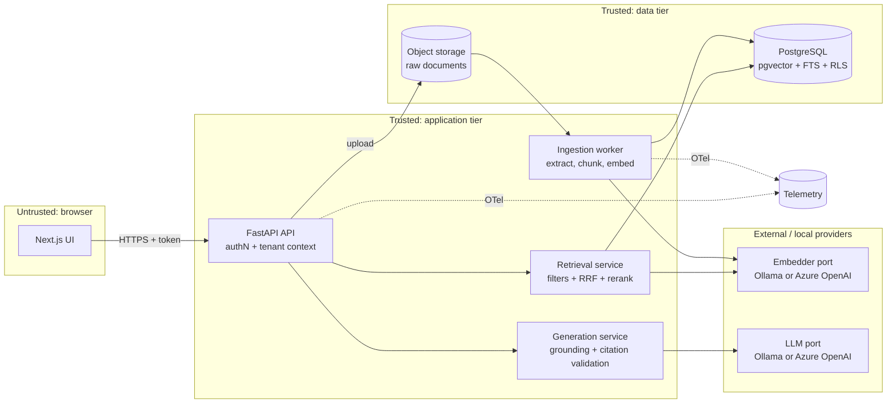

# M1 — Reference Architecture, Technology Comparison, Diagram Inventory, Roadmap

Date: 2026-11-07. Evidence tags: **[V]** verified in RESEARCH-REGISTER, **[H]** hypothesis to measure, **[N]** not researched.

## 1. Reference Architecture (logical)

Original diagram (not a vendor diagram). Trust boundaries are explicit.

Key rules: the tenant/ACL filter is applied inside retrieval queries and backed by RLS (ADR-004); retrieved text is data, never instructions; the LLM is never the authorization boundary.

## 2. Technology Comparison (retrieval store)

| Criterion | Postgres + pgvector + FTS | Azure AI Search | Dedicated vector DB |
|---|---|---|---|
| Hybrid + fusion | App-side RRF; pgvector recommends RRF/cross-encoder [V SRC-001] | Built-in, BM25 + vector via RRF [V SRC-005/006] | [N] |
| Lexical ranker | `ts_rank`/`ts_rank_cd`; BM25 not mentioned in docs read [V SRC-003]; quality vs BM25 [H] | BM25 [V SRC-005] | [N] |
| Filtering with ANN | Post-index filtering; iterative scans (0.8.0+) [V SRC-001] | preFilter (default for newer indexes) / postFilter [V SRC-007] | [N] |
| Tenant / doc security | RLS, default-deny [V SRC-004] | Filter-based trimming; principal is a string [V SRC-008] | [N] |
| Dim limits | vector 2,000 / halfvec 4,000 indexable [V SRC-001] | Not reviewed | [N] |
| Local dev cost | Free, Docker | Cloud service; cost not researched | [N] |
| Operations | Self-managed or managed Postgres (Azure PG support not yet researched) | Fully managed | [N] |
| Best fit | Transactional + single-store, moderate scale, strong governance | Managed hybrid at scale with semantic ranker | [N] |
| Avoid when | Very large corpora / heavy selective-filter ANN without tuning [H] | Strict local/offline requirement, tight cost | [N] |

Do not extrapolate vendor benchmark figures across systems.

## 3. Technology / Version Matrix (verified 2026-11-07)

| Component | Version seen | Purpose | License | Source | Notes |
|---|---|---|---|---|---|
| PostgreSQL | docs 18.6 | Store, FTS, RLS | n/s | SRC-003/004 | pgvector supports 13+ |
| pgvector | 0.8.7 (2026-10-01) | Vector index | n/s on page | SRC-001/002 | Verify license from repo LICENSE before listing |
| pgvector-python | 0.5.1 | DB client helpers | MIT | SRC-014 | Python ≥3.10 |
| FastAPI | 0.162.1 | API | MIT | SRC-013 | Python ≥3.10; pydantic ≥2.9.0; starlette ≥0.46.0 |
| Azure AI Search REST | api-version 2026-04-01 | Alt. retriever | n/a | SRC-005–008 | |
| Azure OpenAI embeddings | 3-large (3,072d), 3-small (1,536d), ada-002 (1,536d) | Hosted embeddings | n/a | SRC-009 | Re-embed required to switch |
| Ollama | installed (version not printed; server not running) | Local runtime | n/s | SRC-015/016 | `embeddinggemma` 300M |
| Python (dev host) | 3.14.2 | Dev | — | local | Container target 3.12/3.13 (to be validated) |
| Node | 24.13.1 | Frontend | — | local | |
| Docker | 29.0.1 | Containers | — | local | |
| Next.js, Pydantic, OpenTelemetry SDK, Ragas, pytest, ruff, mypy | **not yet verified** | — | — | — | Verify before pinning in M5 |

## 4. Environment Capabilities (affects what can be tested)

Available: Python, Node, npm, Docker, git 2.27, .NET 7 SDK (old), NVIDIA GTX 1650 (small VRAM). Missing: psql, pandoc, mermaid-cli (`mmdc`), uv, Azure CLI. Consequences: Postgres via Docker image (to be verified); Mermaid validation via Node package (to be installed/verified in M1/M9, user-approved); PDF toolchain still undecided (OI-003); Azure deployment can be authored but **not executed** here.

## 5. Diagram Inventory (20 mandatory)

| # | Diagram | Type | Chapter | Status |
|---|---|---|---|---|
| 1 | Traditional LLM vs RAG | flowchart | 1 | pending |
| 2 | End-to-end RAG architecture | flowchart (this doc §1 seed) | 7 | seeded |
| 3 | Document ingestion pipeline | flowchart | 3 | pending |
| 4 | Chunking strategies | flowchart | 4 | pending |
| 5 | Embedding generation | sequence | 2 | pending |
| 6 | Vector indexing | flowchart | 5 | pending |
| 7 | Retrieval workflow | sequence | 6 | pending |
| 8 | Hybrid search | flowchart | 9 | pending |
| 9 | Query rewriting | flowchart | 10 | pending |
| 10 | Multi-query retrieval | flowchart | 11 | pending |
| 11 | Reranking | flowchart | 12 | pending |
| 12 | Parent-child retrieval | flowchart | 14 | pending |
| 13 | Agentic RAG | state | 15 | pending |
| 14 | Multi-tenant architecture | C4/flowchart | 8 | pending |
| 15 | Security architecture | flowchart w/ trust boundaries | 22 | pending |
| 16 | Production deployment | flowchart | 16 | pending |
| 17 | Evaluation pipeline | flowchart | 18 | pending |
| 18 | Observability architecture | flowchart | 19 | pending |
| 19 | CI/CD pipeline | flowchart | 16 | pending |
| 20 | Complete reference implementation | C4 | 16 | pending |

Source files go in `docs/assets/diagrams/*.mmd`; rendering validation is an open item (OI-003).

## 6. Implementation Roadmap (M5)

Order per CLAUDE.md §4, each step tested before the next, with ADR updates:

1. Foundation (repo layout, config, Docker Compose, health checks) → 2. Schema + migrations (RLS, indexes) → 3. Ingestion API + object storage → 4. Extraction + chunking (ADR-003 finalized first) → 5. Embeddings (ADR-002 adapters) → 6. Vector + FTS indexing → 7. Hybrid retrieval (RRF) → 8. Metadata/ACL filtering + recall-under-filter test → 9. Reranking → 10. Context assembly → 11. Grounded generation → 12. Citation validation → 13. AuthN → 14. Tenant isolation tests → 15. Frontend → 16. Observability → 17. Evaluation (golden set, Recall@K, MRR, NDCG) → 18. Security tests (prompt injection, cross-tenant) → 19. Infrastructure (Bicep, authored; not deployable here) → 20. CI/CD.

## 7. M1 Exit Status

Done: research inventory, source register (18 sources), reference architecture, comparison, ADR-001 (conditional accept), ADR-002/004 (proposed), ADR-003 (structure only), diagram inventory, roadmap. Not done / carried forward: items in RESEARCH-REGISTER "Research Pending"; competing vector DB research; Mermaid and PDF toolchain; verification of chunking and retrieval-quality claims (M2).
